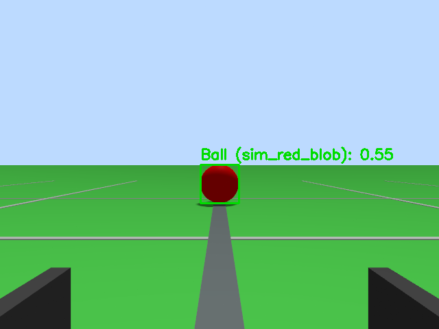
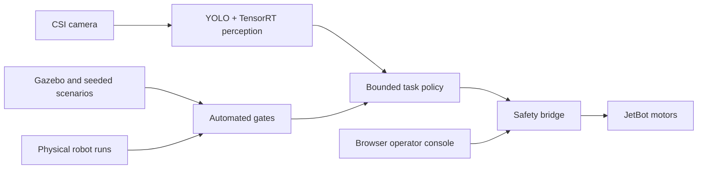

# Chasebot

Chasebot is an autonomous ball-retrieval robot built end to end on a JetBot
Mini with a Jetson Nano. The project combines computer vision, bounded autonomy,
motion control, operator tooling, and hardware safety into one working product
system.

I use Chasebot as a hands-on product and engineering testbed: define a useful
physical task, instrument the real failure modes, build the smallest complete
workflow, and advance capability only when the evidence supports it.

## Product System

The optional LLM layer proposes high-level intent within a fixed action
contract. Deterministic policy and the safety bridge retain control of every
motor command.

## What I Built

| Product area | Implementation |
| --- | --- |
| Perception | Fine-tuned YOLO models, monocular distance estimation, TensorRT deployment, confidence and scene-generalization gates |
| Autonomy | Scan, acquire, approach, push, recover, and stop behaviors with bounded retries and explicit terminal states |
| Operator experience | Browser dashboard for live camera state, motion lock, run controls, error reporting, and emergency stop |
| Hardware integration | JetBot motor bridge, CSI camera backends, command relay, calibration tools, and laptop-to-robot deployment scripts |
| Validation | Seeded simulation scenarios, replayable evidence packages, unit tests, hardware preflight checks, and safety-focused run summaries |

## Selected Evidence

- A 320-pixel TensorRT FP16 model ran on the Jetson Nano at 13.5 ms per frame,
  approximately 73 FPS of GPU inference.
- The two-room fine-tune reached 0.995 mAP50, retained 0.93-0.975 confidence on
  held-out room samples, and produced zero false positives across 18 negative
  validation images.
- The physical control path fails closed on stale camera frames, command
  mismatches, detector disagreement, motion-lock violations, and explicit stop
  requests.
- Hardware runs use capped speed and duration, a 0.5-second deadman timeout,
  final zero-motor verification, and a required lock/relock sequence.

The detailed benchmark record is in
[Hardware V0 Stack Through Bridge Plan](docs/HARDWARE_V0_STACK_THROUGH_BRIDGE_PLAN.md).
The safety model is documented in
[Hardware V0 Unattended Strategy](docs/HARDWARE_V0_UNATTENDED_STRATEGY.md).

## Product Decisions

**AI authority.** Perception and planning can be probabilistic. Actuation stays
inside a deterministic command contract with measurable refusal conditions.

**Simulation and reality.** Simulation provides cheap breadth across seeded
geometry and failure cases. Physical runs establish camera, latency, traction,
stiction, and safety evidence unavailable from simulation.

**Operator trust.** The dashboard exposes the camera feed, active policy,
motion state, command history, and stop controls in one place. Every run ends
with an explicit safe-state check.

**Evidence discipline.** Claims are tied to stored run summaries, model
provenance, tests, and visual evidence. Current evidence supports supervised
single-room acquisition experiments. Unattended contact, delivery, and
multi-room autonomy remain outside the validated boundary.

## Technology

- Python, PowerShell, C++, HTML, and JavaScript
- ROS 2, Nav2, Gazebo, OpenCV, YOLO, ONNX, and TensorRT
- JetBot Mini, Jetson Nano 4GB, CSI camera, and differential-drive control
- Pytest, GitHub Actions, seeded scenario runners, and browser-based UAT

## Repository Guide

| Path | Purpose |
| --- | --- |
| [`tools/robot_factory_bridge/`](tools/robot_factory_bridge/) | Physical robot transport, camera, control, safety, and hardware runners |
| [`scripts/`](scripts/) | Planning, simulation, evaluation, evidence, and operator workflows |
| [`ros2_scripts/`](ros2_scripts/) | ROS 2 perception and control nodes |
| [`ros2_config/`](ros2_config/) | Launch files, worlds, parameters, behavior trees, and robot models |
| [`runtime/`](runtime/) | Runtime contracts, model configuration, and dashboard assets |
| [`tests/`](tests/) | Unit, integration, safety, and regression coverage |
| [`docs/`](docs/) | Architecture, hardware, research, and validation records |

Start with the
[Robot Factory Bridge guide](tools/robot_factory_bridge/README.md) for the
physical stack and
[LLM Control Architecture](docs/LLM_CONTROL_ARCHITECTURE.md) for the bounded
AI design.

## Safety

Chasebot is an active prototype. Physical operation requires a clear room,
an available hard power stop, conservative command caps, and a successful
preflight. Physical operation remains supervised even after all repository
safety gates pass.
