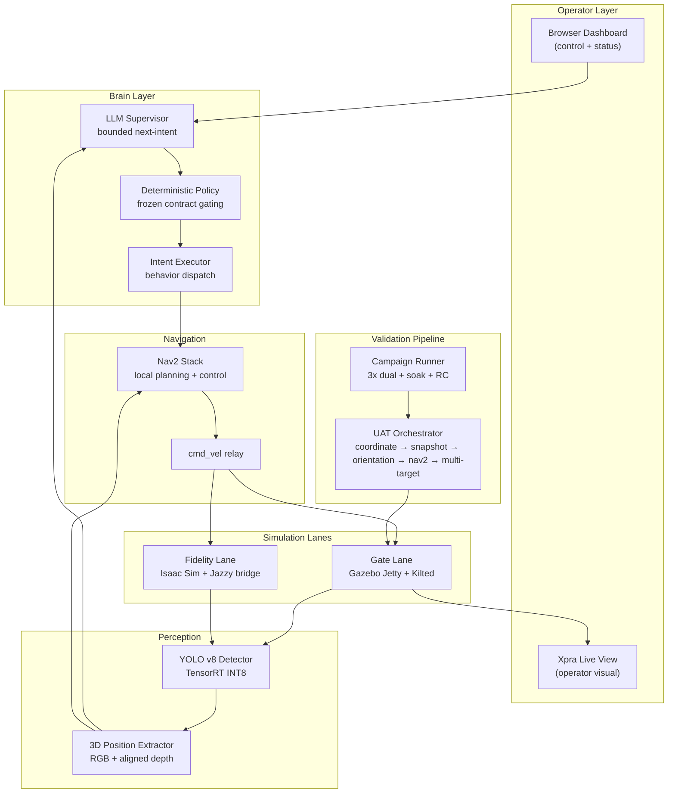

# Chasecar

Container-first ROS 2 stack for autonomous ball acquisition, planning, and tracking validation on a JetBot Nano platform.

## System Overview



## Active Architecture (2026)

| Lane | Role | Stack |
|------|------|-------|
| Gate (authoritative) | Deterministic pass/fail | ROS 2 Kilted + Gazebo Jetty |
| Fidelity (parallel) | High-fidelity parity | Isaac Sim + Jazzy bridge sidecar |

- Robot-fidelity target: `robot_fidelity_orin` (Jetson Orin Nano 8GB)
- Canonical inference: `tensorrt_int8`
- Locked decisions: [docs/STACK_DECISIONS_2026.md](docs/STACK_DECISIONS_2026.md)

## Quick Start

### First UAT (Operator Entry)

```powershell
powershell -ExecutionPolicy Bypass -File scripts/run_first_uat.ps1 `
  -ExecutionLane container_kilted `
  -Distro Ubuntu-24.04 `
  -RuntimeTarget robot_fidelity_orin
```

This cleans stale compose projects, runs coordinate UAT, captures Milestone 1 evidence, and writes session artifacts. See [docs/FIRST_UAT_RUNBOOK.md](docs/FIRST_UAT_RUNBOOK.md) for details.

### Full Headless Replay

```powershell
powershell -ExecutionPolicy Bypass -File scripts/run_headless_pre_llm.ps1 -Lane dual
```

Runs all pre-LLM gates: coordinate, snapshot, orientation, nav2 readiness, and multi-target nav2. `dual` runs fast lane then fidelity lane.

### Pre-LLM Campaign (3x dual + soak + RC)

```powershell
powershell -ExecutionPolicy Bypass -File scripts/run_pre_llm_campaign.ps1
```

Includes same-session GUI rehearsal and parity checks per cycle.

## Visual Milestones

Authoritative visual review uses recorded bundles and the browser dashboard with Xpra live view. Native Gazebo/X11 is debug-only.

1. Recorded evidence: `scripts/run_recorded_visual_demo.ps1`
2. Dashboard + Xpra live view: open the dashboard, use `Open Xpra` link
3. Headless milestone progression: `scripts/run_milestone_demo.ps1`

Operator visual signoff order: single-target M3 first, then multi-target GUI rehearsal.

## Key Directories

| Directory | Purpose |
|-----------|---------|
| `scripts/` | Orchestration, UAT runners, brain supervisor (~90 Python files) |
| `ros2_scripts/` | ROS 2 nodes, detectors, relays (~90 Python files) |
| `ros2_config/` | Launch files, configs, URDFs, worlds, behavior trees |
| `containers/` | Docker container definitions (core-kilted, sim-gate, dashboard, etc.) |
| `telegram_wait_bridge/` | Repo-local Telegram wait bridge and MCP runtime |
| `runtime/` | Runtime contracts, TensorRT config, dashboard assets |
| `compose/` | Docker Compose image lock |
| `launch/` | Top-level launch files |
| `artifacts/` | Session outputs, UAT results, demo evidence |

## Documentation

See [docs/README.md](docs/README.md) for the full documentation index.

Key docs:
- [docs/ACTIVE_WORKFLOW.md](docs/ACTIVE_WORKFLOW.md) — canonical workflow and UAT sequencing
- [docs/LLM_CONTROL_ARCHITECTURE.md](docs/LLM_CONTROL_ARCHITECTURE.md) — layered control architecture
- [docs/FIRST_UAT_RUNBOOK.md](docs/FIRST_UAT_RUNBOOK.md) — first operator UAT procedure
- [docs/TELEGRAM_MCP.md](docs/TELEGRAM_MCP.md) — repo-local Telegram wait bridge and MCP setup
- [AGENTS.md](AGENTS.md) — coding agent execution guidance
