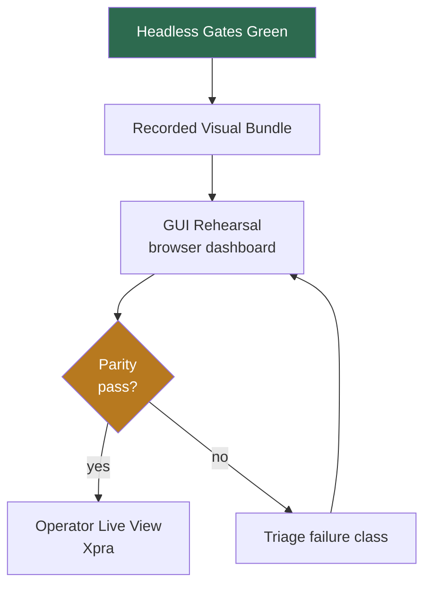
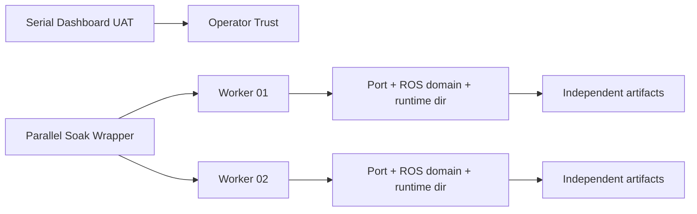

# Active Workflow (Canonical 2026 Rebuild)

## Scope

This is the single source of truth for the rebuilt stack bring-up, UAT execution, and GUI rehearsal sequencing.

## Canonical Runtime Contract

1. `runtime_target`: `robot_fidelity_orin|workstation_balanced|workstation_max`
2. `sim_lane`: `jetty_gate|isaac_fidelity`
3. `inference_backend`: `tensorrt_int8`

Legacy compatibility:

- `robot_fidelity` is accepted as an alias and resolves to `robot_fidelity_orin`.

## Docker Profiles

1. Gate lane (authoritative):
   - `docker compose --profile gate up`
2. Isaac lane (high-fidelity):
   - `docker compose --profile isaac up`
3. UAT orchestrator:
   - `docker compose --profile uat run uat-orchestrator`
4. Telegram wait bridge:
   - Use the global bridge at `D:\services\codex-telegram`; Chasecar-local
     bridge scripts are retained only for recovery/reference.

Windows wrappers:

1. `scripts/run_compose_gate.ps1`
2. `scripts/run_compose_isaac.ps1`
3. `scripts/run_compose_uat.ps1`
4. `scripts/run_telegram_wait_daemon.ps1`

Telegram adjunct tools:

1. `D:\services\codex-telegram\scripts\verify-global.ps1`
2. `D:\services\codex-telegram\scripts\serve-mcp.ps1`

Compose hygiene:

1. Before a new run, stop stale gate projects sharing the same ROS domain:
   - `docker ps --format "table {{.Names}}\t{{.Status}}"`
   - `docker compose -p <stale_project> down --remove-orphans`
2. First-UAT wrapper project naming pattern:
   - `chasecar_gate_firstuat_<timestamp>`
3. Preferred first operator entrypoint performs stale gate cleanup automatically:
   - `scripts/run_first_uat.ps1`

## Telegram Wait Bridge

This is an operator-adjacent service and does not participate in sim/UAT pass-fail.

1. Verify bot credentials, daemon health, and MCP registration:
   - `powershell -ExecutionPolicy Bypass -File D:\services\codex-telegram\scripts\verify-global.ps1`
2. Register/repair global Codex and Claude MCP config:
   - `powershell -ExecutionPolicy Bypass -File D:\services\codex-telegram\scripts\install-global.ps1`
3. Operational note:
   - `telegram_send` expects the human to reply directly to the Telegram prompt message so the daemon can match the response.
4. MCP runtime note:
   - Existing sessions that report `Transport closed` need a session restart after global verification passes.

## First Operator Path

Use this as the default first run on a fresh/recovered machine:

1. `powershell -ExecutionPolicy Bypass -File scripts/run_first_uat.ps1 -ExecutionLane container_kilted -Distro Ubuntu-24.04 -RuntimeTarget robot_fidelity_orin`
2. Runbook details: `docs/FIRST_UAT_RUNBOOK.md`

Key options:

1. `-Distro Ubuntu-24.04`
2. `-ExecutionLane container_kilted|host_ros` (default `container_kilted`)
3. `-RosDistro <name>` (used only when `ExecutionLane=host_ros`)
4. `-RuntimeTarget robot_fidelity_orin`
5. `-ProjectName chasecar_gate_firstuat_manual`
6. `-IncludeVisual true|false` (default `true`)
7. `-StepTimeoutMinutes <n>`
8. `-UatExecutionContext sim_gate|gate_stack|uat_orchestrator` (default `sim_gate`)

First-UAT contract:

1. Coordinate UAT must pass (`summary.json` has `pass=true`).
2. If visual is enabled, milestone 1 evidence bundle must exist.
3. Session outputs are always written to:
   - `artifacts/session/<timestamp>/manifest.json`
   - `artifacts/session/<timestamp>/readiness_report.json`
4. Readiness includes deterministic lane/timeout metadata:
   - `execution_lane`
   - `failure_class`
   - `step_timeout_s`
   - `container_core_ros_distro`
   - `detected_host_ros_distros`

## Calibrated Fetch Evidence Hygiene

Planner-gated generalized fetch evidence must carry three proof surfaces before
operator or promotion claims:

1. corrected marker geometry:
   - `geometry_consistency.pass=true`
   - visible marker center and radius match `fetch_pose_world`
2. calibrated model provenance:
   - `model_provenance_valid=true`
   - target model `calibrated_golf_ball`
   - target radius `0.021336m`
   - marker model `golf_ball_delivery_zone_marker`
3. same-session visual evidence:
   - browser-watchable onboard camera video
   - browser-watchable context video

Model-provenance boundary:

- Commit `680e393 Use calibrated ball for fetch direct runs` changed direct
  `fetch_to_pose` runs to the calibrated golf-ball SDF.
- Pre-boundary direct fetch repeatability artifacts without explicit calibrated
  model fields are diagnostic.
- Run the audit before using older direct fetch summaries:
  `python scripts/fetch_model_provenance_audit.py --campaign-id fetch_model_provenance_audit_<date>`

Evidence rebuild ladder:

1. saved `zero`/`left05`/`right05`, one run each
2. saved `zero`/`left05`/`right05`, `3/3`
3. seeded `fetch_generalization_gate`, `6 x 1`
4. mobile visual UAT package with browser-watchable videos

Planner-routed visual UAT adds a session-binding rule. Each replay row that is
used for operator evidence must bind the mission verdict to the dashboard
session that produced the videos and keyframe review. Prefer the fresh-session
harness for mixed route-owner evidence:

```powershell
python scripts\fetch_planner_route_replay_batch.py `
  --campaign-id <id> `
  --gate-summary artifacts\session\<planner_gate>\fetch_planner_handoff_gate\gate_summary.json `
  --max-per-route 1 `
  --fresh-dashboard-session-per-run `
  --dashboard-url http://127.0.0.1:8875
```

The harness starts a calibrated dashboard session per selected scene, passes
`--expected-session-id` into `golf_ball_circle_delivery_demo_runner.py`, stops
the sim before packaging, and writes a package-local
`keyframe_review_contact_sheet.png`. Review that sheet across the run sequence
before reporting pass/fail.

Open-field planner-routed UAT now has a strict rollup step. Use it after route
replay batches to dedupe reruns by scene, count browser-watchable visual
successes, verify measured push-ready handoff, and confirm true opposite-side
coverage:

```powershell
python scripts\fetch_open_field_uat_rollup.py `
  --campaign-id <id> `
  --batch-summary artifacts\session\<batch_a>\fetch_planner_route_replay_batch\batch_summary.json `
  --batch-summary artifacts\session\<batch_b>\fetch_planner_route_replay_batch\batch_summary.json `
  --min-successes 6 `
  --min-opposite-successes 3
```

Current green reference:
`artifacts/session/open_field_fetch_uat_rollup_20260606/fetch_open_field_uat_rollup/scorecard.md`.
That package proves six strict visual UAT successes, three true opposite-side
successes, the pinned prior opposite-circle regression scene, and measured
push-ready handoff for every counted executable fetch. It is visual UAT
evidence; canonical promotion still follows saved-layout and seeded-random
gates.

Multi-ball retrieval now starts as a planning and replay-command gate above the
same one-ball local primitive. Use this first to confirm bounded scene spread,
retrieval order, route ownership, and per-ball local-fetch layouts:

```powershell
python scripts\fetch_multiball_retrieval_gate.py `
  --campaign-id <id> `
  --dry-run `
  --random-cases 4 `
  --balls-per-scene 3 `
  --seed 20260606
```

Current dry-run reference:
`artifacts/session/multiball_retrieval_v1_dryrun_seed20260606_20260606/fetch_multiball_retrieval_gate/scorecard.md`.
The reference generated four bounded three-ball scenes and twelve replayable
local-fetch commands. It is planning evidence only. The next live rung is one
same-session multi-ball visual demo that retrieves three balls through repeated
planner-routed setup/capture/push-to-target cycles and includes onboard,
topdown, world/context video, keyframe sequence review, and mission-level
retrieval scoring.

Saved-anchor repeatability analyzer scope:

```powershell
python scripts\fetch_planner_route_uat_analyzer.py `
  --campaign-id <id> `
  --evidence-scope saved_anchor_repeatability `
  --repeatability-runs-per-anchor 3 `
  --planner-summary artifacts\session\<planner_gate>\fetch_planner_handoff_gate\gate_summary.json `
  --mission-summary <mission_verdict.json> `
  --visual-package-summary <package_summary.json>
```

June 4, 2026 planner-routed saved-anchor repeatability:

- Analyzer:
  `artifacts/session/analysis_planner_saved_anchor_repeat3x_20260604/fetch_planner_route_uat_analyzer/scorecard.md`
- Contact-sheet montage:
  `artifacts/session/analysis_planner_saved_anchor_repeat3x_20260604/fetch_planner_route_uat_analyzer/saved_anchor_repeat3x_contact_sheet_montage.png`
- Result: `saved_anchor_repeatability_green`, `9/9` live mission passes,
  `9/9` browser-watchable visual packages, `0` first-contact blockers, clean
  setup/contact quality, closest approach range `0.194m..0.198m`.
- Remaining promotion rung: a planner-routed seeded generalization gate with
  canonical promotion semantics.

June 4, 2026 seed `20260627` planner-routed random slice:

- Planner gate:
  `artifacts/session/dev_route_quality_gate_seed20260627_post_repeatability_30case_20260604/fetch_planner_handoff_gate/scorecard.md`
- Analyzer:
  `artifacts/session/analysis_route_quality_seed20260627_exec6_post_repeatability_20260604/fetch_planner_route_uat_analyzer/scorecard.md`
- Contact-sheet montage:
  `artifacts/session/analysis_route_quality_seed20260627_exec6_post_repeatability_20260604/fetch_planner_route_uat_analyzer/seed20260627_exec6_keyframe_montage.png`
- Result: the fresh mixed planner gate passed `30/30` with `0` wrong
  fetch-ready dispatches across all five route labels. The live executable
  slice passed `6/6`, with two clean rows each for `fetch_ready_local`,
  `nav2_reposition_first`, and `recovery_or_reaim`; closest approaches ranged
  from `0.194m` to `0.196m`.
- Evidence meaning: this is randomized route-owner visual UAT. It strengthens
  confidence in the planner-routed stack and keeps `promotion_evidence=false`
  until the planner-routed seeded gate surface carries the canonical `6 x 1`
  promotion contract.

Planner-routed seeded generalization gate wrapper:

```powershell
python scripts\fetch_planner_seeded_generalization_gate.py `
  --campaign-id <id> `
  --random-cases 30 `
  --seed <seed> `
  --max-per-route 2 `
  --fresh-dashboard-session-per-run `
  --stop-on-fail
```

Dry-run proof:

- Gate:
  `artifacts/session/dev_planner_seeded_generalization_gate_dry_run_20260604/fetch_planner_seeded_generalization_gate/scorecard.md`
- Result: the wrapper composed the `30/30` planner handoff gate and a dry-run
  six-row executable replay selection with two rows each for
  `fetch_ready_local`, `nav2_reposition_first`, and `recovery_or_reaim`.
- Evidence meaning: `planner_routed_seeded_generalization_dry_run_ready`.
  Promotion evidence starts only after the same wrapper runs live with fresh
  dashboard sessions, visual packages, clean execution/setup/contact quality,
  and zero first-contact blockers.

Live attempt, same morning:

- Gate:
  `artifacts/session/live_planner_seeded_generalization_gate_seed20260627_20260604/fetch_planner_seeded_generalization_gate/scorecard.md`
- Result: planner child passed `30/30` with `0` wrong fetch-ready dispatches.
  Replay stopped before the first mission because the fresh dashboard session
  stayed in `environment_starting`; first failed row was
  `seed20260627_scene04_recovery_or_reaim` with
  `fresh_dashboard_session_start_failed; environment_state=starting;
  phase=environment_starting`.
- Evidence meaning: infrastructure startup blocker. Fetch-control scoring
  remains unattempted. Repair or bypass the dashboard/compose fresh-session
  startup path, then rerun the same parent gate.

Live rerun after visual-evidence startup fix:

- Gate:
  `artifacts/session/live_planner_seeded_generalization_gate_full_visual_fix_20260604/fetch_planner_seeded_generalization_gate/scorecard.md`
- Replay:
  `artifacts/session/live_planner_seeded_generalization_gate_full_visual_fix_20260604_replay/fetch_planner_route_replay_batch/scorecard.md`
- Analyzer:
  `artifacts/session/live_planner_seeded_generalization_gate_full_visual_fix_20260604_analysis/fetch_planner_route_uat_analyzer/scorecard.md`
- Result: planner child passed `30/30` with `0` wrong fetch-ready dispatches.
  Replay passed `6/6` live executable rows with `6/6` browser-watchable visual
  packages across two `fetch_ready_local`, two `nav2_reposition_first`, and two
  `recovery_or_reaim` rows. The analyzer reports clean execution/setup/contact
  quality and `0` first-contact blockers.
- Evidence meaning: `planner_routed_seeded_generalization_promotion_green`,
  `promotion_evidence=true` for the current sim milestone. The six raw/topdown
  keyframe sheets were sequence-reviewed and agree with the telemetry.
- Fix-forward note: replay batches now ask the dashboard for
  `visual_evidence_required=true` whenever visual packages are enabled, so
  optional/degraded Xpra no longer disables `world_stream_controller.py` or
  `visual_demo_observer.py`.

June 4, 2026 second-seed planner-routed breadth check:

- Gate:
  `artifacts/session/live_planner_seeded_generalization_gate_seed20260628_full_visual_rerun_20260604/fetch_planner_seeded_generalization_gate/scorecard.md`
- Replay:
  `artifacts/session/live_planner_seeded_generalization_gate_seed20260628_full_visual_rerun_20260604_replay/fetch_planner_route_replay_batch/scorecard.md`
- Analyzer:
  `artifacts/session/live_planner_seeded_generalization_gate_seed20260628_full_visual_rerun_20260604_analysis/fetch_planner_route_uat_analyzer/scorecard.md`
- Result: seed `20260628` passed the same parent seeded gate after Docker
  subnet cleanup. Planner routing passed `30/30` with `0` wrong fetch-ready
  dispatches. Replay passed `6/6` live executable rows and `6/6`
  browser-watchable visual packages across two `fetch_ready_local`, two
  `nav2_reposition_first`, and two `recovery_or_reaim` rows.
- Analyzer meaning: execution/setup/contact quality are clean, first-contact
  blocker count is `0`, and the parent gate sets
  `promotion_evidence=true`.
- Visual review: the contact-sheet package now writes sequence review images
  beside each visual session, which keeps Windows package paths short. Six
  raw/topdown contact sheets were inspected across setup, first contact, push,
  and terminal arrival; the onboard and topdown views agree with telemetry.
- Infrastructure note: the first seed `20260628` attempt failed before mission
  launch because Docker exhausted predefined bridge subnets. Unused Chasecar
  dashboard/gate networks were removed; the rerun is the behavior evidence.

June 4, 2026 browser UAT bundle:

- Page:
  `http://100.112.221.6:8883/fetch-plan`
- Scope: the living plan now includes a dedicated UAT review bundle with three
  route samples from seed `20260628`: recovery/re-aim, Nav2-first, and
  fetch-ready local. Each sample leads with the onboard browser MP4 and links to
  topdown telemetry plus the session-local contact sheet.
- Review sequence: watch onboard first, compare the contact sheet, then use the
  seed `20260627` and `20260628` parent/analyzer scorecards for the broader
  milestone claim.
- Validation: desktop and mobile rendered checks passed through isolated
  Playwright after the in-app Browser bridge failed during setup. The contact
  sheet interaction opens
  `artifacts/session/20260604T151923053290Z/visual/keyframe_review_contact_sheet.png`
  from the UAT bundle.

June 4, 2026 recovery/re-aim route-boundary correction:

- Code boundary: `nav2_reposition_first` remains the route that owns real Nav2
  setup before local fetch. `recovery_or_reaim` now keeps the generated robot
  pose and lets the bounded forward-only `line_servo` recovery routine perform
  the local re-aim, first-contact alignment, and push.
- Regression proof:
  `artifacts/session/live_recovery_reaim_local_setup_scene04_20260604/fetch_planner_route_replay_batch/scorecard.md`
- Visual package:
  `artifacts/session/live_recovery_reaim_local_setup_scene04_20260604_seed20260627_scene04_recovery_or_reaim/fetch_visual_uat_package/scorecard.md`
- Result: the exact seed `20260627` scene04 `recovery_or_reaim` row that
  previously failed before contact now passes live with `nav2_reposition_before_fetch=false`,
  clean first-contact quality, stable contact approach, and closest approach
  `0.193732m`.
- Evidence meaning: the corrected route boundary repairs the prior
  before-contact recovery abort. `promotion_evidence` remains `false` until the
  full planner-routed seeded gate reruns with six live executable rows and
  browser-watchable packages.

June 4, 2026 planner-routed readyfix evidence:

- Planner child:
  `artifacts/session/live_planner_seeded_generalization_gate_mission_only_readyfix_20260604_planner/fetch_planner_handoff_gate/scorecard.md`
- Mission-only seeded gate:
  `artifacts/session/live_planner_seeded_generalization_gate_mission_only_readyfix_20260604_replay/fetch_planner_route_replay_batch/scorecard.md`
- Representative browser-visual replay:
  `artifacts/session/live_planner_seeded_generalization_gate_visual_recheck_20260604/fetch_planner_route_replay_batch/scorecard.md`
- Result: the planner child passed `30/30` with `0` wrong fetch-ready
  dispatches. The mission-only replay passed `6/6` executable rows across
  `recovery_or_reaim`, `fetch_ready_local`, and `nav2_reposition_first`; one
  Nav2 row aborted before contact, moved the ball `0.0m`, fell back to bounded
  local recovery, and delivered at `0.197m`. The representative full-visual
  replay then passed `4/4` with browser-watchable packages and frame-sequence
  review across recovery, fetch-ready, and Nav2-first rows; closest approaches
  were `0.193m..0.197m`.
- Evidence meaning: route ownership is currently green for UAT and the
  Nav2-to-local fallback boundary has live mission proof. Promotion remains
  pending until the parent seeded gate itself runs with canonical visual
  packaging semantics and sets `promotion_evidence=true`.
- Harness fix: stale model cleanup now returns timeout status instead of
  crashing the delivery runner, after the fetch-ready visual row exposed a
  Gazebo remove-service timeout before mission dispatch.

June 4, 2026 moonshot regression manifest:

- Command:
  `python scripts\fetch_moonshot_regression_manifest.py --campaign-id analysis_planner_moonshot_regression_set_20260604`
- Scorecard:
  `artifacts/session/analysis_planner_moonshot_regression_set_20260604/fetch_moonshot_regression_manifest/scorecard.md`
- Result: `planner_routed_moonshot_regression_set_green`. The analyzer verifies
  saved-anchor repeatability, setup/contact audit health, seeds `20260627`,
  `20260628`, and `20260629`, and the two seed `20260629` boundary rows
  `seed20260629_scene01_nav2_reposition_first` and
  `seed20260629_scene05_recovery_or_reaim`.
- Evidence meaning: this analyzer is the compact preservation bar for future
  route-owner, recovery, timeout, visual-packaging, and contact-servo changes.
  A green manifest preserves `9/9` saved-anchor repeatability, three promoted
  seeded gates, `18/18` seeded live mission passes, `18/18` seeded visual
  packages, and browser-watchable proof for the known boundary rows.

June 4, 2026 broad-UAT recovery repair:

- Breadth queue:
  `artifacts/session/analysis_planner_moonshot_breadth_queue_20260604/fetch_moonshot_breadth_queue/scorecard.md`
- Initial rough-row failure:
  `artifacts/session/live_planner_seeded_generalization_gate_seed20260630_breadth_20260604/fetch_planner_seeded_generalization_gate/scorecard.md`
- Targeted repair replay:
  `artifacts/session/live_seed20260630_scene28_recovery_crawl_repair_20260604/fetch_planner_route_replay_batch/scorecard.md`
- Result: `seed20260630_scene28_recovery_or_reaim` failed once as a
  setup/first-contact recovery yaw-hold stall with no ball motion, then passed
  after a bounded recovery line-acquire yaw-crawl repair. The repaired run
  delivered to `0.198m`, passed visual packaging, and produced clean
  first-contact flags.
- Full breadth rerun:
  `artifacts/session/live_planner_seeded_generalization_gate_seed20260630_recovery_crawl_full_20260604/fetch_planner_seeded_generalization_gate/scorecard.md`
- Full rerun result: planner routing `30/30`, `wrong_fetch=0`, executable
  missions `6/6`, visual packages `6/6`, analyzer clean, first-contact blockers
  `0`, and closest approach range `0.194m..0.198m`.
- Evidence meaning: this is broad randomized route-owner UAT evidence. Keep the
  regression manifest as the preservation bar for future route-owner,
  recovery-window, and contact-servo changes.

June 4, 2026 second rough-seed breadth proof:

- Full seed `20260631` gate:
  `artifacts/session/live_planner_seeded_generalization_gate_seed20260631_breadth_20260604/fetch_planner_seeded_generalization_gate/scorecard.md`
- Result: planner routing `30/30`, `wrong_fetch=0`, executable missions `6/6`,
  visual packages `6/6`, analyzer clean, first-contact blockers `0`, and
  closest approach range `0.194m..0.197m`.
- Visual review: checked both recovery rows, both Nav2-first rows, and a
  fetch-ready row through raw-camera plus topdown contact sheets before updating
  the dashboard.

June 4, 2026 five-seed regression manifest:

- Command:
  `python scripts\fetch_moonshot_regression_manifest.py --campaign-id analysis_planner_moonshot_regression_set_five_seed_20260604`
- Scorecard:
  `artifacts/session/analysis_planner_moonshot_regression_set_five_seed_20260604/fetch_moonshot_regression_manifest/scorecard.md`
- Result: `planner_routed_moonshot_regression_set_green`; seeded gates `5/5`,
  live seeded missions `30/30`, and visual packages `30/30`.
- Evidence meaning: this is now the preservation bar before the next route-owner,
  controller, visual-packaging, or hardware-transfer change.

June 4, 2026 six-seed breadth checkpoint:

- Full seed `20260632` gate:
  `artifacts/session/live_planner_seeded_generalization_gate_seed20260632_breadth_20260604/fetch_planner_seeded_generalization_gate/scorecard.md`
- Result: planner routing `30/30`, `wrong_fetch=0`, executable missions `6/6`,
  visual packages `6/6`, analyzer clean, first-contact blockers `0`, and
  closest approach range `0.194m..0.198m`.
- Visual review: checked both recovery rows, both Nav2-first rows, and both
  fetch-ready rows through raw-camera plus topdown contact sheets before
  promoting the seed into the manifest.

June 4, 2026 six-seed regression manifest:

- Command:
  `python scripts\fetch_moonshot_regression_manifest.py --campaign-id analysis_planner_moonshot_regression_set_six_seed_20260604`
- Scorecard:
  `artifacts/session/analysis_planner_moonshot_regression_set_six_seed_20260604/fetch_moonshot_regression_manifest/scorecard.md`
- Result: `planner_routed_moonshot_regression_set_green`; seeded gates `6/6`,
  live seeded missions `36/36`, and visual packages `36/36`.
- Evidence meaning: use this as the current preservation bar before route-owner,
  controller, visual-packaging, dashboard, or hardware-transfer changes. Keep
  planner-routed route ownership as the primary path; use alternative
  architectures as reserve lanes when the manifest or broader route-family UAT
  exposes a reproducible stage gap.

June 4, 2026 seven-seed breadth checkpoint:

- Full seed `20260633` gate:
  `artifacts/session/live_planner_seeded_generalization_gate_seed20260633_breadth_20260604/fetch_planner_seeded_generalization_gate/scorecard.md`
- Result: planner routing `30/30`, `wrong_fetch=0`, executable missions `6/6`,
  visual packages `6/6`, analyzer clean, first-contact blockers `0`, and
  closest approach range `0.193m..0.196m`.
- Route mix: `fetch_ready_local=7`, `nav2_reposition_first=5`,
  `recovery_or_reaim=4`, `scan_or_perceive_first=4`, and
  `ambiguous_or_unsafe_no_go=10`.
- Visual review: checked both recovery rows, both Nav2-first rows, and both
  fetch-ready rows through raw-camera plus topdown contact sheets before
  promoting the seed into the manifest.

June 4, 2026 seven-seed regression manifest:

- Command:
  `python scripts\fetch_moonshot_regression_manifest.py --campaign-id analysis_planner_moonshot_regression_set_seven_seed_20260604`
- Scorecard:
  `artifacts/session/analysis_planner_moonshot_regression_set_seven_seed_20260604/fetch_moonshot_regression_manifest/scorecard.md`
- Result: `planner_routed_moonshot_regression_set_green`; seeded gates `7/7`,
  live seeded missions `42/42`, and visual packages `42/42`.
- Evidence meaning: this is the current preservation bar for route-owner,
  controller, visual-packaging, dashboard, and hardware-transfer changes.

June 5, 2026 seed20260635/preflight regression manifest:

- Command:
  `python scripts\fetch_moonshot_regression_manifest.py --campaign-id analysis_planner_moonshot_regression_set_seed20260635_preflight_20260605`
- Scorecard:
  `artifacts/session/analysis_planner_moonshot_regression_set_seed20260635_preflight_20260605/fetch_moonshot_regression_manifest/scorecard.md`
- Result: `planner_routed_moonshot_regression_set_green`; seeded gates `8/8`,
  live seeded missions `48/48`, visual packages `48/48`, boundary rows `2/2`,
  and control preflights `1/1`.
- Evidence meaning: this is the current preservation bar for route-owner,
  contact-servo, visual-packaging, dashboard, controller-preflight, and
  hardware-transfer changes.

June 5, 2026 hardware-transfer readiness package:

- Command:
  `python scripts\fetch_hardware_transfer_readiness.py --campaign-id analysis_fetch_hardware_transfer_readiness_20260605`
- Scorecard:
  `artifacts/session/analysis_fetch_hardware_transfer_readiness_20260605/fetch_hardware_transfer_readiness/scorecard.md`
- Result: `planner_routed_fetch_hardware_rehearsal_ready`;
  `hardware_transfer_ready=true`, `hardware_proven=false`, and
  `promotion_evidence=false`.
- Evidence meaning: the planner-routed stack is packaged for the first
  robot-side rehearsal. The rehearsal must record base-controller preflight,
  mission verdict, onboard raw-camera video, topdown/world context, keyframe
  sequence review, `robot_fidelity_orin`, and `tensorrt_int8` provenance before
  hardware-transfer claims advance beyond rehearsal-ready.

June 5, 2026 hardware rehearsal plan:

- Command:
  `python scripts\fetch_hardware_rehearsal_plan.py --campaign-id analysis_fetch_hardware_rehearsal_plan_20260605`
- Scorecard:
  `artifacts/session/analysis_fetch_hardware_rehearsal_plan_20260605/fetch_hardware_rehearsal_plan/scorecard.md`
- Result: `planner_routed_fetch_hardware_rehearsal_plan_ready`;
  `hardware_rehearsal_plan_ready=true`, `hardware_proven=false`, and
  `promotion_evidence=false`.
- Evidence meaning: the next run is a three-step robot-side rehearsal: runtime
  stack smoke, saved-anchor fetch rehearsal, and seed20260635 mixed-route
  rehearsal. Each fetch step must include controller preflight, mission verdict,
  onboard/context video, and keyframe sequence review.

June 5, 2026 hardware rehearsal runner preflight:

- Command:
  `python scripts\fetch_hardware_rehearsal_runner.py --campaign-id analysis_fetch_hardware_rehearsal_runner_preflight_20260605`
- Scorecard:
  `artifacts/session/analysis_fetch_hardware_rehearsal_runner_preflight_20260605/fetch_hardware_rehearsal_runner/scorecard.md`
- Result: `planner_routed_fetch_hardware_rehearsal_preflight_ready`;
  all three rehearsal commands resolve locally and `next_action=execute_runtime_stack_smoke`.
- Evidence meaning: the runner preflight confirms the stack-smoke, saved-anchor,
  and seed20260635 rehearsal commands are launchable from the current repo. It
  preserves `hardware_proven=false`; robot-side proof starts when
  `runtime_stack_smoke` executes and produces visual/runtime artifacts.

June 5, 2026 runtime stack smoke rehearsal:

- Command:
  `python scripts\fetch_hardware_rehearsal_runner.py --campaign-id live_fetch_hardware_rehearsal_runtime_stack_smoke_artifact_contract_20260605 --step-id runtime_stack_smoke --execute --timeout-s 1800`
- Scorecard:
  `artifacts/session/live_fetch_hardware_rehearsal_runtime_stack_smoke_artifact_contract_20260605/fetch_hardware_rehearsal_runner/scorecard.md`
- Result: `planner_routed_fetch_hardware_rehearsal_step_executed`;
  return code `0`, artifact contract green, session `20260605T054242Z`.
- Visual review: inspected
  `artifacts/demos/milestone_1_20260605T054242Z/screenshots/d415_color.png`
  and
  `artifacts/demos/milestone_1_20260605T054242Z/screenshots/yolo_debug.png`;
  the raw camera shows the target centered and the debug screenshot shows the
  detected ball overlay.
- Infrastructure repair: the first execution attempt exposed CRLF in
  `uat/orchestrator/run_uat_orchestrator.sh`; `.gitattributes` now pins
  `uat/orchestrator/*.sh` to LF and
  `tests/test_uat_orchestrator_line_endings.py` guards the orchestrator entry
  script.
- Evidence meaning: the runtime/sensor stack smoke is green under
  `robot_fidelity_orin` and `tensorrt_int8`. The next rehearsal step is
  saved-anchor fetch execution with raw-camera/topdown/world video.

June 5, 2026 saved-anchor fetch rehearsal:

- Command:
  `python scripts\fetch_hardware_rehearsal_runner.py --campaign-id live_fetch_hardware_rehearsal_saved_anchors_batch_contract_20260605 --step-id saved_anchor_one_run_fetch_rehearsal --execute --timeout-s 2400`
- Runner scorecard:
  `artifacts/session/live_fetch_hardware_rehearsal_saved_anchors_batch_contract_20260605/fetch_hardware_rehearsal_runner/scorecard.md`
- Batch scorecard:
  `artifacts/session/hardware_rehearsal_saved_anchors_20260605/fetch_planner_route_replay_batch/scorecard.md`
- Result: saved anchors `3/3`, mission pass `3/3`, visual packages `3/3`,
  mission failures `0`, and artifact-contract validation green.
- Visual review: inspected the left05, right05, and zero raw/topdown keyframe
  sheets. All three show coherent setup, first contact, push, and delivery
  circle arrival that matches topdown geometry.
- Evidence meaning: saved-anchor fetch rehearsal is green with browser-watchable
  onboard/context videos. This fed the completed seed20260635 executable-route
  rehearsal; the active robot-side runbook now uses seed20260643 mixed
  all-routes coverage.

June 5, 2026 seed20260635 mixed-route hardware rehearsal:

- Command:
  `python scripts\fetch_hardware_rehearsal_runner.py --campaign-id live_fetch_hardware_rehearsal_seed20260635_mixed_route_contract_20260605 --step-id seed20260635_mixed_route_fetch_rehearsal --execute --timeout-s 3600`
- Runner scorecard:
  `artifacts/session/live_fetch_hardware_rehearsal_seed20260635_mixed_route_contract_20260605/fetch_hardware_rehearsal_runner/scorecard.md`
- Seeded gate scorecard:
  `artifacts/session/hardware_rehearsal_seed20260635_20260605/fetch_planner_seeded_generalization_gate/scorecard.md`
- Replay scorecard:
  `artifacts/session/hardware_rehearsal_seed20260635_20260605_replay/fetch_planner_route_replay_batch/scorecard.md`
- Result: planner gate `30/30`, executable replay `6/6`, visual packages
  `6/6`, analyzer clean, mission failures `0`, and runner artifact-contract
  validation green.
- Route coverage: two `fetch_ready_local`, two `nav2_reposition_first`, and
  two `recovery_or_reaim` rows delivered inside the `0.300m` contract.
- Visual review: inspected all six raw/topdown keyframe sheets. The visual
  sequence matches the telemetry across setup, first contact, push, and
  terminal delivery.
- Claim boundary: this is a green hardware-rehearsal simulation package with
  `promotion_evidence=false` and `hardware_proven=false`. It remains historical
  sim-gate rehearsal proof; the next robot-side attempt uses the seed20260643
  mixed all-routes runbook with the same artifact contract.

June 5, 2026 seed20260643 robot-side runbook refresh:

- Command:
  `python scripts\fetch_robot_side_rehearsal_preflight.py --campaign-id analysis_fetch_robot_side_rehearsal_preflight_seed20260643_20260605`
- Scorecard:
  `artifacts/session/analysis_fetch_robot_side_rehearsal_preflight_seed20260643_20260605/fetch_robot_side_rehearsal_preflight/scorecard.md`
- Refreshed readiness:
  `artifacts/session/analysis_fetch_hardware_transfer_readiness_seed20260643_mixed_all_routes_20260605/fetch_hardware_transfer_readiness/scorecard.md`
- Rehearsal plan:
  `artifacts/session/analysis_fetch_hardware_rehearsal_plan_seed20260643_20260605/fetch_hardware_rehearsal_plan/scorecard.md`
- Runner preflight:
  `artifacts/session/analysis_fetch_hardware_rehearsal_runner_seed20260643_preflight_20260605/fetch_hardware_rehearsal_runner/scorecard.md`
- Result: local preflight ready, command/script checks green, `hardware_connected=false`,
  `hardware_proven=false`, and `promotion_evidence=false`.
- Required robot-side proof: controller preflight with
  `/controller_manager/list_controllers`, mission verdict, raw-camera video,
  topdown/world context, keyframe contact sheet, and visual review notes across
  setup, pre-contact, first contact, mid-push, terminal arrival, and final rest.
- Evidence meaning: the local run package is ready to attempt robot-side
  rehearsal. Hardware proof starts with onboard execution of the stack smoke,
  then saved anchors, then seed20260643 mixed all-routes rehearsal under the
  same artifact contract. The mixed route step covers `fetch_ready_local`,
  `nav2_reposition_first`, `recovery_or_reaim`, `scan_or_perceive_first`, and
  `ambiguous_or_unsafe_no_go`, so robot-side proof covers both action and
  abstention routes.

June 5, 2026 seed20260643 robot-side rehearsal evidence:

- Stack smoke:
  `artifacts/session/robot_side_fetch_rehearsal_runtime_stack_smoke_seed20260643_20260605/fetch_hardware_rehearsal_runner/scorecard.md`
- Saved anchors:
  `artifacts/session/robot_side_fetch_rehearsal_saved_anchors_seed20260643_20260605/fetch_hardware_rehearsal_runner/scorecard.md`
- Mixed all-routes batch:
  `artifacts/session/hardware_rehearsal_seed20260643_mixed_all_routes_20260605/fetch_planner_route_replay_batch/scorecard.md`
- Mixed all-routes analyzer:
  `artifacts/session/robot_side_seed20260643_mixed_all_routes_analysis_20260605/fetch_planner_route_uat_analyzer/scorecard.md`
- Result: stack smoke passed with D415 raw and YOLO debug screenshots; saved
  anchors passed `3/3`; seed20260643 mixed all-routes rehearsal passed `10/10`
  route contracts with `6/6` executable deliveries, `4/4` planner-only
  abstentions, `10/10` visual packages, and analyzer-clean execution, setup,
  and contact.
- Visual review: inspected the stack-smoke screenshots, all three saved-anchor
  keyframe sheets, and all ten mixed-route keyframe sheets. The four
  planner-only rows visibly withheld local fetch, while recovery, Nav2-first,
  and fetch-ready rows showed delivery into the circle with topdown agreement.
- Harness note: the first scene05 Nav2 attempt exposed a `set_pose` subprocess
  timeout after Gazebo returned `data: true`; `set_model_pose` now records
  `timed_out_after_success=true` and treats the pose set as successful. The
  hardware runner also accepts planner-only route rows without requiring fetch
  controller preflight.
- Claim boundary: this is green sim-gate robot-target rehearsal evidence.
  Provider-backed LLM routing and physical/onboard proof remain open, and
  `hardware_proven=false` remains the correct claim.

June 5, 2026 fresh rehearsal ladder:

- Runtime stack smoke:
  `artifacts/session/robot_side_fetch_rehearsal_runtime_stack_smoke_20260605/fetch_hardware_rehearsal_runner/scorecard.md`
- Saved-anchor runner:
  `artifacts/session/robot_side_fetch_rehearsal_saved_anchors_20260605/fetch_hardware_rehearsal_runner/scorecard.md`
- Seed20260635 runner:
  `artifacts/session/robot_side_fetch_rehearsal_seed20260635_20260605/fetch_hardware_rehearsal_runner/scorecard.md`
- Result: stack smoke passed with `robot_fidelity_orin`, `tensorrt_int8`,
  coordinate UAT `pass=true`, and raw/debug screenshots. Saved anchors passed
  `3/3`; seed20260635 mixed-route replay passed `6/6` with analyzer-clean
  execution, setup, and contact.
- Visual review: inspected the D415 raw and YOLO debug screenshots, all three
  saved-anchor keyframe sheets, and all six seed keyframe sheets.
- Claim boundary: this is fresh sim-gate/runtime-target rehearsal evidence.
  Physical robot execution, onboard TensorRT on the robot, physical camera
  behavior, and field physics remain the open hardware gates. The active
  robot-side runbook now uses seed20260643 mixed all-routes coverage for the
  next physical/onboard attempt.

June 5, 2026 seed20260636 breadth UAT:

- Command:
  `python scripts\fetch_planner_seeded_generalization_gate.py --campaign-id live_planner_seeded_generalization_gate_seed20260636_breadth_20260605 --seed 20260636 --random-cases 30 --planner-mode llm_supervised_guarded --max-per-route 2 --dashboard-url http://127.0.0.1:8883 --fresh-dashboard-session-per-run --allow-operator-view-degraded --stop-on-fail`
- Parent scorecard:
  `artifacts/session/live_planner_seeded_generalization_gate_seed20260636_breadth_20260605/fetch_planner_seeded_generalization_gate/scorecard.md`
- Replay scorecard:
  `artifacts/session/live_planner_seeded_generalization_gate_seed20260636_breadth_20260605_replay/fetch_planner_route_replay_batch/scorecard.md`
- Analyzer scorecard:
  `artifacts/session/live_planner_seeded_generalization_gate_seed20260636_breadth_20260605_analysis/fetch_planner_route_uat_analyzer/scorecard.md`
- Result: parent gate `pass=true`, `random_cases=30`,
  `wrong_fetch_dispatch_count=0`, executable replay `6/6`, visual packages
  `6/6`, analyzer execution/setup/contact clean, and first-contact blockers
  `0`.
- Route coverage: replay selected two `fetch_ready_local`, two
  `nav2_reposition_first`, and two `recovery_or_reaim` rows. Closest approach
  stayed in `0.193m..0.197m` against the `0.300m` contract.
- Visual review: inspected all six raw-camera/topdown keyframe sheets. The
  onboard camera and topdown geometry agreed through setup, first contact,
  push, and terminal delivery.
- Claim boundary: this is broad sim-gate route-owner UAT. Planner authority ran
  through deterministic fallback because `OPENAI_API_KEY` was unavailable, so
  provider-backed LLM routing and physical/onboard proof remain open.

June 5, 2026 seed20260637 breadth UAT:

- Command:
  `python scripts\fetch_planner_seeded_generalization_gate.py --campaign-id live_planner_seeded_generalization_gate_seed20260637_breadth_20260605 --seed 20260637 --random-cases 30 --planner-mode llm_supervised_guarded --max-per-route 2 --dashboard-url http://127.0.0.1:8883 --fresh-dashboard-session-per-run --allow-operator-view-degraded --stop-on-fail`
- Parent scorecard:
  `artifacts/session/live_planner_seeded_generalization_gate_seed20260637_breadth_20260605/fetch_planner_seeded_generalization_gate/scorecard.md`
- Replay scorecard:
  `artifacts/session/live_planner_seeded_generalization_gate_seed20260637_breadth_20260605_replay/fetch_planner_route_replay_batch/scorecard.md`
- Analyzer scorecard:
  `artifacts/session/live_planner_seeded_generalization_gate_seed20260637_breadth_20260605_analysis/fetch_planner_route_uat_analyzer/scorecard.md`
- Result: parent gate `pass=true`, `random_cases=30`,
  `wrong_fetch_dispatch_count=0`, executable replay `6/6`, visual packages
  `6/6`, analyzer execution/setup/contact clean, and first-contact blockers
  `0`.
- Route coverage: replay selected two `fetch_ready_local`, two
  `nav2_reposition_first`, and two `recovery_or_reaim` rows. The two recovery
  rows were predicted high-risk and still produced coherent visual delivery
  evidence.
- Visual review: inspected all six raw-camera/topdown keyframe sheets. The
  onboard camera and topdown geometry agreed through setup, first contact,
  push, and terminal delivery.
- Claim boundary: this is another broad sim-gate route-owner UAT pass. Planner
  authority ran through deterministic fallback because `OPENAI_API_KEY` was
  unavailable, so provider-backed LLM routing and physical/onboard proof remain
  open.

June 5, 2026 seed20260643 mixed all-routes visual UAT:

- Replay command:
  `python scripts\fetch_planner_route_replay_batch.py --campaign-id live_planner_seed20260643_mixed_route_family_allroutes_2x_20260605 --gate-summary artifacts\session\live_planner_seeded_generalization_gate_seed20260643_rough_breadth_50x4_20260605_planner\fetch_planner_handoff_gate\gate_summary.json --route fetch_ready_local --route nav2_reposition_first --route recovery_or_reaim --route scan_or_perceive_first --route ambiguous_or_unsafe_no_go --quality-order roughest --max-per-route 2 --dashboard-url http://127.0.0.1:8883 --fresh-dashboard-session-per-run --allow-operator-view-degraded --stop-on-fail`
- Replay scorecard:
  `artifacts/session/live_planner_seed20260643_mixed_route_family_allroutes_2x_20260605/fetch_planner_route_replay_batch/scorecard.md`
- Analyzer scorecard:
  `artifacts/session/live_planner_seed20260643_mixed_route_family_allroutes_2x_analysis_fixed_20260605/fetch_planner_route_uat_analyzer/scorecard.md`
- Result: mixed replay `pass=true`, `selected_count=10`,
  `route_success_count=10`, `mission_pass_count=6`,
  `route_only_pass_count=4`, `visual_package_pass_count=10`, and
  `mission_fail_count=0`.
- Route coverage: two rows each for `fetch_ready_local`,
  `nav2_reposition_first`, `recovery_or_reaim`, `scan_or_perceive_first`, and
  `ambiguous_or_unsafe_no_go`. Executable rows delivered `6/6`; planner-only
  scan/no-go rows withheld local fetch `4/4`.
- Visual review: inspected the four planner-only raw-camera/topdown keyframe
  sheets plus representative Nav2, recovery, and fetch-ready sheets. The
  planner-only rows visibly stayed still with local fetch withheld, and the
  executable samples matched delivery geometry.
- Claim boundary: this is full route-family sim-gate UAT for the latest broad
  seed. Provider-backed LLM routing and physical/onboard proof remain open.

June 5, 2026 seed20260643 expanded rough breadth UAT:

- Command:
  `python scripts\fetch_planner_seeded_generalization_gate.py --campaign-id live_planner_seeded_generalization_gate_seed20260643_rough_breadth_50x4_20260605 --seed 20260643 --random-cases 50 --planner-mode llm_supervised_guarded --quality-order roughest --max-per-route 4 --dashboard-url http://127.0.0.1:8883 --fresh-dashboard-session-per-run --allow-operator-view-degraded --stop-on-fail`
- Parent scorecard:
  `artifacts/session/live_planner_seeded_generalization_gate_seed20260643_rough_breadth_50x4_20260605/fetch_planner_seeded_generalization_gate/scorecard.md`
- Replay scorecard:
  `artifacts/session/live_planner_seeded_generalization_gate_seed20260643_rough_breadth_50x4_20260605_replay/fetch_planner_route_replay_batch/scorecard.md`
- Analyzer scorecard:
  `artifacts/session/live_planner_seeded_generalization_gate_seed20260643_rough_breadth_50x4_20260605_analysis/fetch_planner_route_uat_analyzer/scorecard.md`
- Result: parent gate `pass=true`, `random_cases=50`,
  `wrong_fetch_dispatch_count=0`, executable replay `12/12`, visual packages
  `12/12`, analyzer execution/setup/contact clean, and first-contact blockers
  `0`.
- Route coverage: replay selected four `recovery_or_reaim`, four
  `nav2_reposition_first`, and four `fetch_ready_local` rows. The generated
  route mix also held seven `ambiguous_or_unsafe_no_go` and eight
  `scan_or_perceive_first` scenes for route-withholding coverage.
- Visual review: inspected all twelve raw-camera/topdown keyframe sheets. The
  onboard camera and topdown geometry agreed through setup, first contact,
  push, and terminal delivery. Closest approaches stayed in
  `0.191m..0.198m`.
- Claim boundary: this is the broadest rough sim-gate route-owner UAT pass so
  far. Planner authority ran through deterministic fallback because
  `OPENAI_API_KEY` was unavailable, so provider-backed LLM routing and
  physical/onboard proof remain open.

June 5, 2026 seed20260642 rough breadth UAT:

- Command:
  `python scripts\fetch_planner_seeded_generalization_gate.py --campaign-id live_planner_seeded_generalization_gate_seed20260642_rough_breadth_20260605 --seed 20260642 --random-cases 30 --planner-mode llm_supervised_guarded --quality-order roughest --max-per-route 3 --dashboard-url http://127.0.0.1:8883 --fresh-dashboard-session-per-run --allow-operator-view-degraded --stop-on-fail`
- Parent scorecard:
  `artifacts/session/live_planner_seeded_generalization_gate_seed20260642_rough_breadth_20260605/fetch_planner_seeded_generalization_gate/scorecard.md`
- Replay scorecard:
  `artifacts/session/live_planner_seeded_generalization_gate_seed20260642_rough_breadth_20260605_replay/fetch_planner_route_replay_batch/scorecard.md`
- Analyzer scorecard:
  `artifacts/session/live_planner_seeded_generalization_gate_seed20260642_rough_breadth_20260605_analysis/fetch_planner_route_uat_analyzer/scorecard.md`
- Result: parent gate `pass=true`, `random_cases=30`,
  `wrong_fetch_dispatch_count=0`, executable replay `8/8`, visual packages
  `8/8`, analyzer execution/setup/contact clean, and first-contact blockers
  `0`.
- Route coverage: replay selected three `recovery_or_reaim`, three
  `nav2_reposition_first`, and two `fetch_ready_local` rows. The generated
  route mix also held six `ambiguous_or_unsafe_no_go` and six
  `scan_or_perceive_first` scenes for route-withholding coverage.
- Visual review: inspected all eight raw-camera/topdown keyframe sheets. The
  onboard camera and topdown geometry agreed through setup, first contact,
  push, and terminal delivery. Closest approaches stayed in
  `0.194m..0.198m`.
- Claim boundary: this is another broad sim-gate route-owner UAT pass through
  the hardened deterministic fallback lane. `OPENAI_API_KEY` was unavailable,
  so provider-backed LLM routing and physical/onboard proof remain open.

June 5, 2026 seed20260641 timeout/startup repair rough breadth UAT:

- Initial command:
  `python scripts\fetch_planner_seeded_generalization_gate.py --campaign-id live_planner_seeded_generalization_gate_seed20260641_rough_breadth_20260605 --seed 20260641 --random-cases 30 --planner-mode llm_supervised_guarded --quality-order roughest --max-per-route 3 --dashboard-url http://127.0.0.1:8883 --fresh-dashboard-session-per-run --allow-operator-view-degraded --stop-on-fail`
- Initial result: the parent gate crashed on a Python `TimeoutExpired` while
  running `seed20260641_scene08_nav2_reposition_first`, after earlier rows had
  produced partial artifacts. The replay runner now converts live-run
  `TimeoutExpired` into `returncode=124` row evidence with timeout text instead
  of raising a parent traceback.
- Structured failure command:
  `python scripts\fetch_planner_seeded_generalization_gate.py --campaign-id live_planner_seeded_generalization_gate_seed20260641_rough_breadth_timeout_capture_20260605 --seed 20260641 --random-cases 30 --planner-mode llm_supervised_guarded --quality-order roughest --max-per-route 3 --dashboard-url http://127.0.0.1:8883 --fresh-dashboard-session-per-run --allow-operator-view-degraded --stop-on-fail`
- Structured failure result: the gate emitted
  `artifacts/session/live_planner_seeded_generalization_gate_seed20260641_rough_breadth_timeout_capture_20260605/fetch_planner_seeded_generalization_gate/scorecard.md`
  with a row-level fresh-dashboard failure when `world_stream` did not become
  ready. Fresh dashboard startup now defaults to two attempts with an
  intervening environment stop after the first failed start.
- Repaired command:
  `python scripts\fetch_planner_seeded_generalization_gate.py --campaign-id live_planner_seeded_generalization_gate_seed20260641_rough_breadth_startup_retry_20260605 --seed 20260641 --random-cases 30 --planner-mode llm_supervised_guarded --quality-order roughest --max-per-route 3 --dashboard-url http://127.0.0.1:8883 --fresh-dashboard-session-per-run --allow-operator-view-degraded --stop-on-fail`
- Repaired parent scorecard:
  `artifacts/session/live_planner_seeded_generalization_gate_seed20260641_rough_breadth_startup_retry_20260605/fetch_planner_seeded_generalization_gate/scorecard.md`
- Repaired replay scorecard:
  `artifacts/session/live_planner_seeded_generalization_gate_seed20260641_rough_breadth_startup_retry_20260605_replay/fetch_planner_route_replay_batch/scorecard.md`
- Repaired analyzer scorecard:
  `artifacts/session/live_planner_seeded_generalization_gate_seed20260641_rough_breadth_startup_retry_20260605_analysis/fetch_planner_route_uat_analyzer/scorecard.md`
- Repaired result: parent gate `pass=true`, `random_cases=30`,
  `wrong_fetch_dispatch_count=0`, executable replay `9/9`, visual packages
  `9/9`, analyzer execution/setup/contact clean, and first-contact blockers
  `0`.
- Route coverage: replay selected three `recovery_or_reaim`, three
  `nav2_reposition_first`, and three `fetch_ready_local` rows. The generated
  route mix also held two `ambiguous_or_unsafe_no_go` and nine
  `scan_or_perceive_first` scenes for route-withholding coverage.
- Visual review: inspected all nine raw-camera/topdown keyframe sheets. The
  onboard camera and topdown geometry agreed through setup, first contact,
  push, and terminal delivery. The previously timed-out scene08 Nav2 row now
  passes with visible delivery.
- Claim boundary: this is rough sim-gate route-owner UAT. Planner authority ran
  through deterministic fallback because `OPENAI_API_KEY` was unavailable, so
  provider-backed LLM routing and physical/onboard proof remain open.

June 5, 2026 seed20260640 preflight repair rough breadth UAT:

- Initial command:
  `python scripts\fetch_planner_seeded_generalization_gate.py --campaign-id live_planner_seeded_generalization_gate_seed20260640_rough_breadth_20260605 --seed 20260640 --random-cases 30 --planner-mode llm_supervised_guarded --quality-order roughest --max-per-route 3 --dashboard-url http://127.0.0.1:8883 --fresh-dashboard-session-per-run --allow-operator-view-degraded --stop-on-fail`
- Initial result: planner gate `30/30` with `wrong_fetch_dispatch_count=0`,
  then the first replay row,
  `seed20260640_scene20_recovery_or_reaim`, stopped before motion. The
  control preflight at
  `artifacts/session/20260605T101202259947Z/golf_ball_circle_delivery/20260605T101447287352Z/control_preflight.json`
  recorded `pass=false`, `BASE_CONTROLLER_ACTIVE=0`, and output showing
  `Configured and activated jetbot_base_controller`.
- Repair: `ensure_base_controller_active` now performs a final
  `/controller_manager/list_controllers` check after the repair loop before it
  fails closed. This preserves the active-controller proof requirement while
  covering activation that lands near the preflight deadline.
- Repaired command:
  `python scripts\fetch_planner_seeded_generalization_gate.py --campaign-id live_planner_seeded_generalization_gate_seed20260640_rough_breadth_preflight_fix_20260605 --seed 20260640 --random-cases 30 --planner-mode llm_supervised_guarded --quality-order roughest --max-per-route 3 --dashboard-url http://127.0.0.1:8883 --fresh-dashboard-session-per-run --allow-operator-view-degraded --stop-on-fail`
- Repaired parent scorecard:
  `artifacts/session/live_planner_seeded_generalization_gate_seed20260640_rough_breadth_preflight_fix_20260605/fetch_planner_seeded_generalization_gate/scorecard.md`
- Repaired replay scorecard:
  `artifacts/session/live_planner_seeded_generalization_gate_seed20260640_rough_breadth_preflight_fix_20260605_replay/fetch_planner_route_replay_batch/scorecard.md`
- Repaired analyzer scorecard:
  `artifacts/session/live_planner_seeded_generalization_gate_seed20260640_rough_breadth_preflight_fix_20260605_analysis/fetch_planner_route_uat_analyzer/scorecard.md`
- Repaired result: parent gate `pass=true`, `random_cases=30`,
  `wrong_fetch_dispatch_count=0`, executable replay `9/9`, visual packages
  `9/9`, analyzer execution/setup/contact clean, and first-contact blockers
  `0`.
- Route coverage: replay selected three `recovery_or_reaim`, three
  `nav2_reposition_first`, and three `fetch_ready_local` rows. The generated
  route mix also held seven `ambiguous_or_unsafe_no_go` and eight
  `scan_or_perceive_first` scenes for route-withholding coverage.
- Visual review: inspected all nine raw-camera/topdown keyframe sheets. The
  onboard camera and topdown geometry agreed through setup, first contact,
  push, and terminal delivery. The repaired scene20 row now drives, contacts,
  and delivers.
- Claim boundary: this is rough sim-gate route-owner UAT. Planner authority ran
  through deterministic fallback because `OPENAI_API_KEY` was unavailable, so
  provider-backed LLM routing and physical/onboard proof remain open.

June 5, 2026 seed20260639 rough breadth UAT:

- Command:
  `python scripts\fetch_planner_seeded_generalization_gate.py --campaign-id live_planner_seeded_generalization_gate_seed20260639_rough_breadth_20260605 --seed 20260639 --random-cases 30 --planner-mode llm_supervised_guarded --quality-order roughest --max-per-route 3 --dashboard-url http://127.0.0.1:8883 --fresh-dashboard-session-per-run --allow-operator-view-degraded --stop-on-fail`
- Parent scorecard:
  `artifacts/session/live_planner_seeded_generalization_gate_seed20260639_rough_breadth_20260605/fetch_planner_seeded_generalization_gate/scorecard.md`
- Replay scorecard:
  `artifacts/session/live_planner_seeded_generalization_gate_seed20260639_rough_breadth_20260605_replay/fetch_planner_route_replay_batch/scorecard.md`
- Analyzer scorecard:
  `artifacts/session/live_planner_seeded_generalization_gate_seed20260639_rough_breadth_20260605_analysis/fetch_planner_route_uat_analyzer/scorecard.md`
- Result: parent gate `pass=true`, `random_cases=30`,
  `wrong_fetch_dispatch_count=0`, executable replay `9/9`, visual packages
  `9/9`, analyzer execution/setup/contact clean, and first-contact blockers
  `0`.
- Route coverage: replay selected three `recovery_or_reaim`, three
  `nav2_reposition_first`, and three `fetch_ready_local` rows. The planner
  route mix also held five `ambiguous_or_unsafe_no_go` and seven
  `scan_or_perceive_first` scenes for route-withholding coverage.
- Risk coverage: selected rows included three high-risk recovery rows, four
  medium-risk rows, and two low-risk fetch-ready rows. Closest approaches
  stayed in `0.194m..0.198m` inside the `0.300m` contract.
- Visual review: inspected all nine raw-camera/topdown keyframe sheets. The
  onboard camera and topdown geometry agreed through setup, first contact,
  push, and terminal delivery.
- Startup default proof: this command omitted `--env-ready-timeout-s` and still
  passed the full roughest-row gate under the new `600s` default. Treat the
  seed20260638 startup timeout as cleared infrastructure debt unless it
  reproduces under the default.
- Claim boundary: this is rough sim-gate route-owner UAT. Planner authority ran
  through deterministic fallback because `OPENAI_API_KEY` was unavailable, so
  provider-backed LLM routing and physical/onboard proof remain open.

June 5, 2026 seed20260638 rough breadth UAT:

- Command:
  `python scripts\fetch_planner_seeded_generalization_gate.py --campaign-id live_planner_seeded_generalization_gate_seed20260638_rough_breadth_20260605 --seed 20260638 --random-cases 30 --planner-mode llm_supervised_guarded --quality-order roughest --max-per-route 3 --dashboard-url http://127.0.0.1:8883 --fresh-dashboard-session-per-run --allow-operator-view-degraded --resume-skip-existing --env-ready-timeout-s 600 --stop-on-fail`
- Parent scorecard:
  `artifacts/session/live_planner_seeded_generalization_gate_seed20260638_rough_breadth_20260605/fetch_planner_seeded_generalization_gate/scorecard.md`
- Replay scorecard:
  `artifacts/session/live_planner_seeded_generalization_gate_seed20260638_rough_breadth_20260605_replay/fetch_planner_route_replay_batch/scorecard.md`
- Analyzer scorecard:
  `artifacts/session/live_planner_seeded_generalization_gate_seed20260638_rough_breadth_20260605_analysis/fetch_planner_route_uat_analyzer/scorecard.md`
- Result: parent gate `pass=true`, `random_cases=30`,
  `wrong_fetch_dispatch_count=0`, executable replay `8/8`, visual packages
  `8/8`, analyzer execution/setup/contact clean, and first-contact blockers
  `0`.
- Route coverage: replay selected three `recovery_or_reaim`, three
  `nav2_reposition_first`, and two `fetch_ready_local` rows. The generated
  route mix had only two fetch-ready rows, so the rough gate produced eight
  executable rows from a `--max-per-route 3` request.
- Risk coverage: all eight rows were predicted contact-quality watches:
  three high-risk recovery rows, three medium-risk Nav2-first rows, and two
  low-risk fetch-ready rows.
- Visual review: inspected all eight raw-camera/topdown keyframe sheets. The
  onboard camera and topdown geometry agreed through setup, first contact,
  push, and terminal delivery.
- Startup watch: the first attempt timed out during fresh-dashboard startup on
  `seed20260638_scene15_nav2_reposition_first`, with robot truth visible and
  target truth missing. The same row passed on resume with
  `--env-ready-timeout-s 600`, so the interruption is infrastructure/startup
  evidence rather than a route-owner control failure.
- Forward fix: planner route replay, seeded generalization, and breadth-queue
  commands now default `--env-ready-timeout-s` to `600s`, matching the timeout
  that cleared scene15. Keep shorter timeouts for explicit fast screens only.
- Claim boundary: this is rough sim-gate route-owner UAT. Planner authority ran
  through deterministic fallback because `OPENAI_API_KEY` was unavailable, so
  provider-backed LLM routing and physical/onboard proof remain open.

June 4, 2026 planner-only route proof:

- Command:
  `python scripts\fetch_planner_route_replay_batch.py --campaign-id live_planner_only_route_proof_seed20260633_20260604 --gate-summary artifacts\session\live_planner_seeded_generalization_gate_seed20260633_breadth_20260604_planner\fetch_planner_handoff_gate\gate_summary.json --route scan_or_perceive_first --route ambiguous_or_unsafe_no_go --max-per-route 1 --dashboard-url http://127.0.0.1:8883 --fresh-dashboard-session-per-run --allow-operator-view-degraded --route-only-sample-duration-s 6 --timeout-s 120 --package-timeout-s 180 --stop-on-fail`
- Scorecard:
  `artifacts/session/live_planner_only_route_proof_seed20260633_20260604/fetch_planner_route_replay_batch/scorecard.md`
- Result: route-only proof `2/2`, visual packages `2/2`,
  `local_fetch_dispatched=false` for both rows, `fetch_to_pose_pass=false` for
  both rows by design, and `promotion_evidence=false`.
- Visual/trace review: inspected both keyframe contact sheets. The
  `scan_or_perceive_first` row selected
  `scan_or_perception_refresh_selected`, sampled `59` frames, and measured
  robot motion `0.000m` and ball motion `0.000m`. The
  `ambiguous_or_unsafe_no_go` row selected `safe_no_go_selected`, sampled `59`
  frames, and measured robot motion `0.000m` and ball motion `0.000m`.
- Evidence meaning: planner-owned refusal/defer now has live stopped-scene
  browser evidence beside the executable fetch evidence. The next broadening
  target is a mixed route-family UAT batch over additional seeds, scored as
  fetch success for executable routes and correct withholding for route-only
  routes.

June 4, 2026 mixed route-family UAT:

- Command:
  `python scripts\fetch_planner_route_replay_batch.py --campaign-id live_mixed_route_family_uat_seed20260633_20260604 --gate-summary artifacts\session\live_planner_seeded_generalization_gate_seed20260633_breadth_20260604_planner\fetch_planner_handoff_gate\gate_summary.json --route fetch_ready_local --route nav2_reposition_first --route recovery_or_reaim --route scan_or_perceive_first --route ambiguous_or_unsafe_no_go --max-per-route 1 --dashboard-url http://127.0.0.1:8883 --fresh-dashboard-session-per-run --allow-operator-view-degraded --route-only-sample-duration-s 6 --timeout-s 180 --package-timeout-s 180`
- Replay scorecard:
  `artifacts/session/live_mixed_route_family_uat_seed20260633_20260604/fetch_planner_route_replay_batch/scorecard.md`
- Analyzer:
  `artifacts/session/analysis_mixed_route_family_uat_seed20260633_20260604/fetch_planner_route_uat_analyzer/scorecard.md`
- Result: mixed route contracts `5/5`, visual packages `5/5`, executable
  deliveries `3/3`, route-only proofs `2/2`, analyzer clean, and
  first-contact blockers `0`.
- Route read: `fetch_ready_local`, `recovery_or_reaim`, and
  `nav2_reposition_first` delivered with closest approach
  `0.195m..0.197m`. `scan_or_perceive_first` and
  `ambiguous_or_unsafe_no_go` withheld local fetch and passed
  `planner_route_only_pass=true`.
- Visual review: inspected raw-camera plus topdown contact sheets for all five
  sessions. The executable rows showed setup, first contact, push, and
  terminal delivery into the visible circle. The planner-only rows showed
  visible stopped scenes with no local fetch dispatch.
- Evidence meaning: the planner-routed architecture now has live proof across
  all five route families in one batch. The next useful broadening target is a
  larger mixed-family replay with at least two live samples per route before
  contact-control changes.

June 4, 2026 two-per-route mixed route-family UAT:

- Command:
  `python scripts\fetch_planner_route_replay_batch.py --campaign-id live_mixed_route_family_uat_seed20260633_20260604 --gate-summary artifacts\session\live_planner_seeded_generalization_gate_seed20260633_breadth_20260604_planner\fetch_planner_handoff_gate\gate_summary.json --route fetch_ready_local --route nav2_reposition_first --route recovery_or_reaim --route scan_or_perceive_first --route ambiguous_or_unsafe_no_go --max-per-route 2 --dashboard-url http://127.0.0.1:8883 --fresh-dashboard-session-per-run --allow-operator-view-degraded --route-only-sample-duration-s 6 --timeout-s 180 --package-timeout-s 180 --resume-skip-existing`
- Replay scorecard:
  `artifacts/session/live_mixed_route_family_uat_seed20260633_20260604/fetch_planner_route_replay_batch/scorecard.md`
- Analyzer:
  `artifacts/session/analysis_mixed_route_family_2per_route_seed20260633_20260604/fetch_planner_route_uat_analyzer/scorecard.md`
- Result: selected `10`, skipped existing `5`, route contracts `10/10`,
  visual packages `10/10`, executable deliveries `6/6`, route-only proofs
  `4/4`, analyzer clean, and first-contact blockers `0`.
- Route read: every route family now has two live samples satisfying its own
  contract. Executable closest approach range is `0.194m..0.197m`.
- Visual review: inspected the five new raw-camera plus topdown contact sheets.
  The three new executable rows showed setup/contact/delivery; the two new
  planner-only rows showed stopped-scene proof with local fetch withheld.
- Evidence meaning: seed `20260633` now has enough route-family breadth for the
  next question to move to another rough seed or hardware-transfer packaging.

June 4, 2026 second rough-seed mixed route-family UAT:

- Command:
  `python scripts\fetch_planner_route_replay_batch.py --campaign-id live_mixed_route_family_2per_route_seed20260632_20260604 --gate-summary artifacts\session\live_planner_seeded_generalization_gate_seed20260632_breadth_20260604_planner\fetch_planner_handoff_gate\gate_summary.json --route fetch_ready_local --route nav2_reposition_first --route recovery_or_reaim --route scan_or_perceive_first --route ambiguous_or_unsafe_no_go --max-per-route 2 --dashboard-url http://127.0.0.1:8883 --fresh-dashboard-session-per-run --allow-operator-view-degraded --route-only-sample-duration-s 6 --timeout-s 180 --package-timeout-s 180`
- Replay scorecard:
  `artifacts/session/live_mixed_route_family_2per_route_seed20260632_20260604/fetch_planner_route_replay_batch/scorecard.md`
- Analyzer:
  `artifacts/session/analysis_mixed_route_family_2per_route_seed20260632_20260604/fetch_planner_route_uat_analyzer/scorecard.md`
- Result: selected `10`, route contracts `10/10`, visual packages `10/10`,
  executable deliveries `6/6`, route-only proofs `4/4`, analyzer clean, and
  first-contact blockers `0`.
- Route read: every route family has two live samples on a second rough seed.
  `fetch_ready_local`, `recovery_or_reaim`, and `nav2_reposition_first`
  delivered with closest approach `0.195m..0.198m`. `scan_or_perceive_first`
  and `ambiguous_or_unsafe_no_go` withheld local fetch and passed route-only
  proof.
- Visual review: inspected raw-camera plus topdown keyframe sheets for all ten
  sessions. The six executable rows showed coherent setup, contact, push, and
  visible delivery. The four planner-only rows showed stopped-scene proof with
  local fetch withheld.
- Evidence meaning: this confirms the seed `20260633` mixed-family result on a
  second rough seed and keeps the architecture question pointed at
  route-gated planner ownership. The next useful work is a deliberately hard
  mixed-scenario UAT matrix, including opposite-side-of-circle and large
  setup-angle cases, plus hardware-transfer packaging. Keep contact-control
  tuning behind reproducible route-family stage gaps.

June 4, 2026 hard mixed-scenario route-family UAT:

- Handoff command:
  `python scripts\fetch_planner_handoff_gate.py --campaign-id dry_hard_mixed_fetch_planner_v1_20260604 --scene-set hard_mixed_fetch_planner_v1 --random-cases 10 --seed 20260604 --dry-run`
- Replay command:
  `python scripts\fetch_planner_route_replay_batch.py --campaign-id live_hard_mixed_route_family_20260604 --gate-summary artifacts\session\dry_hard_mixed_fetch_planner_v1_20260604\fetch_planner_handoff_gate\gate_summary.json --route fetch_ready_local --route nav2_reposition_first --route recovery_or_reaim --route scan_or_perceive_first --route ambiguous_or_unsafe_no_go --max-per-route 2 --dashboard-url http://127.0.0.1:8883 --fresh-dashboard-session-per-run --allow-operator-view-degraded --route-only-sample-duration-s 6 --timeout-s 240 --package-timeout-s 180`
- Replay scorecard:
  `artifacts/session/live_hard_mixed_route_family_20260604/fetch_planner_route_replay_batch/scorecard.md`
- Analyzer:
  `artifacts/session/analysis_hard_mixed_route_family_20260604/fetch_planner_route_uat_analyzer/scorecard.md`
- Result: hard matrix route contracts `10/10`, visual packages `10/10`,
  executable deliveries `6/6`, route-only proofs `4/4`, clean analyzer status,
  and first-contact blockers `0`.
- Hard coverage: two wide-angle `fetch_ready_local` rows, two opposite-side
  `nav2_reposition_first` rows, two large-angle high-debt
  `recovery_or_reaim` rows, two scan/defer rows, and two safe no-go rows.
  Executable closest approach range was `0.194m..0.197m`.
- Visual review: inspected raw-camera plus topdown keyframe sheets for all ten
  sessions. The opposite-side Nav2, wide-angle fetch-ready, and large-angle
  recovery rows visibly delivered into the circle. Scan/defer and no-go rows
  stayed stopped with local fetch withheld.
- Evidence meaning: the planner-routed architecture now clears a deliberately
  hard named matrix as well as random mixed-route breadth.

June 4, 2026 LLM-shadow hard-matrix route classification:

- Command:
  `python scripts\fetch_planner_handoff_gate.py --campaign-id shadow_llm_hard_mixed_fetch_planner_v1_20260604 --scene-set hard_mixed_fetch_planner_v1 --random-cases 10 --seed 20260604 --planner-mode llm_shadow --dry-run --timeout-s 60`
- Scorecard:
  `artifacts/session/shadow_llm_hard_mixed_fetch_planner_v1_20260604/fetch_planner_handoff_gate/scorecard.md`
- Result: the real provider returned `ok` on all ten hard scenes, matched the
  deterministic guard `10/10`, kept wrong fetch-ready dispatches at `0`, and
  set `llm_shadow_ready=True`.
- Evidence meaning: LLM/world-state planning is now supported for high-level
  route classification in shadow. Deterministic guards and route executors
  remain the live authority.

June 4, 2026 LLM-shadow rough-seed rollup:

- Rollup:
  `artifacts/session/analysis_llm_shadow_hard_plus_rough_mixed_20260604/fetch_planner_llm_shadow_evidence/scorecard.md`
- Inputs:
  `shadow_llm_hard_mixed_fetch_planner_v1_20260604`,
  `shadow_llm_mixed_fetch_planner_seed20260632_20260604`, and
  `shadow_llm_mixed_fetch_planner_seed20260633_20260604`.
- Result: three gates, `70` total route classifications, provider `ok` on
  `70/70`, guard agreement `70/70`, route pass/fail `70/0`, and wrong
  fetch-ready dispatches `0`.
- Evidence meaning: AI route selection now has shadow evidence across the hard
  matrix plus both rough mixed-family UAT seeds.

June 4, 2026 LLM-shadow seven-seed manifest rollup:

- Rollup:
  `artifacts/session/analysis_llm_shadow_hard_plus_seven_seed_manifest_20260604/fetch_planner_llm_shadow_evidence/scorecard.md`
- Inputs: the hard matrix plus generated mixed-route seeds `20260627` through
  `20260633`. Seed `20260630` first had one provider read timeout on
  `seed20260630_scene16_fetch_ready_local`; the longer-timeout rerun
  `shadow_llm_mixed_fetch_planner_seed20260630_rerun_20260604` cleared it.
- Result: eight gates, `220` total route classifications, provider `ok` on
  `220/220`, guard agreement `220/220`, route pass/fail `220/0`, and wrong
  fetch-ready dispatches `0`.
- Evidence meaning: high-level LLM route selection is now shadow-green across
  the current hard-plus-seven-seed manifest. The next work is defining the
  supervised-live route-selection threshold and fallback policy, then packaging
  hardware-transfer review. Deterministic guards and bounded executors remain
  the live authority.

June 4, 2026 supervised LLM route guard proof:

- Command:
  `python scripts\fetch_planner_handoff_gate.py --campaign-id supervised_llm_hard_mixed_fetch_planner_v1_20260604 --scene-set hard_mixed_fetch_planner_v1 --random-cases 10 --seed 20260604 --planner-mode llm_supervised_guarded --dry-run --timeout-s 90`
- Scorecard:
  `artifacts/session/supervised_llm_hard_mixed_fetch_planner_v1_20260604/fetch_planner_handoff_gate/scorecard.md`
- Result: provider `ok` on `10/10`, route pass/fail `10/0`, guard agreement
  `10/10`, supervised accept/veto `10/0`, and wrong fetch-ready dispatches `0`.
- Evidence meaning: the first supervised policy accepts LLM route output only
  under provider success, confidence threshold, and deterministic guard
  agreement. This is still dry route-selection evidence; live motion remains
  deterministic and guarded. The next gate is supervised dry scoring across the
  seven-seed manifest.

June 4, 2026 supervised hard-plus-seven-seed manifest:

- Scorecard:
  `artifacts/session/analysis_supervised_llm_hard_plus_seven_seed_manifest_20260604/fetch_planner_llm_supervised_evidence/scorecard.md`
- Result: gates `8`, total cases `220`, provider `ok` on `220/220`, route
  pass/fail `220/0`, guard agreement `220/220`, wrong fetch-ready dispatches
  `0`, supervised accept/veto `217/3`, and veto reasons
  `{'confidence_below_threshold': 3}`.
- Evidence meaning: the supervised route layer is green as guarded-fallback
  evidence. Strict all-accepted authority is still false because three proposals
  fell below the `0.90` confidence threshold, but the guard preserved the safe
  deterministic route in every vetoed case. The next operator-facing work should
  return to route-owner visual UAT for executable fetch, Nav2-reposition, and
  recovery/re-aim routes.

June 4, 2026 supervised hard route-owner visual UAT:

- Replay command:
  `python scripts\fetch_planner_route_replay_batch.py --campaign-id live_supervised_hard_mixed_route_family_20260604 --gate-summary artifacts\session\supervised_llm_hard_mixed_fetch_planner_v1_20260604\fetch_planner_handoff_gate\gate_summary.json --route fetch_ready_local --route nav2_reposition_first --route recovery_or_reaim --route scan_or_perceive_first --route ambiguous_or_unsafe_no_go --max-per-route 2 --dashboard-url http://127.0.0.1:8883 --fresh-dashboard-session-per-run --allow-operator-view-degraded --route-only-sample-duration-s 6 --timeout-s 240 --package-timeout-s 180`
- Replay scorecard:
  `artifacts/session/live_supervised_hard_mixed_route_family_20260604/fetch_planner_route_replay_batch/scorecard.md`
- Analyzer:
  `artifacts/session/analysis_supervised_hard_mixed_route_family_20260604/fetch_planner_route_uat_analyzer/scorecard.md`
- Result: route contracts `10/10`, visual packages `10/10`, executable
  deliveries `6/6`, route-only proofs `4/4`, analyzer clean, setup/contact
  watches `0`, first-contact blockers `0`, and executable closest approach
  `0.193m..0.197m`.
- Visual review: inspected frame-sequence contact sheets for fetch-ready,
  Nav2 opposite-side, recovery large-angle, and no-go route-only cases. The
  executable sheets showed visible setup, contact, push, and delivery; the
  route-only no-go sheet showed local fetch withheld with a stable scene.
- Evidence meaning: high-level supervised routing now has live hard-matrix
  visual UAT proof. Promotion still requires broader live supervised
  route-owner batches plus canonical saved-layout and seeded-random gates.

June 4, 2026 low-confidence veto route-only proof:

- Replay command:
  `python scripts\fetch_planner_route_replay_batch.py --campaign-id live_supervised_confidence_veto_seed20260629_scene13_20260604 --gate-summary artifacts\session\supervised_llm_mixed_fetch_planner_seed20260629_provider_20260604\fetch_planner_handoff_gate\gate_summary.json --scene-id seed20260629_scene13_scan_or_perceive_first --route scan_or_perceive_first --max-per-route 1 --dashboard-url http://127.0.0.1:8883 --fresh-dashboard-session-per-run --allow-operator-view-degraded --route-only-sample-duration-s 6 --timeout-s 180 --package-timeout-s 180`
- Replay scorecard:
  `artifacts/session/live_supervised_confidence_veto_seed20260629_scene13_20260604/fetch_planner_route_replay_batch/scorecard.md`
- Visual package:
  `artifacts/session/live_supervised_confidence_veto_seed20260629_scene13_20260604_seed20260629_scene13_scan_or_perceive_first/fetch_visual_uat_package/scorecard.md`
- Result: selected `1`, route-only pass `1/1`, visual package pass `1/1`,
  local fetch withheld, closest approach `0.740m`, and promotion evidence
  `False`.
- Visual review: inspected the frame-sequence contact sheet at
  `artifacts/session/20260604T222638636393Z/visual/keyframe_review_contact_sheet.png`.
  The robot stayed stable, the target remained visible ahead, and local fetch
  stayed withheld.
- Evidence meaning: this proves the supervised fallback behavior on a real
  low-confidence case. The model proposed the correct scan/perceive route below
  the `0.90` confidence threshold, the guard withheld LLM authority, and the
  deterministic route-only contract still passed.

June 4, 2026 generated-seed supervised route-owner visual UAT:

- Replay command:
  `python scripts\fetch_planner_route_replay_batch.py --campaign-id live_supervised_mixed_route_family_seed20260629_20260604 --gate-summary artifacts\session\supervised_llm_mixed_fetch_planner_seed20260629_provider_20260604\fetch_planner_handoff_gate\gate_summary.json --route fetch_ready_local --route nav2_reposition_first --route recovery_or_reaim --route scan_or_perceive_first --route ambiguous_or_unsafe_no_go --max-per-route 2 --dashboard-url http://127.0.0.1:8883 --fresh-dashboard-session-per-run --allow-operator-view-degraded --route-only-sample-duration-s 6 --timeout-s 180 --package-timeout-s 180`
- Replay scorecard:
  `artifacts/session/live_supervised_mixed_route_family_seed20260629_20260604/fetch_planner_route_replay_batch/scorecard.md`
- Analyzer:
  `artifacts/session/analysis_supervised_mixed_route_family_seed20260629_20260604/fetch_planner_route_uat_analyzer/scorecard.md`
- Result: route contracts `10/10`, visual packages `10/10`, executable
  deliveries `6/6`, route-only proofs `4/4`, analyzer clean, setup/contact
  watches `0`, first-contact blockers `0`, and executable closest approach
  `0.195m..0.198m`.
- Coverage: two live samples each for `fetch_ready_local`,
  `nav2_reposition_first`, `recovery_or_reaim`, `scan_or_perceive_first`, and
  `ambiguous_or_unsafe_no_go`. The selected set included
  `seed20260629_scene13_scan_or_perceive_first`, the confidence-veto case.
- Visual review: inspected frame-sequence contact sheets for generated
  fetch-ready, Nav2, recovery, and confidence-veto scan cases. Executable cases
  showed visible setup, contact, push, and delivery; the confidence-veto scan
  case withheld local fetch and stayed stable.
- Evidence meaning: supervised route-owner UAT now covers both the named hard
  matrix and a generated mixed-route seed. The next live breadth target is a
  second generated seed or the canonical saved-layout/seeded-random promotion
  ladder if product timing favors consolidation.

June 4, 2026 second generated-seed supervised route-owner visual UAT:

- Replay command:
  `python scripts\fetch_planner_route_replay_batch.py --campaign-id live_supervised_mixed_route_family_seed20260631_20260604 --gate-summary artifacts\session\supervised_llm_mixed_fetch_planner_seed20260631_provider_20260604\fetch_planner_handoff_gate\gate_summary.json --route fetch_ready_local --route nav2_reposition_first --route recovery_or_reaim --route scan_or_perceive_first --route ambiguous_or_unsafe_no_go --max-per-route 2 --dashboard-url http://127.0.0.1:8883 --fresh-dashboard-session-per-run --allow-operator-view-degraded --route-only-sample-duration-s 6 --timeout-s 180 --package-timeout-s 180`
- Replay scorecard:
  `artifacts/session/live_supervised_mixed_route_family_seed20260631_20260604/fetch_planner_route_replay_batch/scorecard.md`
- Analyzer:
  `artifacts/session/analysis_supervised_mixed_route_family_seed20260631_20260604/fetch_planner_route_uat_analyzer/scorecard.md`
- Result: route contracts `10/10`, visual packages `10/10`, executable
  deliveries `6/6`, route-only proofs `4/4`, first-contact blockers `0`, and
  executable closest approach `0.193m..0.196m`.
- Watch: analyzer marked execution/setup/contact `watch` because
  `seed20260631_scene06_recovery_or_reaim` delivered with pre-contact
  lateral/yaw flags.
- Visual review: inspected generated recovery-watch, clean fetch-ready, Nav2,
  scan/perceive, and no-go sheets. The watch case showed a wider setup
  correction before visible delivery; it did not show a failed push. The
  route-only sheets showed local fetch withheld.
- Evidence meaning: generated-seed supervised live UAT now has two green seeds.
  The current residual quality backlog is recovery/re-aim setup smoothness,
  while route selection and route contracts remain green.

June 4, 2026 third generated-seed supervised route-owner visual UAT:

- Replay command:
  `python scripts\fetch_planner_route_replay_batch.py --campaign-id live_supervised_mixed_route_family_seed20260633_20260604 --gate-summary artifacts\session\supervised_llm_mixed_fetch_planner_seed20260633_provider_20260604\fetch_planner_handoff_gate\gate_summary.json --route fetch_ready_local --route nav2_reposition_first --route recovery_or_reaim --route scan_or_perceive_first --route ambiguous_or_unsafe_no_go --max-per-route 2 --dashboard-url http://127.0.0.1:8883 --fresh-dashboard-session-per-run --allow-operator-view-degraded --route-only-sample-duration-s 6 --timeout-s 180 --package-timeout-s 180`
- Replay scorecard:
  `artifacts/session/live_supervised_mixed_route_family_seed20260633_20260604/fetch_planner_route_replay_batch/scorecard.md`
- Analyzer:
  `artifacts/session/analysis_supervised_mixed_route_family_seed20260633_20260604/fetch_planner_route_uat_analyzer/scorecard.md`
- Result: route contracts `10/10`, visual packages `10/10`, executable
  deliveries `6/6`, route-only proofs `4/4`, analyzer clean,
  setup/contact watches `0`, first-contact blockers `0`, and executable
  closest approach `0.196m..0.197m`.
- Coverage: two live samples each for `fetch_ready_local`,
  `nav2_reposition_first`, `recovery_or_reaim`, `scan_or_perceive_first`, and
  `ambiguous_or_unsafe_no_go`. The selected set included
  `seed20260633_scene15_recovery_or_reaim`, a supervised confidence-veto case
  that fell back to the deterministic recovery route and still delivered.
- Visual review: inspected frame-sequence contact sheets for fetch-ready,
  recovery/re-aim, Nav2, scan/perceive, and no-go rows. Executable cases showed
  setup, contact, push/coast, and delivery; route-only rows showed local fetch
  withheld.
- Evidence meaning: generated-seed supervised live UAT now has three green
  seeds. This strengthens the planner-plus-guard architecture and shifts the
  next evidence step toward canonical saved-layout and seeded-random gates,
  unless operator confidence needs one more breadth seed first.

June 4, 2026 supervised seeded generalization promotion gate:

- Initial parent gate:
  `artifacts/session/live_supervised_planner_seeded_generalization_gate_seed20260633_20260604/fetch_planner_seeded_generalization_gate/scorecard.md`
- Promotion parent gate after infrastructure retry/reuse:
  `artifacts/session/live_supervised_planner_seeded_generalization_gate_seed20260633_reuse_promotion_20260604/fetch_planner_seeded_generalization_gate/scorecard.md`
- Supervised planner child:
  `artifacts/session/live_supervised_planner_seeded_generalization_gate_seed20260633_20260604_planner/fetch_planner_handoff_gate/scorecard.md`
- Executable replay retry:
  `artifacts/session/live_supervised_planner_seeded_gate_seed20260633_exec6_retry_20260604/fetch_planner_route_replay_batch/scorecard.md`
- Analyzer:
  `artifacts/session/analysis_supervised_planner_seeded_gate_seed20260633_exec6_retry_20260604/fetch_planner_route_uat_analyzer/scorecard.md`
- Result: `planner_routed_seeded_generalization_promotion_green`,
  `promotion_evidence=true`, supervised planner routing `30/30`, guard
  agreement `30/30`, wrong fetch-ready dispatches `0`, executable replay
  `6/6`, visual packages `6/6`, clean execution/setup/contact quality, and
  first-contact blockers `0`.
- Visual review: inspected representative fetch-ready, recovery/re-aim, Nav2,
  and final recovery frame-sequence contact sheets. The camera and topdown
  sequences agree with telemetry; no visual/geometry mismatch was observed.
- Infrastructure note: the first parent live attempt stopped after two passing
  rows on a fresh-dashboard startup failure. The replay retry completed all six
  executable rows. The seeded gate wrapper now supports
  `--reuse-planner-summary` and `--reuse-replay-summary` so a parent promotion
  summary can reuse already-validated child evidence after infrastructure retry
  without rerunning live sim or relaxing promotion requirements.

June 5, 2026 roughest supervised-seed breadth check:

- Parent gate with provider-backed guarded fallback authority:
  `artifacts/session/live_supervised_planner_seeded_generalization_gate_seed20260634_roughest_provider_reuse_20260605/fetch_planner_seeded_generalization_gate/scorecard.md`
- Replay:
  `artifacts/session/live_supervised_planner_seeded_generalization_gate_seed20260634_roughest_20260605_replay/fetch_planner_route_replay_batch/scorecard.md`
- Analyzer:
  `artifacts/session/live_supervised_planner_seeded_generalization_gate_seed20260634_roughest_provider_reuse_20260605_analysis/fetch_planner_route_uat_analyzer/scorecard.md`
- Result: visual UAT green and promotion evidence false. The gate delivered
  `6/6` executable rows and produced `6/6` visual packages with `0`
  first-contact blockers. Recovery and Nav2 rows were clean; the two direct
  fetch-ready rows delivered near `0.198m` and carried
  `ball_lateral_knock_away` plus `contact_trajectory_angle_error` watches.
- Authority note: the provider-backed reuse pass returned provider `ok` for
  all `30` planner rows, guard agreement `30/30`, wrong fetch dispatches `0`,
  and `planner_authority_ready=true`. Strict all-accepted model authority is
  false because one `scan_or_perceive_first` row used deterministic fallback for
  `confidence_below_threshold`; route agreement remains green under guarded
  fallback authority.
- Visual review: inspected all six contact sheets across setup, contact,
  push/coast, and delivery. The videos are plausible and match the analyzer
  watches; there is no visual/geometry mismatch.

June 5, 2026 fetch-ready contact-smoothing recheck:

- Implementation: `fetch_ready_local` layouts whose route-quality metadata
  requests `pre_contact_smoothing` now use
  `line_servo_contact_lateral_ready_m=0.024` through planner-route defaults.
  Clean fetch-ready layouts keep the existing `0.028m` contact-readiness
  default, and explicit CLI values still take precedence.
- Targeted evidence:
  `artifacts/session/live_fetch_ready_contact_smoothing_recheck_seed20260634_20260605/fetch_planner_route_uat_analyzer/scorecard.md`
- Scene04 visual package:
  `artifacts/session/live_fetch_ready_contact_smoothing_seed20260634_scene04_scene28_20260605_seed20260634_scene04_fetch_ready_local/fetch_visual_uat_package/scorecard.md`
- Scene28 replay:
  `artifacts/session/live_fetch_ready_contact_smoothing_seed20260634_scene28_20260605/fetch_planner_route_replay_batch/scorecard.md`
- Result: the two rough fetch-ready watch rows delivered `2/2` with clean
  execution, setup, contact, and first-contact metrics. Scene04 max ball
  lateral error improved from `0.049686m` to `0.000224m`, and contact-angle
  error improved from `-7.260deg` to `0.015deg`. Scene28 max ball lateral error
  improved from `0.058755m` to `0.000273m`, and contact-angle error improved
  from `-6.799deg` to `0.012deg`.
- Visual review: inspected both smoothed frame-sequence contact sheets. The
  onboard and topdown frames show centered forward contact into the delivery
  circle, matching the clean telemetry.
- Full preservation rerun:
  `artifacts/session/live_fetch_ready_contact_smoothing_seed20260634_full_rough_20260605/fetch_planner_route_replay_batch/scorecard.md`
- Full preservation analyzer:
  `artifacts/session/live_fetch_ready_contact_smoothing_full_rough_analysis_seed20260634_20260605/fetch_planner_route_uat_analyzer/scorecard.md`
- Full preservation result: the rough executable route-family slice delivered
  `6/6` missions with `6/6` visual packages across recovery/re-aim, Nav2-first,
  and fetch-ready rows. The analyzer reports clean execution, setup, contact,
  `0` contact watches, and `0` first-contact blockers. Scene04 max ball lateral
  error was `0.000187m`; scene28 was `0.000247m`.
- Interpretation: treat the seed `20260634` full rerun as rough route-owner UAT
  preservation evidence with `promotion_evidence=false`. Keep the provider-backed
  seed `20260633` parent as the current promotion-green milestone proof until
  the next canonical seeded/saved-layout promotion refresh includes smoothing.

June 5, 2026 supervised seeded promotion refresh:

- Parent gate:
  `artifacts/session/live_supervised_planner_seeded_generalization_gate_seed20260635_smoothing_20260605/fetch_planner_seeded_generalization_gate/scorecard.md`
- Planner child:
  `artifacts/session/dry_supervised_provider_planner_seeded_generalization_gate_seed20260635_20260605_planner/fetch_planner_handoff_gate/scorecard.md`
- Replay:
  `artifacts/session/live_supervised_planner_seeded_generalization_gate_seed20260635_smoothing_20260605_replay/fetch_planner_route_replay_batch/scorecard.md`
- Analyzer:
  `artifacts/session/live_supervised_planner_seeded_generalization_gate_seed20260635_smoothing_20260605_analysis/fetch_planner_route_uat_analyzer/scorecard.md`
- Result: `planner_routed_seeded_generalization_promotion_green`,
  `promotion_evidence=true`, provider `ok=30/30`, guard agreement `30/30`,
  wrong fetch dispatches `0`, one confidence-only deterministic fallback,
  executable replay `6/6`, visual packages `6/6`, clean execution/setup/contact
  analysis, first-contact blockers `0`, and closest approaches
  `0.194m..0.197m`.
- Visual review: all six selected rows were checked through raw/topdown
  keyframe sheets across setup, pre-contact, first contact, push, terminal
  arrival, and final rest. Scene03 recovery/re-aim is the primary fix-forward
  clip:
  `artifacts/session/20260605T045353381785Z/visual/raw_camera_browser.mp4`.
- Fix-forward note: scene03 first exposed a no-motion failure when the base
  diff-drive controller was unavailable. Executable fetch now runs a
  service-call preflight against `/controller_manager/list_controllers`, records
  `control_preflight.json`, and fails before scoring when
  `jetbot_base_controller` is not active.

For infrastructure-interrupted route-owner batches, resume with the same
campaign id and add `--resume-skip-existing`. The runner reuses passing
`fetch_visual_uat_package/package_summary.json` artifacts for completed scenes
and starts Docker/dashboard work only for missing or non-passing rows:

```powershell
python scripts\fetch_planner_route_replay_batch.py `
  --campaign-id <same-id> `
  --gate-summary artifacts\session\<planner_gate>\fetch_planner_handoff_gate\gate_summary.json `
  --max-per-route 0 `
  --resume-skip-existing `
  --stop-on-fail `
  --fresh-dashboard-session-per-run `
  --dashboard-url http://127.0.0.1:8875
```

June 1, 2026 corrected saved-anchor one-run rebuild:

- Campaigns:
  - `live_corrected_fetch_saved_anchor_one_run_zero_v2_20260601`
  - `live_corrected_fetch_saved_anchor_one_run_left05_20260601`
  - `live_corrected_fetch_saved_anchor_one_run_right05_20260601`
- Audit:
  `artifacts/session/live_corrected_fetch_saved_anchor_one_run_audit_20260601/fetch_saved_anchor_setup_contact_audit/scorecard.md`
- Result: `right05` passed with calibrated model provenance, corrected marker
  geometry, and `0.143206m` closest approach. `zero` failed on first-contact
  no-object-motion. `left05` failed on `capture_entry_timeout`.
- Interpretation: saved one-run is blocked by setup/contact behavior before
  repeatability or seeded promotion work. The dashboard package is
  `artifacts/session/uat_corrected_fetch_saved_anchor_one_run_blocked_20260601/fetch_visual_uat_package/scorecard.md`.

June 1, 2026 stage-boundary update:

- Fix commit: `7c2b244 Guard fetch contact handoff geometry`
- Full saved-layout gate:
  `artifacts/session/live_ai_push_coast_forward_contact_guard_saved_layout_one_run_20260601/calibrated_fetch_architecture_revisit/scorecard.md`
- Stage audit:
  `artifacts/session/audit_ai_push_coast_forward_contact_guard_saved_layout_one_run_20260601/fetch_saved_anchor_setup_contact_audit/scorecard.md`
- Visual UAT package:
  `artifacts/session/uat_ai_push_coast_forward_contact_guard_saved_layout_one_run_20260601/fetch_visual_uat_package/scorecard.md`
- Result: `zero` passed with `0.230116m` closest approach. `left05` failed on
  `capture_entry_timeout`. `right05` failed as a setup/contact blocker with
  `0.557965m` closest approach.
- Targeted `right05` diagnostic:
  `artifacts/session/live_ai_push_coast_forward_contact_guard_right05_one_run_20260601/calibrated_fetch_architecture_revisit/scorecard.md`
  passed with `0.196206m` closest approach after first-contact confirmation
  required forward corridor progress.
- Interpretation: the next engineering task is simplifying the stage boundary.
  The robot must prove push-readiness before Nav2 corridor push dispatch.
  Failed setup, capture-entry, or first-contact quality returns to setup or
  reacquire; terminal correction resumes after `zero`, `left05`, and `right05`
  prove clean push-readiness.

June 1, 2026 push-readiness gate requalification:

- Fix commit: `d3d1550 Add fetch push-readiness gate`
- Full saved-layout gate:
  `artifacts/session/live_push_readiness_gate_saved_anchor_one_run_20260601/calibrated_fetch_architecture_revisit/scorecard.md`
- Corrected stage audit:
  `artifacts/session/audit_push_readiness_gate_saved_anchor_one_run_20260601/fetch_saved_anchor_setup_contact_audit/scorecard.md`
- Visual UAT package:
  `artifacts/session/uat_push_readiness_gate_saved_anchor_one_run_20260601/fetch_visual_uat_package/scorecard.md`
- Result: `zero`, `left05`, and `right05` failed one-run saved-anchor
  requalification. `zero` stopped before Nav2 dispatch because measured
  standoff was `0.114858m` against the current `0.120m` minimum. `left05`
  passed the gate narrowly with `19.612223deg` yaw error, then failed during
  Nav2 corridor push. `right05` stopped before Nav2 dispatch because yaw error
  was `36.13447deg` against the current `20.0deg` limit.
- Interpretation: current evidence has `0` guarded-live terminal candidates.
  Repair setup/reacquire until the robot intentionally reaches a clean
  push-ready pose, then rerun the saved-anchor one-run gate.

Push-readiness setup implementation slice:

- Behavior: a failed push-readiness gate triggers one bounded deterministic
  setup window before Nav2 corridor-push dispatch.
- Setup target: `0.24m` standoff behind the ball on the ball-target line.
- Command caps: `0.08m/s` linear and `0.45rad/s` angular.
- Evidence fields: `push_readiness_setup` appears in gate events, final
  payloads, and `nav2_follow_path_corridor_push` diagnostics.
- Gate rule: Nav2 dispatch still requires `push_readiness_gate.pass=true`.
  Runs that remain red after the setup window classify as setup/contact
  blockers.
- Next command: rerun the saved-anchor one-run matrix on
  `zero`/`left05`/`right05`, then build a visual UAT package.

Latest saved-anchor result after setup slice:

- Commits: `0828b33 Add bounded push-readiness setup`,
  `3d5c73c Refine push-readiness backoff alignment`
- Full saved-anchor gate:
  `artifacts/session/live_push_readiness_setup_backoff_saved_anchor_one_run_20260601/calibrated_fetch_architecture_revisit/scorecard.md`
- Stage audit:
  `artifacts/session/audit_push_readiness_setup_backoff_saved_anchor_one_run_20260601/fetch_saved_anchor_setup_contact_audit/scorecard.md`
- Visual UAT package:
  `artifacts/session/uat_push_readiness_setup_backoff_saved_anchor_one_run_20260601/fetch_visual_uat_package/scorecard.md`
- Result: `zero` passed with `0.110841m`; `right05` passed with
  `0.105228m`; `left05` failed on `capture_entry_timeout` before a
  push-readiness gate.
- Next command: diagnose and repair `left05` capture-entry convergence, then
  rerun the full saved-anchor one-run matrix. Keep guarded-live terminal
  correction paused.

Latest saved-anchor result after fetch-ready handoff and setup/contact repair:

- Full saved-anchor gate:
  `artifacts/session/live_fetch_push_ready_handoff_saved_anchor_one_run_20260602/calibrated_fetch_architecture_revisit/scorecard.md`
- Visual UAT package:
  `artifacts/session/uat_fetch_push_ready_handoff_saved_anchor_one_run_20260602/fetch_visual_uat_package/scorecard.md`
- Result: `zero`, `left05`, and `right05` passed the one-run
  `0.300m` delivery-radius screen. Worst closest approaches were `0.200915m`,
  `0.148471m`, and `0.169160m`.
- Stage handoff: `left05` and `right05` reached `fetch_push_ready`, so the
  runner handed off directly from capture-entry to corridor push. The approach
  rollups are clean for all three layouts.
- Repair patch: fetch mode now treats the ball-frame capture-entry band as
  diagnostic only and accepts `fetch_push_readiness` as the corridor-push
  handoff source. The capture-entry standoff cap is `0.58m`, matching the
  observed near-threshold right-offset case while remaining tighter than the
  general `0.80m` dispatch gate.
- Corrected `3/3` gate:
  `artifacts/session/live_fetch_setup_contact_repair_saved_anchor_3x_20260602/calibrated_fetch_architecture_revisit/scorecard.md`
- Corrected setup/contact audit:
  `artifacts/session/audit_fetch_setup_contact_repair_saved_anchor_3x_20260602/fetch_saved_anchor_setup_contact_audit/scorecard.md`
- Repeatability result: `zero`, `left05`, and `right05` all passed saved-layout
  promotion `3/3`. Worst closest approaches were `0.201194m`, `0.169541m`,
  and `0.136046m`.
- Audit result: `stage_quality_green=true`, setup/contact blockers `0`,
  setup/capture blockers `0`, invalid geometry `0`, invalid model provenance
  `0`. `left05` carries a `capture_entry_time_watch` because its slowest
  capture-entry was `4.093s`.
- Seeded shadow/evidence gate:
  `artifacts/session/live_fetch_setup_contact_repair_seeded_gate_20260602/fetch_generalization_gate/gate_summary.json`
- Seeded evidence analyzer:
  `artifacts/session/evidence_fetch_setup_contact_repair_seeded_gate_20260602/fetch_seeded_gate_evidence_analyzer/scorecard.md`
- Initial seeded result: `4/6` passed. `case01` and `case06` reproduced
  `capture_entry_timeout` before corridor-push handoff and were frozen under
  `artifacts/session/live_fetch_setup_contact_repair_seeded_gate_20260602/fetch_generalization_gate/frozen_failure_layouts`.
- Bounded setup repair: `ai_push_coast_servo_v1` now gives large lateral
  setup error a bounded recenter arc, keeps speeds under the existing setup
  cap, uses a closer lateral setup standoff, and extends capture-entry time
  only while `fetch_push_readiness` score improves.
- Frozen repair proof: targeted `case01` and `case06` one-run gates both
  passed with `handoff_kind=fetch_push_ready`.
  - `case01`: `artifacts/session/live_fetch_frozen_case01_setup_capture_bounded_setup_v2_20260602/gather_mission_repeatability/campaign_run_summary.json`
  - `case06`: `artifacts/session/live_fetch_frozen_case06_setup_capture_bounded_setup_v2_20260602/gather_mission_repeatability/campaign_run_summary.json`
- Clean seeded rerun:
  `artifacts/session/live_fetch_setup_capture_bounded_setup_v2_seeded_gate_clean_20260602/fetch_generalization_gate/gate_summary.json`.
- Clean seeded analyzer:
  `artifacts/session/evidence_fetch_setup_capture_bounded_setup_v2_seeded_gate_20260602/fetch_seeded_gate_evidence_analyzer/scorecard.md`.
- Bounded setup seeded result: `5/6` initial pass, `0` reproduced failures.
  `case01` failed once after `fetch_push_ready`; its repro passed.
- Case01 near-margin repair: `ball_already_at_delivery_margin` now records a
  readiness note rather than a blocker when setup geometry is otherwise ready.
  Contact-buffer re-push readiness now accepts `0.10m` standoff.
- Case01 repeatability proof:
  `artifacts/session/live_fetch_case01_near_margin_gate_v1_repeat_3x_20260602/gather_mission_repeatability/campaign_run_summary.json`.
  Result: `3/3` passed with `handoff_kind=fetch_push_ready`.
- Latest seeded gate:
  `artifacts/session/live_fetch_relaxed_standoff_v1_seeded_gate_20260602/fetch_generalization_gate/gate_summary.json`.
- Latest seeded analyzer:
  `artifacts/session/evidence_fetch_relaxed_standoff_v1_seeded_gate_20260602/fetch_seeded_gate_evidence_analyzer/scorecard.md`.
  Earlier result: `5/6` initial pass, `1` non-repro failure, `0` reproduced
  failures. `case04` failed once, then passed repro.
- Case04 targeted repeatability:
  `artifacts/session/live_fetch_case04_relaxed_standoff_v1_repeat_3x_20260602/gather_mission_repeatability/campaign_run_summary.json`.
  Result: delivery passed `3/3`; approach-quality diagnostics reported
  `missing_first_contact_alignment` in `2/3`.
- Clean shadow seeded gate:
  `artifacts/session/live_fetch_near_margin_case04_repeat_seeded_gate_20260602/fetch_generalization_gate/gate_summary.json`.
- Clean shadow seeded analyzer:
  `artifacts/session/evidence_fetch_near_margin_case04_repeat_seeded_gate_20260602/fetch_seeded_gate_evidence_analyzer/scorecard.md`.
  Result: `6/6`, `0` reproduced failures.
- Guarded-live `right05` terminal probe:
  `artifacts/session/live_fetch_guarded_live_terminal_right05_probe_20260602/gather_mission_repeatability/campaign_run_summary.json`.
  Result: `1/1` delivery pass with clean approach-side diagnostics.
- Guarded-live saved-layout `3/3` gate:
  `artifacts/session/live_fetch_guarded_live_saved_anchor_3x_20260602/calibrated_fetch_architecture_revisit/scorecard.md`.
  Result: `zero`, `left05`, and `right05` all passed promotion `3/3`.
- Guarded-live seeded gate:
  `artifacts/session/live_fetch_guarded_live_seeded_gate_20260602/fetch_generalization_gate/gate_summary.json`.
- Guarded-live seeded analyzer:
  `artifacts/session/evidence_fetch_guarded_live_seeded_gate_20260602/fetch_seeded_gate_evidence_analyzer/scorecard.md`.
  Result: `6/6`, `0` reproduced failures,
  `milestone_interpretation=guarded_live_seeded_gate_promotion_ready`, and
  `promotion_evidence=True`.
- Browser-watchable UAT package:
  `artifacts/session/uat_fetch_guarded_live_seeded_case04_20260602/fetch_visual_uat_package/scorecard.md`.
  Result: package pass `True`, mobile-watchable `True`, onboard-camera
  watchable `True`, and same-session local fetch visual confirmation `True`.
- Superseded case01 probe:
  `artifacts/session/live_fetch_case01_bounded_setup_v2_repeat_3x_20260602/gather_mission_repeatability/campaign_run_summary.json`.
  Earlier result: `2/3`; this drove the near-margin repair.
- Next command: review the browser-watchable UAT clips. Use clip review to
  choose the next slice: smoother contact quality or broader planner-routed
  scenario coverage.

June 3 planner-routed fresh-session evidence:

- Corrected six-scene analyzer:
  `artifacts/session/route_uat_seed20260608_six_fresh_sessions_20260603/fetch_planner_route_uat_analyzer/scorecard.md`
- Result: six executable frozen layouts passed with same-session browser
  packages: two `fetch_ready_local`, two `nav2_reposition_first`, and two
  `recovery_or_reaim`. Closest approach ranged from `0.194811m` to
  `0.197835m` against the `0.300m` contract.
- Evidence status: `randomized_route_owner_visual_uat_green`,
  `promotion_evidence=false`, contact quality `watch`, first-contact blockers
  `0`.
- Next command: keep the planner route-owner harness as the broad UAT surface,
  then improve pre-contact lateral/yaw posture and first-contact cleanliness
  while preserving the delivery-radius contract.

June 3 route-quality scorer and roughest-trio evidence:

- Planner route-quality gate:
  `artifacts/session/dev_route_quality_gate_seed20260613_20260603/fetch_planner_handoff_gate/gate_summary.json`
- Roughest executable replay:
  `artifacts/session/live_route_quality_roughest_fresh_replay_20260603/fetch_planner_route_replay_batch/scorecard.md`
- Combined analyzer:
  `artifacts/session/route_uat_route_quality_roughest_live_20260603/fetch_planner_route_uat_analyzer/scorecard.md`
- Result: roughest selected `recovery_or_reaim` risk `high`,
  `nav2_reposition_first` risk `medium`, and `fetch_ready_local` risk `low`.
  All three delivered inside the `0.300m` contract with same-session browser
  packages; closest approach ranged from `0.193026m` to `0.197752m`.
- Visual read: sequence sheets confirm real delivery in all three runs. Nav2
  reposition produced the cleanest first contact; recovery delivered but stayed
  visibly off-axis; fetch-ready delivered with a small lateral first-contact
  watch.
- Next command: keep route-quality scoring in the planner handoff artifact,
  use `--quality-order roughest` for stress UAT, and focus the next controller
  slice on recovery first-contact smoothing.

June 3 recovery final-reaim update:

- Same rough recovery case rerun:
  `artifacts/session/live_recovery_final_reaim_scene04_20260603/fetch_planner_route_replay_batch/scorecard.md`
- Result: delivery stayed green with closest approach `0.194575m`. First-contact
  quality improved from flagged lateral/yaw contact to no first-contact flags:
  lateral `0.026103m`, yaw error `-2.281033deg`.
- Visual read: onboard/topdown frame sequence shows the ball centered through
  first contact and then pushed into the circle. The run still carries
  pre-contact lateral/yaw history watches because it starts as a high-risk
  recovery case.
- Roughest-trio rerun:
  `artifacts/session/route_uat_recovery_final_reaim_roughest_trio_20260603/fetch_planner_route_uat_analyzer/scorecard.md`
  stayed route-owner visual UAT green with `3/3` delivery and
  `promotion_evidence=false`. Recovery and Nav2 had no first-contact flags;
  fetch-ready still had a narrow lateral first-contact watch at `0.030705m`.
- Contact final-reaim follow-up:
  `artifacts/session/route_uat_contact_final_reaim_roughest_trio_20260603/fetch_planner_route_uat_analyzer/scorecard.md`
  stayed route-owner visual UAT green with `3/3` delivery. All three executable
  roughest routes cleared first-contact flags; closest approach ranged from
  `0.192788m` to `0.197427m`. Contact quality remains `watch` because the
  selected cases start with pre-contact lateral/yaw setup debt.
- Next command: broaden to another planner seed, then compare roughest-selector
  evidence against the canonical saved-layout and seeded-random promotion gates.

June 3 second-seed breadth check:

- Planner gate:
  `artifacts/session/dev_route_quality_gate_seed20260614_20260603/fetch_planner_handoff_gate/gate_summary.json`
- Roughest executable analyzer:
  `artifacts/session/route_uat_contact_final_reaim_seed20260614_roughest_trio_20260603/fetch_planner_route_uat_analyzer/scorecard.md`
- Result: seed `20260614` routed `15/15` correctly with zero wrong fetch
  dispatches. The live roughest executable trio passed `3/3` delivery with
  browser-safe packages and no first-contact flags across recovery, Nav2
  reposition, or fetch-ready. Closest approach ranged from `0.194274m` to
  `0.196471m`.
- Interpretation: this is breadth-oriented visual UAT, still
  `promotion_evidence=false`. The next evidence step is canonical saved-layout
  comparison plus the seeded-random promotion gate, using the roughest-selector
  artifacts as stress/backlog evidence.

## UAT Orchestrator Modes

Use `scripts/run_compose_uat.ps1 -UatMode <mode>`:

1. `prepare`
2. `coordinate`
3. `snapshot`
4. `orientation`
5. `nav2`
6. `multi_target`
7. `first_uat`
8. `full_replay`
9. `pre_llm`

Machine-readable markers emitted by orchestrator:

1. `STEP_RESULT=<step>:<status>:<artifact>`
2. `ARTIFACT_DIR=<path>`
3. `READINESS_REPORT=<path>`

## Canonical Launch Surfaces

1. `launch/sim_gate.launch.py`
2. `launch/perception_stack.launch.py`
3. `launch/nav_acquire_plan_track.launch.py`
4. `launch/sim_isaac_bridge.launch.py`

## Canonical Detector Runtime

1. Detector script: `ros2_scripts/chasecar_tensorrt_detector.py`
2. Backend: TensorRT INT8 (`inference_backend=tensorrt_int8`)
3. Engine config:
   - `runtime/tensorrt/calibration/calibration_config.yaml`

## Headless UAT Sequence (Container Lane)

1. Host preflight:
   - `scripts/bootstrap_docker_host.ps1`
2. Runtime sync:
   - `scripts/sync_runtime_workspace.ps1 -Distro Ubuntu-24.04 -SkipBuild`
3. Start gate lane:
   - `scripts/run_compose_gate.ps1 -ProjectName chasecar_gate_replay_<timestamp> -Action up -RuntimeTarget robot_fidelity_orin -IncludeNav2Bringup $true -IncludeBridge $false`
4. Run full replay in one containerized session:
   - `scripts/run_compose_uat.ps1 -Action run -ProjectName chasecar_gate_replay_<timestamp> -RuntimeTarget robot_fidelity_orin -UatMode full_replay -UatExecutionContext sim_gate`
   - Full replay uses orchestrator-managed nav2 bridge startup plus deterministic nav2 target spawn during the nav2 stage.
5. Teardown:
   - `scripts/run_compose_gate.ps1 -Action down -ProjectName chasecar_gate_replay_<timestamp> -RuntimeTarget robot_fidelity_orin -IncludeNav2Bringup $true -IncludeBridge $false`
   - `scripts/run_compose_uat.ps1 -Action down -ProjectName chasecar_gate_replay_<timestamp> -RuntimeTarget robot_fidelity_orin`
6. Optional raw sequence (triage mode):
   - `scripts/run_compose_gate.ps1 -Action up -ProjectName <name> -IncludeNav2Bringup $true -IncludeBridge $false`
   - `scripts/run_compose_uat.ps1 -Action run -ProjectName <name> -UatMode coordinate`
   - `scripts/run_compose_uat.ps1 -Action run -ProjectName <name> -UatMode snapshot`
   - `scripts/run_compose_uat.ps1 -Action run -ProjectName <name> -UatMode orientation`
   - `scripts/run_compose_uat.ps1 -Action run -ProjectName <name> -UatMode nav2`
   - `scripts/run_compose_uat.ps1 -Action run -ProjectName <name> -UatMode multi_target`

## Pre-LLM Headless Path (New Canonical Development Push)

Use this to run everything up to LLM planner wiring with conservative timeouts and fast-lane acceleration:

1. `powershell -ExecutionPolicy Bypass -File scripts/run_headless_pre_llm.ps1 -Lane dual`
2. Campaign automation (3x dual + soak + RC package):
   - `powershell -ExecutionPolicy Bypass -File scripts/run_pre_llm_campaign.ps1`
   - Default campaign now includes per-run GUI rehearsal + parity comparison on the same session ID (`-IncludeGuiParity true`).

`Lane` options:

1. `fast`:
   - `workstation_max`
   - fast-forward world (`yolo_test_world_v6_clean_uat_fast.world`)
   - short timeouts for quick iteration
2. `fidelity`:
   - `robot_fidelity_orin`
   - canonical world (`yolo_test_world_v6_clean_uat.world`)
   - stricter timing for authoritative gate confidence
3. `dual`:
   - runs `fast` then `fidelity` in one command

Lane-specific gate config defaults:

1. Fast Nav2 readiness config:
   - `ros2_config/config/nav2_readiness_fast.yaml`
2. Fidelity Nav2 readiness config:
   - `ros2_config/config/nav2_readiness_fidelity.yaml`
3. Fast multi-target config:
   - `ros2_config/config/multi_target_nav2_fast.yaml`
4. Fidelity multi-target config:
   - `ros2_config/config/multi_target_nav2_fidelity.yaml`
5. Fidelity soak multi-target config:
   - `ros2_config/config/multi_target_nav2_fidelity_soak.yaml`

Adversarial must-fail suite (required for truth-lock confidence):

1. `powershell -ExecutionPolicy Bypass -File scripts/run_pre_llm_adversarial.ps1 -RuntimeTarget robot_fidelity_orin`

Pre-LLM stage order (container lane):


Stage list:

1. coordinate gate
2. snapshot verification gate (raw vs debug image distinctness)
3. orientation gate
4. nav2 readiness gate
5. multi-target nav2 gate

Snapshot gate truth checks:

1. captures must succeed on both topics
2. raw/debug frames must not be byte-identical
3. mean absolute diff must meet threshold
4. changed-pixel ratio must meet threshold

Nav2 readiness truth checks include:

1. target distance improvement minimum
2. retained end-of-window progress minimum
3. improvement ratio minimum
4. final distance maximum
5. away-motion ratio maximum
6. negative distance trend slope requirement

Fallback lane (`host_ros`) is non-canonical and for troubleshooting only.

Pre-LLM brain adapter smoke (post-campaign, pre-GUI):

1. `powershell -ExecutionPolicy Bypass -File scripts/run_brain_adapter_smoke.ps1 -RuntimeTarget robot_fidelity_orin`
2. Required output:
   - `artifacts/session/<timestamp>/brain_adapter_smoke_summary.json`
3. Latest validated smoke:
   - `artifacts/session/20260312T001204Z/brain_adapter_smoke_summary.json`
4. Pass intent:
   - frozen contract intents are emitted on `/chasecar/brain/intent`
   - low-level boundary checks pass for detection/odom/action/service readiness

Deterministic planner shell (first post-freeze integration smoke):

1. `powershell -ExecutionPolicy Bypass -File scripts/run_brain_intent_shell.ps1 -RuntimeTarget robot_fidelity_orin`
2. Required output:
   - `artifacts/session/<timestamp>/brain_intent_shell_summary.json`
3. Latest validated shell:
   - `artifacts/session/20260312T001244Z/brain_intent_shell_summary.json`
4. Pass intent:
   - emits `acquire_target -> plan_to_target -> track_target -> safe_stop`
   - verifies boundary feedback without changing low-level autonomy code paths

## Visual UAT Sequence

Run only after headless gates are green and on the same session ID.



Authoritative visual surfaces:

1. Recorded bundle first:
   - `powershell -ExecutionPolicy Bypass -File scripts/run_recorded_visual_demo.ps1 -Milestone 3 -RuntimeTarget robot_fidelity_orin -SessionId <session_id>`
2. Dashboard control/status plus separate Xpra live view:
   - Open the dashboard for control/status.
   - Use the `Open Xpra` link for the live operator view.
   - Keep the browser-dashboard wrapper for validation and recorded parity.
3. Native Gazebo/X11 is debug-only and non-promoting.
4. The browser world pane remains available as a legacy/debug fallback from the world camera sensor, but Xpra is the recommended live operator surface.

Canonical sequence:

1. Single-target M3 live view first:
   - Open the dashboard and launch Xpra from the `Open Xpra` link.
   - Keep the dashboard open for control/status during the live review.
2. Multi-target GUI rehearsal (same-session parity check is mandatory):
   - `scripts/run_pre_llm_gui_rehearsal.ps1 -ExecutionLane container_kilted -CoreRosDistro kilted -RuntimeTarget robot_fidelity_orin -SessionId <session_id> -HeadlessSummaryPath artifacts/session/<session_id>/pre_llm_headless_summary.json -OpenFeedViewers false -VisualSurface browser_dashboard -WorldSurface streamed_sim`
3. Operator live-view replay of the same multi-target session (only after parity is green):
   - `scripts/run_pre_llm_gui_rehearsal.ps1 -ExecutionLane container_kilted -CoreRosDistro kilted -RuntimeTarget robot_fidelity_orin -SessionId <session_id> -HeadlessSummaryPath artifacts/session/<session_id>/pre_llm_headless_summary.json -OpenFeedViewers true -VisualSurface browser_dashboard -WorldSurface streamed_sim -AutoOpenVisualSurface true`
   - Current strict behavior: if browser dashboard or visual bundle readiness is unavailable, this run fails closed.
   - The browser wrapper remains validation tooling; use Xpra for the live visual session.
4. Dashboard operator strip now exposes:
   - `phase`
   - `target_id`
   - `target_transition_active`
   Use this to distinguish expected target transitions from faults during multi-target rehearsal.

Parity gate:

1. `artifacts/session/<session_id>/parity_summary.json` must exist and `pass=true`.
2. Required checks: lane match, core ROS match, detection pipeline alive in both, `/yolo/ball_position_3d` active in both, nav action readiness in both, motion evidence in both, same-session recorded visual bundle ready, browser dashboard ready, streamed sim world ready, truth alignment OK.
3. `host_ros` GUI runs are debug-only and cannot promote readiness.

## Route-Planning Parallel Soak

Use this only for non-interactive repeatability throughput. The browser dashboard remains the serial operator proof path.

Command:

1. `powershell -ExecutionPolicy Bypass -File scripts/run_route_planning_parallel_soak.ps1 -Workers 2 -RunsPerWorker 1`

Isolation contract:



Worker rules:

1. each worker runs its own `dashboard_service.py` instance on a unique localhost port
2. each worker uses a unique `ROS_DOMAIN_ID`
3. each worker gets its own `runtime/dashboard_parallel/<campaign_id>/worker_##/` state files
4. each worker launches a separate compose project/session and tears it down at the end
5. promotion evidence comes from `route_planning_parallel_soak/campaign_summary.json`, not from dashboard clicks

## Calibrated Fetch Evidence Floor

Use this floor for every golf-ball `fetch_to_pose` UAT, architecture
comparison, and operator demo after the May 31, 2026 geometry reset.

Evidence counts as UAT only when all conditions hold:

1. `geometry_consistency.pass=true`
2. the visible delivery marker matches `fetch_pose_world`
3. the run uses the canonical calibrated golf turf world for promotion evidence
4. the delivery radius is `0.300m`
5. the run uses no retries for promotion gates
6. same-session browser-watchable onboard and context videos are present

Reference artifacts for the corrected metric path:

1. corrected mission:
   - `artifacts/session/20260531T204154158382Z/gather_mission/20260531T204255Z/mission_verdict.json`
2. corrected visual UAT package:
   - `artifacts/session/uat_fetch_visual_package_postfix_20260531/fetch_visual_uat_package/scorecard.md`
3. corrected geometry audit:
   - `artifacts/session/fetch_geometry_evidence_audit_postfix_20260531/fetch_geometry_evidence_audit/scorecard.md`

Post-run package commands:

1. geometry audit:
   - `python scripts/fetch_geometry_evidence_audit.py --campaign-id <id> --mission-verdict <mission_verdict.json>`
2. visual UAT package:
   - `python scripts/fetch_visual_uat_package.py --campaign-id <id> --planner-summary <gate_summary.json> --seeded-evidence-summary <evidence_summary.json> --mission-summary <scenario_or_campaign_summary.json> --visual-dir <session>/visual`

Classify pre-fix or marker-mismatched fetch passes as diagnostic evidence for
implementation debugging. Architecture, generalization, and UAT readiness
claims require the corrected evidence floor.

Default architecture path after the reset:

1. planner classifies scene route:
   - `fetch_ready_local`
   - `nav2_reposition_first`
   - `scan_or_perceive_first`
   - `recovery_or_reaim`
   - `ambiguous_or_unsafe_no_go`
2. Nav2 owns long-haul navigation, repositioning, corridor approach, and
   bounded push paths where corrected evidence shows the ball remains in the
   local envelope.
3. The fetch adapter translates intent, monitors corrected geometry, and
   cancels or replans on success, escape, stale state, unsafe drift, timeout, or
   action abort.
4. Custom contact routines and AI push-coast proposals are fallback lanes for
   reproducible stage gaps found after corrected Nav2/LLM-first evidence.

## Corral Surface Calibration

Use this to compare one-ball corral behavior across the three surface lanes without changing the operator-facing dashboard flow.

Command:

1. `powershell -ExecutionPolicy Bypass -File scripts/run_corral_surface_calibration.ps1 -RunsPerLane 3`

Calibration contract:

1. runs exactly three lanes through the existing one-ball repeatability flow:
   - `baseline`
   - `short_turf`
   - `short_grass`
2. respects the existing scenario/runtime seam:
   - `WORLD_FILE`
   - `CHASECAR_SURFACE_PROFILE`
3. emits a lane comparison summary plus a human-readable scorecard
4. does not promote the operator lane by itself; dashboard promotion still requires a separate one-ball sanity run on the chosen lane

## Gather Goal-Side Matrix (Offline Gate)

Use this headless harness as the first regression gate for the deterministic gather-manager gather slice on short turf before any dashboard UAT promotion.

Command:

1. `powershell -ExecutionPolicy Bypass -File scripts/run_gather_goal_side_matrix.ps1 -MaxRetriesPerTarget 2`
2. blocked ROS-native branch rerun, only if intentionally diagnosing or requalifying it: `powershell -ExecutionPolicy Bypass -File scripts/run_gather_goal_side_matrix.ps1 -GatherControlFamily nav2_reacquire_v1 -MaxRetriesPerTarget 2`
3. failed-branch rerun, only if intentionally requalifying it: `powershell -ExecutionPolicy Bypass -File scripts/run_gather_goal_side_matrix.ps1 -GatherControlFamily region_funnel_v1 -MaxRetriesPerTarget 2`
4. blocked constrained-local branch rerun, only if intentionally diagnosing or requalifying it: `powershell -ExecutionPolicy Bypass -File scripts/run_gather_goal_side_matrix.ps1 -GatherControlFamily constrained_local_planner_v1 -MaxRetriesPerTarget 2`
5. blocked docking-style branch rerun, only if intentionally diagnosing or requalifying it: `powershell -ExecutionPolicy Bypass -File scripts/run_gather_goal_side_matrix.ps1 -GatherControlFamily docking_reacquire_v1 -MaxRetriesPerTarget 2`
6. blocked handoff-yaw branch rerun, only if intentionally diagnosing or requalifying it: `powershell -ExecutionPolicy Bypass -File scripts/run_gather_goal_side_matrix.ps1 -GatherControlFamily handoff_yaw_servo_v1 -MaxRetriesPerTarget 2`
7. blocked pre-stage FSM branch rerun, only if intentionally diagnosing or requalifying it: `powershell -ExecutionPolicy Bypass -File scripts/run_gather_goal_side_matrix.ps1 -GatherControlFamily pre_stage_reacquire_fsm_v1 -RunsPerCase 1 -MaxRetriesPerTarget 2`
8. blocked path-tracker branch rerun, only if intentionally diagnosing or requalifying it: `powershell -ExecutionPolicy Bypass -File scripts/run_gather_goal_side_matrix.ps1 -GatherControlFamily pre_stage_path_tracker_v1 -RunsPerCase 1 -MaxRetriesPerTarget 2`
9. blocked trajectory-owner branch rerun, only if intentionally diagnosing or requalifying it: `powershell -ExecutionPolicy Bypass -File scripts/run_gather_goal_side_matrix.ps1 -GatherControlFamily pre_stage_trajectory_owner_v1 -RunsPerCase 1 -MaxRetriesPerTarget 2`
10. blocked lower-stack FollowPath branch rerun, only if intentionally diagnosing or requalifying it: `powershell -ExecutionPolicy Bypass -File scripts/run_gather_goal_side_matrix.ps1 -GatherControlFamily nav2_follow_path_reacquire_v1 -RunsPerCase 1 -MaxRetriesPerTarget 2`
11. blocked lower-stack MPPI FollowPath branch rerun, only if intentionally diagnosing or requalifying it: `powershell -ExecutionPolicy Bypass -File scripts/run_gather_goal_side_matrix.ps1 -GatherControlFamily nav2_mppi_follow_path_reacquire_v1 -RunsPerCase 1 -MaxRetriesPerTarget 2`

Matrix contract:

1. runs `corral_single_ball_place` in direct repeatability mode
2. treats the named cases as a coverage and regression harness, not the design target for gather tuning
3. uses `short_turf` and the current 10-foot multi-ball arc layout (`3.048 m` from corral center) with primary placements at `+45`, `0`, and `-45`; the `180 backside` case stays as a guard case
4. forwards direct-mode overrides through `gather_mission_repeatability_runner.py` into `gather_mission_runner.py`, including `--max-retries-per-target` from wrapper `-MaxRetriesPerTarget` and `--gather-control-family <family>`; the wrapper defaults `-GatherControlFamily baseline` and `-MaxRetriesPerTarget 2` to preserve existing behavior
5. keeps `gather_manager_helpers.py` as the bounded phase owner for `pre_stage -> stage -> capture_entry -> capture`, while `gather_mission_helpers.py` retains the baseline local steering controllers
6. uses `gather_short_horizon_helpers.py` only for the experimental `short_horizon_v1` and `short_horizon_v2` families, and only for early `pre_stage` goal-side escape / behind-ball repositioning before the baseline late handoff logic resumes
7. treats `region_funnel_v1` as a failed experimental branch after `artifacts/session/live_region_funnel_v1_zero_repair_20260424/gather_goal_side_matrix/campaign_summary.json`; do not use it in portfolio/stress comparison until a repaired branch shows fresh-attempt `zero` and `plus45` pre-stage handoff passes
8. treats `nav2_reacquire_v1` as a blocked experimental ROS-native branch after `artifacts/session/live_nav2_reacquire_v1_matrix_smoke_20260424/gather_goal_side_matrix/campaign_summary.json`; it may dispatch bounded `/navigate_to_pose` goals only during `pre_stage`, then baseline `stage -> capture_entry -> capture` must resume
9. keeps `nav2_reacquire_v1` out of portfolio/stress comparison until a repaired branch shows fresh one-run `zero` and `plus45` matrix attempts both clear pre-stage handoff
10. treats `constrained_local_planner_v1` as a blocked experimental local-planner branch after `artifacts/session/live_constrained_local_planner_v1_matrix_smoke_20260425/gather_goal_side_matrix/campaign_summary.json`; it uses bounded local rollouts and ball-clearance rejection, then releases back to baseline pre-stage/stage control
11. keeps `constrained_local_planner_v1` out of portfolio/stress comparison until a repaired branch shows fresh one-run `zero` and `plus45` matrix attempts both clear pre-stage handoff without pre-stage ball drift/contact
12. treats `docking_reacquire_v1` as a blocked experimental deterministic docking-style pre-stage branch after `artifacts/session/live_docking_reacquire_v1_release_fix_matrix_smoke_20260425/gather_goal_side_matrix/campaign_summary.json`; it computes a safe off-axis docking pocket, applies bounded local pose-servo commands during `pre_stage`, and releases to baseline only after measured geometry enters the strict baseline-ready envelope
13. keeps `docking_reacquire_v1` out of portfolio/stress comparison until a repaired branch shows fresh one-run `zero` and `plus45` matrix attempts both clear pre-stage handoff without pre-stage ball drift/contact
14. treats `handoff_yaw_servo_v1` as a blocked experimental last-mile pre-stage handoff branch after `artifacts/session/live_handoff_yaw_servo_v1_matrix_smoke_20260426/gather_goal_side_matrix/campaign_summary.json`; it emits yaw-only manual-drive commands during `pre_stage` only when measured behind-ball geometry is safe except yaw, and otherwise releases/guards back to baseline without moving forward
15. keeps `handoff_yaw_servo_v1` out of portfolio/stress comparison until a repaired branch shows fresh one-run `zero` and `plus45` matrix attempts both clear pre-stage handoff without pre-stage ball drift/contact
16. treats `pre_stage_reacquire_fsm_v1` as a blocked experimental first-attempt pre-stage branch after `artifacts/session/live_pre_stage_reacquire_fsm_v1_matrix_smoke_20260426/gather_goal_side_matrix/campaign_summary.json`; it combines measured-state `goal_side_escape`, `dock_entry`, `dock_port`, `yaw_align`, and `baseline_release` phases, emits additive FSM debug fields in `state_history.jsonl`, and remains out of portfolio/stress comparison until a repaired branch shows fresh one-run `zero` and `plus45` matrix attempts both clear pre-stage handoff without pre-stage ball drift/contact
17. treats `pre_stage_path_tracker_v1` as a blocked experimental first-attempt pre-stage branch after `artifacts/session/live_pre_stage_path_tracker_v1_matrix_smoke_20260426/gather_goal_side_matrix/campaign_summary.json`; it owns `pre_stage` as a measured SE(2) waypoint path tracker, emits additive path-tracker debug fields in `state_history.jsonl`, and remains out of portfolio/stress comparison until a larger repaired control-stack branch shows fresh one-run `zero` and `plus45` matrix attempts both clear pre-stage handoff without pre-stage ball drift/contact
18. treats `pre_stage_trajectory_owner_v1` as a blocked experimental first-attempt pre-stage branch after `artifacts/session/live_pre_stage_trajectory_owner_v1_matrix_smoke_20260427/gather_goal_side_matrix/campaign_summary.json`; it owns the measured pre-stage trajectory through `escape_clear`, `corridor_approach`, `port`, and `handoff_yaw`, emits additive trajectory-owner debug fields in `state_history.jsonl`, and remains out of portfolio/stress comparison
19. treats `nav2_follow_path_reacquire_v1` as a blocked lower-stack pre-stage experiment after `artifacts/session/live_nav2_follow_path_reacquire_v1_matrix_smoke_20260427/gather_goal_side_matrix/campaign_summary.json`; it built an explicit odom-frame path through `escape_clear`, `corridor_approach`, `port`, and `handoff_yaw`, dispatched `/follow_path` with `controller_id=FollowPath` and `goal_checker_id=general_goal_checker`, disabled manual drive while Nav2 owned the path, and accepted only measured pre-stage handoff dwell
20. keeps `nav2_follow_path_reacquire_v1` out of portfolio/stress ingestion; fresh `zero` and `plus45` accepted FollowPath goals but aborted immediately with no measured handoff and no pre-stage ball drift/contact
21. treats `nav2_mppi_follow_path_reacquire_v1` as a blocked lower-stack pre-stage controller-plugin branch; it dispatches `/follow_path` with `controller_id=MppiFollowPath`, uses the same measured handoff dwell acceptance, and sends a start-anchored dense odom-frame path with tangent headings through `escape_clear`, `corridor_approach`, `port`, and `handoff_yaw`
22. keeps `nav2_mppi_follow_path_reacquire_v1` out of portfolio/stress ingestion; the May 3 research reset `artifacts/session/live_nav2_mppi_follow_path_reacquire_v1_research_reset_20260503/research_reset_summary.json` showed both `8dfe93b` and `eafdc59` fail saved-layout `zero`, loaded runtime params match `nav2_params_simple.yaml`, and the first near-goal critic/pruning patch worsened progress before being reverted
23. treats the May 3 terminal-geometry live audit as the latest MPPI primary-case evidence: removing the extra MPPI-only `handoff_align` waypoint recovered saved-layout `zero` pre-stage handoff 1/1 and then 3/3, and saved-layout `plus45` pre-stage handoff 3/3, all with `STATUS_SUCCEEDED`, `0.0m` pre-stage ball motion, and no `handoff_align` path segment; audit summary: `artifacts/session/live_nav2_mppi_follow_path_reacquire_v1_terminal_geometry_live_audit_20260503/gather_follow_path_research_analyzer/follow_path_research_summary.json`
24. keeps MPPI work blocked downstream rather than promotion-ready: `zero` now fails at `capture_entry_timeout`, while `plus45` reaches capture-entry and then fails around first-contact/release alignment (`missing_first_contact_alignment` / `release_roll_away`); the current capture-layer repair patch is offline-green only and still needs fresh live `zero`/`plus45` gates, with no pre-stage handoff loosening, `/odom` change, frozen-contract change, or new helper/manual-drive branch
25. treats continued MPPI/capture threshold tuning as a baseline-maintenance activity, not the main research path; the next research branch should be `object_centric_gather_policy_v1`, a short-horizon object-centric manipulation policy with deterministic safety gates and Nav2 reserved for long-range repositioning
26. counts pre-stage goal-side failures through the fresh-attempt approach surface when `approach_failure_reason=entered_goal_side_before_capture`, so matrix summaries do not hide early goal-side regressions behind later retry progress
27. proves robust cross-phase behavior through the `capture_entry_ready` handoff, not just one threshold band
28. emits a matrix campaign summary plus one repeatability campaign per case
29. is the offline gate for the gather path; dashboard UAT stays blocked until this matrix and nearby geometry sweeps are green, while `visit_route_planning` remains the protected regression floor

## Gather Control Portfolio (Offline Analyzer)

Use this before changing gather-control behavior so candidate branches are compared on the same end-to-end evidence rather than on isolated recovery anecdotes.

Command:

1. `python scripts/gather_control_stress_analyzer.py --campaign-id <id> --branch helper=<summary> --branch short_horizon_v2=<summary>`
2. `python scripts/gather_control_portfolio.py --campaign-id <id> --branch helper=<summary> --branch short_horizon_v2=<summary> --baseline-branch helper`
3. after Branch 1 hard-case stress analysis is collected for a candidate branch, pass each branch summary into the portfolio analyzer:
   - `python scripts/gather_control_portfolio.py --campaign-id <id> --branch helper=<summary> --stress helper=artifacts/session/<id>/gather_control_portfolio/helper/stress_summary.json --baseline-branch helper`

Portfolio contract:

1. reads existing `gather_mission_repeatability/campaign_run_summary.json` files plus branch-local hard-case stress analyzer outputs only
2. writes `artifacts/session/<campaign_id>/gather_control_portfolio/portfolio_summary.json`, `scorecard.md`, and one `<branch_name>/branch_summary.json` per branch
3. scores each branch on observed end-to-end gather evidence:
   - mission pass
   - practical retrieval placement, meaning the ball is inside the retrieval corral, stopped, and not rolled away after release
   - phase reach rates through `pre_stage`, handoff, staging, and capture entry
   - average mission time and corral placement metrics
4. records baseline deltas when `--baseline-branch` is supplied
5. records missing source metrics as missing rather than inventing pass/fail values
6. keeps the hard-case stress labels fixed at `early_stall`, `mid_stall`, `late_stall`, and `terminal_stall`
7. ingests Branch 1 stress evidence only from explicit `--stress <branch>=<stress_summary.json>` analyzer outputs:
   - `artifacts/session/<campaign_id>/gather_control_portfolio/<branch_name>/stress_summary.json`
   - `artifacts/session/<campaign_id>/gather_control_portfolio/<branch_name>/fixtures/<fixture_label>.json`
8. requires stress evidence to be complete and passing for every required fixture label before any branch can be considered live-promotion ready
9. may identify the best observed end-to-end branch, but must keep `recommended_next_action=collect_hard_case_stress_evidence` and `live_promotion_ready=false` while stress evidence is missing, incomplete, not evaluated, or failing
10. is analyzer-only: stress evidence and portfolio ingestion do not change runtime control, dashboard behavior, live runners, or the public `/odom` contract

## Gather Control Failure Audit (Offline Analyzer)

Use this after blocked candidate smokes to close out failed gather-control branches before designing another architecture branch.

Command:

1. `python scripts/gather_control_failure_audit.py --campaign-id <id> --branch region_funnel_v1=<matrix_summary> --branch nav2_reacquire_v1=<matrix_summary> --branch constrained_local_planner_v1=<matrix_summary> --branch docking_reacquire_v1=<matrix_summary> --branch handoff_yaw_servo_v1=<matrix_summary> --branch pre_stage_reacquire_fsm_v1=<matrix_summary> --branch pre_stage_path_tracker_v1=<matrix_summary> --branch pre_stage_trajectory_owner_v1=<matrix_summary> --branch nav2_follow_path_reacquire_v1=<matrix_summary> --branch nav2_mppi_follow_path_reacquire_v1=<matrix_summary>`

Failure audit contract:

1. reads existing `gather_goal_side_matrix/campaign_summary.json` files plus referenced mission verdict and `state_history.jsonl` evidence only
2. writes `artifacts/session/<campaign_id>/gather_control_failure_audit/failure_audit_summary.json` and `scorecard.md`
3. keeps failure labels fixed at `pre_stage_handoff_blocked`, `goal_side_persistent`, `nav2_goal_timeout`, `ball_contact_during_reacquire`, `post_reacquire_not_handoff_ready`, `path_clearance_guard`, `no_controller_progress`, `slow_controller_convergence`, `handoff_gate_mismatch`, `ball_motion_guard`, `action_error`, `stage_timeout_after_prestage`, `local_planner_progress_insufficient`, `local_planner_release_not_reached`, `local_planner_goal_side_persistent`, `docking_release_not_reached`, `docking_handoff_yaw_not_aligned`, `docking_progress_insufficient`, `handoff_yaw_servo_zero_plus45_pre_stage_handoff_blocked`, `fresh_latest_handoff_divergence`, `late_retry_handoff_not_promotion_ready`, `pre_stage_fsm_zero_plus45_pre_stage_handoff_blocked`, `pre_stage_fsm_escape_not_converged`, `pre_stage_fsm_dock_entry_not_converged`, `pre_stage_fsm_timeout_without_ball_contact`, `pre_stage_path_tracker_zero_plus45_pre_stage_handoff_blocked`, `pre_stage_path_tracker_escape_not_converged`, `pre_stage_path_tracker_progress_stalled`, `pre_stage_path_tracker_timeout_without_ball_contact`, `pre_stage_trajectory_owner_zero_plus45_pre_stage_handoff_blocked`, `pre_stage_trajectory_owner_progress_stalled`, `pre_stage_trajectory_owner_clearance_guard`, `pre_stage_trajectory_owner_escape_not_converged`, and `pre_stage_trajectory_owner_timeout_without_ball_contact`
4. reports `zero` and `plus45` first as primary evidence, with `minus45` and `backside180` retained as secondary context
5. may emit `recommended_next_action=retire_current_candidates_and_design_constrained_local_planner_branch` when the first two blocked candidates fail fresh `zero` and `plus45` pre-stage handoff, or `recommended_next_action=retire_blocked_candidates_and_design_nav2_follow_path_pre_stage_branch` when all eight blocked branches are supplied and blocked on those primary cases
6. classifies FollowPath/MPPI rows from additive `nav2_follow_path_*` diagnostics as controller progress evidence only; those labels do not promote blocked branches or refresh portfolio/stress comparisons
7. summarizes additive `capture_entry_debug` and `capture_debug` rows and verdict fields so downstream capture-entry and generic capture timeouts can be separated into ready-band misses, goal-side authority loss, ready-dwell failures after a transient ready sample, command limiting, first-contact alignment, and terminal capture causes
8. is analyzer-only: it does not refresh portfolio/stress evidence, promote any blocked branch including `region_funnel_v1`, `nav2_reacquire_v1`, `constrained_local_planner_v1`, `docking_reacquire_v1`, `handoff_yaw_servo_v1`, `pre_stage_reacquire_fsm_v1`, `pre_stage_path_tracker_v1`, `pre_stage_trajectory_owner_v1`, `nav2_follow_path_reacquire_v1`, or `nav2_mppi_follow_path_reacquire_v1`, rerun live sim, or change runtime control
9. feeds the next lower-stack control branch after the eight-branch closeout confirms helper/manual-drive overlays have not cleared the shared pre-stage blocker

## Gather FollowPath Research Analyzer (Offline Analyzer)

Use this during Nav2 FollowPath / MPPI FollowPath triage to compare existing state-history evidence before changing controller settings or terminal geometry.

Command:

1. `python scripts/gather_follow_path_research_analyzer.py --campaign-id <id> --artifact may2=<summary> --artifact may3=<summary> --artifact reset=<research_reset_summary>`

Analyzer contract:

1. reads existing `gather_goal_side_matrix/campaign_summary.json`, `gather_mission_repeatability/campaign_run_summary.json`, or MPPI research-reset summaries plus referenced `state_history.jsonl` evidence only
2. writes `artifacts/session/<campaign_id>/gather_follow_path_research_analyzer/follow_path_research_summary.json` and `scorecard.md`
3. summarizes FollowPath dispatch/completion status, loaded MPPI params, path geometry, path progress, cmd velocity tails, feedback distance, terminal distance/yaw, robot motion, and ball motion
4. is analyzer-only: it does not refresh portfolio/stress evidence, rerun live sim, promote blocked FollowPath branches, or change runtime control

## Object-Centric Fetch Policy Research

This is the active direction after the object-centric gather/place work exposed
a useful launch/roll primitive. The detailed plan lives in
[OBJECT_CENTRIC_FETCH_POLICY_PLAN.md](OBJECT_CENTRIC_FETCH_POLICY_PLAN.md).
The previous gather/place plan remains as historical context in
[OBJECT_CENTRIC_GATHER_POLICY_RESEARCH_PLAN.md](OBJECT_CENTRIC_GATHER_POLICY_RESEARCH_PLAN.md).
Branch-role decisions for this work live in
[FETCH_BRANCH_STRATEGY.md](FETCH_BRANCH_STRATEGY.md).

Commands:

1. historical gather evaluator: `python scripts/gather_object_centric_policy_evaluator.py --campaign-id <id> --artifact mppi=<summary> --artifact object_policy=<summary>`
2. historical gather runtime family: `powershell -ExecutionPolicy Bypass -File scripts/run_gather_goal_side_matrix.ps1 -GatherControlFamily object_centric_gather_policy_v1 -RunsPerCase 1 -MaxRetriesPerTarget 0`
3. calibrated fetch UAT gate: `python scripts/calibrated_golf_fetch_gate.py --suite all --campaign-id <id> --off-axis-runs 3`
4. direct calibrated fetch runner surface: `python scripts/gather_mission_repeatability_runner.py --execution-mode direct --mission-objective fetch_to_pose --target-layout-json ros2_config/target_layouts/golf_ball_circle_delivery_zero.json --fetch-delivery-radius-m 0.300 --gather-control-family object_centric_gather_policy_v1 --max-retries-per-target 0 --runs 3`
5. runnable control-family screen: `python scripts/calibrated_fetch_architecture_revisit.py --screen-scope runnable_control_family_screen --candidate-family nav2_mppi_follow_path_reacquire_v1 --runs 1 --promote-on-green --promote-runs 3`
6. accelerated screen for cheap rejection only: `python scripts/calibrated_fetch_architecture_revisit.py --fast-screen --short-circuit-on-failure --screen-scope runnable_control_family_screen --candidate-family <family> --runs 1`
7. contact-aware geometric-shooter offline screen, physics probe only: `python scripts/fetch_geometric_shooter_screen.py --campaign-id <id> --baseline-gate-summary artifacts/session/live_calibrated_golf_fetch_uat_readiness_rerun_20260527/calibrated_golf_fetch_gate/gate_summary.json`
8. contact-aware geometric-shooter canonical probe, physics probe only: `python scripts/fetch_geometric_shooter_probe.py --campaign-id <id> --target-layout-json ros2_config/target_layouts/golf_ball_circle_delivery_zero.json --speed-mode center`
9. generalized last-meter fetch dry-run contract: `python scripts/fetch_generalization_gate.py --campaign-id <id> --dry-run --random-cases 6`
10. no-shoot generalized baseline gate: `python scripts/fetch_generalization_gate.py --campaign-id <id> --random-cases 6 --runs 1 --architecture object_centric_gather_policy_v1`
11. wider architecture portfolio plan: `docs/CALIBRATED_FETCH_ARCHITECTURE_TEST_PLAN.md`
12. next-thread generalized last-meter fetch research charter: `docs/GENERALIZED_LAST_METER_FETCH_RESEARCH_GOAL.md`

Research contract:

Next major milestone: Deliver Multi-Ball Retrieval v1, a robot-owned field
behavior that identifies multiple balls on a bounded soccer-field or
putting-green surface, plans an efficient retrieval order, and executes repeated
setup/capture/push-to-target cycles through the current open-field
`fetch_to_pose` primitive. Open-Field Planner-Gated Generalized Fetch-To-Pose v1
is the local primitive underneath this milestone: the LLM/world-state planner
solves field-like setup geometry, deterministic validators compile the maneuver
plan, Nav2/setup/local route owners execute accepted motion, and the fetch
adapter monitors delivery geometry, object progress, escape, stale state, and
replanning triggers.

Scope correction: Generalized Fetch-To-Pose v1 proves open-field
setup-to-push-ready planning plus the bounded local fetch subsystem. The
broader product path is:
`LLM/world-state planner -> maneuver compiler/validator -> selected route owner
-> measured push-ready gate -> guarded local fetch -> monitor/result back to
planner`.

1. freeze `nav2_mppi_follow_path_reacquire_v1` as the baseline/evidence branch rather than continuing broad MPPI/capture threshold tuning
2. reserve historical Nav2/MPPI branches for long-range/pre-stage evidence.
   The fresh `nav2_followpath_corridor_push_v1` hypothesis has now been tested:
   Nav2 can own useful ball-target corridor `FollowPath` contact, but the saved
   `right05` `3/3` promotion failure shows it is not sufficient as the sole
   contact controller
3. treat `object_centric_gather_policy_v1` as a historical gather/place baseline and source of useful launch/roll behavior
4. define `fetch_to_pose` first; user/person detection comes later through the same target-pose contract
5. score fetch success by measured ball-trajectory intersection with a delivery radius, not final stop in a corral
6. run fetch as bounded `plan -> setup -> push-readiness gate -> Nav2 corridor push -> observe -> recover/reacquire -> done/give_up` cycles with explicit attempt and mission budgets
7. keep deterministic safety filters around every policy proposal: command bounds, ball drift, clearance, target freshness, timeout, stuck state, and safe-stop fallback
8. capture shot-outcome, push-readiness, surface-calibration, failure-replay, and counterfactual-prediction data before tuning push/coast behavior
9. keep AI as a fallback local lane through shadow-mode learned
   handoff/maneuver proposal first: stay with Nav2, terminal re-push,
   recenter, abort/re-stage, miss vector, coast timing, and recovery side
10. allow LM/VLA-style models to supervise task mode, failure interpretation,
    known maneuver choices, and subsystem handoff only through deterministic
    contracts
11. keep direct high-frequency LLM motor control out of scope
12. keep `physics-calibrated-golf-fetch-v1` as the stable demo/UAT integration branch; use short-lived `spike/...` branches for targeted requalification and archive blocked architecture branches as evidence only
13. preferred immediate requalification:
    corrected Nav2/LLM-first saved-layout and planner-approved local random
    evidence with same-session video and corrected marker geometry; keep
    `spike/fetch-arch-ai-push-coast-servo-20260529` for fallback analyzers,
    guards, shadow scoring, and narrow guarded-live routines
14. do not confuse control-family screens with broad architecture coverage; new architecture spikes must change an ownership boundary, prediction model, actuation/contact strategy, or state-machine boundary and must name the expected generalization/product benefit
15. treat the May 27 opposite-side dashboard observation as a generalization
    signal: saved-layout gates prove the known geometry, while target-relative
    side changes must be covered by seeded random/generalization suites before
    promotion
16. rerun green or surprising offline/accelerated/novel-layout results in the
    canonical calibrated world before counting them, and freeze reproducible
    random failures into named saved layouts before tuning against them
17. prove generalized last-meter fetch with a reusable seeded gate before
    claiming a robot-owned architecture generalizes beyond saved layouts
18. prove planner handoff separately before claiming the robot handles major
    unknowns: mixed random scenes must produce executable maneuver plans, route
    family labels, validator decisions, and push-ready handoff evidence. Local
    fetch cases count against the local subsystem only after measured
    push-readiness is true.
19. require `geometry_consistency.pass=true`, corrected visible delivery marker,
    and same-session browser-watchable onboard plus context videos before
    counting any fetch result as UAT or architecture evidence
20. use the June 1 stage-boundary invariant as the current local fetch baseline:
    planner-approved local case -> setup/reacquire to measured push-ready pose ->
    push-readiness gate -> Nav2 corridor push -> delivery monitor. A
    contact-buffer handoff and deterministic first-contact servo may appear
    inside setup/contact confirmation. The measured push-readiness gate remains
    the required dispatch condition.
21. use the fetch delivery pose as the active setup/capture zone for every
    `fetch_to_pose` mission. The legacy corral zone remains historical reporting
    context only. The June 2 opposite-side probe found that pre-stage/stage
    geometry had been using the old corral target at `x=2.4`; after the fix,
    `ros2_config/target_layouts/golf_ball_circle_delivery_opposite_side_01.json`
    passed direct guarded-live `fetch_to_pose` with the ball starting beyond the
    far edge of the visible delivery circle. Evidence:
    `artifacts/session/live_fetch_opposite_side_probe_fetch_zone_fix_20260602/gather_mission_repeatability/campaign_run_summary.json`
    and
    `artifacts/session/uat_fetch_opposite_side_probe_fetch_zone_fix_20260602/fetch_visual_uat_package/scorecard.md`.
    Classify this as broad subsystem proof. Planner-gated
    `nav2_reposition_first` promotion remains a separate handoff gate.
22. require forward-only pre-contact motion for planner-gated `fetch_to_pose`
    UAT. The same June 2 opposite-side proof used legacy reverse pre-stage
    commands before Nav2/contact took over, so it proves corrected geometry and
    delivery but still flags an executable-route gap. Future planner-routed
    broad UAT should send opposite-side or out-of-envelope starts through
    `nav2_reposition_first`, `scan_or_perceive_first`, `recovery_or_reaim`, or
    `ambiguous_or_unsafe_no_go` before local fetch receives control.
23. when the goal is full architecture research, ground in
    `docs/GENERALIZED_LAST_METER_FETCH_RESEARCH_GOAL.md` and return a findings
    matrix before tuning a single path
24. use `broad_spatial_fetch_generalization_v1` as the open-field planner UAT
    surface for front, behind, wraparound, true opposite-side, stale
    perception, blocked/no-go, and recovery cases. The prior opposite-circle
    Nav2 failure is a pinned regression. Browser-watchable UAT should show at
    least six successful deliveries across distinct geometry classes, at least
    three true opposite-side successes, and one success on that pinned
    regression before broad-generalization claims advance.

Implementation contract:

1. preserve the first-class `fetch_to_pose` phase inside `scripts/gather_mission_runner.py` after successful capture/setup and before legacy place/release behavior
2. preserve `scripts/gather_object_centric_policy_helpers.py` `phase="fetch_to_pose"` diagnostics shape when tuning approach, first contact, or bounded trajectory limiting
3. keep detailed shot rows in `state_history.jsonl`; use `gather_sequence.jsonl` only for milestones and result events
4. propagate fetch verdict and shot-outcome summaries through `mission_verdict.json`, repeatability campaign summaries, and the evaluator before adding dashboard-specific live visualization
5. keep direct `fetch_to_pose` runners able to vary robot start pose, target
   pose, and target layout so seeded cases cover target-relative side, yaw,
   lateral offset, ball-target distance, farther starts, and opposite-side starts
6. for AI-assisted fetch, preserve shadow outputs alongside deterministic
   decisions: model input digest, current stage owner, candidate handoffs and
   maneuvers, predicted trajectory, predicted closest approach, miss vector,
   guard decision, and latency

Historical evaluator contract:

1. reads existing `gather_goal_side_matrix/campaign_summary.json`, `gather_mission_repeatability/campaign_run_summary.json`, mission verdicts, and referenced `state_history.jsonl` only
2. writes `artifacts/session/<campaign_id>/gather_object_centric_policy_evaluator/object_centric_policy_summary.json` and `scorecard.md`
3. reports pre-stage handoff, capture-entry reached, first-contact alignment, premature ball motion, capture/secure/soft capture, zone entry, terminal cause, safety stops, command smoothness, and mode churn
4. is analyzer-only: it does not refresh portfolio/stress evidence, rerun live sim, promote a branch, or change runtime control

Live gates:

1. passive calibrated physics gate:
   - `artifacts/session/live_passive_golf_roll_built_resistance_repeatability_20260526/passive_ball_roll_calibration/campaign_summary.json`
2. dashboard contact UAT:
   - `golf_ball_circle_delivery_uat`
   - `0.300m` delivery radius
3. formal calibrated fetch repeatability:
   - `python scripts/calibrated_golf_fetch_gate.py --suite all --campaign-id <id> --off-axis-runs 3`
   - dashboard CTA centerline `3/3`
   - saved-layout `zero`, `left05`, and `right05` policy runs `3/3` each
   - no retries and every `shot_outcome.closest_approach_distance_m <= 0.300`
4. latest demo-readiness reference:
   - `artifacts/session/live_calibrated_golf_fetch_uat_readiness_rerun_20260527/calibrated_golf_fetch_gate/gate_summary.json`
5. targeted alternative-architecture requalification:
   - same calibrated ball, turf world, delivery radius, saved layouts, no retries, approach telemetry, and deterministic guards as the May 27 gate
   - classify any closest-approach, first-contact-alignment, pre-contact-oscillation, lateral-knock-away, or goal-side regression before changing policy code
   - use accelerated or offline screens only for cheap negative evidence; any green or surprising result must be rerun in the canonical `yolo_test_world_v6_calibrated_golf_turf.world` lane before it counts
   - current fast-screen limit is `yolo_test_world_v6_calibrated_golf_turf_fast.world` at `real_time_factor=2.0` and `max_step_size=0.001`; 3.0x/4.0x worlds are experimental speed sweeps only, not promotion evidence
   - latest MPPI revisit artifact:
     `artifacts/session/live_calibrated_fetch_architecture_revisit_nav2_mppi_20260527/calibrated_fetch_architecture_revisit/architecture_revisit_summary.json`
   - latest MPPI revisit result: `zero`, `left05`, and `right05` all failed
     before contact with `pre_stage_path_clearance_guard`; do not develop this
     alternative
6. wider architecture portfolio:
   - follow `docs/CALIBRATED_FETCH_ARCHITECTURE_TEST_PLAN.md`
   - use `docs/GENERALIZED_LAST_METER_FETCH_RESEARCH_GOAL.md` as the
     next-thread charter when the task is to research all paths first
   - required families include contact-aware geometric shooter as a physics
     probe, Nav2 FollowPath corridor-push contact ownership, hybrid fetch stage
     supervisor with AI handoff/proposal, receding-horizon contact MPC/object servo, ROS
     action-server or behavior-tree last-meter owner, Nav2 reposition plus
     object-centric last-meter handoff, passive mechanical guide/funnel, learned
     residual or maneuver proposer, LM/VLA high-level supervisor, portfolio
     switcher, and perception-first target-pose fetch
   - first contact-aware geometric-shooter offline screen:
     `artifacts/session/live_fetch_geometric_shooter_screen_20260527/fetch_geometric_shooter_screen/geometric_shooter_summary.json`
   - result: `12/12` offline model passes on the May 27 CTA/policy traces, max
     required delivery-entry speed `0.626061m/s`, max target-center stop speed
     `0.907718m/s`, minimum aim half-angle `31.621299deg`, and no missing trace
     inputs
   - interpretation: after the no-shoot pivot, this is roll-window and
     coast-geometry evidence only; the artifact remains `offline_only_not_uat`
   - first canonical geometric-shooter `zero` probe:
     `artifacts/session/live_fetch_geometric_shooter_probe_zero_20260527/fetch_geometric_shooter_probe/geometric_shooter_probe_summary.json`
   - result: bounded direct-velocity shot impulse passed one canonical `zero`
     run with initial speed `0.90598m/s`, heading `0.0deg`, closest/final
     distance `0.011837m`, and 65 ball trace samples
   - saved-layout one-run matrix:
     `live_fetch_geometric_shooter_probe_zero_20260527`,
     `live_fetch_geometric_shooter_probe_left05_20260527`, and
     `live_fetch_geometric_shooter_probe_right05_20260527` all passed with
     closest/final distances `0.011837m`, `0.011898m`, and `0.011898m`
   - interpretation: use this to inform bounded push/coast targets; still not
     robot-policy UAT, repeatability, or promotion evidence
7. generalized last-meter fetch gate:
   - command: `python scripts/fetch_generalization_gate.py --campaign-id <id> --random-cases 6 --runs 1`
   - no-shoot baseline command:
     `python scripts/fetch_generalization_gate.py --campaign-id <id> --random-cases 6 --runs 1 --architecture object_centric_gather_policy_v1`
   - dry-run command: `python scripts/fetch_generalization_gate.py --campaign-id <id> --dry-run --random-cases 6`
   - evidence analyzer:
     `python scripts/fetch_seeded_gate_evidence_analyzer.py --campaign-id <id> --gate-summary <gate_summary.json> --local-visual-summary <random_fetch_uat_summary.json> --saved-anchor-summary <architecture_revisit_summary.json> [--saved-anchor-summary ...]`
   - default comparison includes `object_centric_gather_policy_v1` and
     `contact_aware_geometric_shooter`; use explicit `--architecture` for
     no-shoot runtime gates until an AI-assisted push/coast architecture is
     added to the harness
   - emits seeded layouts under
     `artifacts/session/<id>/fetch_generalization_gate/layouts`
   - freezes reproducible random failures under
     `artifacts/session/<id>/fetch_generalization_gate/frozen_failure_layouts`
   - reports geometry-aware failure classes: `side_selection`,
     `pre_contact_reorientation`, `first_contact_alignment`,
     `lateral_knock_away`, `overshoot`, `recovery_failure`, and
     `shot_infeasible`
   - dashboard visual random profiles:
     - green CTA default: `local_visual_v1`, a wider bounded local UAT draw
     - diagnostic compatibility profile: `corridor_contact_v1`, the narrow
       contact-ready draw
     - treat wide dashboard failures as visual/controller-stage backlog
       evidence until saved-layout and seeded generalization gates are green
     - close out visual UAT batches with:
       `python scripts/dashboard_random_fetch_uat_analyzer.py --campaign-id <id> --artifact <mission-root-or-session> [--artifact ...]`
       before changing `local_visual_v1` bounds again
8. planner-gated fetch handoff gate:
   - purpose: score high-level routing before subsystem execution; do not send
     major unknowns directly to local fetch and call the result a fetch failure
   - command:
     `python scripts/fetch_planner_handoff_gate.py --campaign-id <id> --scene-descriptor-json ros2_config/fetch_planner_scene_sets/mixed_fetch_planner_v1.json --dry-run`
   - LLM shadow command:
     `python scripts/fetch_planner_handoff_gate.py --campaign-id <id> --scene-descriptor-json ros2_config/fetch_planner_scene_sets/mixed_fetch_planner_v1.json --dry-run --planner-mode llm_shadow`
   - dashboard mixed-scene CTA uses `planner_gated_random: true`; the v0
     executable path dispatches forward-only proof runs for `fetch_ready_local`
     `nav2_reposition_first`, and `recovery_or_reaim`, records executed safe
     no-go for `ambiguous_or_unsafe_no_go`, and records executed planner-owned
     scan/perception refresh abstention for `scan_or_perceive_first`
   - integration boundary: deterministic and `llm_shadow` route classification
     are integrated; `fetch_ready_local` and `nav2_reposition_first` currently
     use the stage-aware `line_servo` proof executor as route-execution UAT.
     `recovery_or_reaim` uses the same executor with a contact-ready re-aim
     gate and reports first-contact quality watches separately from delivery.
     The next moonshot step swaps that v0 executor for real Nav2 reposition
     plus local fetch, then wires live perception refresh and planner-owned
     setup before recovery fetch.
   - June 3 route-execution evidence:
     `live_planner_routed_line_servo_wide_batch_seed_scan_20260603` passed
     `12/12` planner decisions with no wrong fetch dispatches. Green mobile UAT
     packages cover generated direct local fetch (`scene09`), a hard
     `nav2_reposition_first` start at `1.24m` robot-ball separation (`scene04`),
     and an angled `-23deg` Nav2-reposition corridor (`scene05`).
   - later June 3 contact-ready patch evidence:
     frozen recovery scene01, Nav2 scene02, and fetch-ready scene09 passed live
     after the recovery route became executable. Nav2 scene02 and fetch-ready
     scene09 were clean at first contact; recovery scene01 delivered with a
     remaining first-contact lateral/yaw watch. Packages:
     `artifacts/session/uat_contact_ready_patch_recovery_scene01_20260603/fetch_visual_uat_package/scorecard.md`,
     `artifacts/session/uat_contact_ready_patch_nav2_scene02_20260603/fetch_visual_uat_package/scorecard.md`,
     and
     `artifacts/session/uat_contact_ready_patch_fetch_scene09_20260603/fetch_visual_uat_package/scorecard.md`.
   - later June 3 setup-quality evidence:
     `recovery_or_reaim` now applies route-specific setup before the shared
     proof executor: `0.34m` setup standoff, `0.030m` lateral contact gate, and
     `0.45rad/s` bounded turn authority. Current-code recovery scene01 passed
     with clean first contact (`20260603T025500649447Z`, closest `0.195938m`,
     first-contact lateral `0.029732m`, yaw `-1.397719deg`, trajectory angle
     `0.043748deg`). Non-recovery smoke remained green on Nav2 scene02
     (`20260603T023349145784Z`, closest `0.196889m`) and fetch-ready scene09
     (`20260603T023748259579Z`, closest `0.196443m`). Packages:
     `artifacts/session/uat_recovery_route_setup_quality_scene01_20260603/fetch_visual_uat_package/scorecard.md`,
     `artifacts/session/uat_recovery_route_setup_quality_nav2_scene02_20260603/fetch_visual_uat_package/scorecard.md`,
     and
      `artifacts/session/uat_recovery_route_setup_quality_fetch_scene09_20260603/fetch_visual_uat_package/scorecard.md`.
      Keep the lateral-gate change route-specific; the global threshold variant
      regressed Nav2 scene02 at `0.300912m` closest approach.
    - late June 3 Nav2 setup-first recovery evidence:
      the exact generated recovery layout that previously stalled at
      `0.739814m` closest (`20260603T040615017369Z`) now passes at
      `0.196169m` closest (`20260603T042159429741Z`) after the local runner
      added `recovery_line_acquire`. The contact trace shows
      `setup_converge -> recovery_line_acquire -> push_coast`, with first ball
      motion at `6.026817s`. Sequence review of top-down plus onboard frames
      confirms contact and delivery. Browser-watchable package:
      `artifacts/session/uat_recovery_line_acquire_fix_seed20260606_20260603/fetch_visual_uat_package/scorecard.md`.
      Treat the remaining lateral/yaw first-contact flags as broad
      route-quality backlog; rerun planner-routed multi-scene coverage before
      another narrow contact tweak.
    - broad frozen route rerun, late June 3:
      `artifacts/session/live_broad_frozen_planner_routed_gate_20260603/fetch_planner_handoff_gate/gate_summary.json`
      passed `5/5` with zero wrong fetch dispatches. Same-session executable
      route UAT passed for `fetch_ready_local` (`20260603T043331724833Z`,
      closest `0.196023m`), `nav2_reposition_first`
      (`20260603T043525704923Z`, closest `0.193737m`), and
      `recovery_or_reaim` (`20260603T043728550735Z`, closest `0.197799m`).
      Planner-owned `scan_or_perceive_first` selected perception refresh, and
      `ambiguous_or_unsafe_no_go` selected safe no-go. Sequence-based visual
      review and browser-safe videos are packaged at
      `artifacts/session/uat_broad_frozen_planner_routes_20260603/fetch_visual_uat_package/scorecard.md`.
      Treat this as broad route-owner visual UAT; canonical saved-layout and
      seeded-random gates remain the promotion path.
    - random planner-routed route-owner batch, later June 3:
      `artifacts/session/live_random_planner_routed_gate_seed20260607_15case_20260603/fetch_planner_handoff_gate/gate_summary.json`
      passed `15/15` with zero wrong fetch dispatches and route coverage across
      all five labels. Same-session executable route UAT passed `6/6`, two
      runs per executable route class. Closest approach ranged from `0.193687m`
      to `0.247356m`, all inside the `0.300m` delivery contract. Sequence
      review confirmed start/setup, pre-contact, first-contact, push/coast,
      terminal, and final frames for the latest runs.
      Browser-watchable package:
      `artifacts/session/uat_random_planner_routes_seed20260607_exec6_20260603/fetch_visual_uat_package/scorecard.md`.
      Route UAT analyzer:
      `artifacts/session/route_uat_random_seed20260607_exec6_analyzer_20260603/fetch_planner_route_uat_analyzer/scorecard.md`.
      This is randomized route-owner visual UAT; canonical saved-layout and
      seeded-random evidence remain the promotion path. Contact-quality status
      is `watch` because all six runs flagged pre-contact lateral/yaw error,
      while first-contact flags stayed clean.
    - frozen planner-layout replay fix, later June 3:
      fresh seed `seed20260608_scene24_fetch_ready_local` first exposed a
      replay-path mismatch: manual target-layout replay used the old constant
      push and default robot pose, missing at `0.416135m`. The runner now
      applies planner route execution defaults from frozen layouts, including
      route metadata, planned robot pose for `fetch_ready_local`, current-robot
      pose normalization for setup-first route replays,
      long-horizon line servo, delivery stop, and forward-only contact guard.
      Patched rerun `20260603T120817888242Z` passed at `0.196327m`.
      Browser-watchable package:
      `artifacts/session/uat_planner_route_replay_fix_seed20260608_scene24_20260603/fetch_visual_uat_package/scorecard.md`.
      Treat this as replay-harness fix evidence and a diagnostic UAT clip;
      canonical saved-layout and seeded-random gates remain the promotion path.
    - frozen seed `20260608` executable-route replay set, later June 3:
      `fetch_ready_local`, `nav2_reposition_first`, and `recovery_or_reaim`
      each passed one browser-watchable frozen-layout replay after the route
      default fix. Combined analyzer:
      `artifacts/session/route_uat_frozen_seed20260608_three_route_replays_20260603/fetch_planner_route_uat_analyzer/scorecard.md`.
      Interpretation is `randomized_route_owner_visual_uat_green` with
      `promotion_evidence=false`. Contact quality stays `watch`: ball path and
      delivery are coherent, first-contact blockers are `0`, and pre-contact
      lateral/yaw posture remains the next smoothing backlog.
    - forward-only fetch rule: a planner-gated UAT run that reaches local fetch
      should show no negative pre-contact `linear_x`; any needed backing or
      side-selection should be handled as planner-owned reposition/setup before
     `fetch_to_pose` dispatch
   - first dry-run artifact:
     `artifacts/session/dev_fetch_planner_handoff_gate_frozen_replay_20260531/fetch_planner_handoff_gate/scorecard.md`
   - required case classes:
     - `fetch_ready_local`: inside the documented local fetch envelope; should
       dispatch `fetch_to_pose`
     - `nav2_reposition_first`: ball/target geometry is local but robot start
       is not fetch-ready; should dispatch reposition/setup before fetch
     - `scan_or_perceive_first`: target, ball, or delivery pose is stale,
       missing, ambiguous, or low confidence; should scan/perceive before fetch
     - `recovery_or_reaim`: geometry is near-envelope but needs re-aim,
       recenter, or known recovery before fetch
     - `ambiguous_or_unsafe_no_go`: blocked corridor, unsafe drift, unclear
       target identity, or scene outside known subsystem envelopes; should not
       dispatch fetch
   - scoring: correct route/handoff decision, deterministic guard agreement,
     rationale trace, abstain/no-go when appropriate, and no direct `/cmd_vel`
     or frozen-contract bypass
   - evidence meaning: a wrong `fetch_ready_local` dispatch is a planner
     failure; a local fetch miss after a correct `fetch_ready_local` dispatch is
     subsystem evidence; a correct abstain/reposition/scan on an out-of-envelope
     case is a pass
9. mobile visual UAT package:
   - purpose: give the operator a phone-watchable Tailscale dashboard package,
     not promotion evidence
   - dashboard command:
     `powershell -ExecutionPolicy Bypass -File scripts/run_dashboard_service.ps1 -BindHost 0.0.0.0 -Port 8860`
   - package command:
     `python scripts/fetch_visual_uat_package.py --campaign-id <id> --planner-summary <gate_summary.json> --seeded-evidence-summary <evidence_summary.json> --mission-summary <campaign_run_summary.json> --visual-dir artifacts/session/<session_id>/visual`
   - required visual assets for a green package:
     `world_stream.mp4` and `topdown_telemetry.mp4` must exist and be non-placeholder
   - required operator review:
     inspect a frame sequence before reporting UAT progress: start/setup,
     approach, first contact, mid-push or handoff, terminal/stop, and final.
     Use top-down plus onboard/raw and world-stream frames when available.
     The end frame is one checkpoint in the broader visual review.
   - keyframe review sheet:
     `fetch_visual_uat_package.py` generates
     `visual/keyframe_review_contact_sheet.png` from paired onboard raw and
     topdown keyframes when enough frames exist. Open this sheet before
     reporting a pass so the visual check covers the run sequence, contact, and
     final delivery geometry.
   - keyframe recovery:
     when continuous visual summaries are incomplete but same-session keyframes,
     nonblank raw/debug frames, truth alignment, and browser videos are present,
     the package may pass with `visual_confirmation_keyframe_recovery`; report
     that label with the video links.
   - video recovery:
     `fetch_visual_uat_package.py` recovers browser-safe `raw_camera_browser`,
     `topdown_telemetry_browser`, and `world_stream` videos from saved
     keyframes or world frames when recorder MP4s are missing, empty, or invalid.
     The scorecard lists each recovered clip under `Video Recovery`.
   - dashboard Watch tab exposes the latest package under `Mobile UAT Package`;
     playable videos are served from the whitelisted `/artifacts/session/...`
     route for mobile browser playback
   - interpretation: green package means visually reviewable planner-gated fetch
     UAT; saved-layout `3/3` and seeded random promotion gates remain required
     for promotion
10. Nav2 corridor-push spike contract:
   - branch: `spike/fetch-arch-nav2-corridor-push-20260528`
   - architecture: `nav2_followpath_corridor_push_v1`
   - evidence status: completed May 29, 2026; not promoted standalone
   - contact-ready gate: contact-ready `zero`, `left05`, and `right05` with Nav2
     `FollowPath` owning the ball-target corridor and the monitor canceling only
     on success, ball escape, stale state, unsafe drift, timeout, or action abort
   - contact-ready result:
     `artifacts/session/live_nav2_corridor_push_contact_ready_rerun3_20260529/calibrated_fetch_architecture_revisit/scorecard.md`
     passed `zero`, `left05`, and `right05`
   - full saved-layout result:
     `artifacts/session/live_nav2_corridor_push_full_saved_layout_20260529/calibrated_fetch_architecture_revisit/scorecard.md`
     passed one-run `zero`, `left05`, and `right05`, then failed saved-layout
     repeatability because `right05` promotion run 1 stopped short
   - observed boundary: no ball escape or Nav2 abort; Nav2 returned
     `STATUS_SUCCEEDED`, but object delivery failed with
     `missed_delivery_radius_after_fetch_to_pose_ball_stopped_short`,
     `0.451645m` closest approach, and about `0.121m` ball displacement
   - seeded random/generalization: not run for this branch; do not claim
     generalized behavior
   - interpretation: Nav2 can provide bounded corridor motion and useful
     contact data, but object-outcome feedback/contact persistence must be added
     around it before promotion; the next lane keeps Nav2 as a stage owner and
     adds deterministic terminal/contact routines plus a shadow handoff model
   - hard red: Nav2 action aborts or produces no stable robot motion; classify
     as controller integration failure, not ball-physics evidence
11. Nav2 contact-buffer handoff validation:
   - branch: `spike/fetch-arch-ai-push-coast-servo-20260529`
   - implementation/evidence commit: `02a4c12`
   - purpose: repair the operator-visible stop-short behavior while keeping Nav2
     as the corridor-approach owner
   - campaign:
     `artifacts/session/live_contact_buffer_monitor_servo_zero_probe_20260601/gather_mission_repeatability/campaign_run_summary.json`
   - visual package:
     `artifacts/session/uat_contact_buffer_monitor_servo_zero_probe_20260601/fetch_visual_uat_package/scorecard.md`
   - result: `zero` passed one-run `fetch_to_pose` with
     `geometry_consistency.pass=true`, calibrated model provenance, and
     `0.179959m` closest delivery distance
   - stage telemetry: Nav2 canceled at `monitor_contact_buffer_handoff` with
     `robot_ball_distance_m=0.195671`; the deterministic first-contact servo
     confirmed `0.046811m` ball motion; the corridor push completed with
     `monitor_success`
   - interpretation: this is the current local fetch implementation baseline
     and one-run proof. Promotion still requires corrected
     `zero`/`left05`/`right05` one-run, saved-layout `3/3`, seeded `6 x 1`, and
     a healthy mobile visual UAT package.
   - later June 1 saved-anchor requalification:
     planner gate `live_planner_handoff_mixed_fetch_20260601` passed `5/5`;
     `zero` and `left05` passed one-run; `right05` failed at
     `capture_entry_timeout`; audit
     `artifacts/session/audit_contact_buffer_right05_one_run_20260601/fetch_saved_anchor_setup_contact_audit/scorecard.md`
     classifies the blocker as setup/capture. Next live work is a broad
     stage-owner comparison before right-offset repair. Score current staged
     baseline, May 27 object-centric fetch, Nav2 corridor-push, corrected
     direct `right05`, and prior acquisition or goal-side setup evidence by
     setup, capture, first contact, push/coast, terminal delivery, and video
     clarity.
   - stage-owner comparison artifact:
     `artifacts/session/live_fetch_stage_owner_comparison_20260601/fetch_stage_owner_comparison/scorecard.md`
   - comparison result:
     recommended action is
     `run_setup_capture_gap_fill_or_port_prior_behavior`; planner handoff is
     green, current staged `right05` setup/capture is red, Nav2 corridor-push
     and corrected direct `right05` provide reusable setup/capture evidence,
     and May 27 object-centric fetch remains the terminal-delivery comparison
     baseline with margin watch flags.
   - setup/capture gap-fill probe:
     `artifacts/session/live_fetch_setup_capture_gap_fill_20260601/fetch_setup_capture_gap_fill_probe/scorecard.md`
   - gap-fill result:
     current `ai_push_coast_servo_v1` passed `right05` once with `0.271919m`
     closest approach; Nav2 corridor-push failed terminal arrival at
     `0.572189m`; object-centric passed at `0.29623m`. The corrected
     capture-entry diagnostic over the subsequent saved-anchor rebuild
     requalified setup/capture with `0` blockers.
   - saved-anchor rebuild after gap-fill:
     `artifacts/session/live_ai_push_coast_saved_anchor_gapfill_one_run_20260601/calibrated_fetch_architecture_revisit/scorecard.md`
   - stage-quality result:
     `zero` passed cleanly, `left05` passed with a first-contact alignment
     watch, and `right05` became a terminal-arrival candidate after missing at
     `0.520765m`.
   - clip-review reframe:
     `artifacts/session/audit_ai_push_coast_capture_yaw_saved_layout_one_run_20260601/fetch_saved_anchor_setup_contact_audit/scorecard.md`
     and
     `artifacts/session/uat_ai_push_coast_capture_yaw_saved_layout_one_run_20260601/fetch_visual_uat_package/scorecard.md`
     supersede the terminal-correction priority. `zero` shows the desired
     centerline behavior, while `left05` and `right05` show off-axis
     setup/capture/handoff instability before terminal correction is a fair
     target. Next live work is capture-geometry setup: compute the ball-target
     delivery line, compute the capture pose behind the ball, reach and gate
     that pose, then hand a clean setup to Nav2 corridor push.
12. Hybrid fetch stage-supervisor / AI push-coast spike contract:
   - branch: `spike/fetch-arch-ai-push-coast-servo-20260529`
   - first gate: shadow-only handoff/maneuver prediction over saved anchors, the
     Nav2 `right05` stop-short artifact, and seeded random layouts generated by
     `scripts/fetch_generalization_gate.py`
   - required shadow outputs: current stage owner, candidate handoffs, predicted
     trajectory, closest approach, miss vector, setup pocket, push duration,
     coast timing, terminal re-push choice, recenter side, guard decision, and
     latency
   - required stage labels: `setup`, `first_contact`, `push_coast`,
     `terminal_arrival`, and `terminal_correction`, derived from contact flags,
     miss reasons, and measured geometry
   - deterministic routines own capture-geometry setup, fine pre-capture
     alignment, first-contact stabilization, terminal stop-short correction,
     bounded re-push/coast, and recentering
   - guarded-live v1 is terminal-only: it may accept one deterministic
     re-push/re-aim cycle only after measured object motion and a near-contract
     terminal miss; setup, capture-entry, first-contact, push/coast quality,
     ball escape, stale state, and broad lateral/yaw failures remain shadow
     labels/watchlist evidence
   - if the guarded-live terminal probe fails before a terminal miss, stop the
     guarded-live ladder and repair the earlier setup/contact stage first
   - current push-readiness evidence:
     `artifacts/session/audit_push_readiness_gate_saved_anchor_one_run_20260601/fetch_saved_anchor_setup_contact_audit/scorecard.md`
     reports `0` guarded-live terminal candidates and routes the next work to
     setup/reacquire repair
   - learned live execution remains blocked until saved-anchor and seeded-random
     shadow scoring shows benefit and deterministic guards accept the proposed
     handoff or maneuver class
   - V-JEPA-style world models are offboard/teacher research only; onboard
     inference must be a smaller structured or distilled `tensorrt_int8` path
13. person target prototype only after pose-target gates are green

Branch hygiene:

1. do not revive blocked gather-control branches, including `region_funnel_v1`, `nav2_reacquire_v1`, `constrained_local_planner_v1`, `docking_reacquire_v1`, `handoff_yaw_servo_v1`, `pre_stage_reacquire_fsm_v1`, `pre_stage_path_tracker_v1`, `pre_stage_trajectory_owner_v1`, `nav2_follow_path_reacquire_v1`, or `nav2_mppi_follow_path_reacquire_v1`, without fresh saved-layout `zero` and `plus45` pre-stage handoff proof
2. keep `nav2_mppi_follow_path_reacquire_v1` as evidence for long-range/pre-stage behavior, not as the primary calibrated golf fetch architecture
3. treat `nav2_followpath_corridor_push_v1` as a new hypothesis spike, not a
   renamed revival of `nav2_mppi_follow_path_reacquire_v1`
4. snapshot green demo releases from `physics-calibrated-golf-fetch-v1` as `release/golf-fetch-uat-YYYYMMDD`

## Gather Pre-Stage Command Authority Audit (Offline Analyzer)

Use this after the blocked-branch failure audit and before naming another gather-control family. It separates command realization, geometry progress, ball-safety, and handoff-gate assumptions from the current `zero` / `plus45` pre-stage blocker.

Command:

1. `python scripts/gather_pre_stage_command_authority_audit.py --campaign-id <id> --branch region_funnel_v1=<matrix_summary> --branch nav2_reacquire_v1=<matrix_summary> --branch constrained_local_planner_v1=<matrix_summary> --branch docking_reacquire_v1=<matrix_summary> --branch handoff_yaw_servo_v1=<matrix_summary> --branch pre_stage_reacquire_fsm_v1=<matrix_summary> --branch pre_stage_path_tracker_v1=<matrix_summary> --branch pre_stage_trajectory_owner_v1=<matrix_summary>`

Command-authority audit contract:

1. reads existing `gather_goal_side_matrix/campaign_summary.json` files plus referenced mission verdict and `state_history.jsonl` evidence only
2. writes `artifacts/session/<campaign_id>/gather_pre_stage_command_authority_audit/command_authority_summary.json` and `scorecard.md`
3. reports `zero` and `plus45` first as primary evidence, with `minus45` and `backside180` retained as secondary context
4. compares selected `linear_x` / `angular_z` commands against realized robot pose/yaw, pre-stage projection, lateral error, distance, waypoint/phase progress, ball motion, and clearance
5. keeps audit labels fixed at `command_realization_limited`, `geometry_progress_limited`, `timeout_despite_progress`, `handoff_threshold_mismatch`, `ball_safety_blocked`, and `missing_motion_evidence`
6. emits `recommended_next_action=run_minimal_motion_realization_probe`, `architecture_review_before_next_branch`, or `handoff_gate_contract_audit`
7. is analyzer-only: it does not refresh portfolio/stress evidence, promote any blocked branch, rerun live sim, or change runtime control
8. feeds the architecture/test-assumption review in `docs/gather_pre_stage_architecture_options_review.md`

## Gather Escape Oracle (Offline Truth-State Probe)

Use this before adding another gather escape family when fresh-only `plus45` is still blocked in `pre_stage`.

Command:

1. `powershell -ExecutionPolicy Bypass -File scripts/run_gather_escape_oracle.ps1 -CampaignId <id>`

Oracle contract:

1. reads attempt `0`, `phase=pre_stage` rows from the fresh-only gather repeatability traces listed in `scripts/gather_escape_oracle.py`
2. selects exactly five representative fixtures per run family:
   - `first_post_yaw_gate`
   - `early_stall`
   - `mid_stall`
   - `late_stall`
   - `terminal_stall`
3. defaults to the deeper `deep_escape_v1` search profile through the wrapper:
   - horizon `8.0 s`
   - step `0.5 s`
   - depth `3`
4. performs a static-ball, static-zone, truth-state rollout with a deterministic macro library over the early pre-contact escape problem only
5. ranks sequences lexicographically by stable goal-side clearance first, then lateral gain, projection gain, and pre-stage distance gain
6. treats any sequence that does not maintain goal-side exit through the final stability window as non-promoting even if projection improves
7. classifies representative fixtures as `clearable`, `near_clear`, or `not_clearable`
8. emits one oracle summary bundle plus a human-readable scorecard under the session artifact root
9. gates any new escape-family distillation work; if the representative fixtures do not show feasible stable goal-side-clearing sequences, the blocker should be treated as geometry or horizon limited rather than another threshold seam

## Gather Escape Sandbox (Richer Truth-State Feasibility Probe)

Use this after the oracle if fresh-only `plus45` is still blocked in `pre_stage` and the next question is whether a richer loop-around or reset maneuver can actually reach a safe behind-ball corridor from the real failing starts.

Command:

1. `powershell -ExecutionPolicy Bypass -File scripts/run_gather_escape_sandbox.ps1 -CampaignId <id>`

Sandbox contract:

1. reuses the same fresh-only gather repeatability traces and representative fixture labels as the oracle:
   - `first_post_yaw_gate`
   - `early_stall`
   - `mid_stall`
   - `late_stall`
   - `terminal_stall`
2. keeps the problem scoped to the early pre-contact escape only: `wrong side of ball -> safe behind-ball region`
3. uses a separate richer truth-state search in a ball-to-zone local frame:
   - horizon `12.0 s`
   - step `0.25 s`
   - depth `4`
4. keeps the ball and zone static for sandbox v1 and rolls out only robot unicycle motion
5. compares the current reverse arc / reflank / pivot families against wider deliberate escape families such as:
   - `forward_loop`
   - `retreat_then_loop`
   - `three_point`
   - `sweep_clear`
6. ranks sequences lexicographically by:
   - `corridor_clearable`
   - `goal_side_clearable`
   - lateral gain
   - projection gain
   - pre-stage distance gain
   - switching / stationary penalty
7. treats `corridor_clearable` as the strongest success class:
   - stable goal-side exit through the final `1.5 s` of rollout
   - end projection `<= 1.0 m`
   - end lateral error `<= 0.60 m`
8. emits one sandbox summary bundle, one scorecard, and one trajectory file per representative fixture for the primary trace family
9. is the next-stage gate above the oracle:
   - `>= 4/5 corridor_clearable` unlocks controller distillation
   - `>= 4/5 goal_side_clearable` justifies a narrower escape-only live lane
   - otherwise the blocker should be treated as geometry / horizon / modeling limited rather than another live controller-family tweak

## Gather Escape Reference (Hand-Scripted Feasibility Lane)

Use this after the sandbox if the next question is whether an explicit, fully scripted wrong-side-to-safe-side maneuver is achievable in the current sim geometry before designing another live controller family.

Command:

1. `powershell -ExecutionPolicy Bypass -File scripts/run_gather_escape_reference.ps1 -CampaignId <id>`

Reference-lane contract:

1. reuses the same fresh-only gather repeatability traces and representative fixture labels as the oracle and sandbox:
   - `first_post_yaw_gate`
   - `early_stall`
   - `mid_stall`
   - `late_stall`
   - `terminal_stall`
2. keeps the problem scoped to the early pre-contact escape only: `wrong side of ball -> safe behind-ball region`
3. stays entirely in the ball-to-zone local frame with a static ball and static zone
4. uses explicit hand-scripted mirrored maneuver families instead of beam search:
   - `wide_loop`
   - `retreat_loop`
   - `three_point_commit`
   - `sweep_then_align`
   - `forward_clear`
5. evaluates those scripted families with the same success language as the sandbox:
   - `corridor_clearable`
   - `goal_side_clearable`
   - `near_clear`
   - `not_clearable`
6. emits one reference summary bundle, one scorecard, and one trajectory file per representative fixture for the primary trace family
7. is the feasibility gate in front of any future sandbox-v2 distillation:
   - `>= 4/5 corridor_clearable` unlocks a richer sandbox-v2 distillation slice
   - `>= 4/5 goal_side_clearable` justifies a sandbox-v2 slice focused on corridor completion
   - otherwise the blocker should be treated as geometry / footprint / turn-radius / modeling limited rather than another controller-family tweak

## Gather Escape Feasibility Audit (Capability-First Stop/Go Gate)

Use this after freezing `baseline`, `short_horizon_v1`, `short_horizon_v2`, the oracle, the sandbox, and the hand-scripted reference as control evidence, when the next question is whether the current sim can support a general wrong-side-to-safe-behind-ball escape capability before any new live lane.

Command:

1. `powershell -ExecutionPolicy Bypass -File scripts/run_gather_escape_feasibility_audit.ps1 -CampaignId <id>`

Feasibility-audit contract:

1. reuses the same fresh-only gather repeatability traces, attempt `0`, `phase=pre_stage` filter, and representative fixture labels as the oracle / sandbox / reference lanes:
   - `first_post_yaw_gate`
   - `early_stall`
   - `mid_stall`
   - `late_stall`
   - `terminal_stall`
2. keeps `plus45` as the primary diagnostic corpus but evaluates the problem in the ball-to-zone local frame so the next decision is about reusable capability rather than a one-case patch
3. reuses the current hand-scripted maneuver families from `scripts/gather_escape_reference.py` and does not add a new live controller family in this slice
4. reads nominal geometry and motion bounds from the repo’s current config / SDF sources:
   - `ros2_config/frisbee_target_ball.sdf`
   - `ros2_config/config/robot_hardware_constraints.yaml`
   - `ros2_config/config/jetbot_controllers.yaml`
   - `ros2_config/params/nav2_params_simple.yaml`
5. evaluates the same maneuver set under five fixed offline audit profiles with a deterministic local-frame unicycle rollout:
   - `nominal_current`
   - `tight_turn_relaxed`
   - `footprint_relaxed`
   - `corridor_relaxed`
   - `combined_relaxed`
6. keeps the rollout auditable and fixed:
   - static ball
   - static zone
   - horizon `12.0 s`
   - step `0.25 s`
7. uses the same success language as the sandbox / reference lanes for every profile:
   - `corridor_clearable`
   - `goal_side_clearable`
   - `near_clear`
   - `not_clearable`
8. emits one fixture-level limiter class based on the first profile that unlocks progress:
   - `controller_shape_limited`
   - `turn_radius_limited`
   - `footprint_margin_limited`
   - `corridor_margin_limited`
   - `mixed_margin_limited`
   - `corridor_completion_limited`
   - `modeling_or_world_limited`
9. evaluates a mirrored local-frame copy of every real representative fixture as a symmetry guardrail and records that result in the per-fixture profile bundle
10. is the stop/go gate before any new live escape lane:
   - `nominal_current >= 4/5 corridor_clearable` -> offline distillation from the winning maneuver family
   - relaxed profile only `>= 4/5 corridor_clearable` -> geometry / footprint / turn-radius contract audit and possible sim-parameter correction
   - any profile `>= 4/5 goal_side_clearable` without corridor gate pass -> corridor-completion sandbox
   - otherwise stop controller-family work and pivot to richer world / dynamics validation

## Gather Escape Divergence Audit (Artifact-First Live-vs-Offline Blocker Gate)

Use this after the feasibility audit has already said "stop" and the next question is why the live fresh-only `plus45` `short_horizon_v2` run still remains wrong-side through `pre_stage`.

Command:

1. `powershell -ExecutionPolicy Bypass -File scripts/run_gather_escape_divergence_audit.ps1 -CampaignId <id>`
2. Optional hard-gated follow-up probe:
   - `powershell -ExecutionPolicy Bypass -File scripts/run_gather_escape_divergence_audit.ps1 -CampaignId <id> -RunLiveProbeIfRequired`

Divergence-audit contract:

1. defaults to the first run of `artifacts/session/live_plus45_short_horizon_v2_20260419/gather_mission_repeatability/campaign_run_summary.json`, with optional overrides for campaign summary path and run index
2. reuses the same representative-fixture extraction path as the oracle lane, so it audits:
   - `first_post_yaw_gate`
   - `early_stall`
   - `mid_stall`
   - `late_stall`
   - `terminal_stall`
3. joins the existing artifact surfaces from that run instead of adding another live controller family:
   - `state_history.jsonl`
   - `visual/truth_timeline.json`
   - `visual/timeline.json`
   - `visual/timeline_events.jsonl`
   - `mission_verdict.json`
   - `gather_sequence.jsonl`
4. uses `scripts/gather_escape_feasibility_audit.py` as the offline baseline generator on the same fixture local pose, comparing live truth against the best `nominal_current` and best `combined_relaxed` maneuver
5. computes a fixed per-fixture metric set:
   - commanded angular integral
   - commanded reverse displacement
   - command sign-flip count
   - mode-flip count
   - realized yaw change
   - realized reverse displacement
   - local-frame projection gain
   - local-frame lateral gain
   - minimum robot-ball separation proxy
   - ball motion magnitude
   - time spent on goal side
   - offline-vs-live delta for projection gain, lateral gain, and yaw progress
6. classifies the dominant blocker with explicit precedence:
   - `turn_realization_limited`
   - `contact_geometry_limited`
   - `control_timing_limited`
   - `world_model_mismatch_unresolved`
7. marks `live_probe_required=true` only when the existing artifacts do not yield a dominant blocker that covers at least `3/5` fixtures, or when alignment quality is poor on more than two fixtures
8. keeps the live follow-up path narrowly scoped when it is explicitly enabled:
   - one canonical fresh `plus45` `short_horizon_v2` run
   - same world / surface / layout contract as the source evidence
   - `motion_probe.py` reused only to confirm commanded-vs-realized yaw and displacement during `pre_stage`
   - divergence audit rerun against that new probe summary afterward

## Gather Turn Realization Audit (Artifact-First Manual-Drive Turn Contract Gate)

Use this after the divergence audit has already said `turn_realization_limited` and the next question is whether the frozen live `short_horizon_v2` pre-stage path is under-requesting turn authority, inverting turn sign, or under-realizing an adequate request.

Command:

1. `powershell -ExecutionPolicy Bypass -File scripts/run_gather_turn_realization_audit.ps1 -CampaignId <id>`

Turn-realization audit contract:

1. defaults to the same `artifacts/session/live_plus45_short_horizon_v2_20260419/gather_mission_repeatability/campaign_run_summary.json` source run as the divergence audit, with the same optional campaign summary and run index overrides
2. reuses the divergence audit fixture extraction and alignment path, so it audits:
   - `first_post_yaw_gate`
   - `early_stall`
   - `mid_stall`
   - `late_stall`
   - `terminal_stall`
3. stays scoped to the manual gather pre-stage path and does not treat Nav2 velocity limits as the primary turn contract
4. reads the manual-drive turn-limit surfaces from the current repo sources:
   - `scripts/gather_mission_helpers.py` `compute_pre_stage_command(...)`
   - `scripts/gather_short_horizon_helpers.py`
   - `scripts/gather_motion_bridge.py`
   - `ros2_config/config/jetbot_controllers.yaml`
   - `ros2_config/config/robot_hardware_constraints.yaml`
5. computes one fixed per-fixture metric set:
   - peak requested `angular_z`
   - commanded angular integral
   - percent of samples pinned at the helper cap
   - headroom to helper, bridge, controller, and hardware caps
   - wrong-sign command episodes
   - wrong-sign realized-yaw episodes
   - realized yaw change per commanded angular radian
   - realized reverse displacement
   - comparison against the best offline maneuver family selected from the same `nominal_current` / `combined_relaxed` feasibility baselines
6. classifies the dominant turn contract gap with explicit precedence:
   - `strategy_authority_limited`
   - `sign_parity_limited`
   - `plant_realization_limited`
   - `mixed_turn_contract_limited`
7. applies the gate as follows:
   - `strategy_authority_limited` -> the live request stays materially below the downstream manual-drive cap and below the selected offline maneuver demand on at least `3/5` fixtures
   - `sign_parity_limited` -> realized yaw repeatedly opposes the requested turn sign on at least `3/5` fixtures
   - `plant_realization_limited` -> requested authority is adequate for the selected offline maneuver but realized yaw-per-command stays below the realization floor on at least `3/5` fixtures
   - otherwise -> `mixed_turn_contract_limited`
8. remains diagnostic only and ends with a next-action recommendation rather than a live behavior change:
   - `strategy_authority_limited` -> helper turn-authority contract audit
   - `sign_parity_limited` -> manual-drive sign-parity audit
   - `plant_realization_limited` -> plant/world turn-realization audit
   - `mixed_turn_contract_limited` -> mixed contract review before any live changes

## Helper Turn-Authority Contract Audit (Artifact-First Helper Authority Gate)

Use this after the turn-realization audit has already surfaced `strategy_authority_limited` and the next question is whether the frozen live helper family is capped below the best offline maneuver demand enough to justify a new bounded control-family lane.

Command:

1. `powershell -ExecutionPolicy Bypass -File scripts/run_gather_helper_turn_authority_contract_audit.ps1 -CampaignId <id>`

Helper turn-authority contract audit:

1. defaults to the same `artifacts/session/live_plus45_short_horizon_v2_20260419/gather_mission_repeatability/campaign_run_summary.json` source run as the divergence and turn-realization audits, with the same optional campaign summary, run index, and scenario overrides
2. reuses the same representative-fixture extraction and truth-alignment path, so it stays scoped to:
   - `first_post_yaw_gate`
   - `early_stall`
   - `mid_stall`
   - `late_stall`
   - `terminal_stall`
3. remains analysis-only and does not change live gather behavior
4. reads the current authority surfaces from repo code and config only:
   - `scripts/gather_mission_helpers.py` `compute_pre_stage_command(...)`
   - `scripts/gather_short_horizon_helpers.py`
   - `scripts/gather_motion_bridge.py`
   - `ros2_config/config/jetbot_controllers.yaml`
   - `ros2_config/config/robot_hardware_constraints.yaml`
5. computes one fixed per-fixture authority contract:
   - current helper-family cap seen in the live control family
   - live peak requested `angular_z`
   - live commanded angular integral
   - percent of samples pinned at the current family cap
   - downstream bridge, controller, and hardware caps
   - offline peak `angular_z` and angular integral from the selected best maneuver family
   - `minimum_viable_cap_radps = max(live_peak_requested, offline_peak_angular_z * 1.05)`
   - `max_safe_cap_radps = min(bridge_cap * 0.85, controller_cap, hardware_cap)`
6. marks `authority_gap_confirmed=true` only when:
   - the current live family cap is at least `15%` below the selected offline peak demand
   - the current family cap is still below the downstream safe envelope
   - the turn-realization audit already marked the fixture `strategy_authority_limited`
7. emits one binary next action for the slice:
   - `new_helper_authority_lane` -> open the bounded follow-on lane `short_horizon_authority_v1`
   - `stop_and_branch` -> record `blocking_reason` as `sign_parity`, `plant_realization`, or `cap_exceeds_safe_followup`
8. opens the follow-on patch path only when:
   - `authority_gap_confirmed` covers at least `3/5` representative fixtures
   - the maximum confirmed `minimum_viable_cap_radps` stays `<= 1.0`
   - no dominant sign-parity or plant-realization blocker supersedes the authority gap
9. keeps the follow-on patch definition explicit even when the gate stays closed:
   - proposed lane name: `short_horizon_authority_v1`
   - authority ceiling: `1.0 rad/s`
   - preserve `baseline`, `short_horizon_v1`, and `short_horizon_v2` as frozen comparison lanes
   - do not change stage logic, capture-entry logic, bridge caps above `1.2`, controller config, or hardware config in the first behavior slice

## Manual-Drive Sign Parity Audit (Artifact-First Command/Odom/World Sign Chain Gate)

Use this after the helper turn-authority audit branches on `sign_parity`, or whenever the next question is whether the frozen artifacts implicate a static sign surface, the odom-facing belief pose, or the truth/world sign chain.

Command:

1. `powershell -ExecutionPolicy Bypass -File scripts/run_gather_manual_drive_sign_parity_audit.ps1 -CampaignId <id>`

Manual-drive sign-parity audit:

1. defaults to the same `artifacts/session/live_plus45_short_horizon_v2_20260419/gather_mission_repeatability/campaign_run_summary.json` source run as the divergence, turn-realization, and helper-authority audits, with the same optional campaign summary, run index, and scenario overrides
2. reuses the same representative-fixture extraction and truth-alignment path, so it stays scoped to:
   - `first_post_yaw_gate`
   - `early_stall`
   - `mid_stall`
   - `late_stall`
   - `terminal_stall`
3. remains analysis-only and does not change live gather behavior
4. reads the static sign surfaces from repo code and config only:
   - `scripts/gather_motion_bridge.py`
   - `scripts/visual_demo_observer.py`
   - `scripts/dashboard_service.py`
   - `scripts/gather_mission_runner.py`
   - `ros2_config/config/jetbot_diff_drive_v1.0.0.yaml`
   - `ros2_config/config/jetbot_controllers.yaml`
5. computes one fixed per-fixture sign-chain comparison:
   - dominant requested command sign
   - odom-facing belief-pose net yaw sign and wrong-sign step count from `state_history.jsonl`
   - truth/world net yaw sign and wrong-sign step count from `truth_timeline.json`
   - command-to-odom, command-to-world, and odom-to-world sign matches
   - static sign-surface snapshot for the bridge, controller configs, and belief-pose path
6. classifies one dominant fixture diagnosis from:
   - `static_sign_surface_mismatch`
   - `odom_world_sign_divergent`
   - `command_to_odom_sign_divergent`
   - `mixed_sign_chain_unresolved`
7. emits one next action for the slice:
   - `fix_static_sign_surface`
   - `probe_odom_world_sign_chain`
   - `probe_bridge_controller_sign_chain`
   - `manual_drive_sign_chain_review`
8. treats the static config surface as preserved only when:
   - the bridge preserves the commanded angular sign
   - both controller configs match
   - both controller configs use the same negative symmetric wheel-radius multipliers that restore Gazebo/world parity for the JetBot SDF
9. uses the frozen artifact chain itself to decide the next runtime branch:
   - static sign mismatch first
   - then odom-vs-world divergence if it covers at least `3/5` fixtures
   - then command-to-odom divergence if it covers at least `3/5`
   - otherwise a mixed sign-chain review before changing live behavior
10. when the emitted next action is `probe_odom_world_sign_chain`, use the dedicated live wrapper in the next section instead of inventing an ad hoc runtime probe

## Probe Odom/World Sign Chain (Live Runtime Follow-On)

Use this after the manual-drive sign-parity audit emits `next_action.decision=probe_odom_world_sign_chain` with `live_probe_required=true`, or when we need the concrete runtime command/artifact surface for the odom-vs-world sign branch.

Command:

1. `powershell -ExecutionPolicy Bypass -File scripts/run_probe_odom_world_sign_chain.ps1 -CampaignId <id>`

Probe odom/world sign chain:

1. reruns `scripts/gather_manual_drive_sign_parity_audit.py` through the wrapper first and exits early unless the frozen source audit still points to `probe_odom_world_sign_chain`
2. waits for the fresh direct-mode probe run to reach `environment_ready`, reads the active dashboard `compose_project`, and scopes the live collector to that concrete runtime instead of guessing against whichever `gate-stack` container happens to exist first
3. launches `scripts/odom_world_sign_chain_runtime_probe.py` as a behavior-neutral live collector while it runs one fresh `short_horizon_v2` gather repeatability probe on the same world, surface, layout, and execution mode requested by the source campaign summary
4. analyzes the fresh run with `scripts/probe_odom_world_sign_chain.py`, so the next runtime decision is tied to one concrete artifact bundle rather than only the prior abstract sign-parity diagnosis
5. keeps the live follow-on narrowly scoped to the command -> cmd_vel -> odom -> world sign chain and does not change gather behavior by itself
6. emits one artifact-backed runtime diagnosis such as:
   - `command_surface_sign_divergent`
   - `odom_publication_chain_divergent`
   - `model_odom_vs_world_divergent`
   - `world_truth_divergent_from_odom_chain`
   - `sign_chain_aligned`
   - `runtime_sign_chain_inconclusive`
7. writes the analyzer bundle under `artifacts/session/<campaign_id>/probe_odom_world_sign_chain/` and preserves the live collector payload plus probe logs in the same root
8. current live reference closeout:
   - `artifacts/session/live_plus45_probe_odom_world_sign_chain_20260421_provenance_rerun/probe_odom_world_sign_chain/odom_world_sign_chain_summary.json`
   - `artifacts/session/live_plus45_probe_odom_world_sign_chain_20260421_provenance_rerun/probe_odom_world_sign_chain/runtime_probe.json`
   - the refreshed April 21, 2026 provenance rerun preserves `runtime_classification.diagnosis=sign_chain_aligned` and `source_alignment_assessment.diagnosis=source_fixture_command_sign_mismatch`
   - bounded source-vs-fresh fixture windows still mismatch on `early_stall`, `mid_stall`, and `late_stall`, while `terminal_stall` remains the control match; see [PROBE_ODOM_WORLD_SIGN_CHAIN_CLOSEOUT_2026-04-21.md](PROBE_ODOM_WORLD_SIGN_CHAIN_CLOSEOUT_2026-04-21.md) for the per-label interpretation
   - treat `/jetbot_base_controller/odom` as the working odom witness for this probe branch only; do not redefine the public `/odom` contract based on this rerun
   - current branch implementation after that rerun:
     - `scripts/run_probe_odom_world_sign_chain.ps1` binds `artifacts/session/<session_id>/visual/truth_state.json` from the fresh ready dashboard session rather than from campaign ids
     - `scripts/odom_world_sign_chain_runtime_probe.py` polls that file during the probe window and emits additive `world_truth` metrics in `runtime_probe.json`
     - `scripts/probe_odom_world_sign_chain.py` prefers runtime-probe `world_truth` metrics while retaining `truth_timeline.json` as fallback and post-run cross-check evidence
     - `scripts/probe_odom_world_sign_chain.py` reconstructs source and fresh fixture-local command provenance inside the bundle and emits additive `source_alignment_assessment`, `source_fixture_local_command`, `source_fresh_fixture_window_comparison`, and `source_probe_command_sign_comparison` surfaces
     - `scripts/sim_truth_probe.py` remains unchanged on this branch
   - focused offline verification on the current branch:
     - `pytest tests/test_probe_odom_world_sign_chain.py -q`
     - `pytest tests/test_probe_odom_world_sign_chain_source_provenance.py -q`
     - `pytest tests/test_probe_odom_world_sign_chain_session_binding.py -q`
     - `pytest tests/dashboard/test_world_stream_freshness.py -k "truth_ready or make_session_id" -q`
   - next work after closeout:
     - inspect source fixture/window alignment and preserve the interpretation in [PROBE_ODOM_WORLD_SIGN_CHAIN_CLOSEOUT_2026-04-21.md](PROBE_ODOM_WORLD_SIGN_CHAIN_CLOSEOUT_2026-04-21.md)
     - compare broader bounded gather-control alternatives on end-to-end task performance, with the `early_stall`, `mid_stall`, and `late_stall` cases as required stress tests rather than as proof that the final architecture needs a named recovery strategy

## Headless Milestone Path (Current Preferred)

Use this while iterating before operator-facing GUI rehearsal:

1. `scripts/run_milestone_demo.ps1 -Milestone 2 -RuntimeTarget robot_fidelity_orin -WorldFile yolo_test_world_v6_clean_uat.world -WorldName yolo_test_world -EnsureDemoTarget -MaxRunSeconds 90`
2. `scripts/run_milestone_demo.ps1 -Milestone 3 -RuntimeTarget robot_fidelity_orin -WorldFile yolo_test_world_v6_clean_uat.world -WorldName yolo_test_world -EnsureDemoTarget -MaxRunSeconds 150`

M3 contract knobs:

1. `-RequireMotion` (default true for M3)
2. `-MotionMinDistanceMeters` (default `0.40`)
3. `-MotionWindowSeconds` (default `90`)
4. `-RequireNav2ActionServer` (default true for M3)

Milestone 1 pass criteria include:

1. deterministic target spawn succeeded
2. debug image capture succeeded
3. confidence sample from `/yolo/confidence` met threshold (`>= 0.50` default)
4. `/world/<name>/create` service became available before spawn
5. debug image differs from raw image evidence when confidence gate is met
6. non-headless feed viewers are alive when `-OpenFeedViewers $true`

Milestone 2 pass criteria include:

1. detector + extractor running
2. `/yolo/ball_position_3d` active
3. overlay distinctness maintained when confidence gate passes

Milestone 3 pass criteria include:

1. nav2 action server ready (`/navigate_to_pose`, `Action servers: 1`)
2. odom displacement meets threshold (`>= MotionMinDistanceMeters`)
3. target distance improves by at least `MotionTargetProgressMinMeters`
4. cmd_vel/nav activity is recorded as a diagnostic signal (not sole pass criterion)

## Artifact Contracts

1. Coordinate:
   - `artifacts/uat/<timestamp>/detections.csv`
   - `artifacts/uat/<timestamp>/summary.json`
2. Orientation:
   - `artifacts/orientation/<timestamp>/orientation_samples.csv`
   - `artifacts/orientation/<timestamp>/orientation_summary.json`
   - `artifacts/orientation/<timestamp>/snapshots/*.png`
3. Snapshot verification:
   - `artifacts/snapshots/<timestamp>/d415_color.png`
   - `artifacts/snapshots/<timestamp>/yolo_debug.png`
   - `artifacts/snapshots/<timestamp>/image_diff.json`
   - `artifacts/snapshots/<timestamp>/snapshot_summary.json`
4. Nav2:
   - `artifacts/nav2/<timestamp>/nav_summary.json`
   - `artifacts/nav2/<timestamp>/distance_samples.csv`
5. Multi-target Nav2:
   - `artifacts/nav2_multi/<timestamp>/multi_target_samples.csv`
   - `artifacts/nav2_multi/<timestamp>/multi_target_summary.json`
6. Session:
   - `artifacts/session/<timestamp>/manifest.json`
   - `artifacts/session/<timestamp>/readiness_report.json`
7. Headless pre-LLM summary:
   - `artifacts/session/<timestamp>/pre_llm_headless_summary.json`
8. Campaign + RC package:
   - `artifacts/session/<timestamp>/pre_llm_campaign_trend.json`
   - `artifacts/session/<timestamp>/campaign_run_summary.json`
   - `artifacts/session/<timestamp>/rc/manifest.json`
   - `artifacts/session/<timestamp>/rc/readiness_report.json`
9. Milestone 1 visual evidence:
   - `artifacts/demos/milestone_1_<timestamp>/operator_checklist.json`
   - `artifacts/demos/milestone_1_<timestamp>/screenshots/*.png`
   - `artifacts/demos/milestone_1_<timestamp>/demo_summary.json`
   - `demo_summary.json` includes `capture.detection_confidence*` and `demo_target.*`
10. Milestone 2/3 demo evidence:
   - `artifacts/demos/milestone_<2|3>_<timestamp>/demo_summary.json`
   - `demo_summary.json` includes:
     - `nav2.action_server_ready`
     - `motion.cmd_vel_message_count`
     - `motion.odom_start`
     - `motion.odom_end`
     - `motion.odom_displacement_m`
     - `motion.pass`
11. GUI rehearsal + parity:
   - `artifacts/session/<timestamp>/pre_llm_gui_rehearsal_summary.json`
   - `artifacts/session/<timestamp>/parity_summary.json`
12. Recorded/browser visual bundle:
   - `artifacts/session/<timestamp>/visual/raw_camera.mp4`
   - `artifacts/session/<timestamp>/visual/yolo_debug.mp4`
   - `artifacts/session/<timestamp>/visual/topdown_telemetry.mp4`
   - `artifacts/session/<timestamp>/visual/keyframes/*.png`
   - `artifacts/session/<timestamp>/visual/timeline.json`
   - `artifacts/session/<timestamp>/visual/state.json`
13. Gather escape oracle bundle:
   - `artifacts/session/<timestamp>/gather_escape_oracle/oracle_summary.json`
   - `artifacts/session/<timestamp>/gather_escape_oracle/scorecard.md`
14. Gather escape sandbox bundle:
   - `artifacts/session/<timestamp>/gather_escape_sandbox/sandbox_summary.json`
   - `artifacts/session/<timestamp>/gather_escape_sandbox/scorecard.md`
   - `artifacts/session/<timestamp>/gather_escape_sandbox/trajectories/<fixture_label>.json`
15. Gather escape reference bundle:
   - `artifacts/session/<timestamp>/gather_escape_reference/reference_summary.json`
   - `artifacts/session/<timestamp>/gather_escape_reference/scorecard.md`
   - `artifacts/session/<timestamp>/gather_escape_reference/trajectories/<fixture_label>.json`
16. Gather escape feasibility audit bundle:
   - `artifacts/session/<campaign_id>/gather_escape_feasibility_audit/feasibility_summary.json`
   - `artifacts/session/<campaign_id>/gather_escape_feasibility_audit/scorecard.md`
   - `artifacts/session/<campaign_id>/gather_escape_feasibility_audit/profiles/<fixture_label>.json`
17. Gather escape divergence audit bundle:
   - `artifacts/session/<campaign_id>/gather_escape_divergence_audit/divergence_summary.json`
   - `artifacts/session/<campaign_id>/gather_escape_divergence_audit/scorecard.md`
   - `artifacts/session/<campaign_id>/gather_escape_divergence_audit/fixtures/<fixture_label>.json`
18. Gather turn realization audit bundle:
   - `artifacts/session/<campaign_id>/gather_turn_realization_audit/turn_realization_summary.json`
   - `artifacts/session/<campaign_id>/gather_turn_realization_audit/scorecard.md`
   - `artifacts/session/<campaign_id>/gather_turn_realization_audit/fixtures/<fixture_label>.json`
19. Helper turn-authority contract audit bundle:
   - `artifacts/session/<campaign_id>/gather_helper_turn_authority_contract_audit/helper_turn_authority_contract_summary.json`
   - `artifacts/session/<campaign_id>/gather_helper_turn_authority_contract_audit/scorecard.md`
   - `artifacts/session/<campaign_id>/gather_helper_turn_authority_contract_audit/fixtures/<fixture_label>.json`
20. Manual-drive sign parity audit bundle:
   - `artifacts/session/<campaign_id>/gather_manual_drive_sign_parity_audit/manual_drive_sign_parity_summary.json`
   - `artifacts/session/<campaign_id>/gather_manual_drive_sign_parity_audit/scorecard.md`
   - `artifacts/session/<campaign_id>/gather_manual_drive_sign_parity_audit/fixtures/<fixture_label>.json`
21. Probe odom/world sign chain bundle:
   - `artifacts/session/<campaign_id>/probe_odom_world_sign_chain/odom_world_sign_chain_summary.json`
   - `artifacts/session/<campaign_id>/probe_odom_world_sign_chain/scorecard.md`
   - `artifacts/session/<campaign_id>/probe_odom_world_sign_chain/fixtures/<fixture_label>.json`
   - live wrapper extras:
     - `artifacts/session/<campaign_id>/probe_odom_world_sign_chain/runtime_probe.json`
     - `artifacts/session/<campaign_id>/probe_odom_world_sign_chain/logs/runtime_probe.stdout.log`
     - `artifacts/session/<campaign_id>/probe_odom_world_sign_chain/logs/runtime_probe.stderr.log`
   - current branch additive truth-state and provenance fields:
     - `runtime_probe.json` may now include a top-level `world_truth` block when `--truth-state-path` is supplied, including sign/integral fields plus `truth_state_path` and `source_session_id`
     - `odom_world_sign_chain_summary.json` and `scorecard.md` record the chosen world-truth source and cross-check fields: `world_truth_source`, `world_truth_source_reason`, `timeline_world_truth_metrics`, `runtime_probe_world_truth_metrics`, and `world_truth_cross_check`
     - `odom_world_sign_chain_summary.json`, `scorecard.md`, and per-fixture payloads also record additive source-alignment fields: `source_alignment_assessment`, `source_fixture_local_command`, `source_fresh_fixture_window_comparison`, `source_probe_command_sign_comparison`, and the summary-level `next_action` including `inspect_source_fixture_alignment`
     - when `runtime_probe.world_truth.source_session_id` does not match the expected probe session, the analyzer ignores that block and fail-closes back to `truth_timeline.json` with `world_truth_source_reason=runtime_probe_world_truth_session_mismatch`
     - older bundles without `runtime_probe.world_truth` remain valid because the analyzer falls back to `truth_timeline.json`
22. Route-planning parallel soak:
   - `artifacts/session/<campaign_id>/route_planning_parallel_soak/campaign_summary.json`
   - `artifacts/session/<campaign_id>/route_planning_parallel_soak/workers/worker_##/dashboard_service.log`
   - `artifacts/session/<campaign_id>/route_planning_parallel_soak/workers/worker_##/repeatability.log`
23. Corral surface calibration:
   - `artifacts/session/<campaign_id>/corral_surface_calibration/campaign_summary.json`
   - `artifacts/session/<campaign_id>/corral_surface_calibration/scorecard.md`
   - `artifacts/session/<campaign_id>/corral_surface_calibration/logs/<surface_profile>.log`
24. Gather goal-side matrix:
   - `artifacts/session/<campaign_id>/gather_goal_side_matrix/campaign_summary.json`
   - `artifacts/session/<campaign_id>/gather_goal_side_matrix/scorecard.md`
   - `artifacts/session/<campaign_id>/gather_goal_side_matrix/logs/*.log`
   - `artifacts/session/<campaign_id>/gather_goal_side_matrix/target_layouts/*.json`
   - `artifacts/session/<campaign_id>_<case>/gather_mission_repeatability/campaign_run_summary.json`
25. Gather control portfolio:
   - `artifacts/session/<campaign_id>/gather_control_portfolio/portfolio_summary.json`
   - `artifacts/session/<campaign_id>/gather_control_portfolio/scorecard.md`
   - `artifacts/session/<campaign_id>/gather_control_portfolio/<branch_name>/branch_summary.json`
   - `artifacts/session/<campaign_id>/gather_control_portfolio/stress_summary.json`
   - `artifacts/session/<campaign_id>/gather_control_portfolio/stress_scorecard.md`
   - `artifacts/session/<campaign_id>/gather_control_portfolio/<branch_name>/stress_summary.json`
   - `artifacts/session/<campaign_id>/gather_control_portfolio/<branch_name>/fixtures/<fixture_label>.json`
   - stress outputs are analyzer-only evidence; missing, incomplete, not-evaluated, or failing stress evidence blocks live promotion even when end-to-end portfolio scoring picks a best observed branch
26. Gather control failure audit:
   - `artifacts/session/<campaign_id>/gather_control_failure_audit/failure_audit_summary.json`
   - `artifacts/session/<campaign_id>/gather_control_failure_audit/scorecard.md`
   - failure-audit outputs are analyzer-only evidence; they close out blocked candidate branches before the next architecture design and do not refresh portfolio/stress comparison or promote any blocked branch, including `pre_stage_path_tracker_v1`
27. Gather FollowPath research analyzer:
   - `artifacts/session/<campaign_id>/gather_follow_path_research_analyzer/follow_path_research_summary.json`
   - `artifacts/session/<campaign_id>/gather_follow_path_research_analyzer/scorecard.md`
   - FollowPath research outputs are analyzer-only evidence; they compare existing FollowPath/MPPI dispatch, path geometry, controller progress, and terminal convergence artifacts without promoting blocked branches or changing runtime control
28. Gather object-centric policy evaluator:
   - `artifacts/session/<campaign_id>/gather_object_centric_policy_evaluator/object_centric_policy_summary.json`
   - `artifacts/session/<campaign_id>/gather_object_centric_policy_evaluator/scorecard.md`
   - object-centric policy outputs are analyzer-only evidence; they compare MPPI baseline and object-policy traces on pre-stage handoff, contact/capture, zone entry, safety, and command smoothness without promoting a branch or changing runtime control
29. Object-centric fetch policy evidence:
   - current gate summary: `artifacts/session/<campaign_id>/calibrated_golf_fetch_gate/gate_summary.json`
   - per-run repeatability summaries: `artifacts/session/<campaign_id>_policy_<layout>/gather_mission_repeatability/campaign_run_summary.json`
   - dashboard run verdicts: `artifacts/session/<session_id>/golf_ball_circle_delivery/<run_id>/mission_verdict.json`
   - direct policy verdicts: `artifacts/session/<session_id>/gather_mission_calibrated_golf_policy_probe/<run_id>/mission_verdict.json`
   - architecture revisit summaries: `artifacts/session/<campaign_id>/calibrated_fetch_architecture_revisit/architecture_revisit_summary.json`
   - geometric-shooter offline screens: `artifacts/session/<campaign_id>/fetch_geometric_shooter_screen/geometric_shooter_summary.json`
   - corrected geometry audits: `artifacts/session/<campaign_id>/fetch_geometry_evidence_audit/audit_summary.json`
   - visual UAT packages: `artifacts/session/<campaign_id>/fetch_visual_uat_package/package_summary.json`
   - browser-watchable videos:
     - `artifacts/session/<session_id>/visual/raw_camera_browser.mp4`
     - `artifacts/session/<session_id>/visual/topdown_telemetry_browser.mp4`
     - `artifacts/session/<session_id>/visual/world_stream.mp4`
   - promotion evidence requires corrected marker geometry and same-session
     visual confirmation
   - detailed per-tick shot evidence belongs in `state_history.jsonl`, while milestone/result events belong in `gather_sequence.jsonl`
   - current planner-routed mixed-route breadth package:
     - parent seeded gate:
       `artifacts/session/live_planner_seeded_generalization_gate_seed20260647_breadth_80x3_20260605/fetch_planner_seeded_generalization_gate/scorecard.md`
     - mixed all-routes replay:
       `artifacts/session/live_planner_seed20260647_mixed_all_routes_3x_20260605/fetch_planner_route_replay_batch/scorecard.md`
     - mixed all-routes analyzer:
       `artifacts/session/live_planner_seed20260647_mixed_all_routes_analysis_20260605/fetch_planner_route_uat_analyzer/scorecard.md`
     - review rule: inspect all fifteen keyframe sheets across planner-only
       abstentions and executable delivery routes before using the summary as
       evidence
     - route breadth: seed20260647 classified `80` generated scenes, selected
       three live rows per route family, passed `15/15` route contracts, and
       produced `15/15` browser-watchable visual packages
     - setup-service watch:
       `artifacts/session/live_planner_seed20260645_scene13_fetch_ready_repro_20260605/fetch_planner_route_replay_batch/scorecard.md`
       closed the first scene13 robot set-pose timeout as non-repro control
       evidence
     - claim boundary: this is fresh sim-gate breadth evidence under
       deterministic fallback; provider-backed LLM routing and physical/onboard
       proof remain open
     - provider-rerun readiness:
       `artifacts/session/provider_rerun_readiness_seed20260647_20260605/fetch_planner_provider_rerun_readiness/scorecard.md`
     - provider gate status: fallback evidence and dashboard checks are ready;
       the current blocker is `missing_openai_api_key`
     - next provider sequence: restore `OPENAI_API_KEY`, run the generated
       seed20260648 `llm_supervised_guarded` planner gate, run explicit
       all-routes replay, then analyze provider agreement and guard vetoes
     - latest widened fallback package:
       `artifacts/session/live_planner_seeded_generalization_gate_seed20260648_breadth_100x3_20260605/fetch_planner_seeded_generalization_gate/scorecard.md`
     - latest widened replay/analyzer:
       `artifacts/session/live_planner_seed20260648_mixed_all_routes_3x_20260605/fetch_planner_route_replay_batch/scorecard.md`
       and
       `artifacts/session/live_planner_seed20260648_mixed_all_routes_analysis_20260605/fetch_planner_route_uat_analyzer/scorecard.md`
     - seed20260648 result: `100/100` planner routes, `0` wrong fetch
       dispatches, `15/15` all-routes visual replay, clean
       execution/setup/contact, and `0` first-contact blockers
     - current provider-rerun readiness:
       `artifacts/session/provider_rerun_readiness_seed20260648_20260605/fetch_planner_provider_rerun_readiness/scorecard.md`
     - current provider blocker: `missing_openai_api_key`
     - hardware-transfer readiness:
       `artifacts/session/hardware_transfer_readiness_seed20260648_dashboard_20260605/fetch_hardware_transfer_readiness/scorecard.md`
     - hardware-transfer status: `hardware_transfer_ready=true`,
       `readiness_level=ready_for_hardware_rehearsal`, and
       `hardware_proven=false`
     - refreshed hardware rehearsal plan:
       `artifacts/session/analysis_fetch_hardware_rehearsal_plan_seed20260648_20260605/fetch_hardware_rehearsal_plan/scorecard.md`
     - refreshed hardware rehearsal runner preflight:
       `artifacts/session/analysis_fetch_hardware_rehearsal_runner_seed20260648_preflight_20260605/fetch_hardware_rehearsal_runner/scorecard.md`
     - next hardware sequence: runtime stack smoke, saved anchors one-run,
       then one seed20260648 mixed all-routes rehearsal with onboard TensorRT,
       physical camera video, field-physics evidence, and same-session visual
       packages
     - completed seed20260648 robot-fidelity/sim-gate rehearsal:
       `artifacts/session/live_hardware_rehearsal_seed20260648_runtime_stack_smoke_20260605/fetch_hardware_rehearsal_runner/scorecard.md`,
       `artifacts/session/live_hardware_rehearsal_seed20260648_saved_anchors_20260605/fetch_hardware_rehearsal_runner/scorecard.md`,
       `artifacts/session/live_hardware_rehearsal_seed20260648_mixed_all_routes_20260605/fetch_hardware_rehearsal_runner/scorecard.md`
     - saved-anchor rehearsal result: `3/3` mission pass,
       `3/3` visual package pass, closest approach `0.195m..0.197m`
     - mixed all-routes rehearsal result: `15/15` route contracts,
       `9/9` executable deliveries, `6/6` planner-only abstentions, and
       `15/15` visual packages
     - mixed rehearsal analyzer:
       `artifacts/session/hardware_rehearsal_seed20260648_mixed_all_routes_analysis_20260605/fetch_planner_route_uat_analyzer/scorecard.md`
     - visual review: stack-smoke screenshots, all three saved-anchor
       keyframe sheets, and all fifteen mixed-route keyframe sheets inspected
     - additional fresh breadth check:
       `artifacts/session/live_planner_seeded_generalization_gate_seed20260649_breadth_100x3_20260605/fetch_planner_seeded_generalization_gate/scorecard.md`
     - seed20260649 result: `100/100` planner routes across all five route
       families, `0` wrong fetch dispatches, deterministic fallback because
       `OPENAI_API_KEY` was unavailable, `9/9` executable deliveries across
       recovery, Nav2-first, and fetch-ready rows, `9/9` visual packages, clean
       execution/setup/contact, `0` contact watches, and `0` first-contact
       blockers
     - seed20260649 replay/analyzer:
       `artifacts/session/live_planner_seeded_generalization_gate_seed20260649_breadth_100x3_20260605_replay/fetch_planner_route_replay_batch/scorecard.md`
       and
       `artifacts/session/live_planner_seeded_generalization_gate_seed20260649_breadth_100x3_20260605_analysis/fetch_planner_route_uat_analyzer/scorecard.md`
     - seed20260649 visual review: all nine raw-camera/topdown keyframe sheets
       inspected across setup, first contact, mid-push/coast, terminal arrival,
       and final rest
     - latest fresh breadth check:
       `artifacts/session/live_planner_seeded_generalization_gate_seed20260650_breadth_100x3_20260605/fetch_planner_seeded_generalization_gate/scorecard.md`
     - seed20260650 result: `100/100` planner routes across all five route
       families, `0` wrong fetch dispatches, deterministic fallback because
       `OPENAI_API_KEY` was unavailable, `9/9` executable deliveries across
       recovery, Nav2-first, and fetch-ready rows, `9/9` visual packages, clean
       execution/setup/contact, `0` contact watches, and `0` first-contact
       blockers
     - seed20260650 replay/analyzer:
       `artifacts/session/live_planner_seeded_generalization_gate_seed20260650_breadth_100x3_20260605_replay/fetch_planner_route_replay_batch/scorecard.md`
       and
       `artifacts/session/live_planner_seeded_generalization_gate_seed20260650_breadth_100x3_20260605_analysis/fetch_planner_route_uat_analyzer/scorecard.md`
     - seed20260650 visual review: all nine raw-camera/topdown keyframe sheets
       inspected across setup, first contact, mid-push/coast, terminal arrival,
       and final rest
     - current multi-seed breadth rollup:
       `artifacts/session/analysis_fetch_planner_breadth_rollup_seeds20260648_20260650_20260605/fetch_planner_breadth_rollup/scorecard.md`
     - rollup result: seeds `20260648`, `20260649`, and `20260650`;
       `300/300` planner classifications, `0` wrong fetch dispatches, `27/27`
       executable visual deliveries, `0` contact watches, and `0`
       first-contact blockers
     - rollup route mix: `fetch_ready_local=70`, `nav2_reposition_first=57`,
       `recovery_or_reaim=52`, `scan_or_perceive_first=65`, and
       `ambiguous_or_unsafe_no_go=56`
     - rollup-backed provider-rerun readiness:
       `artifacts/session/provider_rerun_readiness_rollup_seed20260650_20260605/fetch_planner_provider_rerun_readiness/scorecard.md`
     - provider-rerun status: rollup evidence, seed20260650 fallback evidence,
       and dashboard checks are ready; the current blocker is
       `missing_openai_api_key`
     - next provider sequence: restore `OPENAI_API_KEY`, run the generated
       seed20260650 `llm_supervised_guarded` planner gate, run explicit
       all-routes replay, then analyze provider agreement and guard vetoes
     - provider comparison analyzer:
       `artifacts/session/provider_rerun_comparison_pre_provider_seed20260650_20260605/fetch_planner_provider_rerun_comparison/scorecard.md`
     - comparison gate status: current replay and route UAT checks are green;
       provider status remains blocked by missing credentials
     - dashboard visual evidence audit:
       `artifacts/session/dashboard_visual_evidence_audit_rollup_20260605/fetch_dashboard_visual_evidence_audit/scorecard.md`
     - dashboard audit result: `15/15` UAT review-bundle samples and required
       current evidence-card links resolve to browser-watchable artifacts
     - claim boundary: this is robot-fidelity/sim-gate rehearsal evidence;
       `hardware_proven=false` until physical robot execution, onboard
       TensorRT proof, physical camera evidence, and field physics are recorded
30. Gather pre-stage command authority audit:
   - `artifacts/session/<campaign_id>/gather_pre_stage_command_authority_audit/command_authority_summary.json`
   - `artifacts/session/<campaign_id>/gather_pre_stage_command_authority_audit/scorecard.md`
   - command-authority outputs are analyzer-only assumption-peel-back evidence; missing state history or missing debug fields are recorded as missing evidence rather than pass/fail, and no blocked branch is promoted or ingested into portfolio/stress comparison

## Failure Triage Path

1. `S0` fail in first-UAT:
   - Validate Docker daemon and rerun.
2. `S1` fail:
   - Inspect `artifacts/session/<ts>/logs/run_first_uat.log` for compose bring-up failures.
3. `S2` fail with `threshold_failed`:
   - Review `artifacts/uat/<ts>/summary.json` for gate metrics.
4. `S2` fail with `service_unavailable`:
   - Check `/world/<world>/create` readiness in coordinate logs and rerun from a clean project.
5. `S2` fail with `timeout`:
   - Increase `-StepTimeoutMinutes` and rerun from a clean compose project.
6. `S3` blocked:
   - Expected when coordinate gate fails.
7. `S4` fail:
   - Run both down commands manually for the project (`run_compose_gate.ps1` and `run_compose_uat.ps1`).
8. Visual demo shows duplicate balls:
   - Use clean UAT world with `-EnsureDemoTarget`; avoid manual ad-hoc spawns.
9. Visual demo raw/debug windows look identical:
   - Check `demo_summary.json -> capture.detection_above_threshold`; if false, detector has no valid target yet.
10. Visual demo shows sim only with no camera windows:
   - Prefer `-VisualSurface browser_dashboard` and inspect `demo_summary.json -> visual.*`.
   - Native X11/Gazebo windows are debug-only and not part of the promotion path.
11. M3 fails with motion gate false:
   - Check `demo_summary.json -> motion.*` and `operator_checklist.json`.
   - If `cmd_vel_message_count=0`, inspect `logs/bridge.log` and `logs/cmd_vel_relay.log`.
   - If `odom_seen=false`, verify odometry bridge topics in sim launch and rerun from a clean session.

## Interface Contracts

1. Isaac bridge allowlist:
   - `runtime/contracts/isaac_bridge_allowlist.yaml`
2. Message schema manifest:
   - `runtime/contracts/message_schema_manifest.yaml`
3. LLM pre-integration control contract:
   - `runtime/contracts/llm_control_contract.yaml`

## Compatibility Entry Points

Preferred:

1. `scripts/run_chasecar_stack.ps1`
2. `scripts/run_chasecar_coordinate_uat.ps1`

Compatibility wrappers:

1. `scripts/run_chasebot_stack_compat.ps1`
2. `scripts/run_chasebot_coordinate_uat_compat.ps1`

## Notes

1. Gazebo Classic is non-canonical and not used in rebuilt promotion gates.
2. Kilted is primary; Lyrical compatibility runs in CI.
3. Isaac runs behind a Jazzy bridge sidecar contract until native Kilted support is validated.
4. `ros2 action list` includes action clients; validate server availability with `ros2 action info /navigate_to_pose` and check `Action servers: 1`.
