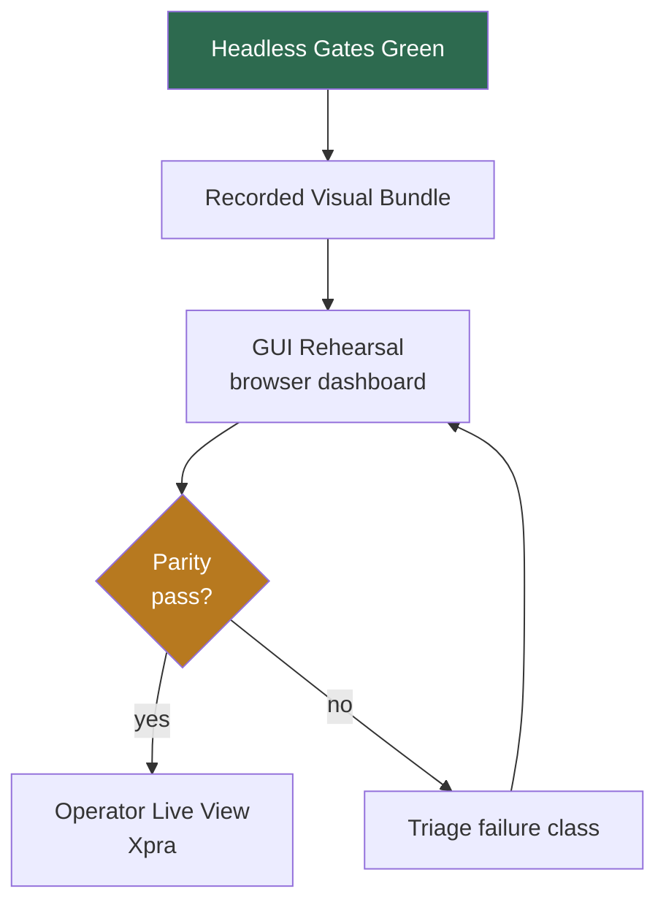
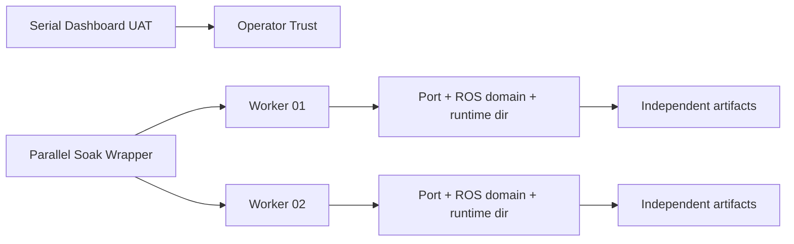

# Active Workflow (Canonical 2026 Rebuild)

## Scope

This is the single source of truth for the rebuilt stack bring-up, UAT execution, and GUI rehearsal sequencing.

## Canonical Runtime Contract

1. `runtime_target`: `robot_fidelity_orin|workstation_balanced|workstation_max`
2. `sim_lane`: `jetty_gate|isaac_fidelity`
3. `inference_backend`: `tensorrt_int8`

Legacy compatibility:

- `robot_fidelity` is accepted as an alias and resolves to `robot_fidelity_orin`.

## Docker Profiles

1. Gate lane (authoritative):
   - `docker compose --profile gate up`
2. Isaac lane (high-fidelity):
   - `docker compose --profile isaac up`
3. UAT orchestrator:
   - `docker compose --profile uat run uat-orchestrator`
4. Telegram wait bridge:
   - `docker compose --profile telegram up -d telegram-daemon`

Windows wrappers:

1. `scripts/run_compose_gate.ps1`
2. `scripts/run_compose_isaac.ps1`
3. `scripts/run_compose_uat.ps1`
4. `scripts/run_telegram_wait_daemon.ps1`

Telegram adjunct tools:

1. `scripts/telegram_preflight.ps1`
2. `scripts/register_telegram_mcp.ps1`

Compose hygiene:

1. Before a new run, stop stale gate projects sharing the same ROS domain:
   - `docker ps --format "table {{.Names}}\t{{.Status}}"`
   - `docker compose -p <stale_project> down --remove-orphans`
2. First-UAT wrapper project naming pattern:
   - `chasecar_gate_firstuat_<timestamp>`
3. Preferred first operator entrypoint performs stale gate cleanup automatically:
   - `scripts/run_first_uat.ps1`

## Telegram Wait Bridge

This is an operator-adjacent service and does not participate in sim/UAT pass-fail.

1. Preflight bot credentials:
   - `powershell -ExecutionPolicy Bypass -File scripts/telegram_preflight.ps1 -CheckBot`
2. Resolve the latest chat id when pairing a new bot/chat:
   - `powershell -ExecutionPolicy Bypass -File scripts/telegram_preflight.ps1 -LatestChatId`
3. Start the daemon:
   - `powershell -ExecutionPolicy Bypass -File scripts/run_telegram_wait_daemon.ps1 -Action up -Build`
4. Register the repo-local MCP entry:
   - `powershell -ExecutionPolicy Bypass -File scripts/register_telegram_mcp.ps1`
5. Operational note:
   - `telegram_send` expects the human to reply directly to the Telegram prompt message so the daemon can match the response.

## First Operator Path

Use this as the default first run on a fresh/recovered machine:

1. `powershell -ExecutionPolicy Bypass -File scripts/run_first_uat.ps1 -ExecutionLane container_kilted -Distro Ubuntu-24.04 -RuntimeTarget robot_fidelity_orin`
2. Runbook details: `docs/FIRST_UAT_RUNBOOK.md`

Key options:

1. `-Distro Ubuntu-24.04`
2. `-ExecutionLane container_kilted|host_ros` (default `container_kilted`)
3. `-RosDistro <name>` (used only when `ExecutionLane=host_ros`)
4. `-RuntimeTarget robot_fidelity_orin`
5. `-ProjectName chasecar_gate_firstuat_manual`
6. `-IncludeVisual true|false` (default `true`)
7. `-StepTimeoutMinutes <n>`
8. `-UatExecutionContext sim_gate|gate_stack|uat_orchestrator` (default `sim_gate`)

First-UAT contract:

1. Coordinate UAT must pass (`summary.json` has `pass=true`).
2. If visual is enabled, milestone 1 evidence bundle must exist.
3. Session outputs are always written to:
   - `artifacts/session/<timestamp>/manifest.json`
   - `artifacts/session/<timestamp>/readiness_report.json`
4. Readiness includes deterministic lane/timeout metadata:
   - `execution_lane`
   - `failure_class`
   - `step_timeout_s`
   - `container_core_ros_distro`
   - `detected_host_ros_distros`

## UAT Orchestrator Modes

Use `scripts/run_compose_uat.ps1 -UatMode <mode>`:

1. `prepare`
2. `coordinate`
3. `snapshot`
4. `orientation`
5. `nav2`
6. `multi_target`
7. `first_uat`
8. `full_replay`
9. `pre_llm`

Machine-readable markers emitted by orchestrator:

1. `STEP_RESULT=<step>:<status>:<artifact>`
2. `ARTIFACT_DIR=<path>`
3. `READINESS_REPORT=<path>`

## Canonical Launch Surfaces

1. `launch/sim_gate.launch.py`
2. `launch/perception_stack.launch.py`
3. `launch/nav_acquire_plan_track.launch.py`
4. `launch/sim_isaac_bridge.launch.py`

## Canonical Detector Runtime

1. Detector script: `ros2_scripts/chasecar_tensorrt_detector.py`
2. Backend: TensorRT INT8 (`inference_backend=tensorrt_int8`)
3. Engine config:
   - `runtime/tensorrt/calibration/calibration_config.yaml`

## Headless UAT Sequence (Container Lane)

1. Host preflight:
   - `scripts/bootstrap_docker_host.ps1`
2. Runtime sync:
   - `scripts/sync_runtime_workspace.ps1 -Distro Ubuntu-24.04 -SkipBuild`
3. Start gate lane:
   - `scripts/run_compose_gate.ps1 -ProjectName chasecar_gate_replay_<timestamp> -Action up -RuntimeTarget robot_fidelity_orin -IncludeNav2Bringup $true -IncludeBridge $false`
4. Run full replay in one containerized session:
   - `scripts/run_compose_uat.ps1 -Action run -ProjectName chasecar_gate_replay_<timestamp> -RuntimeTarget robot_fidelity_orin -UatMode full_replay -UatExecutionContext sim_gate`
   - Full replay uses orchestrator-managed nav2 bridge startup plus deterministic nav2 target spawn during the nav2 stage.
5. Teardown:
   - `scripts/run_compose_gate.ps1 -Action down -ProjectName chasecar_gate_replay_<timestamp> -RuntimeTarget robot_fidelity_orin -IncludeNav2Bringup $true -IncludeBridge $false`
   - `scripts/run_compose_uat.ps1 -Action down -ProjectName chasecar_gate_replay_<timestamp> -RuntimeTarget robot_fidelity_orin`
6. Optional raw sequence (triage mode):
   - `scripts/run_compose_gate.ps1 -Action up -ProjectName <name> -IncludeNav2Bringup $true -IncludeBridge $false`
   - `scripts/run_compose_uat.ps1 -Action run -ProjectName <name> -UatMode coordinate`
   - `scripts/run_compose_uat.ps1 -Action run -ProjectName <name> -UatMode snapshot`
   - `scripts/run_compose_uat.ps1 -Action run -ProjectName <name> -UatMode orientation`
   - `scripts/run_compose_uat.ps1 -Action run -ProjectName <name> -UatMode nav2`
   - `scripts/run_compose_uat.ps1 -Action run -ProjectName <name> -UatMode multi_target`

## Pre-LLM Headless Path (New Canonical Development Push)

Use this to run everything up to LLM planner wiring with conservative timeouts and fast-lane acceleration:

1. `powershell -ExecutionPolicy Bypass -File scripts/run_headless_pre_llm.ps1 -Lane dual`
2. Campaign automation (3x dual + soak + RC package):
   - `powershell -ExecutionPolicy Bypass -File scripts/run_pre_llm_campaign.ps1`
   - Default campaign now includes per-run GUI rehearsal + parity comparison on the same session ID (`-IncludeGuiParity true`).

`Lane` options:

1. `fast`:
   - `workstation_max`
   - fast-forward world (`yolo_test_world_v6_clean_uat_fast.world`)
   - short timeouts for quick iteration
2. `fidelity`:
   - `robot_fidelity_orin`
   - canonical world (`yolo_test_world_v6_clean_uat.world`)
   - stricter timing for authoritative gate confidence
3. `dual`:
   - runs `fast` then `fidelity` in one command

Lane-specific gate config defaults:

1. Fast Nav2 readiness config:
   - `ros2_config/config/nav2_readiness_fast.yaml`
2. Fidelity Nav2 readiness config:
   - `ros2_config/config/nav2_readiness_fidelity.yaml`
3. Fast multi-target config:
   - `ros2_config/config/multi_target_nav2_fast.yaml`
4. Fidelity multi-target config:
   - `ros2_config/config/multi_target_nav2_fidelity.yaml`
5. Fidelity soak multi-target config:
   - `ros2_config/config/multi_target_nav2_fidelity_soak.yaml`

Adversarial must-fail suite (required for truth-lock confidence):

1. `powershell -ExecutionPolicy Bypass -File scripts/run_pre_llm_adversarial.ps1 -RuntimeTarget robot_fidelity_orin`

Pre-LLM stage order (container lane):

Stage list:

1. coordinate gate
2. snapshot verification gate (raw vs debug image distinctness)
3. orientation gate
4. nav2 readiness gate
5. multi-target nav2 gate

Snapshot gate truth checks:

1. captures must succeed on both topics
2. raw/debug frames must not be byte-identical
3. mean absolute diff must meet threshold
4. changed-pixel ratio must meet threshold

Nav2 readiness truth checks include:

1. target distance improvement minimum
2. retained end-of-window progress minimum
3. improvement ratio minimum
4. final distance maximum
5. away-motion ratio maximum
6. negative distance trend slope requirement

Fallback lane (`host_ros`) is non-canonical and for troubleshooting only.

Pre-LLM brain adapter smoke (post-campaign, pre-GUI):

1. `powershell -ExecutionPolicy Bypass -File scripts/run_brain_adapter_smoke.ps1 -RuntimeTarget robot_fidelity_orin`
2. Required output:
   - `artifacts/session/<timestamp>/brain_adapter_smoke_summary.json`
3. Latest validated smoke:
   - `artifacts/session/20260312T001204Z/brain_adapter_smoke_summary.json`
4. Pass intent:
   - frozen contract intents are emitted on `/chasecar/brain/intent`
   - low-level boundary checks pass for detection/odom/action/service readiness

Deterministic planner shell (first post-freeze integration smoke):

1. `powershell -ExecutionPolicy Bypass -File scripts/run_brain_intent_shell.ps1 -RuntimeTarget robot_fidelity_orin`
2. Required output:
   - `artifacts/session/<timestamp>/brain_intent_shell_summary.json`
3. Latest validated shell:
   - `artifacts/session/20260312T001244Z/brain_intent_shell_summary.json`
4. Pass intent:
   - emits `acquire_target -> plan_to_target -> track_target -> safe_stop`
   - verifies boundary feedback without changing low-level autonomy code paths

## Visual UAT Sequence

Run only after headless gates are green and on the same session ID.

Authoritative visual surfaces:

1. Recorded bundle first:
   - `powershell -ExecutionPolicy Bypass -File scripts/run_recorded_visual_demo.ps1 -Milestone 3 -RuntimeTarget robot_fidelity_orin -SessionId <session_id>`
2. Dashboard control/status plus separate Xpra live view:
   - Open the dashboard for control/status.
   - Use the `Open Xpra` link for the live operator view.
   - Keep the browser-dashboard wrapper for validation and recorded parity.
3. Native Gazebo/X11 is debug-only and non-promoting.
4. The browser world pane remains available as a legacy/debug fallback from the world camera sensor, but Xpra is the recommended live operator surface.

Canonical sequence:

1. Single-target M3 live view first:
   - Open the dashboard and launch Xpra from the `Open Xpra` link.
   - Keep the dashboard open for control/status during the live review.
2. Multi-target GUI rehearsal (same-session parity check is mandatory):
   - `scripts/run_pre_llm_gui_rehearsal.ps1 -ExecutionLane container_kilted -CoreRosDistro kilted -RuntimeTarget robot_fidelity_orin -SessionId <session_id> -HeadlessSummaryPath artifacts/session/<session_id>/pre_llm_headless_summary.json -OpenFeedViewers false -VisualSurface browser_dashboard -WorldSurface streamed_sim`
3. Operator live-view replay of the same multi-target session (only after parity is green):
   - `scripts/run_pre_llm_gui_rehearsal.ps1 -ExecutionLane container_kilted -CoreRosDistro kilted -RuntimeTarget robot_fidelity_orin -SessionId <session_id> -HeadlessSummaryPath artifacts/session/<session_id>/pre_llm_headless_summary.json -OpenFeedViewers true -VisualSurface browser_dashboard -WorldSurface streamed_sim -AutoOpenVisualSurface true`
   - Current strict behavior: if browser dashboard or visual bundle readiness is unavailable, this run fails closed.
   - The browser wrapper remains validation tooling; use Xpra for the live visual session.
4. Dashboard operator strip now exposes:
   - `phase`
   - `target_id`
   - `target_transition_active`
   Use this to distinguish expected target transitions from faults during multi-target rehearsal.

Parity gate:

1. `artifacts/session/<session_id>/parity_summary.json` must exist and `pass=true`.
2. Required checks: lane match, core ROS match, detection pipeline alive in both, `/yolo/ball_position_3d` active in both, nav action readiness in both, motion evidence in both, same-session recorded visual bundle ready, browser dashboard ready, streamed sim world ready, truth alignment OK.
3. `host_ros` GUI runs are debug-only and cannot promote readiness.

## Route-Planning Parallel Soak

Use this only for non-interactive repeatability throughput. The browser dashboard remains the serial operator proof path.

Command:

1. `powershell -ExecutionPolicy Bypass -File scripts/run_route_planning_parallel_soak.ps1 -Workers 2 -RunsPerWorker 1`

Isolation contract:

Worker rules:

1. each worker runs its own `dashboard_service.py` instance on a unique localhost port
2. each worker uses a unique `ROS_DOMAIN_ID`
3. each worker gets its own `runtime/dashboard_parallel/<campaign_id>/worker_##/` state files
4. each worker launches a separate compose project/session and tears it down at the end
5. promotion evidence comes from `route_planning_parallel_soak/campaign_summary.json`, not from dashboard clicks

## Headless Milestone Path (Current Preferred)

Use this while iterating before operator-facing GUI rehearsal:

1. `scripts/run_milestone_demo.ps1 -Milestone 2 -RuntimeTarget robot_fidelity_orin -WorldFile yolo_test_world_v6_clean_uat.world -WorldName yolo_test_world -EnsureDemoTarget -MaxRunSeconds 90`
2. `scripts/run_milestone_demo.ps1 -Milestone 3 -RuntimeTarget robot_fidelity_orin -WorldFile yolo_test_world_v6_clean_uat.world -WorldName yolo_test_world -EnsureDemoTarget -MaxRunSeconds 150`

M3 contract knobs:

1. `-RequireMotion` (default true for M3)
2. `-MotionMinDistanceMeters` (default `0.40`)
3. `-MotionWindowSeconds` (default `90`)
4. `-RequireNav2ActionServer` (default true for M3)

Milestone 1 pass criteria include:

1. deterministic target spawn succeeded
2. debug image capture succeeded
3. confidence sample from `/yolo/confidence` met threshold (`>= 0.50` default)
4. `/world/<name>/create` service became available before spawn
5. debug image differs from raw image evidence when confidence gate is met
6. non-headless feed viewers are alive when `-OpenFeedViewers $true`

Milestone 2 pass criteria include:

1. detector + extractor running
2. `/yolo/ball_position_3d` active
3. overlay distinctness maintained when confidence gate passes

Milestone 3 pass criteria include:

1. nav2 action server ready (`/navigate_to_pose`, `Action servers: 1`)
2. odom displacement meets threshold (`>= MotionMinDistanceMeters`)
3. target distance improves by at least `MotionTargetProgressMinMeters`
4. cmd_vel/nav activity is recorded as a diagnostic signal (not sole pass criterion)

## Artifact Contracts

1. Coordinate:
   - `artifacts/uat/<timestamp>/detections.csv`
   - `artifacts/uat/<timestamp>/summary.json`
2. Orientation:
   - `artifacts/orientation/<timestamp>/orientation_samples.csv`
   - `artifacts/orientation/<timestamp>/orientation_summary.json`
   - `artifacts/orientation/<timestamp>/snapshots/*.png`
3. Snapshot verification:
   - `artifacts/snapshots/<timestamp>/d415_color.png`
   - `artifacts/snapshots/<timestamp>/yolo_debug.png`
   - `artifacts/snapshots/<timestamp>/image_diff.json`
   - `artifacts/snapshots/<timestamp>/snapshot_summary.json`
4. Nav2:
   - `artifacts/nav2/<timestamp>/nav_summary.json`
   - `artifacts/nav2/<timestamp>/distance_samples.csv`
5. Multi-target Nav2:
   - `artifacts/nav2_multi/<timestamp>/multi_target_samples.csv`
   - `artifacts/nav2_multi/<timestamp>/multi_target_summary.json`
6. Session:
   - `artifacts/session/<timestamp>/manifest.json`
   - `artifacts/session/<timestamp>/readiness_report.json`
7. Headless pre-LLM summary:
   - `artifacts/session/<timestamp>/pre_llm_headless_summary.json`
8. Campaign + RC package:
   - `artifacts/session/<timestamp>/pre_llm_campaign_trend.json`
   - `artifacts/session/<timestamp>/campaign_run_summary.json`
   - `artifacts/session/<timestamp>/rc/manifest.json`
   - `artifacts/session/<timestamp>/rc/readiness_report.json`
9. Milestone 1 visual evidence:
   - `artifacts/demos/milestone_1_<timestamp>/operator_checklist.json`
   - `artifacts/demos/milestone_1_<timestamp>/screenshots/*.png`
   - `artifacts/demos/milestone_1_<timestamp>/demo_summary.json`
   - `demo_summary.json` includes `capture.detection_confidence*` and `demo_target.*`
10. Milestone 2/3 demo evidence:
   - `artifacts/demos/milestone_<2|3>_<timestamp>/demo_summary.json`
   - `demo_summary.json` includes:
     - `nav2.action_server_ready`
     - `motion.cmd_vel_message_count`
     - `motion.odom_start`
     - `motion.odom_end`
     - `motion.odom_displacement_m`
     - `motion.pass`
11. GUI rehearsal + parity:
   - `artifacts/session/<timestamp>/pre_llm_gui_rehearsal_summary.json`
   - `artifacts/session/<timestamp>/parity_summary.json`
12. Recorded/browser visual bundle:
   - `artifacts/session/<timestamp>/visual/raw_camera.mp4`
   - `artifacts/session/<timestamp>/visual/yolo_debug.mp4`
   - `artifacts/session/<timestamp>/visual/topdown_telemetry.mp4`
   - `artifacts/session/<timestamp>/visual/keyframes/*.png`
   - `artifacts/session/<timestamp>/visual/timeline.json`
   - `artifacts/session/<timestamp>/visual/state.json`
   - `artifacts/session/<timestamp>/visual/visual_demo_summary.json`
13. Route-planning parallel soak:
   - `artifacts/session/<campaign_id>/route_planning_parallel_soak/campaign_summary.json`
   - `artifacts/session/<campaign_id>/route_planning_parallel_soak/workers/worker_##/dashboard_service.log`
   - `artifacts/session/<campaign_id>/route_planning_parallel_soak/workers/worker_##/repeatability.log`

## Failure Triage Path

1. `S0` fail in first-UAT:
   - Validate Docker daemon and rerun.
2. `S1` fail:
   - Inspect `artifacts/session/<ts>/logs/run_first_uat.log` for compose bring-up failures.
3. `S2` fail with `threshold_failed`:
   - Review `artifacts/uat/<ts>/summary.json` for gate metrics.
4. `S2` fail with `service_unavailable`:
   - Check `/world/<world>/create` readiness in coordinate logs and rerun from a clean project.
5. `S2` fail with `timeout`:
   - Increase `-StepTimeoutMinutes` and rerun from a clean compose project.
6. `S3` blocked:
   - Expected when coordinate gate fails.
7. `S4` fail:
   - Run both down commands manually for the project (`run_compose_gate.ps1` and `run_compose_uat.ps1`).
8. Visual demo shows duplicate balls:
   - Use clean UAT world with `-EnsureDemoTarget`; avoid manual ad-hoc spawns.
9. Visual demo raw/debug windows look identical:
   - Check `demo_summary.json -> capture.detection_above_threshold`; if false, detector has no valid target yet.
10. Visual demo shows sim only with no camera windows:
   - Prefer `-VisualSurface browser_dashboard` and inspect `demo_summary.json -> visual.*`.
   - Native X11/Gazebo windows are debug-only and not part of the promotion path.
11. M3 fails with motion gate false:
   - Check `demo_summary.json -> motion.*` and `operator_checklist.json`.
   - If `cmd_vel_message_count=0`, inspect `logs/bridge.log` and `logs/cmd_vel_relay.log`.
   - If `odom_seen=false`, verify odometry bridge topics in sim launch and rerun from a clean session.

## Interface Contracts

1. Isaac bridge allowlist:
   - `runtime/contracts/isaac_bridge_allowlist.yaml`
2. Message schema manifest:
   - `runtime/contracts/message_schema_manifest.yaml`
3. LLM pre-integration control contract:
   - `runtime/contracts/llm_control_contract.yaml`

## Compatibility Entry Points

Preferred:

1. `scripts/run_chasecar_stack.ps1`
2. `scripts/run_chasecar_coordinate_uat.ps1`

Compatibility wrappers:

1. `scripts/run_chasebot_stack_compat.ps1`
2. `scripts/run_chasebot_coordinate_uat_compat.ps1`

## Notes

1. Gazebo Classic is non-canonical and not used in rebuilt promotion gates.
2. Kilted is primary; Lyrical compatibility runs in CI.
3. Isaac runs behind a Jazzy bridge sidecar contract until native Kilted support is validated.
4. `ros2 action list` includes action clients; validate server availability with `ros2 action info /navigate_to_pose` and check `Action servers: 1`.
