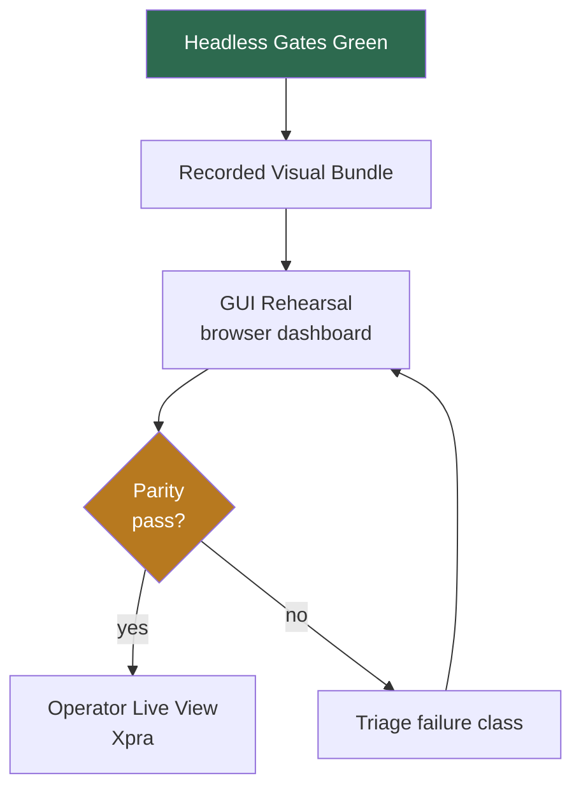
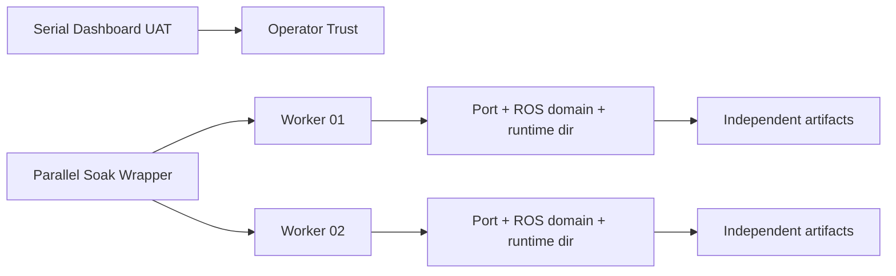

# Active Workflow (Canonical 2026 Rebuild)

## Scope

This is the single source of truth for the rebuilt stack bring-up, UAT execution, and GUI rehearsal sequencing.

## Canonical Runtime Contract

1. `runtime_target`: `robot_fidelity_orin|workstation_balanced|workstation_max`
2. `sim_lane`: `jetty_gate|isaac_fidelity`
3. `inference_backend`: `tensorrt_int8`

Legacy compatibility:

- `robot_fidelity` is accepted as an alias and resolves to `robot_fidelity_orin`.

## Docker Profiles

1. Gate lane (authoritative):
   - `docker compose --profile gate up`
2. Isaac lane (high-fidelity):
   - `docker compose --profile isaac up`
3. UAT orchestrator:
   - `docker compose --profile uat run uat-orchestrator`
4. Telegram wait bridge:
   - Use the global bridge at `D:\services\codex-telegram`; Chasecar-local
     bridge scripts are retained only for recovery/reference.

Windows wrappers:

1. `scripts/run_compose_gate.ps1`
2. `scripts/run_compose_isaac.ps1`
3. `scripts/run_compose_uat.ps1`
4. `scripts/run_telegram_wait_daemon.ps1`

Telegram adjunct tools:

1. `D:\services\codex-telegram\scripts\verify-global.ps1`
2. `D:\services\codex-telegram\scripts\serve-mcp.ps1`

Compose hygiene:

1. Before a new run, stop stale gate projects sharing the same ROS domain:
   - `docker ps --format "table {{.Names}}\t{{.Status}}"`
   - `docker compose -p <stale_project> down --remove-orphans`
2. First-UAT wrapper project naming pattern:
   - `chasecar_gate_firstuat_<timestamp>`
3. Preferred first operator entrypoint performs stale gate cleanup automatically:
   - `scripts/run_first_uat.ps1`

## Telegram Wait Bridge

This is an operator-adjacent service and does not participate in sim/UAT pass-fail.

1. Verify bot credentials, daemon health, and MCP registration:
   - `powershell -ExecutionPolicy Bypass -File D:\services\codex-telegram\scripts\verify-global.ps1`
2. Register/repair global Codex and Claude MCP config:
   - `powershell -ExecutionPolicy Bypass -File D:\services\codex-telegram\scripts\install-global.ps1`
3. Operational note:
   - `telegram_send` expects the human to reply directly to the Telegram prompt message so the daemon can match the response.
4. MCP runtime note:
   - Existing sessions that report `Transport closed` need a session restart after global verification passes.

## First Operator Path

Use this as the default first run on a fresh/recovered machine:

1. `powershell -ExecutionPolicy Bypass -File scripts/run_first_uat.ps1 -ExecutionLane container_kilted -Distro Ubuntu-24.04 -RuntimeTarget robot_fidelity_orin`
2. Runbook details: `docs/FIRST_UAT_RUNBOOK.md`

Key options:

1. `-Distro Ubuntu-24.04`
2. `-ExecutionLane container_kilted|host_ros` (default `container_kilted`)
3. `-RosDistro <name>` (used only when `ExecutionLane=host_ros`)
4. `-RuntimeTarget robot_fidelity_orin`
5. `-ProjectName chasecar_gate_firstuat_manual`
6. `-IncludeVisual true|false` (default `true`)
7. `-StepTimeoutMinutes <n>`
8. `-UatExecutionContext sim_gate|gate_stack|uat_orchestrator` (default `sim_gate`)

First-UAT contract:

1. Coordinate UAT must pass (`summary.json` has `pass=true`).
2. If visual is enabled, milestone 1 evidence bundle must exist.
3. Session outputs are always written to:
   - `artifacts/session/<timestamp>/manifest.json`
   - `artifacts/session/<timestamp>/readiness_report.json`
4. Readiness includes deterministic lane/timeout metadata:
   - `execution_lane`
   - `failure_class`
   - `step_timeout_s`
   - `container_core_ros_distro`
   - `detected_host_ros_distros`

## UAT Orchestrator Modes

Use `scripts/run_compose_uat.ps1 -UatMode <mode>`:

1. `prepare`
2. `coordinate`
3. `snapshot`
4. `orientation`
5. `nav2`
6. `multi_target`
7. `first_uat`
8. `full_replay`
9. `pre_llm`

Machine-readable markers emitted by orchestrator:

1. `STEP_RESULT=<step>:<status>:<artifact>`
2. `ARTIFACT_DIR=<path>`
3. `READINESS_REPORT=<path>`

## Canonical Launch Surfaces

1. `launch/sim_gate.launch.py`
2. `launch/perception_stack.launch.py`
3. `launch/nav_acquire_plan_track.launch.py`
4. `launch/sim_isaac_bridge.launch.py`

## Canonical Detector Runtime

1. Detector script: `ros2_scripts/chasecar_tensorrt_detector.py`
2. Backend: TensorRT INT8 (`inference_backend=tensorrt_int8`)
3. Engine config:
   - `runtime/tensorrt/calibration/calibration_config.yaml`

## Headless UAT Sequence (Container Lane)

1. Host preflight:
   - `scripts/bootstrap_docker_host.ps1`
2. Runtime sync:
   - `scripts/sync_runtime_workspace.ps1 -Distro Ubuntu-24.04 -SkipBuild`
3. Start gate lane:
   - `scripts/run_compose_gate.ps1 -ProjectName chasecar_gate_replay_<timestamp> -Action up -RuntimeTarget robot_fidelity_orin -IncludeNav2Bringup $true -IncludeBridge $false`
4. Run full replay in one containerized session:
   - `scripts/run_compose_uat.ps1 -Action run -ProjectName chasecar_gate_replay_<timestamp> -RuntimeTarget robot_fidelity_orin -UatMode full_replay -UatExecutionContext sim_gate`
   - Full replay uses orchestrator-managed nav2 bridge startup plus deterministic nav2 target spawn during the nav2 stage.
5. Teardown:
   - `scripts/run_compose_gate.ps1 -Action down -ProjectName chasecar_gate_replay_<timestamp> -RuntimeTarget robot_fidelity_orin -IncludeNav2Bringup $true -IncludeBridge $false`
   - `scripts/run_compose_uat.ps1 -Action down -ProjectName chasecar_gate_replay_<timestamp> -RuntimeTarget robot_fidelity_orin`
6. Optional raw sequence (triage mode):
   - `scripts/run_compose_gate.ps1 -Action up -ProjectName <name> -IncludeNav2Bringup $true -IncludeBridge $false`
   - `scripts/run_compose_uat.ps1 -Action run -ProjectName <name> -UatMode coordinate`
   - `scripts/run_compose_uat.ps1 -Action run -ProjectName <name> -UatMode snapshot`
   - `scripts/run_compose_uat.ps1 -Action run -ProjectName <name> -UatMode orientation`
   - `scripts/run_compose_uat.ps1 -Action run -ProjectName <name> -UatMode nav2`
   - `scripts/run_compose_uat.ps1 -Action run -ProjectName <name> -UatMode multi_target`

## Pre-LLM Headless Path (New Canonical Development Push)

Use this to run everything up to LLM planner wiring with conservative timeouts and fast-lane acceleration:

1. `powershell -ExecutionPolicy Bypass -File scripts/run_headless_pre_llm.ps1 -Lane dual`
2. Campaign automation (3x dual + soak + RC package):
   - `powershell -ExecutionPolicy Bypass -File scripts/run_pre_llm_campaign.ps1`
   - Default campaign now includes per-run GUI rehearsal + parity comparison on the same session ID (`-IncludeGuiParity true`).

`Lane` options:

1. `fast`:
   - `workstation_max`
   - fast-forward world (`yolo_test_world_v6_clean_uat_fast.world`)
   - short timeouts for quick iteration
2. `fidelity`:
   - `robot_fidelity_orin`
   - canonical world (`yolo_test_world_v6_clean_uat.world`)
   - stricter timing for authoritative gate confidence
3. `dual`:
   - runs `fast` then `fidelity` in one command

Lane-specific gate config defaults:

1. Fast Nav2 readiness config:
   - `ros2_config/config/nav2_readiness_fast.yaml`
2. Fidelity Nav2 readiness config:
   - `ros2_config/config/nav2_readiness_fidelity.yaml`
3. Fast multi-target config:
   - `ros2_config/config/multi_target_nav2_fast.yaml`
4. Fidelity multi-target config:
   - `ros2_config/config/multi_target_nav2_fidelity.yaml`
5. Fidelity soak multi-target config:
   - `ros2_config/config/multi_target_nav2_fidelity_soak.yaml`

Adversarial must-fail suite (required for truth-lock confidence):

1. `powershell -ExecutionPolicy Bypass -File scripts/run_pre_llm_adversarial.ps1 -RuntimeTarget robot_fidelity_orin`

Pre-LLM stage order (container lane):

Stage list:

1. coordinate gate
2. snapshot verification gate (raw vs debug image distinctness)
3. orientation gate
4. nav2 readiness gate
5. multi-target nav2 gate

Snapshot gate truth checks:

1. captures must succeed on both topics
2. raw/debug frames must not be byte-identical
3. mean absolute diff must meet threshold
4. changed-pixel ratio must meet threshold

Nav2 readiness truth checks include:

1. target distance improvement minimum
2. retained end-of-window progress minimum
3. improvement ratio minimum
4. final distance maximum
5. away-motion ratio maximum
6. negative distance trend slope requirement

Fallback lane (`host_ros`) is non-canonical and for troubleshooting only.

Pre-LLM brain adapter smoke (post-campaign, pre-GUI):

1. `powershell -ExecutionPolicy Bypass -File scripts/run_brain_adapter_smoke.ps1 -RuntimeTarget robot_fidelity_orin`
2. Required output:
   - `artifacts/session/<timestamp>/brain_adapter_smoke_summary.json`
3. Latest validated smoke:
   - `artifacts/session/20260312T001204Z/brain_adapter_smoke_summary.json`
4. Pass intent:
   - frozen contract intents are emitted on `/chasecar/brain/intent`
   - low-level boundary checks pass for detection/odom/action/service readiness

Deterministic planner shell (first post-freeze integration smoke):

1. `powershell -ExecutionPolicy Bypass -File scripts/run_brain_intent_shell.ps1 -RuntimeTarget robot_fidelity_orin`
2. Required output:
   - `artifacts/session/<timestamp>/brain_intent_shell_summary.json`
3. Latest validated shell:
   - `artifacts/session/20260312T001244Z/brain_intent_shell_summary.json`
4. Pass intent:
   - emits `acquire_target -> plan_to_target -> track_target -> safe_stop`
   - verifies boundary feedback without changing low-level autonomy code paths

## Visual UAT Sequence

Run only after headless gates are green and on the same session ID.

Authoritative visual surfaces:

1. Recorded bundle first:
   - `powershell -ExecutionPolicy Bypass -File scripts/run_recorded_visual_demo.ps1 -Milestone 3 -RuntimeTarget robot_fidelity_orin -SessionId <session_id>`
2. Dashboard control/status plus separate Xpra live view:
   - Open the dashboard for control/status.
   - Use the `Open Xpra` link for the live operator view.
   - Keep the browser-dashboard wrapper for validation and recorded parity.
3. Native Gazebo/X11 is debug-only and non-promoting.
4. The browser world pane remains available as a legacy/debug fallback from the world camera sensor, but Xpra is the recommended live operator surface.

Canonical sequence:

1. Single-target M3 live view first:
   - Open the dashboard and launch Xpra from the `Open Xpra` link.
   - Keep the dashboard open for control/status during the live review.
2. Multi-target GUI rehearsal (same-session parity check is mandatory):
   - `scripts/run_pre_llm_gui_rehearsal.ps1 -ExecutionLane container_kilted -CoreRosDistro kilted -RuntimeTarget robot_fidelity_orin -SessionId <session_id> -HeadlessSummaryPath artifacts/session/<session_id>/pre_llm_headless_summary.json -OpenFeedViewers false -VisualSurface browser_dashboard -WorldSurface streamed_sim`
3. Operator live-view replay of the same multi-target session (only after parity is green):
   - `scripts/run_pre_llm_gui_rehearsal.ps1 -ExecutionLane container_kilted -CoreRosDistro kilted -RuntimeTarget robot_fidelity_orin -SessionId <session_id> -HeadlessSummaryPath artifacts/session/<session_id>/pre_llm_headless_summary.json -OpenFeedViewers true -VisualSurface browser_dashboard -WorldSurface streamed_sim -AutoOpenVisualSurface true`
   - Current strict behavior: if browser dashboard or visual bundle readiness is unavailable, this run fails closed.
   - The browser wrapper remains validation tooling; use Xpra for the live visual session.
4. Dashboard operator strip now exposes:
   - `phase`
   - `target_id`
   - `target_transition_active`
   Use this to distinguish expected target transitions from faults during multi-target rehearsal.

Parity gate:

1. `artifacts/session/<session_id>/parity_summary.json` must exist and `pass=true`.
2. Required checks: lane match, core ROS match, detection pipeline alive in both, `/yolo/ball_position_3d` active in both, nav action readiness in both, motion evidence in both, same-session recorded visual bundle ready, browser dashboard ready, streamed sim world ready, truth alignment OK.
3. `host_ros` GUI runs are debug-only and cannot promote readiness.

## Route-Planning Parallel Soak

Use this only for non-interactive repeatability throughput. The browser dashboard remains the serial operator proof path.

Command:

1. `powershell -ExecutionPolicy Bypass -File scripts/run_route_planning_parallel_soak.ps1 -Workers 2 -RunsPerWorker 1`

Isolation contract:

Worker rules:

1. each worker runs its own `dashboard_service.py` instance on a unique localhost port
2. each worker uses a unique `ROS_DOMAIN_ID`
3. each worker gets its own `runtime/dashboard_parallel/<campaign_id>/worker_##/` state files
4. each worker launches a separate compose project/session and tears it down at the end
5. promotion evidence comes from `route_planning_parallel_soak/campaign_summary.json`, not from dashboard clicks

## Corral Surface Calibration

Use this to compare one-ball corral behavior across the three surface lanes without changing the operator-facing dashboard flow.

Command:

1. `powershell -ExecutionPolicy Bypass -File scripts/run_corral_surface_calibration.ps1 -RunsPerLane 3`

Calibration contract:

1. runs exactly three lanes through the existing one-ball repeatability flow:
   - `baseline`
   - `short_turf`
   - `short_grass`
2. respects the existing scenario/runtime seam:
   - `WORLD_FILE`
   - `CHASECAR_SURFACE_PROFILE`
3. emits a lane comparison summary plus a human-readable scorecard
4. does not promote the operator lane by itself; dashboard promotion still requires a separate one-ball sanity run on the chosen lane

## Gather Goal-Side Matrix (Offline Gate)

Use this headless harness as the first regression gate for the deterministic gather-manager gather slice on short turf before any dashboard UAT promotion.

Command:

1. `powershell -ExecutionPolicy Bypass -File scripts/run_gather_goal_side_matrix.ps1 -MaxRetriesPerTarget 2`
2. blocked ROS-native branch rerun, only if intentionally diagnosing or requalifying it: `powershell -ExecutionPolicy Bypass -File scripts/run_gather_goal_side_matrix.ps1 -GatherControlFamily nav2_reacquire_v1 -MaxRetriesPerTarget 2`
3. failed-branch rerun, only if intentionally requalifying it: `powershell -ExecutionPolicy Bypass -File scripts/run_gather_goal_side_matrix.ps1 -GatherControlFamily region_funnel_v1 -MaxRetriesPerTarget 2`
4. blocked constrained-local branch rerun, only if intentionally diagnosing or requalifying it: `powershell -ExecutionPolicy Bypass -File scripts/run_gather_goal_side_matrix.ps1 -GatherControlFamily constrained_local_planner_v1 -MaxRetriesPerTarget 2`
5. blocked docking-style branch rerun, only if intentionally diagnosing or requalifying it: `powershell -ExecutionPolicy Bypass -File scripts/run_gather_goal_side_matrix.ps1 -GatherControlFamily docking_reacquire_v1 -MaxRetriesPerTarget 2`
6. blocked handoff-yaw branch rerun, only if intentionally diagnosing or requalifying it: `powershell -ExecutionPolicy Bypass -File scripts/run_gather_goal_side_matrix.ps1 -GatherControlFamily handoff_yaw_servo_v1 -MaxRetriesPerTarget 2`
7. blocked pre-stage FSM branch rerun, only if intentionally diagnosing or requalifying it: `powershell -ExecutionPolicy Bypass -File scripts/run_gather_goal_side_matrix.ps1 -GatherControlFamily pre_stage_reacquire_fsm_v1 -RunsPerCase 1 -MaxRetriesPerTarget 2`
8. blocked path-tracker branch rerun, only if intentionally diagnosing or requalifying it: `powershell -ExecutionPolicy Bypass -File scripts/run_gather_goal_side_matrix.ps1 -GatherControlFamily pre_stage_path_tracker_v1 -RunsPerCase 1 -MaxRetriesPerTarget 2`
9. blocked trajectory-owner branch rerun, only if intentionally diagnosing or requalifying it: `powershell -ExecutionPolicy Bypass -File scripts/run_gather_goal_side_matrix.ps1 -GatherControlFamily pre_stage_trajectory_owner_v1 -RunsPerCase 1 -MaxRetriesPerTarget 2`
10. blocked lower-stack FollowPath branch rerun, only if intentionally diagnosing or requalifying it: `powershell -ExecutionPolicy Bypass -File scripts/run_gather_goal_side_matrix.ps1 -GatherControlFamily nav2_follow_path_reacquire_v1 -RunsPerCase 1 -MaxRetriesPerTarget 2`
11. blocked lower-stack MPPI FollowPath branch rerun, only if intentionally diagnosing or requalifying it: `powershell -ExecutionPolicy Bypass -File scripts/run_gather_goal_side_matrix.ps1 -GatherControlFamily nav2_mppi_follow_path_reacquire_v1 -RunsPerCase 1 -MaxRetriesPerTarget 2`

Matrix contract:

1. runs `corral_single_ball_place` in direct repeatability mode
2. treats the named cases as a coverage and regression harness, not the design target for gather tuning
3. uses `short_turf` and the current 10-foot multi-ball arc layout (`3.048 m` from corral center) with primary placements at `+45`, `0`, and `-45`; the `180 backside` case stays as a guard case
4. forwards direct-mode overrides through `gather_mission_repeatability_runner.py` into `gather_mission_runner.py`, including `--max-retries-per-target` from wrapper `-MaxRetriesPerTarget` and `--gather-control-family <family>`; the wrapper defaults `-GatherControlFamily baseline` and `-MaxRetriesPerTarget 2` to preserve existing behavior
5. keeps `gather_manager_helpers.py` as the bounded phase owner for `pre_stage -> stage -> capture_entry -> capture`, while `gather_mission_helpers.py` retains the baseline local steering controllers
6. uses `gather_short_horizon_helpers.py` only for the experimental `short_horizon_v1` and `short_horizon_v2` families, and only for early `pre_stage` goal-side escape / behind-ball repositioning before the baseline late handoff logic resumes
7. treats `region_funnel_v1` as a failed experimental branch after `artifacts/session/live_region_funnel_v1_zero_repair_20260424/gather_goal_side_matrix/campaign_summary.json`; do not use it in portfolio/stress comparison until a repaired branch shows fresh-attempt `zero` and `plus45` pre-stage handoff passes
8. treats `nav2_reacquire_v1` as a blocked experimental ROS-native branch after `artifacts/session/live_nav2_reacquire_v1_matrix_smoke_20260424/gather_goal_side_matrix/campaign_summary.json`; it may dispatch bounded `/navigate_to_pose` goals only during `pre_stage`, then baseline `stage -> capture_entry -> capture` must resume
9. keeps `nav2_reacquire_v1` out of portfolio/stress comparison until a repaired branch shows fresh one-run `zero` and `plus45` matrix attempts both clear pre-stage handoff
10. treats `constrained_local_planner_v1` as a blocked experimental local-planner branch after `artifacts/session/live_constrained_local_planner_v1_matrix_smoke_20260425/gather_goal_side_matrix/campaign_summary.json`; it uses bounded local rollouts and ball-clearance rejection, then releases back to baseline pre-stage/stage control
11. keeps `constrained_local_planner_v1` out of portfolio/stress comparison until a repaired branch shows fresh one-run `zero` and `plus45` matrix attempts both clear pre-stage handoff without pre-stage ball drift/contact
12. treats `docking_reacquire_v1` as a blocked experimental deterministic docking-style pre-stage branch after `artifacts/session/live_docking_reacquire_v1_release_fix_matrix_smoke_20260425/gather_goal_side_matrix/campaign_summary.json`; it computes a safe off-axis docking pocket, applies bounded local pose-servo commands during `pre_stage`, and releases to baseline only after measured geometry enters the strict baseline-ready envelope
13. keeps `docking_reacquire_v1` out of portfolio/stress comparison until a repaired branch shows fresh one-run `zero` and `plus45` matrix attempts both clear pre-stage handoff without pre-stage ball drift/contact
14. treats `handoff_yaw_servo_v1` as a blocked experimental last-mile pre-stage handoff branch after `artifacts/session/live_handoff_yaw_servo_v1_matrix_smoke_20260426/gather_goal_side_matrix/campaign_summary.json`; it emits yaw-only manual-drive commands during `pre_stage` only when measured behind-ball geometry is safe except yaw, and otherwise releases/guards back to baseline without moving forward
15. keeps `handoff_yaw_servo_v1` out of portfolio/stress comparison until a repaired branch shows fresh one-run `zero` and `plus45` matrix attempts both clear pre-stage handoff without pre-stage ball drift/contact
16. treats `pre_stage_reacquire_fsm_v1` as a blocked experimental first-attempt pre-stage branch after `artifacts/session/live_pre_stage_reacquire_fsm_v1_matrix_smoke_20260426/gather_goal_side_matrix/campaign_summary.json`; it combines measured-state `goal_side_escape`, `dock_entry`, `dock_port`, `yaw_align`, and `baseline_release` phases, emits additive FSM debug fields in `state_history.jsonl`, and remains out of portfolio/stress comparison until a repaired branch shows fresh one-run `zero` and `plus45` matrix attempts both clear pre-stage handoff without pre-stage ball drift/contact
17. treats `pre_stage_path_tracker_v1` as a blocked experimental first-attempt pre-stage branch after `artifacts/session/live_pre_stage_path_tracker_v1_matrix_smoke_20260426/gather_goal_side_matrix/campaign_summary.json`; it owns `pre_stage` as a measured SE(2) waypoint path tracker, emits additive path-tracker debug fields in `state_history.jsonl`, and remains out of portfolio/stress comparison until a larger repaired control-stack branch shows fresh one-run `zero` and `plus45` matrix attempts both clear pre-stage handoff without pre-stage ball drift/contact
18. treats `pre_stage_trajectory_owner_v1` as a blocked experimental first-attempt pre-stage branch after `artifacts/session/live_pre_stage_trajectory_owner_v1_matrix_smoke_20260427/gather_goal_side_matrix/campaign_summary.json`; it owns the measured pre-stage trajectory through `escape_clear`, `corridor_approach`, `port`, and `handoff_yaw`, emits additive trajectory-owner debug fields in `state_history.jsonl`, and remains out of portfolio/stress comparison
19. treats `nav2_follow_path_reacquire_v1` as a blocked lower-stack pre-stage experiment after `artifacts/session/live_nav2_follow_path_reacquire_v1_matrix_smoke_20260427/gather_goal_side_matrix/campaign_summary.json`; it built an explicit odom-frame path through `escape_clear`, `corridor_approach`, `port`, and `handoff_yaw`, dispatched `/follow_path` with `controller_id=FollowPath` and `goal_checker_id=general_goal_checker`, disabled manual drive while Nav2 owned the path, and accepted only measured pre-stage handoff dwell
20. keeps `nav2_follow_path_reacquire_v1` out of portfolio/stress ingestion; fresh `zero` and `plus45` accepted FollowPath goals but aborted immediately with no measured handoff and no pre-stage ball drift/contact
21. treats `nav2_mppi_follow_path_reacquire_v1` as a blocked lower-stack pre-stage controller-plugin branch; it dispatches `/follow_path` with `controller_id=MppiFollowPath`, uses the same measured handoff dwell acceptance, and sends a start-anchored dense odom-frame path with tangent headings through `escape_clear`, `corridor_approach`, `port`, and `handoff_yaw`
22. keeps `nav2_mppi_follow_path_reacquire_v1` out of portfolio/stress ingestion; the May 3 research reset `artifacts/session/live_nav2_mppi_follow_path_reacquire_v1_research_reset_20260503/research_reset_summary.json` showed both `8dfe93b` and `eafdc59` fail saved-layout `zero`, loaded runtime params match `nav2_params_simple.yaml`, and the first near-goal critic/pruning patch worsened progress before being reverted
23. treats the May 3 terminal-geometry live audit as the latest MPPI primary-case evidence: removing the extra MPPI-only `handoff_align` waypoint recovered saved-layout `zero` pre-stage handoff 1/1 and then 3/3, and saved-layout `plus45` pre-stage handoff 3/3, all with `STATUS_SUCCEEDED`, `0.0m` pre-stage ball motion, and no `handoff_align` path segment; audit summary: `artifacts/session/live_nav2_mppi_follow_path_reacquire_v1_terminal_geometry_live_audit_20260503/gather_follow_path_research_analyzer/follow_path_research_summary.json`
24. keeps MPPI work blocked downstream rather than promotion-ready: `zero` now fails at `capture_entry_timeout`, while `plus45` reaches capture-entry and then fails around first-contact/release alignment (`missing_first_contact_alignment` / `release_roll_away`); the current capture-layer repair patch is offline-green only and still needs fresh live `zero`/`plus45` gates, with no pre-stage handoff loosening, `/odom` change, frozen-contract change, or new helper/manual-drive branch
25. treats continued MPPI/capture threshold tuning as a baseline-maintenance activity, not the main research path; the next research branch should be `object_centric_gather_policy_v1`, a short-horizon object-centric manipulation policy with deterministic safety gates and Nav2 reserved for long-range repositioning
26. counts pre-stage goal-side failures through the fresh-attempt approach surface when `approach_failure_reason=entered_goal_side_before_capture`, so matrix summaries do not hide early goal-side regressions behind later retry progress
27. proves robust cross-phase behavior through the `capture_entry_ready` handoff, not just one threshold band
28. emits a matrix campaign summary plus one repeatability campaign per case
29. is the offline gate for the gather path; dashboard UAT stays blocked until this matrix and nearby geometry sweeps are green, while `visit_route_planning` remains the protected regression floor

## Gather Control Portfolio (Offline Analyzer)

Use this before changing gather-control behavior so candidate branches are compared on the same end-to-end evidence rather than on isolated recovery anecdotes.

Command:

1. `python scripts/gather_control_stress_analyzer.py --campaign-id <id> --branch helper=
 --branch short_horizon_v2=
`
2. `python scripts/gather_control_portfolio.py --campaign-id <id> --branch helper=
 --branch short_horizon_v2=
 --baseline-branch helper`
3. after Branch 1 hard-case stress analysis is collected for a candidate branch, pass each branch summary into the portfolio analyzer:
   - `python scripts/gather_control_portfolio.py --campaign-id <id> --branch helper=
 --stress helper=artifacts/session/<id>/gather_control_portfolio/helper/stress_summary.json --baseline-branch helper`

Portfolio contract:

1. reads existing `gather_mission_repeatability/campaign_run_summary.json` files plus branch-local hard-case stress analyzer outputs only
2. writes `artifacts/session/<campaign_id>/gather_control_portfolio/portfolio_summary.json`, `scorecard.md`, and one `<branch_name>/branch_summary.json` per branch
3. scores each branch on observed end-to-end gather evidence:
   - mission pass
   - practical retrieval placement, meaning the ball is inside the retrieval corral, stopped, and not rolled away after release
   - phase reach rates through `pre_stage`, handoff, staging, and capture entry
   - average mission time and corral placement metrics
4. records baseline deltas when `--baseline-branch` is supplied
5. records missing source metrics as missing rather than inventing pass/fail values
6. keeps the hard-case stress labels fixed at `early_stall`, `mid_stall`, `late_stall`, and `terminal_stall`
7. ingests Branch 1 stress evidence only from explicit `--stress <branch>=<stress_summary.json>` analyzer outputs:
   - `artifacts/session/<campaign_id>/gather_control_portfolio/<branch_name>/stress_summary.json`
   - `artifacts/session/<campaign_id>/gather_control_portfolio/<branch_name>/fixtures/<fixture_label>.json`
8. requires stress evidence to be complete and passing for every required fixture label before any branch can be considered live-promotion ready
9. may identify the best observed end-to-end branch, but must keep `recommended_next_action=collect_hard_case_stress_evidence` and `live_promotion_ready=false` while stress evidence is missing, incomplete, not evaluated, or failing
10. is analyzer-only: stress evidence and portfolio ingestion do not change runtime control, dashboard behavior, live runners, or the public `/odom` contract

## Gather Control Failure Audit (Offline Analyzer)

Use this after blocked candidate smokes to close out failed gather-control branches before designing another architecture branch.

Command:

1. `python scripts/gather_control_failure_audit.py --campaign-id <id> --branch region_funnel_v1=<matrix_summary> --branch nav2_reacquire_v1=<matrix_summary> --branch constrained_local_planner_v1=<matrix_summary> --branch docking_reacquire_v1=<matrix_summary> --branch handoff_yaw_servo_v1=<matrix_summary> --branch pre_stage_reacquire_fsm_v1=<matrix_summary> --branch pre_stage_path_tracker_v1=<matrix_summary> --branch pre_stage_trajectory_owner_v1=<matrix_summary> --branch nav2_follow_path_reacquire_v1=<matrix_summary> --branch nav2_mppi_follow_path_reacquire_v1=<matrix_summary>`

Failure audit contract:

1. reads existing `gather_goal_side_matrix/campaign_summary.json` files plus referenced mission verdict and `state_history.jsonl` evidence only
2. writes `artifacts/session/<campaign_id>/gather_control_failure_audit/failure_audit_summary.json` and `scorecard.md`
3. keeps failure labels fixed at `pre_stage_handoff_blocked`, `goal_side_persistent`, `nav2_goal_timeout`, `ball_contact_during_reacquire`, `post_reacquire_not_handoff_ready`, `path_clearance_guard`, `no_controller_progress`, `slow_controller_convergence`, `handoff_gate_mismatch`, `ball_motion_guard`, `action_error`, `stage_timeout_after_prestage`, `local_planner_progress_insufficient`, `local_planner_release_not_reached`, `local_planner_goal_side_persistent`, `docking_release_not_reached`, `docking_handoff_yaw_not_aligned`, `docking_progress_insufficient`, `handoff_yaw_servo_zero_plus45_pre_stage_handoff_blocked`, `fresh_latest_handoff_divergence`, `late_retry_handoff_not_promotion_ready`, `pre_stage_fsm_zero_plus45_pre_stage_handoff_blocked`, `pre_stage_fsm_escape_not_converged`, `pre_stage_fsm_dock_entry_not_converged`, `pre_stage_fsm_timeout_without_ball_contact`, `pre_stage_path_tracker_zero_plus45_pre_stage_handoff_blocked`, `pre_stage_path_tracker_escape_not_converged`, `pre_stage_path_tracker_progress_stalled`, `pre_stage_path_tracker_timeout_without_ball_contact`, `pre_stage_trajectory_owner_zero_plus45_pre_stage_handoff_blocked`, `pre_stage_trajectory_owner_progress_stalled`, `pre_stage_trajectory_owner_clearance_guard`, `pre_stage_trajectory_owner_escape_not_converged`, and `pre_stage_trajectory_owner_timeout_without_ball_contact`
4. reports `zero` and `plus45` first as primary evidence, with `minus45` and `backside180` retained as secondary context
5. may emit `recommended_next_action=retire_current_candidates_and_design_constrained_local_planner_branch` when the first two blocked candidates fail fresh `zero` and `plus45` pre-stage handoff, or `recommended_next_action=retire_blocked_candidates_and_design_nav2_follow_path_pre_stage_branch` when all eight blocked branches are supplied and blocked on those primary cases
6. classifies FollowPath/MPPI rows from additive `nav2_follow_path_*` diagnostics as controller progress evidence only; those labels do not promote blocked branches or refresh portfolio/stress comparisons
7. summarizes additive `capture_entry_debug` and `capture_debug` rows and verdict fields so downstream capture-entry and generic capture timeouts can be separated into ready-band misses, goal-side authority loss, ready-dwell failures after a transient ready sample, command limiting, first-contact alignment, and terminal capture causes
8. is analyzer-only: it does not refresh portfolio/stress evidence, promote any blocked branch including `region_funnel_v1`, `nav2_reacquire_v1`, `constrained_local_planner_v1`, `docking_reacquire_v1`, `handoff_yaw_servo_v1`, `pre_stage_reacquire_fsm_v1`, `pre_stage_path_tracker_v1`, `pre_stage_trajectory_owner_v1`, `nav2_follow_path_reacquire_v1`, or `nav2_mppi_follow_path_reacquire_v1`, rerun live sim, or change runtime control
9. feeds the next lower-stack control branch after the eight-branch closeout confirms helper/manual-drive overlays have not cleared the shared pre-stage blocker

## Gather FollowPath Research Analyzer (Offline Analyzer)

Use this during Nav2 FollowPath / MPPI FollowPath triage to compare existing state-history evidence before changing controller settings or terminal geometry.

Command:

1. `python scripts/gather_follow_path_research_analyzer.py --campaign-id <id> --artifact may2=
 --artifact may3=
 --artifact reset=<research_reset_summary>`

Analyzer contract:

1. reads existing `gather_goal_side_matrix/campaign_summary.json`, `gather_mission_repeatability/campaign_run_summary.json`, or MPPI research-reset summaries plus referenced `state_history.jsonl` evidence only
2. writes `artifacts/session/<campaign_id>/gather_follow_path_research_analyzer/follow_path_research_summary.json` and `scorecard.md`
3. summarizes FollowPath dispatch/completion status, loaded MPPI params, path geometry, path progress, cmd velocity tails, feedback distance, terminal distance/yaw, robot motion, and ball motion
4. is analyzer-only: it does not refresh portfolio/stress evidence, rerun live sim, promote blocked FollowPath branches, or change runtime control

## Object-Centric Fetch Policy Research

This is the active direction after the object-centric gather/place work exposed
a useful launch/roll primitive. The detailed plan lives in
[OBJECT_CENTRIC_FETCH_POLICY_PLAN.md](OBJECT_CENTRIC_FETCH_POLICY_PLAN.md).
The previous gather/place plan remains as historical context in
[OBJECT_CENTRIC_GATHER_POLICY_RESEARCH_PLAN.md](OBJECT_CENTRIC_GATHER_POLICY_RESEARCH_PLAN.md).
Branch-role decisions for this work live in
[FETCH_BRANCH_STRATEGY.md](FETCH_BRANCH_STRATEGY.md).

Commands:

1. historical gather evaluator: `python scripts/gather_object_centric_policy_evaluator.py --campaign-id <id> --artifact mppi=
 --artifact object_policy=
`
2. historical gather runtime family: `powershell -ExecutionPolicy Bypass -File scripts/run_gather_goal_side_matrix.ps1 -GatherControlFamily object_centric_gather_policy_v1 -RunsPerCase 1 -MaxRetriesPerTarget 0`
3. calibrated fetch UAT gate: `python scripts/calibrated_golf_fetch_gate.py --suite all --campaign-id <id> --off-axis-runs 3`
4. direct calibrated fetch runner surface: `python scripts/gather_mission_repeatability_runner.py --execution-mode direct --mission-objective fetch_to_pose --target-layout-json ros2_config/target_layouts/golf_ball_circle_delivery_zero.json --fetch-delivery-radius-m 0.300 --gather-control-family object_centric_gather_policy_v1 --max-retries-per-target 0 --runs 3`
5. runnable control-family screen: `python scripts/calibrated_fetch_architecture_revisit.py --screen-scope runnable_control_family_screen --candidate-family nav2_mppi_follow_path_reacquire_v1 --runs 1 --promote-on-green --promote-runs 3`
6. accelerated screen for cheap rejection only: `python scripts/calibrated_fetch_architecture_revisit.py --fast-screen --short-circuit-on-failure --screen-scope runnable_control_family_screen --candidate-family <family> --runs 1`
7. contact-aware geometric-shooter offline screen, physics probe only: `python scripts/fetch_geometric_shooter_screen.py --campaign-id <id> --baseline-gate-summary artifacts/session/live_calibrated_golf_fetch_uat_readiness_rerun_20260527/calibrated_golf_fetch_gate/gate_summary.json`
8. contact-aware geometric-shooter canonical probe, physics probe only: `python scripts/fetch_geometric_shooter_probe.py --campaign-id <id> --target-layout-json ros2_config/target_layouts/golf_ball_circle_delivery_zero.json --speed-mode center`
9. generalized last-meter fetch dry-run contract: `python scripts/fetch_generalization_gate.py --campaign-id <id> --dry-run --random-cases 6`
10. no-shoot generalized baseline gate: `python scripts/fetch_generalization_gate.py --campaign-id <id> --random-cases 6 --runs 1 --architecture object_centric_gather_policy_v1`
11. wider architecture portfolio plan: `docs/CALIBRATED_FETCH_ARCHITECTURE_TEST_PLAN.md`
12. next-thread generalized last-meter fetch research charter: `docs/GENERALIZED_LAST_METER_FETCH_RESEARCH_GOAL.md`

Research contract:

Next major milestone: Deliver Generalized Fetch-To-Pose v1, a no-shoot,
robot-owned local fetch behavior that combines Nav2 corridor tracking with a
guarded AI push-coast/contact-stability layer, proven on saved layouts and the
first seeded random generalization gate.

1. freeze `nav2_mppi_follow_path_reacquire_v1` as the baseline/evidence branch rather than continuing broad MPPI/capture threshold tuning
2. reserve historical Nav2/MPPI branches for long-range/pre-stage evidence.
   The fresh `nav2_followpath_corridor_push_v1` hypothesis has now been tested:
   Nav2 can own useful ball-target corridor `FollowPath` contact, but the saved
   `right05` `3/3` promotion failure shows it is not sufficient as the sole
   contact controller
3. treat `object_centric_gather_policy_v1` as a historical gather/place baseline and source of useful launch/roll behavior
4. define `fetch_to_pose` first; user/person detection comes later through the same target-pose contract
5. score fetch success by measured ball-trajectory intersection with a delivery radius, not final stop in a corral
6. run fetch as bounded `setup -> contact/push -> coast/observe -> recover/re-aim -> done/give_up` cycles with explicit attempt and mission budgets
7. keep deterministic safety filters around every policy proposal: command bounds, ball drift, clearance, target freshness, timeout, stuck state, and safe-stop fallback
8. capture shot-outcome, surface-calibration, failure-replay, and counterfactual-prediction data before tuning push/coast behavior
9. keep AI as the next local lane through shadow-mode learned
   prediction/proposal first: setup pocket, push duration, coast timing, miss
   vector, terminal re-push, and recovery side
10. allow LM/VLA-style models to supervise task mode, failure interpretation, and known maneuver choices only through deterministic contracts
11. keep direct high-frequency LLM motor control out of scope
12. keep `physics-calibrated-golf-fetch-v1` as the stable demo/UAT integration branch; use short-lived `spike/...` branches for targeted requalification and archive blocked architecture branches as evidence only
13. preferred immediate spike:
    `spike/fetch-arch-ai-push-coast-servo-20260529`; keep
    `spike/fetch-arch-nav2-corridor-push-20260528` as evidence and data for
    what Nav2 can handle
14. do not confuse control-family screens with broad architecture coverage; new architecture spikes must change an ownership boundary, prediction model, actuation/contact strategy, or state-machine boundary and must name the expected generalization/product benefit
15. treat the May 27 opposite-side dashboard observation as a generalization
    signal: saved-layout gates prove the known geometry, while target-relative
    side changes must be covered by seeded random/generalization suites before
    promotion
16. rerun green or surprising offline/accelerated/novel-layout results in the
    canonical calibrated world before counting them, and freeze reproducible
    random failures into named saved layouts before tuning against them
17. prove generalized last-meter fetch with a reusable seeded gate before
    claiming a robot-owned architecture generalizes beyond saved layouts
18. when the goal is full architecture research, ground in
    `docs/GENERALIZED_LAST_METER_FETCH_RESEARCH_GOAL.md` and return a findings
    matrix before tuning a single path

Implementation contract:

1. preserve the first-class `fetch_to_pose` phase inside `scripts/gather_mission_runner.py` after successful capture/setup and before legacy place/release behavior
2. preserve `scripts/gather_object_centric_policy_helpers.py` `phase="fetch_to_pose"` diagnostics shape when tuning approach, first contact, or bounded trajectory limiting
3. keep detailed shot rows in `state_history.jsonl`; use `gather_sequence.jsonl` only for milestones and result events
4. propagate fetch verdict and shot-outcome summaries through `mission_verdict.json`, repeatability campaign summaries, and the evaluator before adding dashboard-specific live visualization
5. keep direct `fetch_to_pose` runners able to vary robot start pose, target
   pose, and target layout so seeded cases cover target-relative side, yaw,
   lateral offset, ball-target distance, farther starts, and opposite-side starts
6. for AI-assisted fetch, preserve shadow outputs alongside deterministic
   decisions: model input digest, candidate maneuvers, predicted trajectory,
   predicted closest approach, miss vector, guard decision, and latency

Historical evaluator contract:

1. reads existing `gather_goal_side_matrix/campaign_summary.json`, `gather_mission_repeatability/campaign_run_summary.json`, mission verdicts, and referenced `state_history.jsonl` only
2. writes `artifacts/session/<campaign_id>/gather_object_centric_policy_evaluator/object_centric_policy_summary.json` and `scorecard.md`
3. reports pre-stage handoff, capture-entry reached, first-contact alignment, premature ball motion, capture/secure/soft capture, zone entry, terminal cause, safety stops, command smoothness, and mode churn
4. is analyzer-only: it does not refresh portfolio/stress evidence, rerun live sim, promote a branch, or change runtime control

Live gates:

1. passive calibrated physics gate:
   - `artifacts/session/live_passive_golf_roll_built_resistance_repeatability_20260526/passive_ball_roll_calibration/campaign_summary.json`
2. dashboard contact UAT:
   - `golf_ball_circle_delivery_uat`
   - `0.300m` delivery radius
3. formal calibrated fetch repeatability:
   - `python scripts/calibrated_golf_fetch_gate.py --suite all --campaign-id <id> --off-axis-runs 3`
   - dashboard CTA centerline `3/3`
   - saved-layout `zero`, `left05`, and `right05` policy runs `3/3` each
   - no retries and every `shot_outcome.closest_approach_distance_m <= 0.300`
4. latest demo-readiness reference:
   - `artifacts/session/live_calibrated_golf_fetch_uat_readiness_rerun_20260527/calibrated_golf_fetch_gate/gate_summary.json`
5. targeted alternative-architecture requalification:
   - same calibrated ball, turf world, delivery radius, saved layouts, no retries, approach telemetry, and deterministic guards as the May 27 gate
   - classify any closest-approach, first-contact-alignment, pre-contact-oscillation, lateral-knock-away, or goal-side regression before changing policy code
   - use accelerated or offline screens only for cheap negative evidence; any green or surprising result must be rerun in the canonical `yolo_test_world_v6_calibrated_golf_turf.world` lane before it counts
   - current fast-screen limit is `yolo_test_world_v6_calibrated_golf_turf_fast.world` at `real_time_factor=2.0` and `max_step_size=0.001`; 3.0x/4.0x worlds are experimental speed sweeps only, not promotion evidence
   - latest MPPI revisit artifact:
     `artifacts/session/live_calibrated_fetch_architecture_revisit_nav2_mppi_20260527/calibrated_fetch_architecture_revisit/architecture_revisit_summary.json`
   - latest MPPI revisit result: `zero`, `left05`, and `right05` all failed
     before contact with `pre_stage_path_clearance_guard`; do not develop this
     alternative
6. wider architecture portfolio:
   - follow `docs/CALIBRATED_FETCH_ARCHITECTURE_TEST_PLAN.md`
   - use `docs/GENERALIZED_LAST_METER_FETCH_RESEARCH_GOAL.md` as the
     next-thread charter when the task is to research all paths first
   - required families include contact-aware geometric shooter as a physics
     probe, Nav2 FollowPath corridor-push contact ownership, AI-assisted bounded
     push-coast object servo, receding-horizon contact MPC/object servo, ROS
     action-server or behavior-tree last-meter owner, Nav2 reposition plus
     object-centric last-meter handoff, passive mechanical guide/funnel, learned
     residual or maneuver proposer, LM/VLA high-level supervisor, portfolio
     switcher, and perception-first target-pose fetch
   - first contact-aware geometric-shooter offline screen:
     `artifacts/session/live_fetch_geometric_shooter_screen_20260527/fetch_geometric_shooter_screen/geometric_shooter_summary.json`
   - result: `12/12` offline model passes on the May 27 CTA/policy traces, max
     required delivery-entry speed `0.626061m/s`, max target-center stop speed
     `0.907718m/s`, minimum aim half-angle `31.621299deg`, and no missing trace
     inputs
   - interpretation: after the no-shoot pivot, this is roll-window and
     coast-geometry evidence only; the artifact remains `offline_only_not_uat`
   - first canonical geometric-shooter `zero` probe:
     `artifacts/session/live_fetch_geometric_shooter_probe_zero_20260527/fetch_geometric_shooter_probe/geometric_shooter_probe_summary.json`
   - result: bounded direct-velocity shot impulse passed one canonical `zero`
     run with initial speed `0.90598m/s`, heading `0.0deg`, closest/final
     distance `0.011837m`, and 65 ball trace samples
   - saved-layout one-run matrix:
     `live_fetch_geometric_shooter_probe_zero_20260527`,
     `live_fetch_geometric_shooter_probe_left05_20260527`, and
     `live_fetch_geometric_shooter_probe_right05_20260527` all passed with
     closest/final distances `0.011837m`, `0.011898m`, and `0.011898m`
   - interpretation: use this to inform bounded push/coast targets; still not
     robot-policy UAT, repeatability, or promotion evidence
7. generalized last-meter fetch gate:
   - command: `python scripts/fetch_generalization_gate.py --campaign-id <id> --random-cases 6 --runs 1`
   - no-shoot baseline command:
     `python scripts/fetch_generalization_gate.py --campaign-id <id> --random-cases 6 --runs 1 --architecture object_centric_gather_policy_v1`
   - dry-run command: `python scripts/fetch_generalization_gate.py --campaign-id <id> --dry-run --random-cases 6`
   - default comparison includes `object_centric_gather_policy_v1` and
     `contact_aware_geometric_shooter`; use explicit `--architecture` for
     no-shoot runtime gates until an AI-assisted push/coast architecture is
     added to the harness
   - emits seeded layouts under
     `artifacts/session/<id>/fetch_generalization_gate/layouts`
   - freezes reproducible random failures under
     `artifacts/session/<id>/fetch_generalization_gate/frozen_failure_layouts`
   - reports geometry-aware failure classes: `side_selection`,
     `pre_contact_reorientation`, `first_contact_alignment`,
     `lateral_knock_away`, `overshoot`, `recovery_failure`, and
     `shot_infeasible`
8. Nav2 corridor-push spike contract:
   - branch: `spike/fetch-arch-nav2-corridor-push-20260528`
   - architecture: `nav2_followpath_corridor_push_v1`
   - evidence status: completed May 29, 2026; not promoted standalone
   - contact-ready gate: contact-ready `zero`, `left05`, and `right05` with Nav2
     `FollowPath` owning the ball-target corridor and the monitor canceling only
     on success, ball escape, stale state, unsafe drift, timeout, or action abort
   - contact-ready result:
     `artifacts/session/live_nav2_corridor_push_contact_ready_rerun3_20260529/calibrated_fetch_architecture_revisit/scorecard.md`
     passed `zero`, `left05`, and `right05`
   - full saved-layout result:
     `artifacts/session/live_nav2_corridor_push_full_saved_layout_20260529/calibrated_fetch_architecture_revisit/scorecard.md`
     passed one-run `zero`, `left05`, and `right05`, then failed saved-layout
     repeatability because `right05` promotion run 1 stopped short
   - observed boundary: no ball escape or Nav2 abort; Nav2 returned
     `STATUS_SUCCEEDED`, but object delivery failed with
     `missed_delivery_radius_after_fetch_to_pose_ball_stopped_short`,
     `0.451645m` closest approach, and about `0.121m` ball displacement
   - seeded random/generalization: not run for this branch; do not claim
     generalized behavior
   - interpretation: Nav2 can provide bounded corridor motion and useful
     contact data, but object-outcome feedback/contact persistence must be added
     around it before promotion
   - hard red: Nav2 action aborts or produces no stable robot motion; classify
     as controller integration failure, not ball-physics evidence
9. AI push-coast/contact-stability spike contract:
   - branch: `spike/fetch-arch-ai-push-coast-servo-20260529`
   - first gate: shadow-only prediction/proposal over saved anchors, the Nav2
     `right05` stop-short artifact, and seeded random layouts generated by
     `scripts/fetch_generalization_gate.py`
   - required shadow outputs: predicted trajectory, closest approach, miss
     vector, setup pocket, push duration, coast timing, terminal re-push choice,
     guard decision, and latency
   - learned live execution remains blocked until saved-anchor and seeded-random
     shadow scoring shows benefit and deterministic guards accept the proposed
     maneuver class
10. person target prototype only after pose-target gates are green

Branch hygiene:

1. do not revive blocked gather-control branches, including `region_funnel_v1`, `nav2_reacquire_v1`, `constrained_local_planner_v1`, `docking_reacquire_v1`, `handoff_yaw_servo_v1`, `pre_stage_reacquire_fsm_v1`, `pre_stage_path_tracker_v1`, `pre_stage_trajectory_owner_v1`, `nav2_follow_path_reacquire_v1`, or `nav2_mppi_follow_path_reacquire_v1`, without fresh saved-layout `zero` and `plus45` pre-stage handoff proof
2. keep `nav2_mppi_follow_path_reacquire_v1` as evidence for long-range/pre-stage behavior, not as the primary calibrated golf fetch architecture
3. treat `nav2_followpath_corridor_push_v1` as a new hypothesis spike, not a
   renamed revival of `nav2_mppi_follow_path_reacquire_v1`
4. snapshot green demo releases from `physics-calibrated-golf-fetch-v1` as `release/golf-fetch-uat-YYYYMMDD`

## Gather Pre-Stage Command Authority Audit (Offline Analyzer)

Use this after the blocked-branch failure audit and before naming another gather-control family. It separates command realization, geometry progress, ball-safety, and handoff-gate assumptions from the current `zero` / `plus45` pre-stage blocker.

Command:

1. `python scripts/gather_pre_stage_command_authority_audit.py --campaign-id <id> --branch region_funnel_v1=<matrix_summary> --branch nav2_reacquire_v1=<matrix_summary> --branch constrained_local_planner_v1=<matrix_summary> --branch docking_reacquire_v1=<matrix_summary> --branch handoff_yaw_servo_v1=<matrix_summary> --branch pre_stage_reacquire_fsm_v1=<matrix_summary> --branch pre_stage_path_tracker_v1=<matrix_summary> --branch pre_stage_trajectory_owner_v1=<matrix_summary>`

Command-authority audit contract:

1. reads existing `gather_goal_side_matrix/campaign_summary.json` files plus referenced mission verdict and `state_history.jsonl` evidence only
2. writes `artifacts/session/<campaign_id>/gather_pre_stage_command_authority_audit/command_authority_summary.json` and `scorecard.md`
3. reports `zero` and `plus45` first as primary evidence, with `minus45` and `backside180` retained as secondary context
4. compares selected `linear_x` / `angular_z` commands against realized robot pose/yaw, pre-stage projection, lateral error, distance, waypoint/phase progress, ball motion, and clearance
5. keeps audit labels fixed at `command_realization_limited`, `geometry_progress_limited`, `timeout_despite_progress`, `handoff_threshold_mismatch`, `ball_safety_blocked`, and `missing_motion_evidence`
6. emits `recommended_next_action=run_minimal_motion_realization_probe`, `architecture_review_before_next_branch`, or `handoff_gate_contract_audit`
7. is analyzer-only: it does not refresh portfolio/stress evidence, promote any blocked branch, rerun live sim, or change runtime control
8. feeds the architecture/test-assumption review in `docs/gather_pre_stage_architecture_options_review.md`

## Gather Escape Oracle (Offline Truth-State Probe)

Use this before adding another gather escape family when fresh-only `plus45` is still blocked in `pre_stage`.

Command:

1. `powershell -ExecutionPolicy Bypass -File scripts/run_gather_escape_oracle.ps1 -CampaignId <id>`

Oracle contract:

1. reads attempt `0`, `phase=pre_stage` rows from the fresh-only gather repeatability traces listed in `scripts/gather_escape_oracle.py`
2. selects exactly five representative fixtures per run family:
   - `first_post_yaw_gate`
   - `early_stall`
   - `mid_stall`
   - `late_stall`
   - `terminal_stall`
3. defaults to the deeper `deep_escape_v1` search profile through the wrapper:
   - horizon `8.0 s`
   - step `0.5 s`
   - depth `3`
4. performs a static-ball, static-zone, truth-state rollout with a deterministic macro library over the early pre-contact escape problem only
5. ranks sequences lexicographically by stable goal-side clearance first, then lateral gain, projection gain, and pre-stage distance gain
6. treats any sequence that does not maintain goal-side exit through the final stability window as non-promoting even if projection improves
7. classifies representative fixtures as `clearable`, `near_clear`, or `not_clearable`
8. emits one oracle summary bundle plus a human-readable scorecard under the session artifact root
9. gates any new escape-family distillation work; if the representative fixtures do not show feasible stable goal-side-clearing sequences, the blocker should be treated as geometry or horizon limited rather than another threshold seam

## Gather Escape Sandbox (Richer Truth-State Feasibility Probe)

Use this after the oracle if fresh-only `plus45` is still blocked in `pre_stage` and the next question is whether a richer loop-around or reset maneuver can actually reach a safe behind-ball corridor from the real failing starts.

Command:

1. `powershell -ExecutionPolicy Bypass -File scripts/run_gather_escape_sandbox.ps1 -CampaignId <id>`

Sandbox contract:

1. reuses the same fresh-only gather repeatability traces and representative fixture labels as the oracle:
   - `first_post_yaw_gate`
   - `early_stall`
   - `mid_stall`
   - `late_stall`
   - `terminal_stall`
2. keeps the problem scoped to the early pre-contact escape only: `wrong side of ball -> safe behind-ball region`
3. uses a separate richer truth-state search in a ball-to-zone local frame:
   - horizon `12.0 s`
   - step `0.25 s`
   - depth `4`
4. keeps the ball and zone static for sandbox v1 and rolls out only robot unicycle motion
5. compares the current reverse arc / reflank / pivot families against wider deliberate escape families such as:
   - `forward_loop`
   - `retreat_then_loop`
   - `three_point`
   - `sweep_clear`
6. ranks sequences lexicographically by:
   - `corridor_clearable`
   - `goal_side_clearable`
   - lateral gain
   - projection gain
   - pre-stage distance gain
   - switching / stationary penalty
7. treats `corridor_clearable` as the strongest success class:
   - stable goal-side exit through the final `1.5 s` of rollout
   - end projection `<= 1.0 m`
   - end lateral error `<= 0.60 m`
8. emits one sandbox summary bundle, one scorecard, and one trajectory file per representative fixture for the primary trace family
9. is the next-stage gate above the oracle:
   - `>= 4/5 corridor_clearable` unlocks controller distillation
   - `>= 4/5 goal_side_clearable` justifies a narrower escape-only live lane
   - otherwise the blocker should be treated as geometry / horizon / modeling limited rather than another live controller-family tweak

## Gather Escape Reference (Hand-Scripted Feasibility Lane)

Use this after the sandbox if the next question is whether an explicit, fully scripted wrong-side-to-safe-side maneuver is achievable in the current sim geometry before designing another live controller family.

Command:

1. `powershell -ExecutionPolicy Bypass -File scripts/run_gather_escape_reference.ps1 -CampaignId <id>`

Reference-lane contract:

1. reuses the same fresh-only gather repeatability traces and representative fixture labels as the oracle and sandbox:
   - `first_post_yaw_gate`
   - `early_stall`
   - `mid_stall`
   - `late_stall`
   - `terminal_stall`
2. keeps the problem scoped to the early pre-contact escape only: `wrong side of ball -> safe behind-ball region`
3. stays entirely in the ball-to-zone local frame with a static ball and static zone
4. uses explicit hand-scripted mirrored maneuver families instead of beam search:
   - `wide_loop`
   - `retreat_loop`
   - `three_point_commit`
   - `sweep_then_align`
   - `forward_clear`
5. evaluates those scripted families with the same success language as the sandbox:
   - `corridor_clearable`
   - `goal_side_clearable`
   - `near_clear`
   - `not_clearable`
6. emits one reference summary bundle, one scorecard, and one trajectory file per representative fixture for the primary trace family
7. is the feasibility gate in front of any future sandbox-v2 distillation:
   - `>= 4/5 corridor_clearable` unlocks a richer sandbox-v2 distillation slice
   - `>= 4/5 goal_side_clearable` justifies a sandbox-v2 slice focused on corridor completion
   - otherwise the blocker should be treated as geometry / footprint / turn-radius / modeling limited rather than another controller-family tweak

## Gather Escape Feasibility Audit (Capability-First Stop/Go Gate)

Use this after freezing `baseline`, `short_horizon_v1`, `short_horizon_v2`, the oracle, the sandbox, and the hand-scripted reference as control evidence, when the next question is whether the current sim can support a general wrong-side-to-safe-behind-ball escape capability before any new live lane.

Command:

1. `powershell -ExecutionPolicy Bypass -File scripts/run_gather_escape_feasibility_audit.ps1 -CampaignId <id>`

Feasibility-audit contract:

1. reuses the same fresh-only gather repeatability traces, attempt `0`, `phase=pre_stage` filter, and representative fixture labels as the oracle / sandbox / reference lanes:
   - `first_post_yaw_gate`
   - `early_stall`
   - `mid_stall`
   - `late_stall`
   - `terminal_stall`
2. keeps `plus45` as the primary diagnostic corpus but evaluates the problem in the ball-to-zone local frame so the next decision is about reusable capability rather than a one-case patch
3. reuses the current hand-scripted maneuver families from `scripts/gather_escape_reference.py` and does not add a new live controller family in this slice
4. reads nominal geometry and motion bounds from the repo’s current config / SDF sources:
   - `ros2_config/frisbee_target_ball.sdf`
   - `ros2_config/config/robot_hardware_constraints.yaml`
   - `ros2_config/config/jetbot_controllers.yaml`
   - `ros2_config/params/nav2_params_simple.yaml`
5. evaluates the same maneuver set under five fixed offline audit profiles with a deterministic local-frame unicycle rollout:
   - `nominal_current`
   - `tight_turn_relaxed`
   - `footprint_relaxed`
   - `corridor_relaxed`
   - `combined_relaxed`
6. keeps the rollout auditable and fixed:
   - static ball
   - static zone
   - horizon `12.0 s`
   - step `0.25 s`
7. uses the same success language as the sandbox / reference lanes for every profile:
   - `corridor_clearable`
   - `goal_side_clearable`
   - `near_clear`
   - `not_clearable`
8. emits one fixture-level limiter class based on the first profile that unlocks progress:
   - `controller_shape_limited`
   - `turn_radius_limited`
   - `footprint_margin_limited`
   - `corridor_margin_limited`
   - `mixed_margin_limited`
   - `corridor_completion_limited`
   - `modeling_or_world_limited`
9. evaluates a mirrored local-frame copy of every real representative fixture as a symmetry guardrail and records that result in the per-fixture profile bundle
10. is the stop/go gate before any new live escape lane:
   - `nominal_current >= 4/5 corridor_clearable` -> offline distillation from the winning maneuver family
   - relaxed profile only `>= 4/5 corridor_clearable` -> geometry / footprint / turn-radius contract audit and possible sim-parameter correction
   - any profile `>= 4/5 goal_side_clearable` without corridor gate pass -> corridor-completion sandbox
   - otherwise stop controller-family work and pivot to richer world / dynamics validation

## Gather Escape Divergence Audit (Artifact-First Live-vs-Offline Blocker Gate)

Use this after the feasibility audit has already said "stop" and the next question is why the live fresh-only `plus45` `short_horizon_v2` run still remains wrong-side through `pre_stage`.

Command:

1. `powershell -ExecutionPolicy Bypass -File scripts/run_gather_escape_divergence_audit.ps1 -CampaignId <id>`
2. Optional hard-gated follow-up probe:
   - `powershell -ExecutionPolicy Bypass -File scripts/run_gather_escape_divergence_audit.ps1 -CampaignId <id> -RunLiveProbeIfRequired`

Divergence-audit contract:

1. defaults to the first run of `artifacts/session/live_plus45_short_horizon_v2_20260419/gather_mission_repeatability/campaign_run_summary.json`, with optional overrides for campaign summary path and run index
2. reuses the same representative-fixture extraction path as the oracle lane, so it audits:
   - `first_post_yaw_gate`
   - `early_stall`
   - `mid_stall`
   - `late_stall`
   - `terminal_stall`
3. joins the existing artifact surfaces from that run instead of adding another live controller family:
   - `state_history.jsonl`
   - `visual/truth_timeline.json`
   - `visual/timeline.json`
   - `visual/timeline_events.jsonl`
   - `mission_verdict.json`
   - `gather_sequence.jsonl`
4. uses `scripts/gather_escape_feasibility_audit.py` as the offline baseline generator on the same fixture local pose, comparing live truth against the best `nominal_current` and best `combined_relaxed` maneuver
5. computes a fixed per-fixture metric set:
   - commanded angular integral
   - commanded reverse displacement
   - command sign-flip count
   - mode-flip count
   - realized yaw change
   - realized reverse displacement
   - local-frame projection gain
   - local-frame lateral gain
   - minimum robot-ball separation proxy
   - ball motion magnitude
   - time spent on goal side
   - offline-vs-live delta for projection gain, lateral gain, and yaw progress
6. classifies the dominant blocker with explicit precedence:
   - `turn_realization_limited`
   - `contact_geometry_limited`
   - `control_timing_limited`
   - `world_model_mismatch_unresolved`
7. marks `live_probe_required=true` only when the existing artifacts do not yield a dominant blocker that covers at least `3/5` fixtures, or when alignment quality is poor on more than two fixtures
8. keeps the live follow-up path narrowly scoped when it is explicitly enabled:
   - one canonical fresh `plus45` `short_horizon_v2` run
   - same world / surface / layout contract as the source evidence
   - `motion_probe.py` reused only to confirm commanded-vs-realized yaw and displacement during `pre_stage`
   - divergence audit rerun against that new probe summary afterward

## Gather Turn Realization Audit (Artifact-First Manual-Drive Turn Contract Gate)

Use this after the divergence audit has already said `turn_realization_limited` and the next question is whether the frozen live `short_horizon_v2` pre-stage path is under-requesting turn authority, inverting turn sign, or under-realizing an adequate request.

Command:

1. `powershell -ExecutionPolicy Bypass -File scripts/run_gather_turn_realization_audit.ps1 -CampaignId <id>`

Turn-realization audit contract:

1. defaults to the same `artifacts/session/live_plus45_short_horizon_v2_20260419/gather_mission_repeatability/campaign_run_summary.json` source run as the divergence audit, with the same optional campaign summary and run index overrides
2. reuses the divergence audit fixture extraction and alignment path, so it audits:
   - `first_post_yaw_gate`
   - `early_stall`
   - `mid_stall`
   - `late_stall`
   - `terminal_stall`
3. stays scoped to the manual gather pre-stage path and does not treat Nav2 velocity limits as the primary turn contract
4. reads the manual-drive turn-limit surfaces from the current repo sources:
   - `scripts/gather_mission_helpers.py` `compute_pre_stage_command(...)`
   - `scripts/gather_short_horizon_helpers.py`
   - `scripts/gather_motion_bridge.py`
   - `ros2_config/config/jetbot_controllers.yaml`
   - `ros2_config/config/robot_hardware_constraints.yaml`
5. computes one fixed per-fixture metric set:
   - peak requested `angular_z`
   - commanded angular integral
   - percent of samples pinned at the helper cap
   - headroom to helper, bridge, controller, and hardware caps
   - wrong-sign command episodes
   - wrong-sign realized-yaw episodes
   - realized yaw change per commanded angular radian
   - realized reverse displacement
   - comparison against the best offline maneuver family selected from the same `nominal_current` / `combined_relaxed` feasibility baselines
6. classifies the dominant turn contract gap with explicit precedence:
   - `strategy_authority_limited`
   - `sign_parity_limited`
   - `plant_realization_limited`
   - `mixed_turn_contract_limited`
7. applies the gate as follows:
   - `strategy_authority_limited` -> the live request stays materially below the downstream manual-drive cap and below the selected offline maneuver demand on at least `3/5` fixtures
   - `sign_parity_limited` -> realized yaw repeatedly opposes the requested turn sign on at least `3/5` fixtures
   - `plant_realization_limited` -> requested authority is adequate for the selected offline maneuver but realized yaw-per-command stays below the realization floor on at least `3/5` fixtures
   - otherwise -> `mixed_turn_contract_limited`
8. remains diagnostic only and ends with a next-action recommendation rather than a live behavior change:
   - `strategy_authority_limited` -> helper turn-authority contract audit
   - `sign_parity_limited` -> manual-drive sign-parity audit
   - `plant_realization_limited` -> plant/world turn-realization audit
   - `mixed_turn_contract_limited` -> mixed contract review before any live changes

## Helper Turn-Authority Contract Audit (Artifact-First Helper Authority Gate)

Use this after the turn-realization audit has already surfaced `strategy_authority_limited` and the next question is whether the frozen live helper family is capped below the best offline maneuver demand enough to justify a new bounded control-family lane.

Command:

1. `powershell -ExecutionPolicy Bypass -File scripts/run_gather_helper_turn_authority_contract_audit.ps1 -CampaignId <id>`

Helper turn-authority contract audit:

1. defaults to the same `artifacts/session/live_plus45_short_horizon_v2_20260419/gather_mission_repeatability/campaign_run_summary.json` source run as the divergence and turn-realization audits, with the same optional campaign summary, run index, and scenario overrides
2. reuses the same representative-fixture extraction and truth-alignment path, so it stays scoped to:
   - `first_post_yaw_gate`
   - `early_stall`
   - `mid_stall`
   - `late_stall`
   - `terminal_stall`
3. remains analysis-only and does not change live gather behavior
4. reads the current authority surfaces from repo code and config only:
   - `scripts/gather_mission_helpers.py` `compute_pre_stage_command(...)`
   - `scripts/gather_short_horizon_helpers.py`
   - `scripts/gather_motion_bridge.py`
   - `ros2_config/config/jetbot_controllers.yaml`
   - `ros2_config/config/robot_hardware_constraints.yaml`
5. computes one fixed per-fixture authority contract:
   - current helper-family cap seen in the live control family
   - live peak requested `angular_z`
   - live commanded angular integral
   - percent of samples pinned at the current family cap
   - downstream bridge, controller, and hardware caps
   - offline peak `angular_z` and angular integral from the selected best maneuver family
   - `minimum_viable_cap_radps = max(live_peak_requested, offline_peak_angular_z * 1.05)`
   - `max_safe_cap_radps = min(bridge_cap * 0.85, controller_cap, hardware_cap)`
6. marks `authority_gap_confirmed=true` only when:
   - the current live family cap is at least `15%` below the selected offline peak demand
   - the current family cap is still below the downstream safe envelope
   - the turn-realization audit already marked the fixture `strategy_authority_limited`
7. emits one binary next action for the slice:
   - `new_helper_authority_lane` -> open the bounded follow-on lane `short_horizon_authority_v1`
   - `stop_and_branch` -> record `blocking_reason` as `sign_parity`, `plant_realization`, or `cap_exceeds_safe_followup`
8. opens the follow-on patch path only when:
   - `authority_gap_confirmed` covers at least `3/5` representative fixtures
   - the maximum confirmed `minimum_viable_cap_radps` stays `<= 1.0`
   - no dominant sign-parity or plant-realization blocker supersedes the authority gap
9. keeps the follow-on patch definition explicit even when the gate stays closed:
   - proposed lane name: `short_horizon_authority_v1`
   - authority ceiling: `1.0 rad/s`
   - preserve `baseline`, `short_horizon_v1`, and `short_horizon_v2` as frozen comparison lanes
   - do not change stage logic, capture-entry logic, bridge caps above `1.2`, controller config, or hardware config in the first behavior slice

## Manual-Drive Sign Parity Audit (Artifact-First Command/Odom/World Sign Chain Gate)

Use this after the helper turn-authority audit branches on `sign_parity`, or whenever the next question is whether the frozen artifacts implicate a static sign surface, the odom-facing belief pose, or the truth/world sign chain.

Command:

1. `powershell -ExecutionPolicy Bypass -File scripts/run_gather_manual_drive_sign_parity_audit.ps1 -CampaignId <id>`

Manual-drive sign-parity audit:

1. defaults to the same `artifacts/session/live_plus45_short_horizon_v2_20260419/gather_mission_repeatability/campaign_run_summary.json` source run as the divergence, turn-realization, and helper-authority audits, with the same optional campaign summary, run index, and scenario overrides
2. reuses the same representative-fixture extraction and truth-alignment path, so it stays scoped to:
   - `first_post_yaw_gate`
   - `early_stall`
   - `mid_stall`
   - `late_stall`
   - `terminal_stall`
3. remains analysis-only and does not change live gather behavior
4. reads the static sign surfaces from repo code and config only:
   - `scripts/gather_motion_bridge.py`
   - `scripts/visual_demo_observer.py`
   - `scripts/dashboard_service.py`
   - `scripts/gather_mission_runner.py`
   - `ros2_config/config/jetbot_diff_drive_v1.0.0.yaml`
   - `ros2_config/config/jetbot_controllers.yaml`
5. computes one fixed per-fixture sign-chain comparison:
   - dominant requested command sign
   - odom-facing belief-pose net yaw sign and wrong-sign step count from `state_history.jsonl`
   - truth/world net yaw sign and wrong-sign step count from `truth_timeline.json`
   - command-to-odom, command-to-world, and odom-to-world sign matches
   - static sign-surface snapshot for the bridge, controller configs, and belief-pose path
6. classifies one dominant fixture diagnosis from:
   - `static_sign_surface_mismatch`
   - `odom_world_sign_divergent`
   - `command_to_odom_sign_divergent`
   - `mixed_sign_chain_unresolved`
7. emits one next action for the slice:
   - `fix_static_sign_surface`
   - `probe_odom_world_sign_chain`
   - `probe_bridge_controller_sign_chain`
   - `manual_drive_sign_chain_review`
8. treats the static config surface as preserved only when:
   - the bridge preserves the commanded angular sign
   - both controller configs match
   - both controller configs use the same negative symmetric wheel-radius multipliers that restore Gazebo/world parity for the JetBot SDF
9. uses the frozen artifact chain itself to decide the next runtime branch:
   - static sign mismatch first
   - then odom-vs-world divergence if it covers at least `3/5` fixtures
   - then command-to-odom divergence if it covers at least `3/5`
   - otherwise a mixed sign-chain review before changing live behavior
10. when the emitted next action is `probe_odom_world_sign_chain`, use the dedicated live wrapper in the next section instead of inventing an ad hoc runtime probe

## Probe Odom/World Sign Chain (Live Runtime Follow-On)

Use this after the manual-drive sign-parity audit emits `next_action.decision=probe_odom_world_sign_chain` with `live_probe_required=true`, or when we need the concrete runtime command/artifact surface for the odom-vs-world sign branch.

Command:

1. `powershell -ExecutionPolicy Bypass -File scripts/run_probe_odom_world_sign_chain.ps1 -CampaignId <id>`

Probe odom/world sign chain:

1. reruns `scripts/gather_manual_drive_sign_parity_audit.py` through the wrapper first and exits early unless the frozen source audit still points to `probe_odom_world_sign_chain`
2. waits for the fresh direct-mode probe run to reach `environment_ready`, reads the active dashboard `compose_project`, and scopes the live collector to that concrete runtime instead of guessing against whichever `gate-stack` container happens to exist first
3. launches `scripts/odom_world_sign_chain_runtime_probe.py` as a behavior-neutral live collector while it runs one fresh `short_horizon_v2` gather repeatability probe on the same world, surface, layout, and execution mode requested by the source campaign summary
4. analyzes the fresh run with `scripts/probe_odom_world_sign_chain.py`, so the next runtime decision is tied to one concrete artifact bundle rather than only the prior abstract sign-parity diagnosis
5. keeps the live follow-on narrowly scoped to the command -> cmd_vel -> odom -> world sign chain and does not change gather behavior by itself
6. emits one artifact-backed runtime diagnosis such as:
   - `command_surface_sign_divergent`
   - `odom_publication_chain_divergent`
   - `model_odom_vs_world_divergent`
   - `world_truth_divergent_from_odom_chain`
   - `sign_chain_aligned`
   - `runtime_sign_chain_inconclusive`
7. writes the analyzer bundle under `artifacts/session/<campaign_id>/probe_odom_world_sign_chain/` and preserves the live collector payload plus probe logs in the same root
8. current live reference closeout:
   - `artifacts/session/live_plus45_probe_odom_world_sign_chain_20260421_provenance_rerun/probe_odom_world_sign_chain/odom_world_sign_chain_summary.json`
   - `artifacts/session/live_plus45_probe_odom_world_sign_chain_20260421_provenance_rerun/probe_odom_world_sign_chain/runtime_probe.json`
   - the refreshed April 21, 2026 provenance rerun preserves `runtime_classification.diagnosis=sign_chain_aligned` and `source_alignment_assessment.diagnosis=source_fixture_command_sign_mismatch`
   - bounded source-vs-fresh fixture windows still mismatch on `early_stall`, `mid_stall`, and `late_stall`, while `terminal_stall` remains the control match; see [PROBE_ODOM_WORLD_SIGN_CHAIN_CLOSEOUT_2026-04-21.md](PROBE_ODOM_WORLD_SIGN_CHAIN_CLOSEOUT_2026-04-21.md) for the per-label interpretation
   - treat `/jetbot_base_controller/odom` as the working odom witness for this probe branch only; do not redefine the public `/odom` contract based on this rerun
   - current branch implementation after that rerun:
     - `scripts/run_probe_odom_world_sign_chain.ps1` binds `artifacts/session/<session_id>/visual/truth_state.json` from the fresh ready dashboard session rather than from campaign ids
     - `scripts/odom_world_sign_chain_runtime_probe.py` polls that file during the probe window and emits additive `world_truth` metrics in `runtime_probe.json`
     - `scripts/probe_odom_world_sign_chain.py` prefers runtime-probe `world_truth` metrics while retaining `truth_timeline.json` as fallback and post-run cross-check evidence
     - `scripts/probe_odom_world_sign_chain.py` reconstructs source and fresh fixture-local command provenance inside the bundle and emits additive `source_alignment_assessment`, `source_fixture_local_command`, `source_fresh_fixture_window_comparison`, and `source_probe_command_sign_comparison` surfaces
     - `scripts/sim_truth_probe.py` remains unchanged on this branch
   - focused offline verification on the current branch:
     - `pytest tests/test_probe_odom_world_sign_chain.py -q`
     - `pytest tests/test_probe_odom_world_sign_chain_source_provenance.py -q`
     - `pytest tests/test_probe_odom_world_sign_chain_session_binding.py -q`
     - `pytest tests/dashboard/test_world_stream_freshness.py -k "truth_ready or make_session_id" -q`
   - next work after closeout:
     - inspect source fixture/window alignment and preserve the interpretation in [PROBE_ODOM_WORLD_SIGN_CHAIN_CLOSEOUT_2026-04-21.md](PROBE_ODOM_WORLD_SIGN_CHAIN_CLOSEOUT_2026-04-21.md)
     - compare broader bounded gather-control alternatives on end-to-end task performance, with the `early_stall`, `mid_stall`, and `late_stall` cases as required stress tests rather than as proof that the final architecture needs a named recovery strategy

## Headless Milestone Path (Current Preferred)

Use this while iterating before operator-facing GUI rehearsal:

1. `scripts/run_milestone_demo.ps1 -Milestone 2 -RuntimeTarget robot_fidelity_orin -WorldFile yolo_test_world_v6_clean_uat.world -WorldName yolo_test_world -EnsureDemoTarget -MaxRunSeconds 90`
2. `scripts/run_milestone_demo.ps1 -Milestone 3 -RuntimeTarget robot_fidelity_orin -WorldFile yolo_test_world_v6_clean_uat.world -WorldName yolo_test_world -EnsureDemoTarget -MaxRunSeconds 150`

M3 contract knobs:

1. `-RequireMotion` (default true for M3)
2. `-MotionMinDistanceMeters` (default `0.40`)
3. `-MotionWindowSeconds` (default `90`)
4. `-RequireNav2ActionServer` (default true for M3)

Milestone 1 pass criteria include:

1. deterministic target spawn succeeded
2. debug image capture succeeded
3. confidence sample from `/yolo/confidence` met threshold (`>= 0.50` default)
4. `/world/<name>/create` service became available before spawn
5. debug image differs from raw image evidence when confidence gate is met
6. non-headless feed viewers are alive when `-OpenFeedViewers $true`

Milestone 2 pass criteria include:

1. detector + extractor running
2. `/yolo/ball_position_3d` active
3. overlay distinctness maintained when confidence gate passes

Milestone 3 pass criteria include:

1. nav2 action server ready (`/navigate_to_pose`, `Action servers: 1`)
2. odom displacement meets threshold (`>= MotionMinDistanceMeters`)
3. target distance improves by at least `MotionTargetProgressMinMeters`
4. cmd_vel/nav activity is recorded as a diagnostic signal (not sole pass criterion)

## Artifact Contracts

1. Coordinate:
   - `artifacts/uat/<timestamp>/detections.csv`
   - `artifacts/uat/<timestamp>/summary.json`
2. Orientation:
   - `artifacts/orientation/<timestamp>/orientation_samples.csv`
   - `artifacts/orientation/<timestamp>/orientation_summary.json`
   - `artifacts/orientation/<timestamp>/snapshots/*.png`
3. Snapshot verification:
   - `artifacts/snapshots/<timestamp>/d415_color.png`
   - `artifacts/snapshots/<timestamp>/yolo_debug.png`
   - `artifacts/snapshots/<timestamp>/image_diff.json`
   - `artifacts/snapshots/<timestamp>/snapshot_summary.json`
4. Nav2:
   - `artifacts/nav2/<timestamp>/nav_summary.json`
   - `artifacts/nav2/<timestamp>/distance_samples.csv`
5. Multi-target Nav2:
   - `artifacts/nav2_multi/<timestamp>/multi_target_samples.csv`
   - `artifacts/nav2_multi/<timestamp>/multi_target_summary.json`
6. Session:
   - `artifacts/session/<timestamp>/manifest.json`
   - `artifacts/session/<timestamp>/readiness_report.json`
7. Headless pre-LLM summary:
   - `artifacts/session/<timestamp>/pre_llm_headless_summary.json`
8. Campaign + RC package:
   - `artifacts/session/<timestamp>/pre_llm_campaign_trend.json`
   - `artifacts/session/<timestamp>/campaign_run_summary.json`
   - `artifacts/session/<timestamp>/rc/manifest.json`
   - `artifacts/session/<timestamp>/rc/readiness_report.json`
9. Milestone 1 visual evidence:
   - `artifacts/demos/milestone_1_<timestamp>/operator_checklist.json`
   - `artifacts/demos/milestone_1_<timestamp>/screenshots/*.png`
   - `artifacts/demos/milestone_1_<timestamp>/demo_summary.json`
   - `demo_summary.json` includes `capture.detection_confidence*` and `demo_target.*`
10. Milestone 2/3 demo evidence:
   - `artifacts/demos/milestone_<2|3>_<timestamp>/demo_summary.json`
   - `demo_summary.json` includes:
     - `nav2.action_server_ready`
     - `motion.cmd_vel_message_count`
     - `motion.odom_start`
     - `motion.odom_end`
     - `motion.odom_displacement_m`
     - `motion.pass`
11. GUI rehearsal + parity:
   - `artifacts/session/<timestamp>/pre_llm_gui_rehearsal_summary.json`
   - `artifacts/session/<timestamp>/parity_summary.json`
12. Recorded/browser visual bundle:
   - `artifacts/session/<timestamp>/visual/raw_camera.mp4`
   - `artifacts/session/<timestamp>/visual/yolo_debug.mp4`
   - `artifacts/session/<timestamp>/visual/topdown_telemetry.mp4`
   - `artifacts/session/<timestamp>/visual/keyframes/*.png`
   - `artifacts/session/<timestamp>/visual/timeline.json`
   - `artifacts/session/<timestamp>/visual/state.json`
13. Gather escape oracle bundle:
   - `artifacts/session/<timestamp>/gather_escape_oracle/oracle_summary.json`
   - `artifacts/session/<timestamp>/gather_escape_oracle/scorecard.md`
14. Gather escape sandbox bundle:
   - `artifacts/session/<timestamp>/gather_escape_sandbox/sandbox_summary.json`
   - `artifacts/session/<timestamp>/gather_escape_sandbox/scorecard.md`
   - `artifacts/session/<timestamp>/gather_escape_sandbox/trajectories/<fixture_label>.json`
15. Gather escape reference bundle:
   - `artifacts/session/<timestamp>/gather_escape_reference/reference_summary.json`
   - `artifacts/session/<timestamp>/gather_escape_reference/scorecard.md`
   - `artifacts/session/<timestamp>/gather_escape_reference/trajectories/<fixture_label>.json`
16. Gather escape feasibility audit bundle:
   - `artifacts/session/<campaign_id>/gather_escape_feasibility_audit/feasibility_summary.json`
   - `artifacts/session/<campaign_id>/gather_escape_feasibility_audit/scorecard.md`
   - `artifacts/session/<campaign_id>/gather_escape_feasibility_audit/profiles/<fixture_label>.json`
17. Gather escape divergence audit bundle:
   - `artifacts/session/<campaign_id>/gather_escape_divergence_audit/divergence_summary.json`
   - `artifacts/session/<campaign_id>/gather_escape_divergence_audit/scorecard.md`
   - `artifacts/session/<campaign_id>/gather_escape_divergence_audit/fixtures/<fixture_label>.json`
18. Gather turn realization audit bundle:
   - `artifacts/session/<campaign_id>/gather_turn_realization_audit/turn_realization_summary.json`
   - `artifacts/session/<campaign_id>/gather_turn_realization_audit/scorecard.md`
   - `artifacts/session/<campaign_id>/gather_turn_realization_audit/fixtures/<fixture_label>.json`
19. Helper turn-authority contract audit bundle:
   - `artifacts/session/<campaign_id>/gather_helper_turn_authority_contract_audit/helper_turn_authority_contract_summary.json`
   - `artifacts/session/<campaign_id>/gather_helper_turn_authority_contract_audit/scorecard.md`
   - `artifacts/session/<campaign_id>/gather_helper_turn_authority_contract_audit/fixtures/<fixture_label>.json`
20. Manual-drive sign parity audit bundle:
   - `artifacts/session/<campaign_id>/gather_manual_drive_sign_parity_audit/manual_drive_sign_parity_summary.json`
   - `artifacts/session/<campaign_id>/gather_manual_drive_sign_parity_audit/scorecard.md`
   - `artifacts/session/<campaign_id>/gather_manual_drive_sign_parity_audit/fixtures/<fixture_label>.json`
21. Probe odom/world sign chain bundle:
   - `artifacts/session/<campaign_id>/probe_odom_world_sign_chain/odom_world_sign_chain_summary.json`
   - `artifacts/session/<campaign_id>/probe_odom_world_sign_chain/scorecard.md`
   - `artifacts/session/<campaign_id>/probe_odom_world_sign_chain/fixtures/<fixture_label>.json`
   - live wrapper extras:
     - `artifacts/session/<campaign_id>/probe_odom_world_sign_chain/runtime_probe.json`
     - `artifacts/session/<campaign_id>/probe_odom_world_sign_chain/logs/runtime_probe.stdout.log`
     - `artifacts/session/<campaign_id>/probe_odom_world_sign_chain/logs/runtime_probe.stderr.log`
   - current branch additive truth-state and provenance fields:
     - `runtime_probe.json` may now include a top-level `world_truth` block when `--truth-state-path` is supplied, including sign/integral fields plus `truth_state_path` and `source_session_id`
     - `odom_world_sign_chain_summary.json` and `scorecard.md` record the chosen world-truth source and cross-check fields: `world_truth_source`, `world_truth_source_reason`, `timeline_world_truth_metrics`, `runtime_probe_world_truth_metrics`, and `world_truth_cross_check`
     - `odom_world_sign_chain_summary.json`, `scorecard.md`, and per-fixture payloads also record additive source-alignment fields: `source_alignment_assessment`, `source_fixture_local_command`, `source_fresh_fixture_window_comparison`, `source_probe_command_sign_comparison`, and the summary-level `next_action` including `inspect_source_fixture_alignment`
     - when `runtime_probe.world_truth.source_session_id` does not match the expected probe session, the analyzer ignores that block and fail-closes back to `truth_timeline.json` with `world_truth_source_reason=runtime_probe_world_truth_session_mismatch`
     - older bundles without `runtime_probe.world_truth` remain valid because the analyzer falls back to `truth_timeline.json`
22. Route-planning parallel soak:
   - `artifacts/session/<campaign_id>/route_planning_parallel_soak/campaign_summary.json`
   - `artifacts/session/<campaign_id>/route_planning_parallel_soak/workers/worker_##/dashboard_service.log`
   - `artifacts/session/<campaign_id>/route_planning_parallel_soak/workers/worker_##/repeatability.log`
23. Corral surface calibration:
   - `artifacts/session/<campaign_id>/corral_surface_calibration/campaign_summary.json`
   - `artifacts/session/<campaign_id>/corral_surface_calibration/scorecard.md`
   - `artifacts/session/<campaign_id>/corral_surface_calibration/logs/<surface_profile>.log`
24. Gather goal-side matrix:
   - `artifacts/session/<campaign_id>/gather_goal_side_matrix/campaign_summary.json`
   - `artifacts/session/<campaign_id>/gather_goal_side_matrix/scorecard.md`
   - `artifacts/session/<campaign_id>/gather_goal_side_matrix/logs/*.log`
   - `artifacts/session/<campaign_id>/gather_goal_side_matrix/target_layouts/*.json`
   - `artifacts/session/<campaign_id>_<case>/gather_mission_repeatability/campaign_run_summary.json`
25. Gather control portfolio:
   - `artifacts/session/<campaign_id>/gather_control_portfolio/portfolio_summary.json`
   - `artifacts/session/<campaign_id>/gather_control_portfolio/scorecard.md`
   - `artifacts/session/<campaign_id>/gather_control_portfolio/<branch_name>/branch_summary.json`
   - `artifacts/session/<campaign_id>/gather_control_portfolio/stress_summary.json`
   - `artifacts/session/<campaign_id>/gather_control_portfolio/stress_scorecard.md`
   - `artifacts/session/<campaign_id>/gather_control_portfolio/<branch_name>/stress_summary.json`
   - `artifacts/session/<campaign_id>/gather_control_portfolio/<branch_name>/fixtures/<fixture_label>.json`
   - stress outputs are analyzer-only evidence; missing, incomplete, not-evaluated, or failing stress evidence blocks live promotion even when end-to-end portfolio scoring picks a best observed branch
26. Gather control failure audit:
   - `artifacts/session/<campaign_id>/gather_control_failure_audit/failure_audit_summary.json`
   - `artifacts/session/<campaign_id>/gather_control_failure_audit/scorecard.md`
   - failure-audit outputs are analyzer-only evidence; they close out blocked candidate branches before the next architecture design and do not refresh portfolio/stress comparison or promote any blocked branch, including `pre_stage_path_tracker_v1`
27. Gather FollowPath research analyzer:
   - `artifacts/session/<campaign_id>/gather_follow_path_research_analyzer/follow_path_research_summary.json`
   - `artifacts/session/<campaign_id>/gather_follow_path_research_analyzer/scorecard.md`
   - FollowPath research outputs are analyzer-only evidence; they compare existing FollowPath/MPPI dispatch, path geometry, controller progress, and terminal convergence artifacts without promoting blocked branches or changing runtime control
28. Gather object-centric policy evaluator:
   - `artifacts/session/<campaign_id>/gather_object_centric_policy_evaluator/object_centric_policy_summary.json`
   - `artifacts/session/<campaign_id>/gather_object_centric_policy_evaluator/scorecard.md`
   - object-centric policy outputs are analyzer-only evidence; they compare MPPI baseline and object-policy traces on pre-stage handoff, contact/capture, zone entry, safety, and command smoothness without promoting a branch or changing runtime control
29. Object-centric fetch policy evidence:
   - current gate summary: `artifacts/session/<campaign_id>/calibrated_golf_fetch_gate/gate_summary.json`
   - per-run repeatability summaries: `artifacts/session/<campaign_id>_policy_<layout>/gather_mission_repeatability/campaign_run_summary.json`
   - dashboard run verdicts: `artifacts/session/<session_id>/golf_ball_circle_delivery/<run_id>/mission_verdict.json`
   - direct policy verdicts: `artifacts/session/<session_id>/gather_mission_calibrated_golf_policy_probe/<run_id>/mission_verdict.json`
   - architecture revisit summaries: `artifacts/session/<campaign_id>/calibrated_fetch_architecture_revisit/architecture_revisit_summary.json`
   - geometric-shooter offline screens: `artifacts/session/<campaign_id>/fetch_geometric_shooter_screen/geometric_shooter_summary.json`
   - detailed per-tick shot evidence belongs in `state_history.jsonl`, while milestone/result events belong in `gather_sequence.jsonl`
30. Gather pre-stage command authority audit:
   - `artifacts/session/<campaign_id>/gather_pre_stage_command_authority_audit/command_authority_summary.json`
   - `artifacts/session/<campaign_id>/gather_pre_stage_command_authority_audit/scorecard.md`
   - command-authority outputs are analyzer-only assumption-peel-back evidence; missing state history or missing debug fields are recorded as missing evidence rather than pass/fail, and no blocked branch is promoted or ingested into portfolio/stress comparison

## Failure Triage Path

1. `S0` fail in first-UAT:
   - Validate Docker daemon and rerun.
2. `S1` fail:
   - Inspect `artifacts/session/<ts>/logs/run_first_uat.log` for compose bring-up failures.
3. `S2` fail with `threshold_failed`:
   - Review `artifacts/uat/<ts>/summary.json` for gate metrics.
4. `S2` fail with `service_unavailable`:
   - Check `/world/<world>/create` readiness in coordinate logs and rerun from a clean project.
5. `S2` fail with `timeout`:
   - Increase `-StepTimeoutMinutes` and rerun from a clean compose project.
6. `S3` blocked:
   - Expected when coordinate gate fails.
7. `S4` fail:
   - Run both down commands manually for the project (`run_compose_gate.ps1` and `run_compose_uat.ps1`).
8. Visual demo shows duplicate balls:
   - Use clean UAT world with `-EnsureDemoTarget`; avoid manual ad-hoc spawns.
9. Visual demo raw/debug windows look identical:
   - Check `demo_summary.json -> capture.detection_above_threshold`; if false, detector has no valid target yet.
10. Visual demo shows sim only with no camera windows:
   - Prefer `-VisualSurface browser_dashboard` and inspect `demo_summary.json -> visual.*`.
   - Native X11/Gazebo windows are debug-only and not part of the promotion path.
11. M3 fails with motion gate false:
   - Check `demo_summary.json -> motion.*` and `operator_checklist.json`.
   - If `cmd_vel_message_count=0`, inspect `logs/bridge.log` and `logs/cmd_vel_relay.log`.
   - If `odom_seen=false`, verify odometry bridge topics in sim launch and rerun from a clean session.

## Interface Contracts

1. Isaac bridge allowlist:
   - `runtime/contracts/isaac_bridge_allowlist.yaml`
2. Message schema manifest:
   - `runtime/contracts/message_schema_manifest.yaml`
3. LLM pre-integration control contract:
   - `runtime/contracts/llm_control_contract.yaml`

## Compatibility Entry Points

Preferred:

1. `scripts/run_chasecar_stack.ps1`
2. `scripts/run_chasecar_coordinate_uat.ps1`

Compatibility wrappers:

1. `scripts/run_chasebot_stack_compat.ps1`
2. `scripts/run_chasebot_coordinate_uat_compat.ps1`

## Notes

1. Gazebo Classic is non-canonical and not used in rebuilt promotion gates.
2. Kilted is primary; Lyrical compatibility runs in CI.
3. Isaac runs behind a Jazzy bridge sidecar contract until native Kilted support is validated.
4. `ros2 action list` includes action clients; validate server availability with `ros2 action info /navigate_to_pose` and check `Action servers: 1`.
