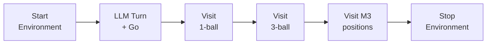

# Dashboard Operator Guide

## Purpose

Use the browser dashboard to run and observe the bounded LLM supervisor demos:

1. Start the environment
2. Run a scenario
3. Watch the robot respond and the proof panel update
4. Understand what the LLM layer does and does not own

The dashboard shows the same layered architecture described in [LLM_CONTROL_ARCHITECTURE.md](./LLM_CONTROL_ARCHITECTURE.md), organized into three tabs that correspond to increasing levels of detail.

## Launch

1. Open Docker Desktop.
2. Start the Chasecar app.
3. Open `http://127.0.0.1:8855`.

If warm services are still coming up, the dashboard will load first and controls will enable once the control plane is ready.

## Dashboard Tabs

### Watch (default)

The operator landing view. Shows:

- **World Surface** — live sim camera or embedded Xpra operator view
- **YOLO Debug** — bounding box detection feed
- **Proof Stage Bar** — visual progress through Init → Spawn → Search → Approach → Done
- **Metrics** — distance to target, trend, motion evidence
- **Events Log** — timestamped operator events (right panel)
- **Action Bar** — Start/Stop env, Reset, Run scenarios

This tab answers: *Is the robot searching? Did it lock the target? Is it approaching? Did it finish?*

### Drive

Interactive LLM architecture demo. Shows:

- **Left panel: "What the LLM sees"** — the compact state digest (same fixed-shape input the LLM receives). Shows target visibility, lock status, distance, and the policy recommendation.
- **Right panel: "Your action"** — the same bounded intent buttons the LLM has. You can dispatch any frozen intent manually and see the robot respond.
- **LLM Would Choose** — shows what the deterministic policy recommends given the current state.

This tab answers: *What information does the LLM get? What can it do? What would it choose right now?*

### Inspect

Engineering detail organized by architecture layer:

- **L1: What the robot is doing** — executor state, target lock, search rotation, goal progress
- **L2: LLM decision layer** — policy stage, preferred intent, allowed intents, reasoning
- **L3: Raw signals** — perception, belief, outcome (collapsed by default)

This tab answers: *What are the exact signals at each layer? Where is the boundary between LLM decisions and deterministic control?*

## Recommended Scenario Order

1. **Start Environment**
2. **LLM Turn + Go** — the core proof: robot searches, finds ball, approaches it
3. **Visit 1-ball** — single hidden-start target with prior-based approach
4. **Visit 3-ball** — three targets (hidden + visible starts) with sequential visits
5. **Visit M3 positions** — center, left, right targets proving policy generalization
6. **Stop Environment**

Use the **Scenarios** dropdown for the full list including legacy M3 and multi-target rehearsal.

## What The Architecture Looks Like In Practice

When you run a scenario, the four layers work together:

1. **Layer 1 (LLM Supervisor)** reads the compact state digest and picks one bounded intent
2. **Layer 2 (Policy Gate)** validates the intent against the frozen contract and readiness checks
3. **Layer 3 (Executor)** translates the intent into concrete robot actions (search turn, nav goal, etc.)
4. **Layer 4 (Subsystems)** runs the real-time loops — YOLO detection, Nav2 planning, odometry

The **Watch** tab shows Layers 3-4 (what the robot is doing). The **Drive** tab shows Layers 1-2 (what the LLM sees and decides). The **Inspect** tab shows all layers with raw signals.

### Escalation Flow

The policy escalates through stages as the situation evolves:

| What you see | Policy stage | Intent dispatched |
|---|---|---|
| Robot turning in place, no ball visible | `search` | `search_for_target(ball)` |
| Ball visible in YOLO feed, not locked yet | `acquire` | `acquire_target(ball)` |
| Ball locked, no nav goal active | `plan` | `plan_to_target(0.25)` |
| Robot driving toward ball, goal active | `track` | `track_target()` |
| Robot reached ball or problem detected | `stop` | `safe_stop()` |

## Expected Visual Observations

### LLM Turn + Go

1. Robot starts facing away from the ball
2. Robot turns in place (search phase — Watch tab shows "Searching")
3. Ball appears in YOLO debug feed
4. Robot stops turning and drives toward the ball (approach phase)
5. Proof stage bar completes and topbar shows "Proof passed OK"

### Visit Scenarios

1. Ball spawns (hidden or visible depending on target)
2. For hidden starts: robot searches by turning
3. Robot locks target and drives toward it
4. Robot visits ball (gets within 0.35m)
5. Ball is removed, next target spawns
6. Repeat for each target in the sequence
7. "Visit mission completed" event appears

## Troubleshooting

### Dashboard loads but controls are disabled

- Wait a few seconds for warm services to finish
- Check the topbar status indicator

### Environment will not start

- Confirm Docker Desktop is running
- Confirm the Chasecar app is started
- Use Reset once before retrying

### Visual panes are blank

- Make sure environment is `environment_ready`
- Give the session a few seconds to start publishing
- Use Reset Sim if the session looks stale

### Scenario looks stuck

- Use Stop to cancel the active scenario
- Wait for the dashboard to return to ready
- Rerun the scenario

## Related Docs

- [LLM Control Architecture](./LLM_CONTROL_ARCHITECTURE.md)
- [LLM Browser UAT Plan](./LLM_BROWSER_UAT_PLAN.md)
- [Roadmap 2026 H2](./ROADMAP_2026_H2.md)
