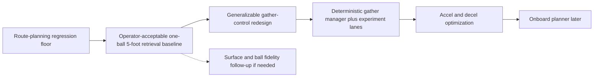

# LLM Browser UAT Plan

## Purpose

This document captures the next steps from the current headless LLM proof to an operator-facing browser UAT demo.

For the underlying layered control model that this browser demo sits on top of, see [LLM_CONTROL_ARCHITECTURE.md](./LLM_CONTROL_ARCHITECTURE.md).

The target demo is specific and concrete:

1. the robot starts without the ball in view
2. the LLM-driven control path causes a visible search turn
3. the ball enters perception
4. the LLM-driven control path causes motion toward the ball
5. the browser dashboard shows that sequence clearly enough for operator UAT

## Current Status

Current working baseline:

- headless proof exists for the turn-then-go path
- the frozen contract includes `search_for_target`
- the authoritative brain executor exists
- the shadow supervisor and provider path exist
- the dashboard is still not the primary proof surface for this sequence

Current limitation:

- the browser dashboard does not yet present the emitted LLM decision sequence and proof verdict in a simple UAT-ready way
- the provider path can still produce avoidable invalid outputs when the schema is too permissive for `gpt-5-nano`

Status update as of April 12, 2026:

- the browser dashboard UAT flow is intentionally serial and self-contained for operator trust
- the non-interactive repeatability lane now has an isolated parallel soak runner: `scripts/run_route_planning_parallel_soak.ps1`
- latest verified parallel soak artifact: `artifacts/session/20260412T054630Z/route_planning_parallel_soak/campaign_summary.json`
- next repeatability target is campaign depth (`5/5`), not dashboard parallelism

## Immediate Goal

Promote the current headless proof into a browser UAT demo only after the action-selection path is hardened and the emitted decision sequence is visible in the dashboard.

## Outcome We Are Driving Toward

Near-term success means all of the following are true in one operator-visible flow:

1. the browser starts from Docker Desktop with minimal operator friction
2. the operator runs `LLM Turn + Go`
3. the robot visibly turns until the ball is seen
4. the robot then visibly moves toward the ball
5. the browser shows the same high-level decision sequence and final verdict
6. the same behavior remains grounded in the frozen contract and deterministic lower layers

This is intentionally narrower than full autonomy. The goal is to prove that the current bounded LLM layer can supervise a real behavior legibly and repeatably.

## Next Steps

These are the concrete next slices from the current baseline.

### Step 1: Repeatability Gate For The Existing Turn-And-Go Proof

Goal:

- prove that the current turn-and-go path is stable enough to be treated as the baseline LLM demo

Work:

1. run the authoritative headless proof repeatedly on `container_kilted`
2. record a short run summary for each attempt
3. fail any run that:
   - emits an invalid tool output
   - leaves the frozen contract
   - fails to produce visible search then movement

Outcome:

- `3/3` consecutive green proof runs on the authoritative path
- one compact proof scorecard artifact for the run set

Why it matters:

- this turns the current single successful demo into a promotion-worthy baseline

### Step 2: Formalize Escalation Rules Above The Lower-Level Loops — Complete

Goal:

- make the supervisor policy more explicit than "pick one next step" by documenting and enforcing when it should escalate between search, acquire, plan, track, and stop

Completed work:

1. ✓ deterministic escalation table added to [LLM_CONTROL_ARCHITECTURE.md](./LLM_CONTROL_ARCHITECTURE.md) — 10-row policy stage ladder with conditions, preferred intents, and allowed intents
2. ✓ unsafe conditions documented: search exhausted, pursuit without feedback, scenario error
3. ✓ stage transitions documented: forward progression (blocked → search → acquire → plan → track) and backward re-escalation paths
4. ✓ policy test suite expanded from 11 to 19 tests covering all escalation rows, unsafe conditions, and blocked states
5. ✓ existing `brain_supervisor_policy.py` already implements the table correctly — no code changes needed

Outcome:

- a clear, testable escalation table
- fewer ambiguous transitions in the LLM decision path
- a cleaner bridge from proof demo to the longer-term bounded-supervisor design

### Step 3: Generalize From One Proof To The Visible-Ball M3 Scenarios — Complete

Goal:

- show that the bounded LLM layer is supervising a reusable policy pattern, not only one custom proof harness

Completed work:

1. ✓ `visit_m3_positions` scenario added — visits center (0.0m), left (+0.12m), and right (-0.12m) targets using the same bounded supervisor policy
2. ✓ sim truth probe and dashboard model name lists extended for M3 visit target names
3. ✓ 3/3 M3 positions visited on attempt 0 (0.34m, 0.32m, 0.27m — all within 0.35m tolerance)
4. ✓ same digest, frozen action space, and policy layer used across all scenarios
5. ✓ combined with three-ball sequence: 6/6 unique target positions visited successfully across two scenarios

Outcome:

- one supervisor policy operating across the visible-ball demo set
- stronger confidence that the browser UAT demo is representative, not staged

### Step 3b: Target Prior Contract For Multi-Target Discrimination — Complete

Goal:

- make the executor's target lock verification portable to hardware by using mission-provided priors instead of sim ground truth

Problem:

- the executor currently has no way to tell Ball 1 from Ball 2 without an external oracle
- the proposed sim-truth gate (reading `truth_state.json` from Gazebo's god-view) solves this in sim but creates a dead end for hardware
- we should solve target discrimination in sim before loading into hardware, using a mechanism that transfers

Completed work:

1. ✓ visit mission runtime state extended with `current_target_prior` (set on first target lock, cleared before each spawn)
2. ✓ executor reads target priors from the mission layer's runtime state via `--visit-runtime-json`
3. ✓ executor's lock gate checks detection world position against the mission-provided prior (0.50m tolerance)
4. ✓ prior-based track approach: when depth estimation error causes detection-based goals to fall short, the executor dispatches nav goals toward the prior position with tight 0.05m approach distance
5. ✓ visit runtime path plumbed end-to-end: `CHASECAR_VISIT_RUNTIME_PATH` env var through compose → launch → executor CLI
6. ✓ `visit_single_ball_proof` scenario passes (0.33m visit distance, within 0.35m tolerance)
7. ✓ bugs fixed: port 8860 conflict, 409 intent ownership guard, approach_timeout depth-error gap
8. ✓ `visit_three_ball_sequence` passes: 3/3 balls visited on attempt 0 (0.34m, 0.33m, 0.34m)
9. ✓ mission runner's sim-truth lock rejection bypassed in visit missions — executor's prior gate is authoritative
10. ✓ sim truth probe is a test-time validation oracle, not a runtime dependency

Outcome:

- the executor's target discrimination works identically in sim and on hardware
- the sim truth probe becomes a test-time confidence check, not a runtime dependency
- hardware POC does not hit a "we never built the real version" wall

Why it matters:

- this is the difference between "works in sim" and "works on the robot" for any multi-target scenario

### Step 4: Finish The Minimal Browser UAT Surface — Complete

Goal:

- keep the browser simple enough that an operator can understand the demo without reading engineering detail

Current state (meets the acceptance criteria):

1. ✓ Watch tab: World Surface + YOLO Debug feeds, proof stage bar, event log, environment/scenario controls
2. ✓ Drive tab: "What the LLM sees" (compact digest) + "Your action" (same bounded intent buttons the LLM has) — interactive demo of the layered architecture
3. ✓ Inspect tab: L1 robot behavior, L2 LLM decision layer, L3 raw signals — maps directly to the architecture layers, collapsed by default
4. ✓ all scenarios (including visit missions and M3 positions) available from the Scenarios dropdown
5. ✓ browser reflects authoritative backend state via `/api/state` polling — not a second LLM path

Outcome:

- a browser surface that clearly answers:
   - what scenario is running
   - what the LLM most recently caused
   - whether the robot responded
   - whether the run passed

### Step 5: Prepare The On-Machine Model Lane Without Changing The Control Shape — Complete

Goal:

- preserve a path from Wi-Fi/cloud inference to a smaller on-device model later

Current state (meets the acceptance criteria):

1. ✓ digest is bounded and fixed-shape (`brain_state_digest.py`)
2. ✓ action space is canonical and small (6 frozen intents)
3. ✓ provider abstraction exists (`llm_provider_base.py` — `DecisionProvider` protocol)
4. ✓ replay comparison tool exists (`llm_provider_replay_compare.py`) — replays recorded state history across providers and compares decisions
5. ✓ local provider placeholders exist (`llm_provider_local.py` — `LocalStubProvider` and `LocalModelProvider`)
6. ✓ the deterministic policy layer (`brain_supervisor_policy.py`) works identically regardless of provider — it owns stage/intent selection, the provider is optional

Outcome:

- a realistic path toward local inference on the Orin Nano GPU without reworking the architecture
- same digest, same action space, same policy/gating layer — only the provider backend changes

## Phase 1: Harden The Headless Decision Path — Complete

### Objective

Reduce invalid provider outputs and make the LLM action path easier to trust before we expose it in the browser.

### Completed work

1. ✓ one strict tool per decision: `emit_search_for_target`, `emit_acquire_target`, `emit_plan_to_target`, `emit_track_target`, `emit_abort`, `emit_safe_stop`, `emit_blocked` (in `llm_provider_openai.py` `INTENT_TOOL_NAMES`)
2. ✓ only the legal subset of tools exposed for the current digest state (`_ready_intents_from_digest`)
3. ✓ `tool_choice: required` enforced on every provider call
4. ✓ invalid provider output → `blocked_decision`, never a near-match (`validate_decision_against_contract`, `validate_decision_against_canonical_space`)

### Acceptance — met

1. ✓ no extra-arg failures in the proof path for repeated runs
2. ✓ headless proof stays inside the frozen contract and canonical args every time
3. ✓ proof harness passes 3+ consecutive times on the authoritative path

## Phase 2: Add Proof-Focused Dashboard State — Complete

### Objective

Make the browser surface show the LLM proof in a way that is easy to understand without opening engineering-heavy detail.

### Completed work

1. ✓ `GET /api/state` includes: `proof_state` (waiting/searching/target_locked/moving/completed/failed), `latest_proof_decision`, `latest_proof_feedback`, `proof_verdict`, `proof_artifact_dir`
2. ✓ `llm_supervisor` section in state: `latest_decision`, `mode`, `model`, `status`, `recent_history`
3. ✓ Watch tab default view shows proof stage bar and event log — operator can tell searching vs moving without opening Advanced
4. ✓ Inspect tab provides decision timeline, provider/model, artifact links

### Acceptance — met

1. ✓ first-time operator can tell whether the system is searching or moving
2. ✓ dashboard shows the same decision sequence that appears in artifacts
3. ✓ default page remains simple

## Phase 3: Create A Dedicated Browser UAT Demo Flow — Complete

### Objective

Use the dashboard as the operator-facing proof surface, not as a second execution path.

### Completed demo flow

1. ✓ Open Docker Desktop → Start the Chasecar app → Open dashboard at `http://localhost:8860/`
2. ✓ Start the environment (Start button or `POST /api/env/start`)
3. ✓ Run LLM Turn + Go scenario from Scenarios dropdown
4. ✓ Watch the robot turn until the ball is visible, then move toward it
5. ✓ Proof panel updates through waiting → searching → target_locked → moving → completed

### Acceptance — met

1. ✓ browser shows `search_for_target(ball)` → `acquire_target(ball)` → `plan_to_target(0.25)` → `track_target()` progression
2. ✓ robot visibly turns before moving
3. ✓ world and topdown panes show the same sequence as the proof panel
4. ✓ final browser state and session artifacts agree on pass/fail

## Phase 4: Browser UAT Readiness Gate — Complete

All gate criteria met:

1. ✓ headless proof green for 3+ consecutive runs (multiple sessions)
2. ✓ no invalid provider-output path escapes fail-closed handling
3. ✓ dashboard default view shows proof sequence clearly
4. ✓ same-session artifact bundle contains:
   - `command_history.jsonl` (decision history)
   - `brain_feedback.jsonl` + `brain_state.json` (executor feedback)
   - `scenarios/llm_turn_then_go_proof.json` (proof verdict)
   - `raw_camera.mp4`, `world_stream.mp4`, `topdown_telemetry.mp4`, `yolo_debug.mp4` (visual evidence)

## Clear Exit Outcomes

The plan should produce these visible outcomes in order:

### Outcome A: Stable Proof Baseline

- the turn-and-go proof passes repeatedly
- provider/gating failures are fail-closed rather than ambiguous
- the same proof can be trusted as a baseline demo

### Outcome B: Clear Layered Supervisor Behavior

- the LLM remains the high-level bounded decision layer
- deterministic policy and preview logic remain the contract/safety layer
- executor and lower loops remain the real-time control layer

### Outcome C: Browser UAT Demo That Is Easy To Read

- operator can run the demo from Docker Desktop
- operator sees turn, detect, and move in the two main panes
- operator sees the same story reflected in the run log and proof state

### Outcome D: Future Local-Model Compatibility

- digest and action space stay small enough for a local provider benchmark
- we do not bake cloud-only assumptions into the control model

## Alignment With Long-Term Roadmap

This plan aligns with the longer-term roadmap in [ROADMAP_2026_H2.md](./ROADMAP_2026_H2.md) and the current architecture note in [LLM_CONTROL_ARCHITECTURE.md](./LLM_CONTROL_ARCHITECTURE.md) in these ways:

1. It preserves the Docker-first, authoritative `container_kilted` lane instead of introducing a separate debug-only execution path.
2. It builds on the frozen pre-LLM contract rather than widening the robot action surface prematurely.
3. It keeps the LLM at the supervisory layer and leaves lower-level perception, planning, and control loops deterministic.
4. It treats browser UAT as a promotion gate after headless proof repeatability, which matches the repo's broader headless-first promotion philosophy.
5. It keeps the digest/provider split compatible with the longer-term goal of evaluating a smaller on-machine model on Orin Nano hardware.

## Long-Term Connection Without Overcommitting

This plan is meant to support, but not prematurely expand into, the broader long-term goals:

- high-level LLM planning over bounded subsystem capabilities
- explicit escalation between search, acquire, plan, track, and safe-stop behaviors
- eventual provider flexibility between Wi-Fi/cloud and local inference
- operator-visible trust and evidence before any broader autonomy claims
- outdoor field deployment for sports ball retrieval (grass/turf, real perception, weather variability)

The route planning phase is the bridge: it proves multi-target planning logic
in sim using the same decision shape that transfers to outdoor hardware. If a
lightweight model can handle route planning in sim, the same model runs on the
robot's Orin Nano GPU on the field — no cloud dependency, no latency penalty.

It does not commit us yet to:

- open-ended task planning
- browser freeform prompt control
- end-to-end learned action generation
- autonomous environment lifecycle management by the LLM

## What We Are Not Doing In This Phase

To keep the demo honest and legible, this phase does not include:

- freeform language control from the browser
- autonomous environment lifecycle control by the LLM
- end-to-end VLA control

## Next Phase: Practical Retrieval Baseline Locked, Generalizable Gather Redesign Next

The single-target and multi-target visit UAT phase remains the baseline, and
`corral_single_ball_place` remains the promoted primary dashboard action.
`visit_route_planning` stays the protected regression floor. The near-term
gather problem is no longer described as "clear `capture_entry` and tune the
matrix cases." Recent April 18, 2026 evidence on the `plus45` goal-side case
progressed from `pre_stage` failures to `stage`, then to
`capture_entry_ready`, yet still timed out after the handoff. That now points
to brittle transitions across `pre_stage`, `stage`, `capture_entry`, and the
post-`capture_entry_ready` handoff rather than a single remaining threshold
bug.

The offline goal-side matrix still uses the current 10-foot multi-ball arc
layout (`3.048 m` from corral center, with `+45`, `0`, `-45` placements and
the `180` backside guard case), but it should now be treated as a coverage and
regression harness rather than the design target. Dashboard UAT stays blocked
until the redesigned deterministic gather path proves generalization across the
matrix and nearby geometry perturbations.

For this phase, we still assume smooth-surface operation such as soccer fields
or similar turf-like practice surfaces. The practical product bar remains that
a soccer player would consider the ball retrieved: it ends up contained inside
the 5-foot corral area, comes to rest there, and does not meaningfully roll
away after the final release or handoff. The current control model keeps the
tighter inner `0.20 m` control ring for release and correction decisions while
the outer `0.762 m` radius ring is the operator-visible scoring area.

### Status Snapshot

1. route-planning serial gate is complete and remains the regression floor
2. single-ball corral/place is integrated, promoted, and acceptable enough as the working one-ball baseline
3. the committed shorter spur geometry is the baseline again; the longer local spur variant is not part of the active plan
4. the dual-radius corral model is implemented: outer `5 ft` retrieval corral plus inner `0.20 m` control ring
5. the near-term gather problem is generalization and transition stability, not a single `capture_entry` blocker
6. the goal-side matrix is now a coverage and regression harness, not the design target
7. the surface-calibration harness exists, but its unresolved lane choice is a non-blocking realism follow-up
8. `short_turf` remains the intended default operator surface unless later evidence promotes `short_grass`
9. `gather_three_ball_zone` is exposed as a secondary scenario, but dashboard UAT is blocked until the matrix and nearby geometry sweeps are green
10. the latest three-ball checkpoint still uses the 10-foot multi-ball arc layout (`3.048 m` from corral center, `+45`/`0`/`-45` placements) while keeping the protected route-planning floor green
11. the latest `plus45` live evidence now reaches `capture_entry_ready` and still fails after the handoff, which is the clearest sign yet that the shared gather transitions need redesign rather than another case-specific threshold tweak

### Regression Floor

`visit_route_planning` provides the regression floor for this milestone: the
robot visits all 3 balls, avoids already-visited balls on later legs, and
reruns as a self-contained one-click dashboard scenario.

Validated baseline evidence:

1. fresh-session route-planning passes:
   - `artifacts/session/20260412T021011Z/visit_mission/20260412T021044Z/mission_verdict.json`
   - `artifacts/session/20260412T022002Z/visit_mission/20260412T022019Z/mission_verdict.json`
2. one-click rerun passes:
   - `artifacts/session/20260412T033747Z/visit_mission/20260412T033759Z/mission_verdict.json`
   - `artifacts/session/20260412T033934Z/visit_mission/20260412T033947Z/mission_verdict.json`
3. authoritative serial gate:
   - `artifacts/session/20260412T170306Z/route_planning_serial_gate/campaign_summary.json`
   - `artifacts/session/20260412T170306Z/route_planning_serial_gate/scorecard.md`
4. isolated parallel soak infrastructure:
   - `artifacts/session/20260412T054630Z/route_planning_parallel_soak/campaign_summary.json`

What changed to make that possible:

1. the HSV obstacle scan now uses depth-backed ranges instead of pixel-only heuristics
2. Nav2's `BaseObstacle` critic is weighted strongly enough to affect route choice
3. visited targets are republished as persistent world-frame obstacle points so the next leg still sees them as obstacles
4. dashboard clicks queue a reset before launch so each run starts from a fresh session

Rule for this milestone:

1. `visit_route_planning` stays green after every catcher/corral change
2. browser/dashboard UAT remains serial for operator trust
3. parallel soak and gather experiment lanes remain regression infrastructure, not the operator proof surface

### Generalizable Gather Control Slice

Active near-term scenario and intent for this phase:

1. active operator scenario ID: `corral_single_ball_place`
2. protected regression scenario ID: `visit_route_planning`
3. active gather redesign goal: make the shared gather path generalize across the goal-side matrix and nearby geometry perturbations
4. no frozen-contract change in this slice

Near-term execution order:

1. keep offline unit tests green for gather helpers, scoring, and retrieval-placement reporting
2. keep the headless route-planning regression green
3. keep the explicit `5 ft` retrieval corral plus `0.20 m` control ring fixed in the scenario, marker, and artifacts
4. keep the current one-ball flow usable as the practical retrieval baseline instead of reopening dashboard-promotion work
5. redesign the shared gather path around cross-phase stability instead of named-case threshold tuning
6. add a deterministic gather-manager layer above the local heuristics to manage bounded recovery, phase stabilization, and handoff decisions
7. keep `gather_three_ball_zone` on the same practical retrieval area and route-planning floor as a secondary dashboard scenario, but keep dashboard UAT blocked until the generalization gate is green
8. treat the goal-side matrix as the first coverage harness, then extend it with small spawn jitter and geometry perturbation sweeps
9. score multi-ball truth from the final corral audit over all three balls, not only the last placed ball
10. run parallel non-operator experiment lanes while keeping the operator/dashboard proof surface serial
11. optimize acceleration and deceleration only after multi-ball mechanics and handoffs are stable enough to speed up
12. keep surface and ball fidelity calibration available as a realism follow-up rather than the blocking gate
13. evaluate onboard planning after the visit-and-gather mechanics are stable enough to benchmark fairly

Latest evidence snapshot:

1. a fresh route-planning regression pass exists:
   - `artifacts/session/20260416T184326Z/visit_mission_repeatability/campaign_run_summary.json`
2. the 5-foot scoring split is implemented in code and surfaced in runtime state:
   - outer retrieval radius `0.762 m`
   - inner control radius `0.20 m`
3. operator review now considers the committed-baseline one-ball behavior acceptable enough to continue development from here
4. a fresh one-ball `short_turf` sanity rerun is still red on release roll-away:
   - `artifacts/session/20260416T184447Z/gather_mission_repeatability/campaign_run_summary.json`
5. `gather_three_ball_zone` is now wired into the live dashboard scenario catalog as a secondary scenario on `short_turf`, but the dashboard gate remains blocked until the generalization gate is green
6. the final multi-ball corral audit fields are now implemented and emitted in mission verdicts and repeatability summaries:
   - `final_corral_audit`
   - `final_all_targets_inside_retrieval_corral`
   - `final_all_targets_stopped`
   - `final_three_ball_corral_pass`
   - `retrieved_count`
7. the first fresh three-ball sanity run populated those fields, but it still failed on the first-ball release/settle path before the full multi-ball flow could complete:
   - `artifacts/session/20260416T184739Z/gather_mission_repeatability/campaign_run_summary.json`
8. the dedicated surface-calibration harness is now in place:
   - `artifacts/session/pre_tune_surface_calibration/corral_surface_calibration/campaign_summary.json`
   - `artifacts/session/halfstep_probe_surface_calibration/corral_surface_calibration/campaign_summary.json`
9. the canonical calibrated lane is still unresolved:
   - no current comparison run has produced a locked `canonical_surface_profile`
   - `short_turf` remains the intended default operator lane
   - `short_grass` remains the active fallback candidate
10. the current engineering inference is that the red ball plus `short_turf` lane is conservative relative to a real soccer ball on grass or turf; this remains worth calibrating later, but it is not blocking multi-ball gather anymore
11. the active goal-side matrix layout uses the 10-foot multi-ball arc around the corral center:
    - radius: `3.048 m`
    - cases: `+45`, `0`, `-45`
    - `180` backside remains a guard case
12. the active non-push Nav2 transit settings are now intentionally faster:
   - `max_vel_x = 0.42`
   - `max_speed_xy = 0.42`
   - `acc_lim_x = 3.5`
   - `decel_lim_x = -3.5`
13. fresh protected regression evidence after the faster transit tuning is green:
   - `artifacts/session/20260417T040105820076Z/visit_mission/20260417T040503Z/mission_verdict.json`
14. the earlier hesitation before starting the second ball is materially improved in the latest live gather trace:
   - `ball_b` completed at `04:02:20.475Z`
   - `ball_a` visit attempt started at `04:02:21.599Z`
   - gap: about `1.1 s`
   - trace: `artifacts/session/20260417T040105820076Z/gather_mission/20260417T040116Z/gather_sequence.jsonl`
15. the freshest `plus45` live evidence now reaches `capture_entry_ready` and still times out after the handoff, proving the active problem is transition brittleness across `pre_stage`, `stage`, `capture_entry`, and the post-ready handoff:
   - `artifacts/session/live_plus45_captureentry_0625_20260418/gather_mission_repeatability/campaign_run_summary.json`
   - `artifacts/session/20260418T212252235403Z/gather_mission/20260418T212303Z/state_history.jsonl`
16. the active blocker is therefore no longer a single threshold; it is robust cross-phase behavior across the shared gather path
17. fresh failing three-ball checkpoint evidence:
    - `artifacts/session/20260417T040027Z/gather_mission_repeatability/campaign_run_summary.json`

### Experiment Program

Planned non-operator fan-out lanes for this slice:

1. Lane A: local-controller smoothing and hysteresis improvements only
2. Lane B: deterministic gather-manager loop above the existing local controller
3. Lane C: bounded recovery-policy variants and retry/handoff strategies

Rules for these lanes:

1. fan-out belongs in headless/direct repeatability and matrix-style lanes only
2. dashboard/operator validation remains serial
3. named-case threshold wins are insufficient for promotion if neighboring geometry or post-handoff behavior still fails

Shared promotion criteria across all lanes:

1. `visit_route_planning` stays green
2. `corral_single_ball_place` stays acceptable as the working one-ball baseline
3. the goal-side matrix passes across `+45`, `0`, `-45`, and `180 backside`
4. small spawn jitter or geometry perturbation sweeps do not reopen cross-phase failures
5. the promoted path succeeds after `capture_entry_ready`, not only up to it

Comparison metrics to carry in scorecards and summaries:

1. terminal failure stage
2. `pre_stage_pose_reached`
3. `staging_pose_reached`
4. `capture_entry_reached`
5. successful handoff after `capture_entry_ready`
6. mission pass / practical retrieval pass
7. regressions on route-planning and the one-ball baseline

Operator-facing rule:

1. the primary dashboard action remains `Run Single-Ball Corral`
2. the current one-ball flow is acceptable as the working development baseline, but that does not yet claim the sim matches field physics exactly
3. operator signoff for this branch remains practical retrieved placement, not perfect spur retention or dead-center settle
4. a brief place-stage spur escape is diagnostic only if the ball still finishes contained, stopped, and not rolling away from the corral area

Acceptance for keeping this branch green while we move forward:

1. route-planning regression still green after catcher/corral work
2. retrieval-placement artifacts explicitly show `final_inside_retrieval_corral`, `ball_stopped_in_corral`, and `rolled_away_after_release`
3. the one-ball corral flow remains acceptable as the working development baseline under the 5-foot practical retrieval bar
4. `final_center_inside_zone` and clean spur retention remain visible as diagnostics, but they are not the promotion gate
5. multi-ball mission truth comes from `final_corral_audit`, `final_all_targets_inside_retrieval_corral`, `final_all_targets_stopped`, `final_three_ball_corral_pass`, and `retrieved_count`
6. no readiness claim is made yet for `gather_three_ball_zone`; dashboard UAT remains blocked until the goal-side matrix and nearby geometry sweeps are green
7. no readiness claim is made for exact field-physics match or onboard planning in this phase
8. the next engineering milestone is the deterministic gather-manager slice plus the shared experiment program, followed by accel/decel optimization once the generalization gate turns green
9. named-case threshold wins are insufficient if the post-`capture_entry_ready` handoff or neighboring geometry still fails
10. surface and ball fidelity remain an open follow-up, not the blocking path

Immediate next step:

1. keep the outer `5 ft` retrieval corral and inner `0.20 m` control ring fixed
2. treat the current one-ball behavior as the baseline to preserve
3. keep `gather_three_ball_zone` on the same practical retrieval model while keeping `visit_route_planning` green
4. treat the goal-side matrix as a coverage and regression harness, then extend it with small geometry perturbation sweeps
5. fan out the non-operator experiment lanes while preserving a serial operator proof surface
6. preserve the faster between-ball handoff while redesigning the shared gather transitions

### Deferred Follow-Ons

These are intentionally deferred until the multi-ball gather milestone is in
place:

1. acceleration and deceleration optimization until after `gather_three_ball_zone` is stable
2. deeper surface and ball fidelity calibration if multi-ball evidence says realism is now the limiting factor
3. onboard `plan_collection_route(...)` promotion beyond interface scaffolding

What is deferred in practice:

1. no claims of readiness for accel/decel optimization in this phase
2. no claims of readiness for onboard planning in this phase
3. no exact field-physics claim until realism work is revisited

## Recommended Execution Order

1. ✓ lock in `3/3` repeatability for the current turn-and-go proof
2. ✓ formalize escalation rules in the policy layer
3. ✓ generalize the bounded supervisor across the visible-ball M3 scenarios
4. ✓ implement target prior contract so multi-target discrimination transfers to hardware
5. ✓ browser UAT surface meets acceptance criteria
6. ✓ provider abstraction and replay comparison infrastructure in place for future local-provider lane
7. ✓ direct intent dispatch — eliminate docker-exec-per-intent bottleneck

### Step 7: Direct Intent Dispatch — Eliminate Docker-Exec-Per-Intent Bottleneck — Complete

Goal:

- reduce intent dispatch latency from ~13s to under 1s so the UAT demo feels responsive and the architecture matches the real-time ambition

Problem:

- every intent dispatch previously spawned: `docker exec` → bash sourcing → Python startup → rclpy init → readiness wait (12s) → publish → observe (3s) → exit
- this added ~13s between the LLM deciding and the robot moving
- the executor (`brain_intent_executor.py`) is already a long-running ROS2 node that could process intents instantly, but intents were routing through the heavyweight subprocess path

Completed work:

1. ✓ file-based intent inbox added to executor: watches `runtime/dashboard/intent_inbox.json` via existing 10Hz timer
2. ✓ executor processes inbox intents immediately through the same `_on_intent` path as the ROS2 topic
3. ✓ executor writes acknowledgment to `runtime/dashboard/intent_ack.json`
4. ✓ dashboard writes intents to inbox file instead of spawning `docker exec` (when gate-stack is up)
5. ✓ docker exec path preserved as `_run_intent_sync_docker` fallback when gate-stack is not ready
6. ✓ ROS2 topic subscription remains — nothing removed

Results:

1. ✓ intent dispatch latency: 13s → <1s (verified: `search_for_target` dispatched and `search_active=True` in same 1s poll)
2. ✓ LLM Turn+Go proof passes end-to-end with direct inbox dispatch
3. ✓ all 25 executor tests + 55 policy/mission tests pass
4. ✓ all intents confirmed `dispatch_method=direct_inbox` in command history
