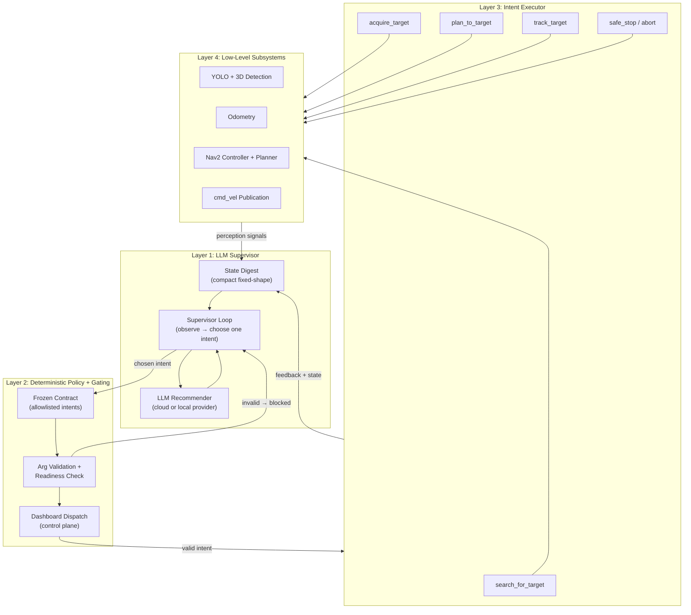
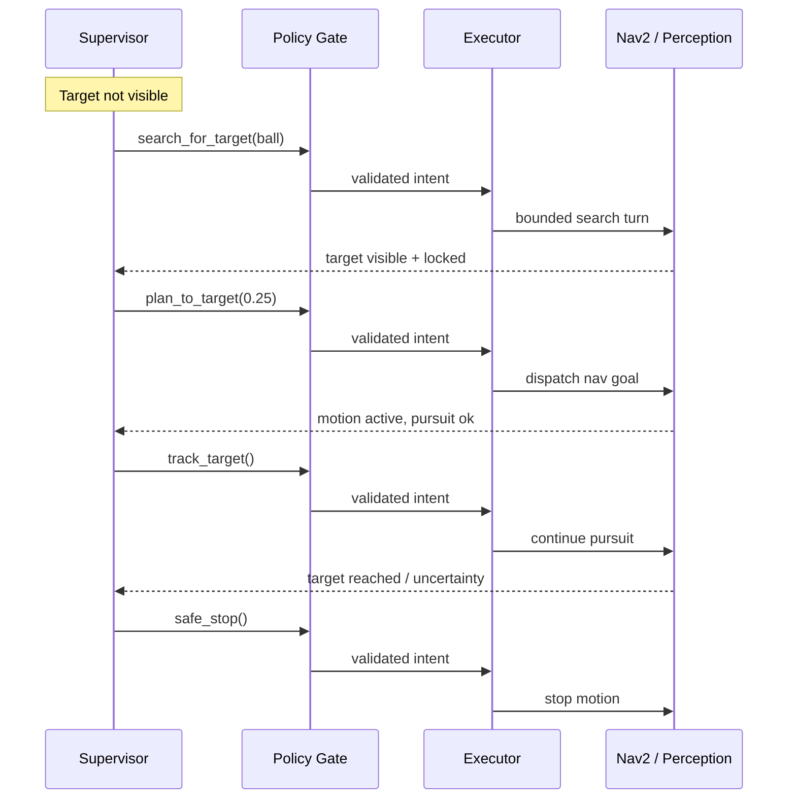

# LLM Control Architecture

## Purpose

This note captures the current intended control architecture for Chasecar's LLM layer:

- the LLM handles only high-level bounded decision-making
- deterministic policy and validation sit between the model and the robot
- lower-level subsystems own the real-time control loops
- escalation between layers is explicit rather than implicit

This is a design and implementation note for the current stack. It is not a roadmap expansion.

## Design Goal

The LLM should act like a bounded supervisor, not like a direct motor controller.

That means:

- it observes a compact state digest instead of raw ROS graphs or image streams
- it chooses at most one next bounded action
- it never bypasses deterministic gating
- it never owns fast control loops
- it can escalate to safer or lower-level behaviors, but not replace them

## Layered Architecture

### Layer 1: LLM Supervisor

Role:

- interpret the current situation at a high level
- choose one bounded next intent
- prefer blocked or safe actions when the state is weak or uncertain

Current implementation anchors:

- [brain_supervisor_loop.py](../scripts/brain_supervisor_loop.py)
- [brain_llm_recommender.py](../scripts/brain_llm_recommender.py)
- [llm_provider_openai.py](../scripts/llm_provider_openai.py)
- [brain_state_digest.py](../scripts/brain_state_digest.py)

What it sees:

- environment and scenario state
- target visibility and lock status
- robot pose, goal pose, and distance trend
- recent boundary activity and feedback
- the currently legal frozen action subset

What it does not do:

- publish ROS motion directly
- own environment lifecycle
- own scenario orchestration
- run continuous steering or tracking loops
- invent actions outside the frozen contract

### Layer 2: Deterministic Policy And Gating

Role:

- constrain the model to the frozen intent boundary
- validate tool output and canonical args
- check readiness before dispatch
- fail closed on invalid, stale, or unsafe decisions

Current implementation anchors:

- [llm_supervisor_core.py](../scripts/llm_supervisor_core.py)
- [dashboard_service.py](../scripts/dashboard_service.py)
- [llm_control_contract.yaml](../runtime/contracts/llm_control_contract.yaml)

Responsibilities:

- allowlist frozen intents
- canonical arg enforcement
- preview validation against live system readiness
- dispatch only through the authoritative dashboard/control-plane path
- convert invalid provider output into `blocked`

This is the main safety and contract boundary between "what the model suggests" and "what the robot may actually do."

### Layer 3: Brain Intent Executor

Role:

- consume frozen intents from the authoritative control plane
- translate those intents into concrete lower-level subsystem actions
- maintain bounded execution state and feedback

Current implementation anchor:

- [brain_intent_executor.py](../scripts/brain_intent_executor.py)

Current executor responsibilities:

- `search_for_target`
  - bounded turn-in-place search
- `acquire_target`
  - establish target lock from live perception
- `plan_to_target`
  - dispatch a navigation goal toward the target
- `track_target`
  - keep pursuit active and refresh planning when needed
- `abort`
  - cancel active behavior
- `safe_stop`
  - stop motion cleanly and quickly

This layer is where high-level intent becomes concrete robot behavior.

### Layer 4: Lower-Level Subsystems And Control Loops

Role:

- own the fast control and perception loops
- expose stable signals upward
- execute the bounded behavior requested by the executor

Examples in the current stack:

- YOLO + 3D detection pipeline
- odometry updates
- Nav2 planning and controller execution
- cmd_vel publication
- bounded search-turn loop inside the executor

These loops should remain non-LLM and deterministic.

## Escalation Model

The intended escalation model is:

1. lower-level loops try to do the local job first
2. executor manages bounded behavior state across those loops
3. supervisor re-evaluates when the state changes meaningfully
4. supervisor escalates only by choosing another frozen intent

Examples:

- no target visible:
  - lower-level perception keeps running
  - supervisor escalates to `search_for_target(ball)`
- target visible and locked:
  - supervisor escalates from search to `plan_to_target(0.25)`
- motion already active and pursuit should continue:
  - supervisor may choose `track_target()`
- uncertainty, interruption, or bad state:
  - supervisor escalates to `safe_stop()` or `abort()`

Important boundary:

- escalation is between bounded intents and subsystem states
- not between arbitrary freeform model thoughts and low-level robot commands

## Current Canonical Flow

For the current turn-and-go proof, the intended control story is:

1. proof setup puts the target out of view
2. supervisor sees no visible target and chooses `search_for_target(ball)`
3. executor runs a bounded search turn
4. perception reports stable target visibility
5. executor records target lock
6. supervisor now chooses `plan_to_target(0.25)` or `track_target()`
7. executor hands off to Nav2 / pursuit behavior
8. feedback and motion evidence flow back into state
9. supervisor re-evaluates until completion or a safe stop condition

## Why This Architecture Still Fits The Local-Model Goal

This architecture is intentionally friendly to a smaller on-machine model later because:

- the input is a compact fixed-shape digest
- the output is a small bounded action set
- most of the complexity stays in deterministic layers
- the model does classification-style next-step choice rather than open-ended policy generation

That keeps the cloud and local paths aligned:

- same digest
- same frozen action space
- same policy/gating layer
- different provider backend only

## What Is Out Of Scope For This Architecture

This design does not currently include:

- open-ended multi-step mission planning
- freeform natural-language control in the browser
- direct end-to-end vision-language-action control
- LLM ownership of environment lifecycle or scenario orchestration
- LLM ownership of real-time steering or controller loops

## Current Design Principle

The LLM should be the highest-level bounded decision layer in the stack, not the place where low-level robot competence lives.
