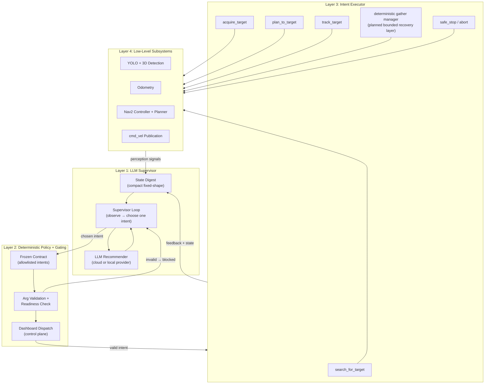
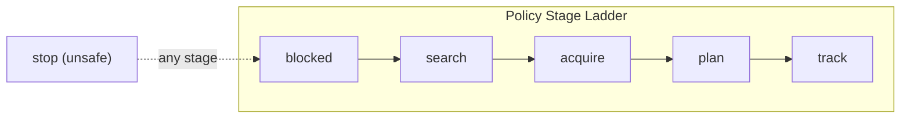
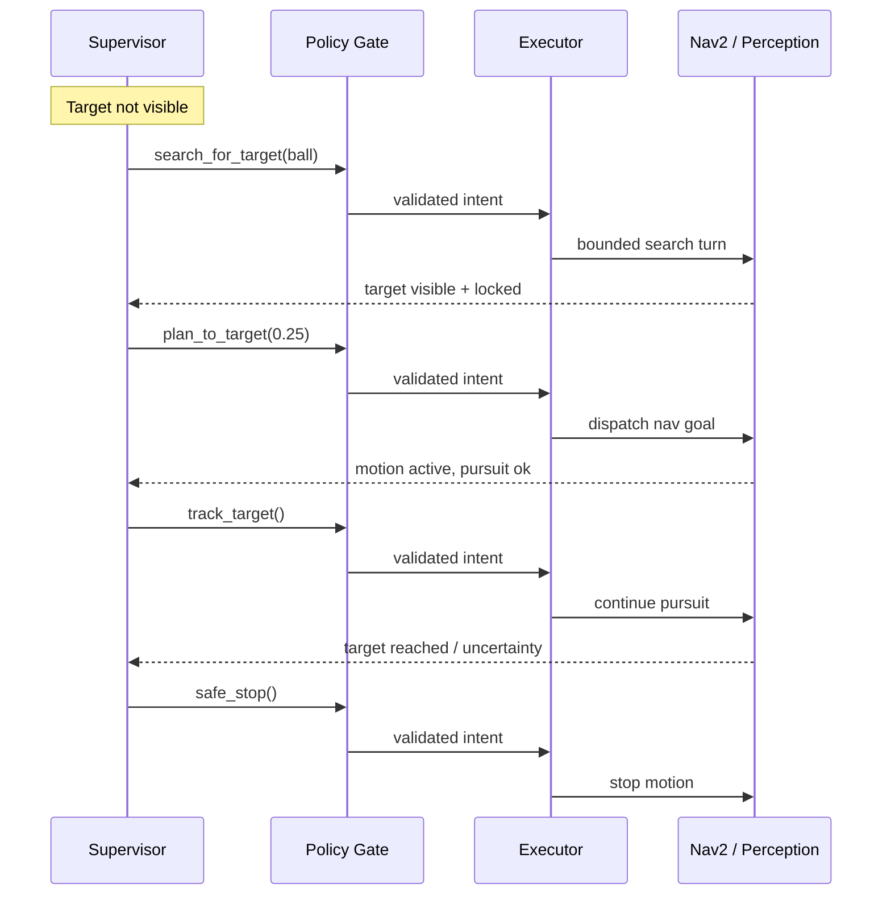

# LLM Control Architecture

## Purpose

This note captures the current intended control architecture for Chasecar's LLM layer:

- the LLM handles only high-level bounded decision-making
- deterministic policy and validation sit between the model and the robot
- lower-level subsystems own the real-time control loops
- slower deterministic orchestration loops may sit above those fast loops inside the executor layer
- escalation between layers is explicit rather than implicit

This is a design and implementation note for the current stack. It is not a roadmap expansion.

## Design Goal

The LLM should act like a bounded supervisor, not like a direct motor controller.

That means:

- it observes a compact state digest instead of raw ROS graphs or image streams
- it chooses at most one next bounded action
- it never bypasses deterministic gating
- it never owns fast control loops
- it may rely on slower deterministic recovery or orchestration loops below it
- it can escalate to safer or lower-level behaviors, but not replace them

## Fetch AI Control Stance

The calibrated golf-ball `fetch_to_pose` pivot keeps the runtime no-shoot and
the layers explicit. The Nav2 corridor-push spike showed Nav2 can be a useful
stage owner for long-haul, coarse setup, and corridor tracking, but the
`right05` saved-layout promotion failure showed that path completion is not
enough for object delivery. AI is now a shadow-only handoff and maneuver-class
proposer inside a hybrid stage supervisor, not a replacement for Nav2 or
deterministic contact routines:

1. LM or VLA-style models may supervise high-level task mode, failure
   interpretation, and known maneuver choices.
2. The deterministic local fetch planner computes the intended ball path,
   capture pose, setup route, and handoff gate before Nav2 is asked to push.
3. A local learned model may predict ball trajectory, miss vector, stage handoff,
   terminal re-push need, coast timing, setup pocket, recenter side, or recovery
   side.
4. The fetch state machine and deterministic guards decide whether any proposal
   is legal.
5. Nav2 `FollowPath` may own coarse robot path tracking through the ball-target
   corridor while a monitor cancels on success, ball escape, stale state, unsafe
   drift, timeout, or action abort.
6. Deterministic homebrew routines own capture-geometry setup, fine pre-contact
   alignment, first-contact stabilization, terminal stop-short correction,
   bounded re-push/coast, and recentering.
7. The learned lane should predict when to stay with Nav2 versus hand off to one
   of those deterministic routines.
8. Learned outputs remain shadow-only until saved-anchor and seeded-random
   scoring is green and deterministic guards accept the handoff or maneuver
   class.

The planner handoff is now explicit. The LLM/world-state planner is responsible
for deciding whether local fetch is applicable before any local subsystem is
scored:

1. `fetch_ready_local`: scene is inside the documented local fetch envelope;
   dispatch `fetch_to_pose`.
2. `nav2_reposition_first`: ball/target are local, but robot pose or topology is
   not fetch-ready; dispatch a bounded reposition/setup routine first.
3. `scan_or_perceive_first`: ball, target, delivery pose, or confidence is
   stale, missing, or ambiguous; scan/perceive before fetch.
4. `recovery_or_reaim`: scene is near-envelope but needs a known re-aim,
   recenter, or recovery routine before fetch.
5. `ambiguous_or_unsafe_no_go`: scene is outside known envelopes, blocked,
   unsafe, or semantically unclear; do not dispatch fetch.

This means a major-unknown random scene is not automatically a fetch subsystem
test. A wrong `fetch_ready_local` dispatch is a planner failure. A local fetch
miss after a correct `fetch_ready_local` dispatch is subsystem evidence. A
correct scan, reposition, recovery, abstain, or no-go on an out-of-envelope
scene is a planner success.

The first concrete gate for this contract is
`scripts/fetch_planner_handoff_gate.py`. It can run deterministic scoring or
`llm_shadow` scoring over frozen mixed-scene descriptors, starting with
`ros2_config/fetch_planner_scene_sets/mixed_fetch_planner_v1.json`. LLM shadow
may record provider requests and rationales, but deterministic guard agreement
remains the promotion condition and no planner output can command `/cmd_vel`.

Current integration boundary, June 2, 2026: the planner is integrated for route
classification, deterministic replay, LLM-shadow comparison, rationale capture,
dashboard artifact recording, and a v0 executable route contract. The dashboard
now treats `fetch_ready_local` and `nav2_reposition_first` as runnable forward-only
proof routes with route metadata and a pre-contact forward-motion guard.
`ambiguous_or_unsafe_no_go` is an executed safe-stop/no-go route. The scan and
recovery labels remain classified placeholders until their perception-refresh
and bounded re-aim executors are wired.

The opposite-side fetch probe turns that boundary into a control requirement.
Local fetch should enter contact from a forward-driving setup. Reverse pre-stage
commands are legacy gather behavior and should be treated as a planner/executor
gap for `fetch_to_pose`. The intended fix is LLM/world-state route selection
plus executable deterministic/Nav2 routes that put the robot into a forward-only
capture pose before local fetch starts. Fast motor control stays with Nav2 and
deterministic local controllers.

The next architecture experiment should therefore be wide and disposable:
`spike/fetch-arch-planner-routed-forward-only-moonshot-20260602`. That branch
should convert the v0 forward-proof route into real executor ownership:
Nav2 reposition plus local fetch for `nav2_reposition_first`, perception refresh
for `scan_or_perceive_first`, one bounded deterministic re-aim for
`recovery_or_reaim`, and browser-watchable videos where the operator can see the
planner route and the actual robot path.

The latest proven Nav2 lane is therefore evidence, not the final architecture:

`LM/VLA supervisor -> deterministic fetch state machine/guards -> Nav2 FollowPath corridor-push -> ball-escape/success monitor -> robot`

The immediate hybrid learned lane is:

`LM/VLA supervisor -> deterministic fetch state machine/guards -> Nav2 or deterministic contact routine -> local learned handoff/proposer in shadow -> robot`

The current preferred local fetch algorithm is:

`planner route label -> ball-target delivery line -> capture pose -> setup motion -> handoff geometry gate -> Nav2 corridor push -> monitor -> bounded correction/replan`

This is a no-shoot architecture. Contact-aware geometric-shooter artifacts can
inform roll/coast physics, but direct ball impulses are not a runtime control
owner. Large calibrated simulation batches may train the local predictor.
V-JEPA-style video world models may be useful as offboard teachers or research
baselines for candidate-action scoring, but onboard execution should be a small
structured or distilled inference path sized for the canonical `tensorrt_int8`
backend.

## Layered Architecture

### Layer 1: LLM Supervisor

Role:

- interpret the current situation at a high level
- choose one bounded next intent
- prefer blocked or safe actions when the state is weak or uncertain

Current implementation anchors:

- [brain_supervisor_loop.py](../scripts/brain_supervisor_loop.py)
- [brain_llm_recommender.py](../scripts/brain_llm_recommender.py)
- [llm_provider_openai.py](../scripts/llm_provider_openai.py)
- [brain_state_digest.py](../scripts/brain_state_digest.py)

What it sees:

- environment and scenario state
- target visibility and lock status
- robot pose, goal pose, and distance trend
- recent boundary activity and feedback
- the currently legal frozen action subset

What it does not do:

- publish ROS motion directly
- own environment lifecycle
- own scenario orchestration
- run continuous steering or tracking loops
- invent actions outside the frozen contract

### Layer 2: Deterministic Policy And Gating

Role:

- constrain the model to the frozen intent boundary
- validate tool output and canonical args
- check readiness before dispatch
- fail closed on invalid, stale, or unsafe decisions

Current implementation anchors:

- [llm_supervisor_core.py](../scripts/llm_supervisor_core.py)
- [dashboard_service.py](../scripts/dashboard_service.py)
- [llm_control_contract.yaml](../runtime/contracts/llm_control_contract.yaml)

Responsibilities:

- allowlist frozen intents
- canonical arg enforcement
- preview validation against live system readiness
- dispatch only through the authoritative dashboard/control-plane path
- convert invalid provider output into `blocked`

This is the main safety and contract boundary between "what the model suggests" and "what the robot may actually do."

### Layer 3: Brain Intent Executor

Role:

- consume frozen intents from the authoritative control plane
- translate those intents into concrete lower-level subsystem actions
- maintain bounded execution state and feedback

Current implementation anchor:

- [brain_intent_executor.py](../scripts/brain_intent_executor.py)

Current executor responsibilities:

- `search_for_target`
  - bounded turn-in-place search
- `acquire_target`
  - establish target lock from live perception
- `plan_to_target`
  - dispatch a navigation goal toward the target
- `track_target`
  - keep pursuit active and refresh planning when needed
- `abort`
  - cancel active behavior
- `safe_stop`
  - stop motion cleanly and quickly

This layer is where high-level intent becomes concrete robot behavior.

Planned near-term extension for gather:

- a deterministic gather-manager sublayer may sit inside Layer 3 above the local gather heuristics
- it may consume bounded gather state such as behind-ball progress, goal-side status, capture-entry readiness, retry history, loss or recovery signals, and explicit stall metrics
- it may emit bounded phase or strategy directives such as `recover_goal_side`, `stabilize_pre_stage`, `stabilize_stage`, `close_capture_gap`, `handoff_to_capture`, `recover_after_handoff`, `reset_reacquire`, or other fixed strategy labels
- a gather-control candidate seam may start at the current manual `pre_stage` point where [gather_mission_runner.py](../scripts/gather_mission_runner.py) resolves `compute_pre_stage_command(...)` and `decide_short_horizon_pre_stage_command(...)` before `_set_manual_drive(...)`, but the winning candidate does not have to expose a separate "recovery strategy"
- that seam should consume bounded local gather state: normalized ball-to-zone / robot-to-ball geometry, phase context, manager directive, progress, stall, goal-side status, and known hard-case indicators
- that seam should allow only bounded outputs: a target region, maneuver-family choice, bounded short command chunk, or switch / abstain / fallback signal
- phase names should remain useful reporting surfaces, but they do not need to stay the primary control primitives
- it may normalize gather geometry in a ball-to-zone local frame so mirrored cases reduce to the same bounded control problem
- it may own region or funnel targets instead of exact point targets when that better preserves generalization
- it may host a deterministic short-horizon action scorer or rollout planner for escape and behind-ball recovery as long as the candidate set, scoring terms, and horizon remain bounded and auditable
- it may use reset-style recovery to retreat to a known-safe reacquire shape when measured progress stalls
- candidate approaches may include the preserved helper turn-authority / turn-profile baseline, deterministic region/funnel or scripted maneuver controllers, ROS-native local planners such as docking-style or MPPI-style recovery, learned maneuver selectors, learned bounded-action proposals, and learned switch / abstain sidecars, but they should be compared on the same shared harness rather than promoted as isolated lanes; the current helper lane remains a safe comparison baseline after `helper_turn_authority_contract_audit` returned `stop_and_branch` with blocking reason `sign_parity`, and the narrow runtime-check branch that followed through `manual_drive_sign_parity_audit` / `scripts/run_probe_odom_world_sign_chain.ps1 -CampaignId <id>` is now closed by the refreshed April 21, 2026 provenance rerun: `runtime_classification.diagnosis=sign_chain_aligned`, `source_alignment_assessment.diagnosis=source_fixture_command_sign_mismatch`, and `/jetbot_base_controller/odom` stays a probe-only witness rather than a public `/odom` contract change; that landed consumer-side implementation keeps `truth_state.json` additive, emits `source_alignment_assessment`, `source_fixture_local_command`, and `source_fresh_fixture_window_comparison`, and fail-closes mismatched `runtime_probe.world_truth.source_session_id` back to `truth_timeline.json`; the remaining work is end-to-end gather-control comparison with the known bad geometries as stress tests rather than another runtime sign-chain patch or a forced recovery-mode architecture, with the per-label closeout captured in [PROBE_ODOM_WORLD_SIGN_CHAIN_CLOSEOUT_2026-04-21.md](PROBE_ODOM_WORLD_SIGN_CHAIN_CLOSEOUT_2026-04-21.md)
- before promoting a new live gather strategy family, it should be informed by an offline truth-state escape sandbox or oracle that proves stable goal-side exit is actually feasible from the failing geometries
- if the current sandbox still fails to prove stable goal-side exit, the portfolio should keep richer sandboxing, reference maneuvers, and geometry/model audits available as comparison tools rather than defaulting to another blind live controller-family tweak
- the current helper-plus-manager path plus `short_horizon_v1` and `short_horizon_v2` should be treated as frozen comparison lanes until that offline proof exists
- deterministic translation remains authoritative above any backend-specific choice, and the downstream manual-drive contract remains authoritative below it:
  - [gather_motion_bridge.py](../scripts/gather_motion_bridge.py) remains the runtime clamp surface
  - controller and hardware caps remain the low-level safety envelope
- it must not publish real-time steering directly and must not replace low-level control loops
- for calibrated fetch, preserve `nav2_followpath_corridor_push_v1` as
  evidence after the `right05` stop-short promotion failure; the first learned
  component should be a shadow-mode handoff/maneuver proposer inside a hybrid
  stage supervisor, proposing stay-with-Nav2, terminal re-push, recenter,
  abort/re-stage, or recovery side only after saved-anchor and seeded-random
  shadow evidence is green, with deterministic guards still vetoing unsafe
  proposals

Not planned for the active gather path:

- unbounded full RL or direct end-to-end learned low-level gather control
- active LLM-owned gather strategy or steering in the real-time loop
- direct live promotion of a learned gather-control candidate without deterministic translation, bridge clamping, and shared-harness evidence
- promoting lightweight forward-model prediction or automatic gain search as the primary controller family rather than shadow or sidecar tools

### Layer 4: Lower-Level Subsystems And Control Loops

Role:

- own the fast control and perception loops
- expose stable signals upward
- execute the bounded behavior requested by the executor

Examples in the current stack:

- YOLO + 3D detection pipeline
- odometry updates
- Nav2 planning and controller execution
- cmd_vel publication
- bounded search-turn loop inside the executor

These loops should remain non-LLM and deterministic. Slower deterministic
phase or recovery orchestration above them is acceptable, but it must not own
real-time steering.

## Escalation Model

The intended escalation model is:

1. lower-level loops try to do the local job first
2. executor, including any deterministic gather-manager sublayer, manages bounded behavior state across those loops
3. supervisor re-evaluates when the state changes meaningfully
4. supervisor escalates only by choosing another frozen intent

Important boundary:

- escalation is between bounded intents and subsystem states
- not between arbitrary freeform model thoughts and low-level robot commands

### Escalation Table

The deterministic policy in `brain_supervisor_policy.py` resolves the current digest state to exactly one policy stage and preferred intent. The table is evaluated top-to-bottom; the first matching row wins.

| # | Condition | Stage | Preferred Intent | Allowed Intents |
|---|-----------|-------|-----------------|-----------------|
| 0 | Common readiness missing (control plane, environment, session, sim gate) | `blocked` | _(none)_ | _(none)_ |
| 1 | Robot pose not available | `blocked` | _(none)_ | _(none)_ |
| 2 | `search_bias_active` and not locked and no active pursuit (hidden-start settle) | `search` | `search_for_target` | search, stop |
| 3 | Unsafe reasons present (environment error, scenario error, search exhausted, pursuit without feedback) | `stop` | `safe_stop` | stop, abort (if pursuit active) |
| 4 | Target not visible and not locked | `search` | `search_for_target` | search, stop, abort (if pursuit active) |
| 5 | Target visible but not locked | `acquire` | `acquire_target` | acquire, stop, abort (if pursuit active) |
| 6 | Target locked and pursuit active (goal in progress, track active, or recent goal) | `track` | `track_target` | track, stop, abort |
| 7 | Target locked but lock stale, visibility lost, no recent feedback or goal | `search` | `search_for_target` | search, stop, abort (if pursuit active) |
| 8 | Target locked, no active pursuit | `plan` | `plan_to_target` | plan, stop, abort (if pursuit active) |
| 9 | Fallback: state does not match any clear bucket | `stop` | `safe_stop` | stop |

### Unsafe Conditions

These conditions trigger an immediate escalation to `stop`, overriding normal stage progression:

| Unsafe Reason | Trigger |
|---------------|---------|
| `environment_error` | Environment state is `error` (note: also fails common readiness, so `blocked` takes priority) |
| `scenario_error` | Scenario state is `error` |
| `search_exhausted_without_lock` | Search active, rotation ≥ 6.0 rad (~1 full turn), target not visible and not locked |
| `active_pursuit_without_target_feedback` | Pursuit active (not search), target not visible/recent, not locked, no recent feedback |

### Stage Transitions In Practice

Normal forward progression through a visit:

1. **blocked** → environment starts, readiness keys appear
2. **search** → target not visible, robot turns in place
3. **acquire** → target visible, executor centers and locks
4. **plan** → target locked, executor dispatches nav goal
5. **track** → pursuit active, executor monitors and replans

Backward transitions (re-escalation):

- **track → search**: lock goes stale, visibility lost, no recent feedback
- **acquire → search**: visible detection diverges from active truth (visit missions)
- **any → stop**: unsafe condition detected

## Current Canonical Flow

For the current turn-and-go proof, the intended control story is:

1. proof setup puts the target out of view
2. supervisor sees no visible target and chooses `search_for_target(ball)`
3. executor runs a bounded search turn
4. perception reports stable target visibility
5. executor records target lock
6. supervisor now chooses `plan_to_target(0.25)` or `track_target()`
7. executor hands off to Nav2 / pursuit behavior
8. feedback and motion evidence flow back into state
9. supervisor re-evaluates until completion or a safe stop condition

## Why This Architecture Still Fits The Local-Model Goal

This architecture is intentionally friendly to a smaller on-machine model later because:

- the input is a compact fixed-shape digest
- the output is a small bounded action set
- most of the complexity stays in deterministic layers
- the model does classification-style next-step choice rather than open-ended policy generation

That keeps the cloud and local paths aligned:

- same digest
- same frozen action space
- same policy/gating layer
- different provider backend only

## What Is Out Of Scope For This Architecture

This design does not currently include:

- open-ended multi-step mission planning
- freeform natural-language control in the browser
- direct end-to-end vision-language-action control
- LLM ownership of environment lifecycle or scenario orchestration
- LLM ownership of real-time steering or controller loops
- early live gather-supervisor control; any gather-brain exploration before deterministic gather mechanics stabilize should stay shadow-mode only

## Current Design Principle

The LLM should be the highest-level bounded decision layer in the stack, not
the place where low-level robot competence lives. Near-term gather redesign may
add more deterministic orchestration inside Layer 3, but it should not move
fast control into the model layer.
