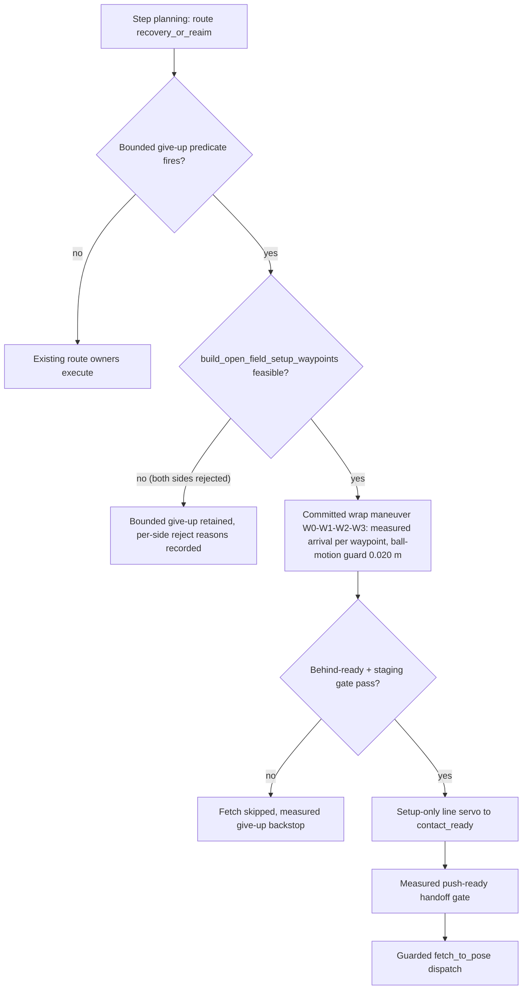

# Open-Field Setup Trajectory Owner — Design (June 9, 2026)

Status: **design complete, implementation sequencing requires supervisory
choice**. Fred's June 9 decision let Multi-Ball Retrieval v1 promote with
bounded give-up as an accepted terminal outcome, leaving this owner as the
headline v1.1 capability. The June 15/16 postfix seed `20260651` gate then
produced two bounded setup give-ups in one seed run and crossed the documented
stop-and-report bound. This design is the approved capability plan if the owner
is pulled into the current requalification lane or kept as v1.1.

Current handoff surface: `docs/handoffs/README.md`, which links the June 16
decision packet, approval-gated Slice 1 work-order draft, and browser-watchable
visual proof.

Branch context: `spike/fetch-multiball-open-field-20260606`, designed against
commit `eb54a05`.

## The capability gap this closes

The seed `20260648` route-diverse gate
(`artifacts/session/live_multiball_route_diverse_seed20260648_4x3_bounded_giveup_20260608/fetch_multiball_retrieval_gate/scorecard.md`)
passed with `11/12` deliveries and one bounded give-up:
`seed20260648_mb_route_diverse_s02_setup` step 3 `ball_2`, reason
`field_bounded_setup_pose_requires_open_field_setup_planner`, next capability
`open_field_setup_trajectory_owner_required`.

The June 15/16 postfix seed `20260651` requalification gate expanded the same
capability gap from planned skip to measured setup failure:
`artifacts/session/live_multiball_route_diverse_seed20260651_4x3_postfix_20260615/fetch_multiball_retrieval_gate/scorecard.md`.
It delivered `10/12` and recorded two bounded give-ups, both
`measured_setup_handoff_failed_before_contact` with next capability
`open_field_setup_trajectory_owner_required`:
`seed20260651_mb_route_diverse_s01_nav2` step 3 `ball_3`
(`closest_approach_m=0.656639`) and
`seed20260651_mb_route_diverse_s04_ready` step 3 `ball_2`
(`closest_approach_m=0.774709`). The visual package found no contradiction
between the frame sequence and the setup-failure classifications.

The geometry class: the ball sits near the field boundary with the target on
the far side (ball-target angle >= 145 deg, robot on the target side), so the
push-ready setup pose "behind" the ball lies at or beyond the field edge. The
current owners cannot solve it:

- `bounded_nav2_setup_standoff` bisects the standoff along the ball-target
  back-line only — it cannot route *around* the ball.
- The recovery orbit recomputes a single greedy goal per control tick — no
  committed trajectory, and its behind-ball offset itself leaves the field in
  this geometry.
- The wraparound subsystem (3-waypoint side-entry plan) is the right shape but
  is disabled in gate runs (`--disable-wraparound-setup` always set), gated to
  `local_setup_capture` only, and not boundary-aware.

## How this design was produced

Multi-agent judged design study (June 9): four parallel readers grounded the
facts (runner setup-ownership code, frozen give-up geometry artifacts,
architecture-contract docs, gate integration points); three independent
designers each produced a complete design from a distinct angle; three judges
scored every design through correctness, contract, and delivery lenses,
verifying the geometric claims numerically against the frozen seed `20260648`
case.

## Candidates and verdict

| Design | Correctness judge | Contract judge | Delivery judge | Sum |
| --- | --- | --- | --- | --- |
| Boundary-Aware Wraparound Promotion (minimal extension, no new route label) | 40.5 | 41 | **41** (winner) | 122.5 |
| Nav2-Staged Open-Field Setup Owner | 30 | 28.5 | 32 | 90.5 |
| Bounded Orbit-Arc Setup Trajectory Owner (new route label) | **41** (winner) | **42** (winner) | 39 | 122 |

The Nav2-staged design is a **no-go**: it hands ball-relative wrap maneuvering
to Nav2's replanning behavior tree, whose executed path between waypoints is
unconstrained near an uncostmapped 4 cm ball. Planned chord clearance is not
binding on the executed path. Standing rule worth keeping: any future owner
that delegates ball-relative legs to Nav2 must be rejected at review time
unless the ball is in the costmap.

The two finalists effectively tied (122.5 vs 122), and the judges' graft lists
converged on the same synthesis: **land the minimal extension first, promote to
the named route owner second.**

## Decision: two-slice landing

### Slice 1 — Boundary-Aware Wraparound Promotion (behind a CLI flag)

Promote the existing wraparound machinery into a boundary-aware open-field
setup maneuver, with zero `planner_gate` changes, no new route label, and the
give-up reason string unchanged. Roughly two production files, ~270 lines.

New planner `build_open_field_setup_waypoints` (runner, beside
`build_wraparound_setup_waypoints`):

- Side-entry / behind-side / final-behind waypoint chain per side sign:
  W1 = ball + 0.62·n, W2 = ball + 0.58·u_back + 0.62·n,
  W3 = ball + 0.46·u_back at line yaw (existing standoff constants).
- **Field clamp**: W1/W2 clamped into field bounds shrunk by
  `OPEN_FIELD_SETUP_WALL_MARGIN_M = 0.10`; W3 never clamped (the give-up
  predicate's bounded-standoff >= 0.60 guarantee proves W3 at 0.46 and W2's
  longitudinal 0.58 always fit in-field).
- **Clearance floor**: every chord keeps >= `0.30` m ball clearance via
  `point_segment_distance`; entry chord below `0.42` m triggers a W0 radial
  back-out along the robot-ball ray (monotonically increases ball clearance).
- **Side ranking**: feasibility, then min chord clearance, then path length;
  both sides infeasible => bounded give-up retained with per-side reject
  reasons serialized into the step detail.
- Gate integration: `bounded_give_up_decision` calls the builder after the
  existing predicate matches; feasible plan => step stays executable
  `recovery_or_reaim`, runner re-derives the plan from measured pose at
  execution under `--open-field-setup-maneuver` (gate plan is advisory).
- Execution is the existing executor verbatim
  (`collect_wraparound_setup_samples` already accepts N-waypoint lists —
  verified; no executor generalization work needed), with the 0.020 m
  ball-motion abort and per-waypoint measured arrival validation.

Grafted hardening requirements (from the judge panel, all mandatory for
slice 1):

1. Degenerate-entry skip rule: waypoint within ~0.05 m counts as reached (the
   frozen case itself hits a 4.9 mm degenerate entry in the orbit-arc
   parameterization).
2. Boundary-tightened waypoint tolerance: 0.060 m for waypoints within
   ~0.25 m of a wall (executor already reads per-waypoint
   `position_tolerance_m`).
3. Measured staging gate before line-servo release: |lateral| <= 0.12 m and
   |yaw error| <= 12 deg via `_route_geometry_from_poses` — the wraparound
   behind-ready pass alone has no lateral/yaw bound.
4. Stage-indexed failure reasons (`open_field_setup_stage_failed:W2:...`)
   parsed into the mission summary.
5. Full per-side candidate evaluation serialized into both the retained
   give-up detail and the executed plan record.
6. Persistent-field multiball clearance: chord checks against ALL remaining
   undelivered ball poses, not just the target ball.
7. Shared give-up predicate helper used by both the gate's
   `bounded_give_up_decision` and any route rewrite, so the predicates cannot
   drift.
8. Planner-stability unit test: re-plan from the measured post-step pose in
   addition to the decision pose (4.6 cm apart in the frozen case); side and
   feasibility must not flip.
9. Predicate-region property sweep test (angle 145-180 deg, bounded standoff
   0.60-0.65, target-side 0.35-0.70, lateral 0.10-0.24): always either an
   admissible plan with all waypoints in-field and effective (not
   center-to-center) clearance above floor, or a named reject reason.
10. Synthetic corner-pinned infeasible regression so the retained give-up
    path, reason payload, and scorecard milestone string stay covered after
    the predicate narrows.
11. Bounded single-replan-from-measured-state policy for non-ball-motion
    stage failures; ball-motion violations stay immediately terminal.
12. Executor-identity stamp (`open_field_arc_setup` vs legacy wraparound) in
    the layout `maneuver_plan` so evidence review can distinguish rows while
    the frozen 7-intent vocabulary is reused unchanged.

### Slice 2 — Promote to the named route owner (after live mileage)

Once slice 1 has live mileage (frozen layout, s02 scene, full-seed
requalification), promote to route label `open_field_setup_trajectory` with
executor `open_field_arc_setup` and adopt the orbit-arc construction, which
the correctness and contract judges scored highest:

- Orbit circle on the ball; radius ladder (0.58, 0.52, 0.46, 0.40) x
  {CCW, CW}, conservative continuous-arc field check (endpoints + axis-extreme
  angles — provably bounds wall approach on a convex field).
- Arc discretized at 30 deg (measured correction roughly every 0.27 m), then
  behind-ball pose, then final setup pose with standoff ladder
  (0.46, 0.40, 0.34).
- Candidate ladder with per-candidate reject reasons: give-up diagnosis
  upgrades from "no owner exists" to "owner rejected because X".
- Route-level scorecard provenance for the capability (slice 1 rows stay
  labeled `recovery_or_reaim`, distinguishable only via detail payload — the
  known cost of the cheap first slice).

Slice 2 carries the route-taxonomy churn (planner_gate classification branch,
route-quality calibration that can flip ball ordering in unrelated scenes) —
that is exactly why it waits for slice 1 mileage and needs a label-invariance
sweep across the existing seeded one-ball corpus before merge.

## Step flow after slice 1

All downstream measured gates are untouched: behind-ready, setup-only line
servo to `contact_ready` (lateral <= 0.030 m, yaw <= 3 deg, zero pre-ready
ball motion), measured push-ready handoff, guarded fetch dispatch, terminal
delivery radius 0.300 m, and the mission-level contact-quality proof.

## Frozen-case verification (numerical)

For the frozen geometry — ball (1.578356, 0.321342), target (0.95, 0.0),
robot (1.224993, -0.052715), line yaw -152.91 deg, bounded standoff 0.642 —
the slice-1 planner solves it on the robot's own side: W2 clamps at the
x = 2.20 wall to (2.10, 0.033) keeping ~0.59 m ball clearance; W3 lands
in-field with 0.162 m margin; chord clearances 0.456 / 0.580 / 0.446, all
above the 0.30 floor and the 0.42 back-out trigger; committed path 1.526 m.
The step flips from bounded give-up to executable, taking s02 to 3/3 and the
seed `20260648` gate to an expected 12/12 with 0 give-ups. Judges verified
these numbers independently (one found a minor arithmetic slip in the design
text — 0.596 m actual vs 0.580 m claimed clamped-W2 clearance — in the safe
direction).

## Pre-merge requalification ladder (mandatory, in order)

1. `python -m pytest tests/test_fetch_multiball_retrieval_gate.py -q` with the
   flipped expectations plus the new property-sweep, planner-stability, and
   synthetic-infeasible tests.
2. `fetch_moonshot_regression_manifest` run (route-owner-affecting change).
3. Targeted live proof on the frozen layout
   `target_layouts/seed20260648_mb_route_diverse_s02_setup_step03_ball_2.json`
   — this is also where to measure real maneuver duration (estimates range
   20-90 s; validate the 90 s wraparound duration budget and the 420 s step
   class before locking timeouts) and to observe wall-margin behavior with the
   physical robot footprint.
4. Persistent-field `seed20260648` s02 scene, expect 3/3.
5. Full seed `20260648` 4x3 route-diverse gate, expect 12/12, 0 give-ups.
6. Seed `20260647` invariance gate: 12 executable, 0 give-ups, unchanged
   route labels (not just unchanged counts).
7. Track the planned-feasible/executed-infeasible flip rate and the
   `measured_setup_handoff_failed_before_contact` rate across these runs.

## Open concerns carried into implementation

- Clearance accounting is center-to-center; compute and document the effective
  worst-case gap (floor minus arrival tolerance minus chassis half-width minus
  ball radius) and watch near-graze instances live.
- Field bounds are script constants duplicated in runner and gate, not derived
  from the world SDF; gate-side analysis must import the runner's planner
  (the `runner_nav2_setup_analysis` pattern), and physical-wall existence at
  the bounds needs one rehearsal observation.
- In-place heading_align (~175 deg) at the predicate-region minimum robot-ball
  distance (~0.364 m) assumes rotation does not translate; wheel-slip creep is
  covered only by the ball-motion guard — verify live, consider a bounded
  rotation-duration guard.
- The legacy 1.10 m ball-target cap remains a scoped, named limitation
  (gate scenes cap at 0.84 m); stamp it as a reject reason, not a mystery.
- Hardware gap is the pose source: the executor's measured validation rides
  sim-truth `dynamic_pose` sampling, which does not exist on the Orin robot.
  Keep the stage machine pose-source-agnostic, record provenance, and keep
  `hardware_proven=false` claims accurate per the `robot_fidelity_orin`
  contract.
- Adjacent cleanup while editing `build_step_command`: the dead inner
  conditional at `fetch_multiball_retrieval_gate.py:1071-1075` (compares
  `route_label` to `ROUTE_LOCAL_SETUP_CAPTURE` inside a
  `ROUTE_NAV2_REPOSITION` block) — confirmed dead in this review.

## Relationship to the v1 promotion decision

**Decided June 9, 2026 (Fred): Option A.** v1 promotes with bounded give-up
accepted as a terminal outcome; this owner is the headline v1.1 capability and
slice 1 starts after v1 promotion. The numeric promotion bar approved the same
day: five consecutive green route-diverse seeds, delivery rate >= 90%, all
non-deliveries bounded-and-diagnosed, visual package green every run.

(Original framing, for the record: Option A = v1 accepts bounded give-up,
owner becomes v1.1; Option B = v1 requires the owner, with the
requalification ladder folded into the v1 promotion gate.)
