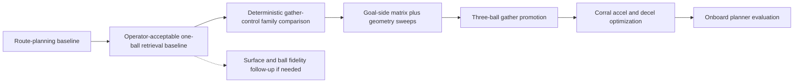

# Roadmap 2026 H2

## Near-Term (First UAT to Full Visual UAT)

Current status as of February 27, 2026:

1. First-UAT promotion gate is green (`session 20260227T230314Z`).
2. Full headless replay gate is green (`session 20260227T231443Z`).
3. Visual milestone evidence runs are green for M1/M2/M3 (latest M2 `20260227T232250Z`, M3 `20260227T232745Z`).
4. Next promotion focus is repeatability and soak cycles for the same gates.

1. Keep `scripts/run_first_uat.ps1` as the default operator entrypoint on `ExecutionLane=container_kilted`.
2. Keep gate-critical first-UAT steps container-native (no host `/opt/ros/kilted` dependency).
3. Achieve first-UAT green on canonical target:
   - coordinate summary `pass=true`
   - milestone 1 evidence bundle present
4. Run headless replay gates in sequence:
   - coordinate
   - snapshot verification
   - orientation
   - Nav2 readiness
   - multi-target Nav2
5. Run visual milestone progression:
   - milestone 1 (perception)
   - milestone 2 (3D estimate coherence)
   - milestone 3 (autonomous approach)
6. Freeze operator docs only after one green first-UAT cycle and one green full headless replay cycle.
7. Keep `scripts/run_headless_pre_llm.ps1` as the default developer push path with `Lane=dual` until LLM integration starts.

Status update as of February 28, 2026:

1. Pre-LLM dual-lane campaign achieved `3/3` green:
   - `artifacts/session/20260228T155850Z/pre_llm_headless_summary.json`
   - `artifacts/session/20260228T160643Z/pre_llm_headless_summary.json`
   - `artifacts/session/20260228T161425Z/pre_llm_headless_summary.json`
2. Fidelity soak gate is green:
   - `artifacts/session/20260228T162201Z/pre_llm_headless_summary.json`
   - includes Nav2 duration `1200s` and 12-goal multi-target sequence.
3. Campaign trend report and RC package generated:
   - `artifacts/session/20260228T164623Z/pre_llm_campaign_trend.json`
   - `artifacts/session/20260228T164654Z/readiness_report.json` (`pass=true`)
4. Pre-LLM contract freeze applied:
   - `runtime/contracts/llm_control_contract.yaml` (`contract_status: frozen_pre_llm`)

## Mid-Term (Dual-Lane Regression Hardening)

1. Keep Jetty gate lane as authoritative release lane.
2. Maintain Isaac lane as parity/cross-validation lane behind bridge contract.
3. Add weekly dual-lane regression policy:
   - Jetty full headless gate replay weekly
   - Isaac subset parity replay weekly
4. Enforce per-session isolation:
   - unique compose project naming
   - stale project cleanup before each run
   - explicit ROS domain strategy per session

## Pre-LLM Integration Gate Checklist

1. Acquire/plan/track low-level interfaces are frozen and documented.
2. Safety contracts are frozen:
   - stale detection timeout
   - navigation timeout
   - safe stop behavior
3. Required artifact set is green in one release candidate cycle:
   - coordinate summary
   - orientation summary
   - nav readiness summary
   - milestone evidence bundle(s)
4. Unresolved failure signatures are tracked in session readiness reports.
5. Final GUI rehearsal aligns with headless gate outcomes before LLM handoff.

## Post-Freeze Bounded LLM Promotion Path

Once the frozen pre-LLM boundary is in place, the next roadmap step is not open-ended autonomy. It is a bounded promotion ladder:

1. headless LLM proof over the frozen intent contract (complete)
2. repeatability gate on the authoritative `container_kilted` lane (complete)
3. simple browser UAT demo for the same proof path (complete)
4. bounded supervisor reuse across the visible-ball M3 scenario family (complete)
   - `visit_m3_positions` scenario validates center, left, right targets using the same policy
5. target prior contract for multi-target scenarios (complete)
   - executor receives expected target position from the mission layer, not from sim ground truth
   - prior-based lock gating and prior-based track approach implemented and tested
   - `visit_single_ball_proof` and `visit_three_ball_sequence` passing
   - sim truth probe is a validation oracle (test-time only), not an executor runtime dependency
   - this makes the executor's target discrimination portable to hardware
6. provider benchmarking infrastructure for a future on-machine model path on Orin Nano (complete)
   - provider abstraction (`DecisionProvider` protocol) and replay comparison tool exist
   - `LocalModelProvider` placeholder ready for Orin Nano integration
   - benchmarking is not a prerequisite for the current promotion ladder

Status update as of April 3, 2026:

1. All six promotion ladder steps are complete.
2. Target prior contract validated: `visit_three_ball_sequence` 3/3, `visit_m3_positions` 3/3.
3. Escalation rules formalized with table and 19 policy tests.
4. Browser UAT surface meets acceptance criteria (Watch/Drive/Inspect tabs).
5. Provider benchmarking infrastructure in place (replay comparison tool, local provider placeholder).

Status update as of April 4, 2026:

1. Direct intent dispatch implemented: file-based inbox replaces docker-exec-per-intent.
2. Intent dispatch latency reduced from ~13s to <1s.
3. Zombie dashboard prevention: startup kills stale processes, `allow_reuse_address` enabled.
4. Dashboard URL fix: client-facing URL uses `127.0.0.1` when binding `0.0.0.0` (Windows).

### Intended Outcomes

1. prove that the LLM can supervise high-level bounded decisions without owning low-level loops
2. keep deterministic policy/gating as the safety and contract layer
3. give operators a browser demo that is simple enough to trust and understand
4. keep the control architecture compatible with both:
   - Wi-Fi/cloud inference
   - smaller local-model inference later
5. ensure multi-target discrimination is solved in sim before hardware POC:
   - executor target verification uses mission-provided priors, not sim-only ground truth
   - the same mechanism works on hardware with operator-provided or observation-derived priors

### Explicit Non-Goals For This Roadmap Slice

1. freeform browser prompt control
2. open-ended task decomposition
3. end-to-end VLA action generation
4. autonomous environment lifecycle management by the LLM
5. pivoting the roadmap slice to end-to-end VLA control
6. replacing deterministic perception, planning, or execution loops with model-generated low-level action

## Next Roadmap Slice: Gather Generalization Slice, Goal-Side Matrix And Geometry Sweeps

The route-planning baseline remains the protected regression floor, and the
single-ball corral path now has an explicit dual-radius scoring model on
realistic soccer-practice surfaces. Using the committed shorter spur geometry,
the current one-ball flow is acceptable enough as the working development
baseline. The next gather milestone is no longer framed as "clear
`capture_entry` and green the named matrix cases." The latest April 18, 2026
`plus45` evidence progressed from `pre_stage` failures to `stage`, then to
`capture_entry_ready`, yet still failed after the handoff, which now points to
brittle cross-phase transitions rather than a single remaining threshold bug.
Fresh-only April 19, 2026 `plus45` evidence then stayed red `5/5` in
`pre_stage_timeout` even after retry-oriented escape fixes, which shows the
current controller can satisfy local branch objectives while still failing the
global behind-ball objective. The goal-side matrix remains the first offline
coverage harness, and the next gate extends beyond those named cases into
nearby geometry sweeps and controller-family comparisons. The deeper April 19,
2026 truth-state escape oracle then still produced `0/5` stable goal-side
clears on the representative fresh-only `plus45` fixtures, which means the
next move should be a richer offline escape sandbox rather than another live
controller-family promotion attempt.

Surface and ball fidelity remain an open realism question, and the calibration
harness remains useful, but that thread no longer blocks the roadmap. The
dashboard UAT story stays honest: route-planning is protected, and gather UAT
does not move until the redesigned control path proves generalization across
the harness.

The important product outcome stays explicit: we care about the ball ending up
retrieved and stopped in the corral area, not whether it stayed perfectly
centered under the spur. The outer retrieval ring remains a 5-foot diameter
circle (`0.762 m` radius), while the inner `0.20 m` control ring stays in
place for release and correction heuristics. In the later multi-ball
milestone, already retrieved balls helping arrest later balls through
collisions is a valid assist, not an anti-goal.

### Step 1: Route-Planning Baseline - Complete

Goal: keep the current visit-and-avoid stack as the regression floor while new
gather behavior lands above it.

Validated evidence:

1. authoritative serial dashboard gate: `artifacts/session/20260412T170306Z/route_planning_serial_gate/campaign_summary.json`
2. serial operator scorecard: `artifacts/session/20260412T170306Z/route_planning_serial_gate/scorecard.md`
3. isolated parallel soak baseline: `artifacts/session/20260412T054630Z/route_planning_parallel_soak/campaign_summary.json`

What this means:

1. `visit_route_planning` is now a one-click self-contained dashboard proof
2. already-visited balls are avoided on later legs instead of being driven through
3. serial dashboard UAT remains the trust surface
4. parallel soak remains the throughput surface

Exit criterion for this step:

1. keep the route-planning serial gate green while corral/place work is added

### Step 2: Single-Ball Corral / Place Through Dashboard UAT - Complete

Goal: the robot keeps one ball controlled at the front of the robot and places
it into a designated area, then proves that behavior through the browser
dashboard before the operator-facing primary action changes.

Assumptions for this proof:

1. operating surface is smooth, like a soccer field or similar practice surface
2. the robot gets a simulated front-mounted catcher shaped like a spur with a U opening outward
3. the catcher sits below the ball midline so the ball can roll into a stable push envelope while the robot advances
4. success is measured by zone entry and control, not just contact

Work:

1. keep `visit_route_planning` green as the regression baseline while catcher/corral work lands
2. hold the single-ball corral/place proof green offline and headless before dashboard handoff
3. keep `corral_single_ball_place` integrated in the dashboard control plane without promoting the primary button yet
4. stabilize repeated operator-visible dashboard UAT on the one-ball flow until it is green `3/3`
5. repoint and relabel the old `Run LLM Route Plan` primary button only after the dashboard proof is green

Validated evidence:

1. single-ball headless `5/5`: `artifacts/session/20260413T054235Z/gather_mission_repeatability/campaign_run_summary.json`
2. clean browser/dashboard `3/3`: `artifacts/session/20260413T_CORRAL_DASHBOARD_UAT_GATE2/dashboard_uat_summary.json`
3. milestone promotion commit: `98ca4a2`

Acceptance:

1. single-ball dashboard UAT passes `3/3`
2. the ball is kept controlled and placed into the zone without ricochet dependence
3. the old primary route-planning button is replaced by the new single-ball corral action only after that proof
4. route-planning regression evidence remains green

Operator-facing promotion rule:

1. before dashboard UAT passes, `corral_single_ball_place` may exist as a scenario but does not replace the primary route-planning action
2. after dashboard UAT passes, the existing `Run LLM Route Plan` primary button is repointed or relabelled to the single-ball corral flow
3. that button replacement is the promotion signal for this milestone

Interfaces held constant in this slice:

1. active UAT scenario: `corral_single_ball_place`
2. protected regression scenario: `visit_route_planning`
3. deferred later scenario: `gather_three_ball_zone`
4. deferred provider seam: `plan_collection_route(...)`
5. no frozen-contract changes in this slice

### Step 3: Surface-Aware Single-Ball Corral Refinement - Infrastructure Complete

Goal: simulate the real practice surfaces we care about, then tune one-ball
corral placement so surface friction helps the ball settle inside the zone
instead of rolling through and overshooting.

Why this mattered:

1. fresh UAT showed the ball can still overshoot after it exits the catcher
2. real turf and grass surfaces add friction that should arrest the ball earlier than the current sim surface does
3. it is better to get one-ball place-and-settle behavior right before adding multi-ball gather complexity

Completed work:

1. research how to simulate turf-like and grass-like practice surfaces in the active Gazebo/SDF stack
2. choose one canonical friction preset for short turf and one for short grass, then make them repeatable in sim
3. rerun the one-ball corral proof on those surfaces and measure zone overshoot and settle distance
4. tune the corral placement behavior so friction works to our advantage once the ball leaves the catcher
5. keep `visit_route_planning` green while the surface and corral changes land

Historical evidence under the earlier tighter settle bar:

1. route-planning regression pass: `artifacts/session/20260413T135805491949Z/visit_mission/20260413T135817Z/mission_verdict.json`
2. canonical short-turf headless `5/5`: `artifacts/session/20260413T135949Z/gather_mission_repeatability/campaign_run_summary.json`
3. secondary short-grass headless `3/3`: `artifacts/session/20260413T140714Z/gather_mission_repeatability/campaign_run_summary.json`
4. dashboard UAT `3/3` on calibrated short turf: `artifacts/session/20260412T_CORRAL_DASHBOARD_UAT/dashboard_uat_summary.json`

Checkpoint truth after the 5-foot retrieval-corral promotion:

1. the surface presets and contact seams still exist and remain the right structure
2. the strict sim-only one-ball gate became mixed again after the scoring bar changed
3. fresh mixed checkpoints include failing conservative-lane runs:
   - `artifacts/session/20260416T023444Z/gather_mission_repeatability/campaign_run_summary.json`
   - `artifacts/session/20260416T023035Z/gather_mission_repeatability/campaign_run_summary.json`

Acceptance for this step now means infrastructure only:

1. at least one turf-like surface preset and one grass-like surface preset are reproducible in sim
2. the surface-comparison seam exists even though the canonical calibrated lane is now reopened
3. route-planning regression evidence remains green

What this means:

1. `short_turf` remains the intended default one-ball comparison surface
2. `short_grass` is credible as a secondary comparison surface and fallback candidate
3. gather artifacts now carry settle metrics (`surface_profile`, `final_settle_distance_m`, `max_overshoot_distance_m`, `settle_time_s`, `release_recontact_count`)
4. future multi-ball and speed work will build on this surface structure, but the canonical lane decision remains an open calibration task

### Step 4: 5-Foot Practical Retrieval Baseline - Accepted Checkpoint

Goal: lock the one-ball outcome bar around what a player would call retrieved:
the ball finishes inside the 5-foot corral area, comes to rest there, and does
not meaningfully roll away after the final release or handoff.

Why this checkpoint matters:

1. it defines the product outcome in operator terms rather than overfitting to perfect spur retention
2. it gives later multi-ball work a practical retrieval footprint instead of a too-tight center-only target
3. it keeps the inner `0.20 m` control ring as a robot heuristic without making that tighter ring the product pass bar

Implemented checkpoint:

1. outer retrieval corral fixed at `5 ft` diameter (`0.762 m` radius)
2. inner control ring remains `0.20 m`
3. artifacts and dashboard state carry `final_inside_retrieval_corral`, `ball_stopped_in_corral`, and `rolled_away_after_release`
4. visible corral marker shows both rings
5. the committed shorter spur geometry is restored as the baseline geometry

Checkpoint truth:

1. route-planning regression remains green after the latest corral/contact tuning:
   - `artifacts/session/20260416T023747Z/visit_mission_repeatability/campaign_run_summary.json`
2. operator review now considers the current one-ball behavior acceptable enough to continue development from here
3. strict conservative-lane `short_turf` evidence is still mixed, so this checkpoint should be treated as a practical baseline rather than an exact surface-fidelity proof

Acceptance for this checkpoint:

1. route-planning regression evidence remains green
2. the promoted one-ball flow remains acceptable as the practical retrieval baseline
3. `final_center_inside_zone` and clean spur retention remain visible in artifacts, but they are diagnostic rather than gating
4. no claim is made yet that the simulation exactly matches real grass or turf behavior

### Step 5: Generalizable Gather Control Redesign

Goal: extend the accepted one-ball practical-retrieval baseline into
`gather_three_ball_zone` by replacing brittle phase-specific threshold tuning
with a more general deterministic gather-control design. The active problem is
cross-phase stability across `pre_stage`, `stage`, `capture_entry`, and the
post-`capture_entry_ready` handoff.

Why this is the next slice:

1. the one-ball flow is already acceptable enough to serve as a mechanical baseline
2. multi-ball gather is the next product milestone that actually exercises sequencing and already-placed-ball interactions
3. the latest April 18 `plus45` evidence shows failures migrating across phases, which means single-threshold tuning is no longer the right framing
4. acceleration and deceleration tuning should optimize a multi-ball behavior we trust, not a controller whose handoffs are still brittle
5. exact surface fidelity is still open, but it no longer blocks this next milestone
6. the goal-side matrix plus nearby geometry sweeps are the offline coverage harness for this slice
7. dashboard UAT stays blocked until that harness shows robust cross-phase behavior

Work:

1. keep `gather_three_ball_zone` in the dashboard as a secondary gather scenario, but only behind the offline generalization gate
2. keep the 5-foot diameter retrieval corral (`0.762 m` radius) and `0.20 m` inner control ring fixed
3. preserve the current practical-retrieval pass bar:
   - ball center finishes inside the outer corral
   - ball stops there
   - ball does not meaningfully roll away
4. redesign the shared gather path around stable cross-phase invariants instead of named-case thresholds
5. treat the current 10-foot multi-ball arc matrix as the first coverage and regression harness:
   - radius: `3.048 m` from corral center
   - cases: `+45`, `0`, `-45`
   - `180` backside guard case retained in the matrix
6. extend the harness with small spawn jitter or geometry perturbation sweeps so promotion is not based only on four fixed placements
7. keep `visit_route_planning` green while multi-ball gather work lands
8. keep non-push travel intentionally fast so the robot moves on quickly once a ball is practically retrieved
9. keep surface and ball fidelity calibration available as a realism follow-up rather than the blocking lane
10. compare candidate designs on shared metrics:
   - terminal failure stage
   - `pre_stage_pose_reached`
   - `staging_pose_reached`
   - `capture_entry_reached`
   - successful handoff after `capture_entry_ready`
   - mission pass / practical retrieval pass

Current truth:

1. the one-ball practical-retrieval baseline is accepted enough to keep moving, but fresh strict `short_turf` reruns are still mixed:
   - `artifacts/session/20260416T184447Z/gather_mission_repeatability/campaign_run_summary.json`
2. `visit_route_planning` remains green and protected:
   - `artifacts/session/20260416T184326Z/visit_mission_repeatability/campaign_run_summary.json`
3. the 5-foot diameter corral model is already implemented and operator-visible
4. `gather_three_ball_zone` is now wired into the dashboard as a secondary gather scenario on `short_turf`, but dashboard UAT is blocked until the generalization gate is green
5. the final multi-ball corral audit fields are implemented and emitted in live artifacts:
   - `final_corral_audit`
   - `final_all_targets_inside_retrieval_corral`
   - `final_all_targets_stopped`
   - `final_three_ball_corral_pass`
   - `retrieved_count`
6. the first fresh three-ball sanity run populated those fields, but it still failed on the first-ball release/settle path before any full three-ball proof:
   - `artifacts/session/20260416T184739Z/gather_mission_repeatability/campaign_run_summary.json`
7. the calibration harness exists, but it did not lock a canonical surface yet:
   - `artifacts/session/pre_tune_surface_calibration/corral_surface_calibration/campaign_summary.json`
   - `artifacts/session/halfstep_probe_surface_calibration/corral_surface_calibration/campaign_summary.json`
8. that unresolved fidelity question is now treated as a known follow-up, not the gate in front of multi-ball gather
9. the active three-ball checkpoint now uses the 10-foot multi-ball arc layout and faster non-push transit
10. the protected regression floor stayed green after the faster transit tuning:
   - `artifacts/session/20260417T040105820076Z/visit_mission/20260417T040503Z/mission_verdict.json`
11. the earlier delay before starting the second ball is materially improved in the latest live trace:
   - `ball_b` completed at `04:02:20.475Z`
   - `ball_a` visit attempt started at `04:02:21.599Z`
   - gap: about `1.1 s`
   - trace: `artifacts/session/20260417T040105820076Z/gather_mission/20260417T040116Z/gather_sequence.jsonl`
12. the freshest `plus45` live evidence now reaches `capture_entry_ready` and still fails after the handoff, which is the clearest current sign that the shared gather transitions need redesign:
   - `artifacts/session/live_plus45_captureentry_0625_20260418/gather_mission_repeatability/campaign_run_summary.json`
   - `artifacts/session/20260418T212252235403Z/gather_mission/20260418T212303Z/state_history.jsonl`
13. fresh failing three-ball checkpoint evidence still exists:
   - `artifacts/session/20260417T040027Z/gather_mission_repeatability/campaign_run_summary.json`
14. the deeper truth-state escape oracle still reports `0/5` stable clears and only `near_clear` evidence on the primary fresh-only `plus45` fixtures:
   - `artifacts/session/live_plus45_escape_oracle_deep_20260419/gather_escape_oracle/oracle_summary.json`
   - `artifacts/session/live_plus45_escape_oracle_deep_20260419/gather_escape_oracle/scorecard.md`

Acceptance:

1. route-planning regression evidence remains green
2. the goal-side matrix passes across `+45`, `0`, `-45`, and `180 backside`
3. nearby spawn jitter or geometry perturbation sweeps do not reopen cross-phase failures
4. the promoted path succeeds after `capture_entry_ready`, not only up to it
5. `gather_three_ball_zone` reaches `placed_count == 3` and `retrieved_count == 3`
6. `final_all_targets_inside_retrieval_corral == true`, `final_all_targets_stopped == true`, and `final_three_ball_corral_pass == true`
7. `post_visit_revisit_count == 0` in the promotion bundle
8. already retrieved balls remain in the world and behave as normal obstacles or passive stopping aids
9. one-ball baseline behavior is not regressed while multi-ball gather lands

### Step 6: Gather-Control Alternatives Portfolio

Goal: find the best bounded gather-control approach for the single-ball corral
task without assuming the final design must contain a separate "recovery
strategy." The known wrong-side and stall fixtures are required stress tests,
but the primary comparison is end-to-end task performance.

Why this comes next:

1. the deeper oracle and sandbox already showed that the current simplified escape formulation is still not enough to prove stable goal-side exit
2. the April 20, 2026 audit stack says the strongest current preserved safe-control signal is still `strategy_authority_limited`, but the helper turn-authority / turn-profile lane is now preserved as a comparison baseline after `helper_turn_authority_contract_audit` returned `stop_and_branch` with blocking_reason=`sign_parity`, and the follow-on `manual_drive_sign_parity_audit` now points the runtime-check branch at the concrete `scripts/run_probe_odom_world_sign_chain.ps1 -CampaignId <id>` follow-on
3. the escape fixtures should be treated as hard-case evidence, not as proof that the winning architecture must expose a named recovery mode
4. a candidate can win by avoiding the bad geometry earlier, by handling it when it happens, or by safely switching away before it becomes a stall
5. serial dashboard proof should remain the trust surface while this broader alternatives portfolio competes offline and in shadow first
6. this portfolio is local to the gather-control layer; it does not replace the later onboard high-level visit-and-gather planner evaluation

Work:

1. keep one safe control:
   - preserve the helper turn-authority / turn-profile / manual-drive contract lane as the deterministic comparison baseline informed by the April 20 audit stack, not as the next direct promotion path while `sign_parity` remains the blocking reason
2. open broader alternative paths as co-equal exploration branches:
   - deterministic gather-controller branch:
     - `region_funnel_v1`: region or funnel targets that avoid brittle exact `pre_stage` points
     - explicit scripted maneuvers such as back up, arc around, and re-approach when needed
   - ROS-native local-planner branch:
     - `nav2_reacquire_v1`: direct bounded `NavigateToPose` pre-stage reacquisition before handing back to baseline staging
     - docking-style local staging / recovery
     - MPPI-style local recovery
   - learned maneuver selector branch:
     - rule-labeled maneuver-family choice in shadow mode
   - learned bounded-action backend branch:
     - small bounded local action proposals in shadow mode
   - learned switch / abstain backend branch:
     - stall detection, backend selection, or fallback gating in shadow mode
3. compare candidates through a shared gather-control adapter that can start at the current manual `pre_stage` seam, but does not require every candidate to model itself as "recovery"
4. keep every branch bounded by the same downstream safety contract:
   - deterministic translation remains authoritative
   - `gather_motion_bridge.py` remains the runtime clamp surface
   - controller and hardware caps remain authoritative
5. judge every branch on the same two-layer harness:
   - end-to-end gather score: mission pass, practical retrieval placement, phase reached, post-handoff success, time-to-place, and protected-baseline regressions
   - hard-case stress score: April 19, 2026 fixtures, nearby geometry jitter, behind-ball progress, stall duration, and whether the candidate avoids or survives the known bad geometries
   - April 19, 2026 canonical `live_plus45_short_horizon_v2_20260419` corpus
   - five representative fixtures
   - nearby geometry jitter
   - neighboring-case expansion only after a branch earns it
   - fresh shadow-sim comparison before any live consideration
6. keep the protected floors unchanged:
   - `visit_route_planning` remains the regression floor
   - the accepted one-ball baseline remains protected
   - no live promotion is unlocked by this roadmap update alone
7. avoid declaring whole categories dead from one early weak result:
   - one weak formulation is branch-specific signal
   - it is not by itself proof that the whole deterministic, ROS-native, or learned category should be retired
8. keep LLM-owned real-time gather steering out of scope while allowing shadow learned backends inside the bounded Layer 3 evaluation surface

Shared evidence contract:

1. v1 portfolio analyzer bundle:
   - `artifacts/session/<campaign_id>/gather_control_portfolio/portfolio_summary.json`
   - `artifacts/session/<campaign_id>/gather_control_portfolio/scorecard.md`
   - `artifacts/session/<campaign_id>/gather_control_portfolio/<branch_name>/branch_summary.json`
2. Branch 1 hard-case stress analyzer bundle:
   - `artifacts/session/<campaign_id>/gather_control_portfolio/stress_summary.json`
   - `artifacts/session/<campaign_id>/gather_control_portfolio/stress_scorecard.md`
   - `artifacts/session/<campaign_id>/gather_control_portfolio/<branch_name>/stress_summary.json`
   - `artifacts/session/<campaign_id>/gather_control_portfolio/<branch_name>/fixtures/<fixture_label>.json`
   - fixture evidence remains analyzer-only and feeds portfolio readiness through explicit `--stress <branch>=<stress_summary.json>` inputs; it does not change runtime control or unlock live promotion by itself
3. future per-branch shadow bundle:
   - `artifacts/session/<campaign_id>/gather_control_portfolio/<branch_name>/counterfactual_replay_summary.json`
   - `artifacts/session/<campaign_id>/gather_control_portfolio/<branch_name>/shadow_summary.json`
4. learned-branch extras:
   - `artifacts/session/<campaign_id>/gather_control_portfolio/<branch_name>/teacher_dataset_summary.json`
   - `artifacts/session/<campaign_id>/gather_control_portfolio/<branch_name>/holdout_eval_summary.json`
5. readiness rule:
   - hard-case stress evidence blocks live promotion unless every required fixture is present, complete, and passing, even when a branch is the best observed end-to-end performer

Acceptance:

1. the portfolio is evaluated as a shared comparison program rather than a single mainline plus token sidecars
2. the protected route-planning floor and one-ball baseline remain untouched while the portfolio work lands
3. no branch is considered live-promotion ready until it improves end-to-end gather behavior and survives the hard-case stress slice plus fresh shadow-sim comparison
4. the later onboard model step remains a distinct high-level planning milestone rather than being merged into this local gather-control comparison work

Current direction update:

Next major milestone: Deliver Planner-Gated Generalized Fetch-To-Pose v1, a
no-shoot, robot-owned fetch behavior where an LLM/world-state planner selects
the correct route class, Nav2 owns as much real-time robot motion as the
corrected evidence supports, and a thin fetch adapter monitors delivery
geometry, object progress, escape, stale state, and replanning triggers.
Custom contact routines and AI/model proposal layers remain fallback lanes that
earn live authority only from corrected, reproducible stage-gap evidence.

Planner-gating correction: this milestone proves the planner-to-subsystem
handoff plus the bounded local fetch skill. The planner first classifies each
scene as `fetch_ready_local`, `nav2_reposition_first`,
`scan_or_perceive_first`, `recovery_or_reaim`, or
`ambiguous_or_unsafe_no_go`. Only `fetch_ready_local` cases are handed to the
fetch subsystem and scored as local fetch evidence.

May 31, 2026 evidence reset: the delivery-marker geometry issue means prior
fetch pass/fail claims require reclassification unless the artifact proves
`geometry_consistency.pass=true`, the visible delivery marker matches
`fetch_pose_world`, and the run has same-session browser-watchable onboard plus
context video. The corrected reference run is
`artifacts/session/20260531T204154158382Z/gather_mission/20260531T204255Z/mission_verdict.json`;
the corrected visual package is
`artifacts/session/uat_fetch_visual_package_postfix_20260531/fetch_visual_uat_package/scorecard.md`;
the corrected geometry audit is
`artifacts/session/fetch_geometry_evidence_audit_postfix_20260531/fetch_geometry_evidence_audit/scorecard.md`.
That run passed `fetch_to_pose` with matched marker geometry and truth telemetry
showing the ball reached about `0.158m` from the target center inside the
`0.300m` contract. Treat it as the first valid post-fix UAT reference. Broad
generalization still requires saved-layout repeatability and the seeded gate.

June 1, 2026 calibrated-ball provenance reset: direct `fetch_to_pose` evidence
now requires explicit model provenance in addition to marker geometry and video.
Commit `680e393 Use calibrated ball for fetch direct runs` changed direct fetch
defaults from the legacy `frisbee_target_ball.sdf` to
`calibrated_golf_ball.sdf`. Pre-boundary direct repeatability artifacts that do
not record `model_provenance_valid=true`, target model `calibrated_golf_ball`,
and marker model `golf_ball_delivery_zone_marker` are diagnostic. Rebuild the
evidence ladder from corrected direct runs: saved `zero`/`left05`/`right05`
one-run, saved `3/3`, seeded `6 x 1`, then browser-watchable visual UAT.

June 1, 2026 corrected saved-anchor one-run rebuild: the provenance and marker
path is functioning, and the next blocker at that point was setup/contact
reliability.
`right05` passed with `0.143206m` closest approach, `zero` failed on
first-contact no-object-motion, and `left05` failed on `capture_entry_timeout`.
The stage audit is
`artifacts/session/live_corrected_fetch_saved_anchor_one_run_audit_20260601/fetch_saved_anchor_setup_contact_audit/scorecard.md`.
The next milestone step is repair setup/contact behavior before saved-layout
`3/3`, seeded gate, or guarded-live promotion.

June 1, 2026 contact-buffer handoff validation: the operator-visible stop-short
behavior was real, and the staged fix passed the `zero` one-run proof. Commit
`02a4c12 Fix Nav2 contact-buffer fetch handoff` adds the tight corridor goal
checker, the missing depth scan TF, and a monitored handoff from Nav2 to the
deterministic contact servo when the robot reaches a close/aligned
no-object-motion contact buffer. Campaign
`artifacts/session/live_contact_buffer_monitor_servo_zero_probe_20260601/gather_mission_repeatability/campaign_run_summary.json`
passed `fetch_to_pose` with `0.179959m` closest delivery distance. Nav2 handed
off at `robot_ball_distance_m=0.195671`, the servo confirmed `0.046811m` ball
motion, and the corridor push completed with `monitor_success`. The roadmap
baseline is now staged local fetch: planner-approved local case, Nav2 corridor
approach, contact-buffer monitor, deterministic first-contact servo, Nav2
corridor push, delivery monitor. The next milestone step is a broad stage-owner
comparison, then the selected targeted repair and corrected
`zero`/`left05`/`right05` one-run.

Later June 1 saved-anchor requalification refined that sequence. The planner
handoff gate
`artifacts/session/live_planner_handoff_mixed_fetch_20260601/fetch_planner_handoff_gate/gate_summary.json`
passed `5/5`. `zero` and `left05` passed one-run under the staged baseline:
`artifacts/session/live_contact_buffer_saved_anchor_zero_one_run_20260601/gather_mission_repeatability/campaign_run_summary.json`
and
`artifacts/session/live_contact_buffer_saved_anchor_left05_one_run_20260601/gather_mission_repeatability/campaign_run_summary.json`.
`right05` failed at `capture_entry_timeout`:
`artifacts/session/live_contact_buffer_saved_anchor_right05_one_run_20260601/gather_mission_repeatability/campaign_run_summary.json`.
The audit
`artifacts/session/audit_contact_buffer_right05_one_run_20260601/fetch_saved_anchor_setup_contact_audit/scorecard.md`
classifies this as setup/capture. The roadmap now inserts a broad stage-owner
comparison before right-offset repair: current staged Nav2/contact-buffer
behavior, May 27 object-centric fetch, Nav2 corridor-push, corrected direct
`right05`, and prior acquisition or goal-side setup evidence. Repeatability,
seeded generalization, and guarded-live terminal correction wait for that
comparison.

The later June 1 setup/capture gap-fill probe requalified the front half of the
staged local fetch path. `scripts/fetch_setup_capture_gap_fill_probe.py`
compared current `ai_push_coast_servo_v1`, Nav2 corridor-push, and
object-centric behavior on `right05`:
`artifacts/session/live_fetch_setup_capture_gap_fill_20260601/fetch_setup_capture_gap_fill_probe/scorecard.md`.
The current staged path passed once at `0.271919m`; object-centric passed once
at `0.29623m`; Nav2 corridor-push missed terminal arrival at `0.572189m`.
The follow-on saved-anchor rebuild
`artifacts/session/live_ai_push_coast_saved_anchor_gapfill_one_run_20260601/calibrated_fetch_architecture_revisit/scorecard.md`
passed `zero` and `left05`, while `right05` reached capture-entry and failed
terminal arrival at `0.520765m`. The refreshed stage-quality audit
`artifacts/session/audit_ai_push_coast_gapfill_saved_anchor_one_run_20260601/fetch_saved_anchor_setup_contact_audit/scorecard.md`
classified the blocker as terminal arrival at that point and suggested narrow
terminal-arrival correction before the later clip review refined the priority.

Later operator clip review refined that sequence again. The
`ai_push_coast_servo_v1` guarded-live saved-anchor clips in
`artifacts/session/uat_ai_push_coast_capture_yaw_saved_layout_one_run_20260601/fetch_visual_uat_package/scorecard.md`
and
`artifacts/session/audit_ai_push_coast_capture_yaw_saved_layout_one_run_20260601/fetch_saved_anchor_setup_contact_audit/scorecard.md`
show one clean centerline pass and two off-axis setup/capture/handoff failures:
`left05` escapes laterally, and `right05` under-moves after unstable capture.
The roadmap sequence is now capture-geometry setup first, then saved-anchor
one-run rebuild, then terminal correction only for clean near-contract misses.
The intended algorithm is straightforward: route classification, ball-target
delivery line, capture pose behind the ball, geometry-gated setup handoff, Nav2
corridor push, delivery monitor, and bounded correction only from a clean
terminal state.

June 2 saved-anchor repeatability repair cleared the current setup/contact
blocker for the saved anchors. The corrected gate
`artifacts/session/live_fetch_setup_contact_repair_saved_anchor_3x_20260602/calibrated_fetch_architecture_revisit/scorecard.md`
passed `zero`, `left05`, and `right05` promotion `3/3` with worst closest
approaches `0.201194m`, `0.169541m`, and `0.136046m`. The stage audit
`artifacts/session/audit_fetch_setup_contact_repair_saved_anchor_3x_20260602/fetch_saved_anchor_setup_contact_audit/scorecard.md`
is `stage_quality_green=true`, with one `left05` `capture_entry_time_watch`.
The first seeded random shadow/evidence gate
`artifacts/session/live_fetch_setup_contact_repair_seeded_gate_20260602/fetch_generalization_gate/gate_summary.json`
passed `4/6` and reproduced `capture_entry_timeout` on `case01` and `case06`.
The analyzer
`artifacts/session/evidence_fetch_setup_contact_repair_seeded_gate_20260602/fetch_seeded_gate_evidence_analyzer/scorecard.md`
sets `recommended_next_action=freeze_reproduced_failures_before_tuning`.
The bounded setup repair cleared that setup/capture blocker in targeted
one-run gates:
`artifacts/session/live_fetch_frozen_case01_setup_capture_bounded_setup_v2_20260602/gather_mission_repeatability/campaign_run_summary.json`
and
`artifacts/session/live_fetch_frozen_case06_setup_capture_bounded_setup_v2_20260602/gather_mission_repeatability/campaign_run_summary.json`.
The clean seeded rerun
`artifacts/session/live_fetch_setup_capture_bounded_setup_v2_seeded_gate_clean_20260602/fetch_generalization_gate/gate_summary.json`
passed `5/6` initially with `0` reproduced failures. Its analyzer
`artifacts/session/evidence_fetch_setup_capture_bounded_setup_v2_seeded_gate_20260602/fetch_seeded_gate_evidence_analyzer/scorecard.md`
kept `case01` on the watchlist after one non-repro miss following
`fetch_push_ready`. The near-margin repair then made
`ball_already_at_delivery_margin` a readiness note when setup geometry is ready
and accepted `0.10m` contact-buffer standoff for short re-push geometry. The
case01 repeatability proof
`artifacts/session/live_fetch_case01_near_margin_gate_v1_repeat_3x_20260602/gather_mission_repeatability/campaign_run_summary.json`
passed `3/3`.

The next milestone slice first checked case04 reproducibility. The latest seeded gate
`artifacts/session/live_fetch_relaxed_standoff_v1_seeded_gate_20260602/fetch_generalization_gate/gate_summary.json`
and analyzer
`artifacts/session/evidence_fetch_relaxed_standoff_v1_seeded_gate_20260602/fetch_seeded_gate_evidence_analyzer/scorecard.md`
report `5/6` initial pass, `1` non-repro failure, and `0` reproduced failures.
Case04 missed once, then passed repro. The targeted case04 repeatability probe
`artifacts/session/live_fetch_case04_relaxed_standoff_v1_repeat_3x_20260602/gather_mission_repeatability/campaign_run_summary.json`
passed delivery `3/3`, with `missing_first_contact_alignment` in `2/3` as a
contact-quality flag. The clean shadow seeded gate
`artifacts/session/live_fetch_near_margin_case04_repeat_seeded_gate_20260602/fetch_generalization_gate/gate_summary.json`
then passed `6/6`.

The guarded-live ladder is now contract-green. The saved-layout gate
`artifacts/session/live_fetch_guarded_live_saved_anchor_3x_20260602/calibrated_fetch_architecture_revisit/scorecard.md`
passed `zero`, `left05`, and `right05` promotion `3/3`; the guarded-live seeded
gate
`artifacts/session/live_fetch_guarded_live_seeded_gate_20260602/fetch_generalization_gate/gate_summary.json`
passed `6/6`. The analyzer
`artifacts/session/evidence_fetch_guarded_live_seeded_gate_20260602/fetch_seeded_gate_evidence_analyzer/scorecard.md`
sets `promotion_evidence=True` and
`milestone_interpretation=guarded_live_seeded_gate_promotion_ready`. The
browser-watchable UAT package
`artifacts/session/uat_fetch_guarded_live_seeded_case04_20260602/fetch_visual_uat_package/scorecard.md`
passes with mobile-watchable onboard, topdown, debug, and world-stream video.
The next roadmap step is operator clip review. This keeps the broader
architecture simple: planner selects the route class, the setup/capture stage
gets the robot onto the delivery line, Nav2 owns the corridor push, and the
monitor verifies object outcome.

June 2 opposite-side fetch probe expanded the validated subsystem envelope. The
layout `ros2_config/target_layouts/golf_ball_circle_delivery_opposite_side_01.json`
places the ball beyond the far edge of the visible delivery circle from the
robot start. The first direct run exposed a geometry-source bug: setup and stage
logic used the legacy corral zone at `x=2.4` while fetch validation used
`fetch_pose_world` at `x=0.95`. The current slice preserves the legacy corral
zone for reporting and makes the active control zone the fetch delivery pose
for `fetch_to_pose` missions. The fixed rerun
`artifacts/session/live_fetch_opposite_side_probe_fetch_zone_fix_20260602/gather_mission_repeatability/campaign_run_summary.json`
passed `1/1` with `mission_completed_pass=true`,
`fetch_to_pose_pass_count=1`, `fetch_to_pose_time_max_s=12.703`, and matched
marker geometry. The visual package
`artifacts/session/uat_fetch_opposite_side_probe_fetch_zone_fix_20260602/fetch_visual_uat_package/scorecard.md`
is browser-watchable and confirms the broad setup arc plus delivery push. This
is direct subsystem evidence; the next architecture step is to connect the
planner route `nav2_reposition_first` to explicit setup/reposition execution
before treating opposite-side scenes as planner-gated UAT.

June 2 forward-motion reframe: the fixed opposite-side run also exposed a
planning boundary. Telemetry shows the direct local fetch runner used legacy
reverse pre-stage commands before Nav2/contact took over. The LLM/world-state
planner can prevent that behavior only after `nav2_reposition_first` becomes an
executable route, because the current integrated planner surface classifies and
scores routes while non-local starts still need live reposition/setup dispatch.
The next branch should therefore be a throwaway-friendly moonshot rather than a
single threshold repair:
`spike/fetch-arch-planner-routed-forward-only-moonshot-20260602`.

The moonshot goal is a browser-watchable mixed-scene demo where the planner
chooses among `fetch_ready_local`, `nav2_reposition_first`,
`scan_or_perceive_first`, `recovery_or_reaim`, and
`ambiguous_or_unsafe_no_go`, and every executed fetch path preserves
forward-only pre-contact motion. Cheap simulation runs should explore broad
scene classes first: opposite-side starts, far standoffs, stale perception,
blocked corridors, near-margin delivery, and recovery/re-aim cases. Promotion
evidence still comes from canonical 1.0x saved-layout and seeded gates, but the
research loop should favor larger disposable branches when the question is
architectural ownership rather than parameter fit.

June 3 moonshot progress: the planner-routed branch now proves the executable
fetch/reposition routes with a shared stage-aware `line_servo` proof executor.
The mixed planner gate
`live_planner_routed_line_servo_wide_batch_seed_scan_20260603` passed `12/12`
with no wrong fetch dispatches. Generated live UAT packages are green for
direct local fetch (`scene09`), hard long setup (`scene04`, `1.24m`
robot-ball separation), and an angled Nav2-reposition corridor (`scene05`,
`-23deg`). The next roadmap step is route-owner completion: replace the v0
proof executor with real Nav2 reposition plus local fetch, wire scan/perception
refresh and bounded recovery/re-aim, then rerun the saved-layout and seeded
random gates with sequence-based visual review.

Later June 3 moonshot progress: `recovery_or_reaim` is now executable through
the bounded forward-only proof executor with a contact-ready re-aim gate, and
`scan_or_perceive_first` records an executed planner-owned refresh/abstain
route. Frozen post-change live checks passed recovery scene01, Nav2 scene02,
and fetch-ready scene09. Nav2 and fetch-ready were clean at first contact;
recovery delivered inside the contract with a remaining contact-quality watch.
The next roadmap step is a planner-owned setup/reposition owner before recovery
fetch so recovery clips look as clean as the direct and Nav2-positioned clips.

Later June 3 setup-quality progress: the recovery route now has route-specific
setup geometry before the shared forward-only proof executor. The current-code
recovery rerun passed with clean first contact (`20260603T025500649447Z`,
closest `0.195938m`, first-contact lateral `0.029732m`, yaw `-1.397719deg`,
trajectory angle `0.043748deg`) and a green browser-watchable package:
`artifacts/session/uat_recovery_route_setup_quality_scene01_20260603/fetch_visual_uat_package/scorecard.md`.
Nav2 scene02 and fetch-ready scene09 also stayed green with packages
`artifacts/session/uat_recovery_route_setup_quality_nav2_scene02_20260603/fetch_visual_uat_package/scorecard.md`
and
`artifacts/session/uat_recovery_route_setup_quality_fetch_scene09_20260603/fetch_visual_uat_package/scorecard.md`.

Late June 3 Nav2 setup-first recovery progress: the generated recovery layout
that previously stalled without contact (`20260603T040615017369Z`, closest
`0.739814m`) now passes under real Nav2 setup plus `recovery_line_acquire`
(`20260603T042159429741Z`, closest `0.196169m`). Sequence-based visual review
shows the robot advances into contact and pushes the ball into the delivery
circle. Browser-watchable package:
`artifacts/session/uat_recovery_line_acquire_fix_seed20260606_20260603/fetch_visual_uat_package/scorecard.md`.
The remaining lateral/yaw contact flags make the next roadmap step broader
planner-routed multi-scene coverage before another narrow local-contact patch.

Late June 3 broad frozen route evidence: the route-owner coverage step is now
green as mobile visual UAT. The mixed handoff gate passed `5/5` with zero wrong
fetch dispatches:
`artifacts/session/live_broad_frozen_planner_routed_gate_20260603/fetch_planner_handoff_gate/gate_summary.json`.
Executable route videos and mission verdicts passed for `fetch_ready_local`
(`20260603T043331724833Z`, closest `0.196023m`), `nav2_reposition_first`
(`20260603T043525704923Z`, closest `0.193737m`), and `recovery_or_reaim`
(`20260603T043728550735Z`, closest `0.197799m`). The planner also selected
the correct non-fetch actions for `scan_or_perceive_first` and
`ambiguous_or_unsafe_no_go`. Combined browser-watchable package:
`artifacts/session/uat_broad_frozen_planner_routes_20260603/fetch_visual_uat_package/scorecard.md`.
This advances the roadmap from single-case recovery repair to route-owner UAT.
The next roadmap step is randomized planner-routed coverage plus contact-quality
polish, then canonical saved-layout and seeded-random gates.

Route-owner completion now means scaling beyond frozen scenes: run randomized
planner-routed coverage, keep live perception refresh as a classified
planner-owned action until it needs an executable scan behavior, polish the
remaining contact-quality watches, then run saved-layout and seeded-random
gates with sequence-based visual review.

Later June 3 randomized route-owner evidence: the first generated route-owner
batch passed the dry planner gate `15/15` with zero wrong fetch dispatches:
`artifacts/session/live_random_planner_routed_gate_seed20260607_15case_20260603/fetch_planner_handoff_gate/gate_summary.json`.
Executable live replays passed `6/6`, with two runs for direct local fetch,
Nav2 reposition-first, and recovery/re-aim. Closest approach ranged from
`0.193687m` to `0.247356m`, inside the `0.300m` delivery contract. Combined
browser-watchable package:
`artifacts/session/uat_random_planner_routes_seed20260607_exec6_20260603/fetch_visual_uat_package/scorecard.md`.
Route UAT analyzer:
`artifacts/session/route_uat_random_seed20260607_exec6_analyzer_20260603/fetch_planner_route_uat_analyzer/scorecard.md`.
The package builder now recovers browser-safe videos from saved frame sequences,
so every future evidence package can include onboard and context clips even when
the live MP4 recorder emits empty files. The next roadmap slice is contact-
quality scoring and pre-contact smoothing under the same route-owner harness,
followed by the canonical saved-layout and seeded-random promotion gates.

Replay-path fix, later June 3: the next generated seed found a harness gap
before it found a new controller gap. `seed20260608_scene24_fetch_ready_local`
failed as a manual frozen-layout replay because the runner used the old
constant-push defaults and default robot pose, then passed after
`golf_ball_circle_delivery_demo_runner.py` started applying planner route
execution defaults from frozen layouts. The patched replay reached `0.196327m`
and produced a browser-watchable package:
`artifacts/session/uat_planner_route_replay_fix_seed20260608_scene24_20260603/fetch_visual_uat_package/scorecard.md`.
This protects the roadmap evidence ladder because frozen random failures can now
be replayed through the same route-owner profile as dashboard planner-gated
runs. Contact-quality watch flags remain the next controller backlog.

Frozen executable-route replay set, later June 3: the seed `20260608` frozen
layouts now cover the three executable route owners with browser-watchable
evidence. `fetch_ready_local`, `nav2_reposition_first`, and `recovery_or_reaim`
each delivered inside the `0.300m` contract, and the combined analyzer reports
`randomized_route_owner_visual_uat_green` with `promotion_evidence=false`:
`artifacts/session/route_uat_frozen_seed20260608_three_route_replays_20260603/fetch_planner_route_uat_analyzer/scorecard.md`.
The next roadmap slice is pre-contact smoothing and route-quality scoring,
because the remaining watch is lateral/yaw posture before contact rather than
planner dispatch or delivery geometry.

Corrected fresh-session replay evidence, later June 3: the first six-scene
route-owner batch exposed an evidence-binding issue, then the fixed harness
closed it. `scripts/fetch_planner_route_replay_batch.py` now supports
`--fresh-dashboard-session-per-run`, binds each mission to an
`--expected-session-id`, stops the sim before packaging, and writes a
package-local keyframe review sheet. The corrected six-scene analyzer passed
all executable frozen layouts from seed `20260608`: two `fetch_ready_local`,
two `nav2_reposition_first`, and two `recovery_or_reaim`.
`artifacts/session/route_uat_seed20260608_six_fresh_sessions_20260603/fetch_planner_route_uat_analyzer/scorecard.md`.

The roadmap interpretation is route-owner UAT green with contact polish
remaining. All six deliveries landed inside the `0.300m` radius
(`0.194811m..0.197835m` closest approach), all six visual packages were
browser-watchable, and sequence-based sheet review aligned with the geometry.
Contact quality stayed in `watch` on every run, mostly pre-contact lateral/yaw
posture and recovery first-contact alignment. The next roadmap step is a
route-quality scorer plus pre-contact smoothing under the same harness, then
the canonical saved-layout and seeded-random promotion gates.

June 4 recovery/re-aim boundary correction: the route-owner ladder now assigns
real Nav2 setup to `nav2_reposition_first` and assigns bounded local re-aim to
`recovery_or_reaim`. The exact seed `20260627` recovery scene that had failed
before contact passed after this boundary change with
`nav2_reposition_before_fetch=false`, clean first-contact quality, stable
contact approach, and closest approach `0.193732m`.
Replay batch:
`artifacts/session/live_recovery_reaim_local_setup_scene04_20260604/fetch_planner_route_replay_batch/scorecard.md`.
Visual package:
`artifacts/session/live_recovery_reaim_local_setup_scene04_20260604_seed20260627_scene04_recovery_or_reaim/fetch_visual_uat_package/scorecard.md`.
The corrected route boundary repairs the latest before-contact recovery abort.
The roadmap still requires a full planner-routed seeded gate rerun before
promotion.

June 4 readyfix evidence: the route-owner stack now has a broader green UAT
package on seed `20260627`. The planner child
`live_planner_seeded_generalization_gate_mission_only_readyfix_20260604_planner`
passed `30/30` with zero wrong fetch-ready dispatches, and the mission-only
replay passed `6/6` across the three executable route owners. That run proved
the Nav2 failure boundary: one Nav2-first case aborted before contact, left the
ball unmoved, fell back to bounded local recovery, and delivered at `0.197m`.
The browser-visual replay
`live_planner_seeded_generalization_gate_visual_recheck_20260604` passed `4/4`
with browser-watchable packages and sequence-reviewed contact sheets across
recovery, fetch-ready, and Nav2-first cases. Treat this as route-owner UAT
green and keep promotion gated on the canonical parent seeded gate surface.

The same run converted stale-model cleanup timeouts into recorded runner status
instead of pre-mission crashes, which keeps future visual evidence batches
recoverable with `--resume-skip-existing`.

June 4 promotion-green evidence: the canonical parent seeded gate now passed
after the visual-evidence startup fix:
`artifacts/session/live_planner_seeded_generalization_gate_full_visual_fix_20260604/fetch_planner_seeded_generalization_gate/scorecard.md`.
The planner-routed stack delivered `30/30` planner routing, `6/6` live
executable missions, `6/6` browser-watchable visual packages, clean
execution/setup/contact quality, `0` first-contact blockers, and
`promotion_evidence=true`. The roadmap now advances from repair to breadth:
rerun the same parent gate on at least one additional seed, keep seed
`20260627` and saved anchors as regression gates, and begin hardware-transfer
planning for the route-owner split.

Second-seed breadth evidence, later June 4: seed `20260628` passed the same
parent seeded gate after unused Chasecar Docker networks were cleaned up:
`artifacts/session/live_planner_seeded_generalization_gate_seed20260628_full_visual_rerun_20260604/fetch_planner_seeded_generalization_gate/scorecard.md`.
The planner child passed `30/30` with `0` wrong fetch-ready dispatches. The
live replay passed `6/6` missions and `6/6` visual packages across local fetch,
Nav2-first, and recovery/re-aim routes:
`artifacts/session/live_planner_seeded_generalization_gate_seed20260628_full_visual_rerun_20260604_replay/fetch_planner_route_replay_batch/scorecard.md`.
The analyzer stayed clean for execution, setup, and contact quality with `0`
first-contact blockers:
`artifacts/session/live_planner_seeded_generalization_gate_seed20260628_full_visual_rerun_20260604_analysis/fetch_planner_route_uat_analyzer/scorecard.md`.
The roadmap now treats the sim milestone as multi-seed strong evidence. Seed
`20260629` added the third promotion-green parent gate after repairing the
clean Nav2 setup-abort fallback and the high-debt recovery window:
`artifacts/session/live_planner_seeded_generalization_gate_seed20260629_boundary_repair_full_visual_20260604/fetch_planner_seeded_generalization_gate/scorecard.md`.
The regression manifest captures the current preservation bar:
`artifacts/session/analysis_planner_moonshot_regression_set_20260604/fetch_moonshot_regression_manifest/scorecard.md`.
It verifies saved anchors, seeds `20260627`, `20260628`, and `20260629`, and
the two repaired seed `20260629` boundary rows. The next milestone slice is
hardware-transfer planning and broader browser-watchable UAT, with the manifest
run before route-owner or contact-servo changes are credited.

Route-quality scorer evidence, later June 3: the planner handoff now emits a
route-quality score, predicted contact quality, first-contact risk, flags, and
recommended next stage. The roughest executable route replay from seed
`20260613` selected one high-risk recovery case, one medium-risk Nav2
reposition case, and one low-risk fetch-ready case:
`artifacts/session/live_route_quality_roughest_fresh_replay_20260603/fetch_planner_route_replay_batch/scorecard.md`.
All three passed delivery and visual packaging. The combined analyzer
`artifacts/session/route_uat_route_quality_roughest_live_20260603/fetch_planner_route_uat_analyzer/scorecard.md`
keeps the result as `promotion_evidence=false`, contact quality `watch`, and
first-contact blockers `0`. The roadmap implication is stable: route ownership
is working across rough executable classes. Recovery first-contact smoothness is
the next development target.

Recovery first-contact smoothing evidence, later June 3: the first final-reaim
slice reran the same high-risk recovery scene04 case:
`artifacts/session/live_recovery_final_reaim_scene04_20260603/fetch_planner_route_replay_batch/scorecard.md`.
Delivery stayed green with closest approach `0.194575m`, and first-contact
quality cleared its prior lateral/yaw flags with lateral `0.026103m` and yaw
error `-2.281033deg`. The run still carries pre-contact lateral/yaw history
watches. The fresh roughest-trio analyzer
`artifacts/session/route_uat_recovery_final_reaim_roughest_trio_20260603/fetch_planner_route_uat_analyzer/scorecard.md`
stayed visual UAT green with `3/3` delivery and `promotion_evidence=false`;
recovery and Nav2 cleared first-contact flags, while fetch-ready kept a narrow
lateral first-contact watch at `0.030705m`. The next roadmap step is
fetch-ready bumper-clearance polish.

Contact final-reaim evidence, later June 3: the follow-up roughest-trio analyzer
`artifacts/session/route_uat_contact_final_reaim_roughest_trio_20260603/fetch_planner_route_uat_analyzer/scorecard.md`
stayed visual UAT green with `3/3` delivery and `promotion_evidence=false`. All
three executable roughest routes cleared first-contact flags, with closest
approach `0.192788m..0.197427m`. Contact quality remains `watch` because the
selected cases begin with pre-contact lateral/yaw setup debt. The next roadmap
step is a second planner seed before promotion-gate discussion.

Second-seed breadth evidence, later June 3: seed `20260614` routed `15/15`
planner cases correctly with zero wrong fetch dispatches:
`artifacts/session/dev_route_quality_gate_seed20260614_20260603/fetch_planner_handoff_gate/gate_summary.json`.
The roughest executable analyzer
`artifacts/session/route_uat_contact_final_reaim_seed20260614_roughest_trio_20260603/fetch_planner_route_uat_analyzer/scorecard.md`
passed `3/3` delivery with browser-safe packages and no first-contact flags
across recovery, Nav2 reposition, or fetch-ready. Closest approach was
`0.194274m..0.196471m`. The result strengthens the planner-routed local-random
case while preserving `promotion_evidence=false`; canonical saved layouts and
the seeded-random promotion gate remain the milestone evidence.

June 4 seven-seed breadth evidence: the planner-routed moonshot stack now has a
green preservation bar at
`artifacts/session/analysis_planner_moonshot_regression_set_seven_seed_20260604/fetch_moonshot_regression_manifest/scorecard.md`.
It verifies saved anchors, seeds `20260627` through `20260633`, planner routing
`210/210`, `wrong_fetch=0`, live executable missions `42/42`, and visual
packages `42/42`. Seed `20260633` adds a heavier non-fetch route mix with
`10` no-go classifications and `4` scan/perception classifications while the
six selected executable rows remain green.

June 5 seed20260635/preflight preservation refresh: the active preservation bar
is now
`artifacts/session/analysis_planner_moonshot_regression_set_seed20260635_preflight_20260605/fetch_moonshot_regression_manifest/scorecard.md`.
It verifies saved anchors, seeds `20260627` through `20260633` plus seed
`20260635`, planner routing `240/240`, `wrong_fetch=0`, live executable
missions `48/48`, visual packages `48/48`, the two seed `20260629` boundary
repairs, and the seed `20260635` scene03 base-controller preflight. Future
executor and hardware-transfer moonshots should preserve this bar before making
new promotion claims.

June 4 route-only proof: planner-owned non-fetch behavior now has live stopped-
scene UAT evidence at
`artifacts/session/live_planner_only_route_proof_seed20260633_20260604/fetch_planner_route_replay_batch/scorecard.md`.
The batch replayed one `scan_or_perceive_first` row and one
`ambiguous_or_unsafe_no_go` row from the seed `20260633` planner child. Both
rows passed route-only proof, produced browser-watchable visual packages,
withheld local fetch, and sampled `59` frames with measured robot motion
`0.000m` and ball motion `0.000m`. This closes the immediate scan/no-go UAT
gap while preserving `promotion_evidence=false`. The next roadmap slice is a
mixed route-family UAT batch over additional seeds, where executable routes
must deliver and route-only rows must refuse/defer cleanly.

June 4 mixed route-family UAT evidence: the first one-per-family mixed replay is
green at
`artifacts/session/analysis_mixed_route_family_uat_seed20260633_20260604/fetch_planner_route_uat_analyzer/scorecard.md`.
The live batch selected `fetch_ready_local`, `recovery_or_reaim`,
`scan_or_perceive_first`, `ambiguous_or_unsafe_no_go`, and
`nav2_reposition_first` from seed `20260633`. It passed route contracts `5/5`,
browser-watchable visual packages `5/5`, executable deliveries `3/3`, and
route-only proofs `2/2`; analyzer status was clean with first-contact blockers
`0`. The next roadmap slice is a larger mixed-family replay with at least two
live samples per route family before contact-control changes.

June 4 two-per-route mixed-family evidence: seed `20260633` now has the larger
mixed replay green at
`artifacts/session/analysis_mixed_route_family_2per_route_seed20260633_20260604/fetch_planner_route_uat_analyzer/scorecard.md`.
The resumed run selected `10` rows, reused `5` existing green packages, and
passed route contracts `10/10`, visual packages `10/10`, executable deliveries
`6/6`, route-only proofs `4/4`, clean analyzer status, and first-contact
blockers `0`. The next roadmap slice should repeat mixed-family breadth on a
second rough seed or package the current stack for hardware-transfer review.

June 4 second rough-seed mixed-family evidence: seed `20260632` repeated the
full two-per-route mixed-family UAT at
`artifacts/session/analysis_mixed_route_family_2per_route_seed20260632_20260604/fetch_planner_route_uat_analyzer/scorecard.md`.
The live replay selected `10` rows with no reused packages and passed route
contracts `10/10`, visual packages `10/10`, executable deliveries `6/6`,
route-only proofs `4/4`, clean analyzer status, and first-contact blockers
`0`. The route mix included two live rows each for direct local fetch,
Nav2-first setup, recovery/re-aim, scan/defer, and safe no-go. The roadmap
therefore keeps the planner-gated architecture as the active path. The next
roadmap slice is a harder mixed-scenario UAT matrix that deliberately includes
opposite-side-of-circle starts, larger setup angles, and forward-only setup
pressure, while hardware-transfer packaging starts in parallel.

June 4 hard mixed-scenario evidence: `hard_mixed_fetch_planner_v1` is now a
named repeatable gate, and its first live replay is green at
`artifacts/session/analysis_hard_mixed_route_family_20260604/fetch_planner_route_uat_analyzer/scorecard.md`.
The matrix covered wide-angle local fetch, opposite-side Nav2-first setup,
large-angle recovery/re-aim, scan/defer, and safe no-go with two rows per
route family. It passed route contracts `10/10`, visual packages `10/10`,
executable deliveries `6/6`, route-only proofs `4/4`, clean analyzer status,
and first-contact blockers `0`; executable closest approaches ranged from
`0.194m` to `0.197m`. The roadmap keeps planner-gated route ownership as the
primary path.

June 4 LLM-shadow route evidence: the real LLM-shadow planner now matches the
hard mixed-scenario route guard at
`artifacts/session/shadow_llm_hard_mixed_fetch_planner_v1_20260604/fetch_planner_handoff_gate/scorecard.md`.
Provider status was `ok` on `10/10` cases, guard agreement was `10/10`, wrong
fetch-ready dispatches stayed at `0`, and `llm_shadow_ready=True`. This supports
LLM/world-state planning as a high-level route classifier while deterministic
guards and bounded executors keep live authority.

The first LLM-shadow rollup is green at
`artifacts/session/analysis_llm_shadow_hard_plus_rough_mixed_20260604/fetch_planner_llm_shadow_evidence/scorecard.md`.
It combines the hard matrix with rough mixed seeds `20260632` and `20260633`:
three gates, `70` total scenes, provider `ok` on `70/70`, guard agreement
`70/70`, route pass/fail `70/0`, and wrong fetch-ready dispatches `0`.

The full hard-plus-seven-seed LLM-shadow manifest is now green at
`artifacts/session/analysis_llm_shadow_hard_plus_seven_seed_manifest_20260604/fetch_planner_llm_shadow_evidence/scorecard.md`.
It covers the hard matrix plus seeds `20260627` through `20260633`: eight gates,
`220` total scenes, provider `ok` on `220/220`, guard agreement `220/220`,
route pass/fail `220/0`, and wrong fetch-ready dispatches `0`. Seed `20260630`
had one transient read timeout on the first pass and cleared on a longer-timeout
rerun. The next roadmap slice packages the supervised-live route-selection
threshold, fallback policy, and hardware-transfer plan.

The first supervised route guard proof is green at
`artifacts/session/supervised_llm_hard_mixed_fetch_planner_v1_20260604/fetch_planner_handoff_gate/scorecard.md`.
The `llm_supervised_guarded` mode accepted `10/10` hard-matrix model proposals,
vetoed `0`, kept guard agreement at `10/10`, and produced wrong fetch-ready
dispatches `0`. The dry proof establishes the acceptance policy before live
authority: provider success, confidence threshold, and deterministic guard
agreement are all required. The next roadmap slice repeats supervised dry
scoring across the seven-seed manifest.

The supervised hard-plus-seven-seed manifest is now green at
`artifacts/session/analysis_supervised_llm_hard_plus_seven_seed_manifest_20260604/fetch_planner_llm_supervised_evidence/scorecard.md`.
Across `220` cases, provider status was `ok` on `220/220`, route pass/fail was
`220/0`, guard agreement was `220/220`, and wrong fetch-ready dispatches stayed
at `0`. The guard accepted `217` model proposals and vetoed `3` confidence-only
proposals into deterministic fallback. This clears the high-level route
selection question for the next roadmap slice: route-owner visual UAT with live
executors and browser-watchable proof.

That live slice is now green on the supervised hard matrix:
`artifacts/session/analysis_supervised_hard_mixed_route_family_20260604/fetch_planner_route_uat_analyzer/scorecard.md`.
The replay used the `llm_supervised_guarded` hard gate, passed route contracts
`10/10`, produced visual packages `10/10`, delivered executable routes `6/6`,
and produced route-only proofs `4/4`. Visual frame-sequence review confirmed
coherent fetch-ready, Nav2 opposite-side, recovery large-angle, and no-go
behavior. The roadmap now advances to broader live supervised route-owner UAT
before canonical promotion gates.

The first generated-seed supervised route-owner batch is also green:
`artifacts/session/analysis_supervised_mixed_route_family_seed20260629_20260604/fetch_planner_route_uat_analyzer/scorecard.md`.
Seed `20260629` passed route contracts `10/10`, visual packages `10/10`,
executable deliveries `6/6`, and route-only proofs `4/4`; the selected set also
included the confidence-veto scan case. The next roadmap choice is a second
generated-seed live batch for breadth or the canonical saved-layout and
seeded-random promotion ladder for consolidation.

The second generated-seed supervised route-owner batch is green with one quality
watch:
`artifacts/session/analysis_supervised_mixed_route_family_seed20260631_20260604/fetch_planner_route_uat_analyzer/scorecard.md`.
Seed `20260631` also passed route contracts `10/10`, visual packages `10/10`,
executable deliveries `6/6`, and route-only proofs `4/4`. One recovery/re-aim
row carried pre-contact lateral/yaw watch flags while still delivering. The
roadmap implication is clear: route selection and route contracts are green
enough for broader evidence, while recovery setup smoothness remains the
highest-value quality backlog.

The third generated-seed supervised route-owner batch is green and clean:
`artifacts/session/analysis_supervised_mixed_route_family_seed20260633_20260604/fetch_planner_route_uat_analyzer/scorecard.md`.
Seed `20260633` passed route contracts `10/10`, visual packages `10/10`,
executable deliveries `6/6`, and route-only proofs `4/4`; analyzer execution,
setup, and contact quality were all clean. The selected rows included a
recovery/re-aim confidence-veto case that fell back to deterministic routing and
still delivered. The roadmap now has enough generated-seed visual breadth to
shift toward canonical saved-layout and seeded-random promotion gates, with
seed `20260631` preserved as the quality-watch backlog.

The supervised seeded generalization gate is promotion green:
`artifacts/session/live_supervised_planner_seeded_generalization_gate_seed20260633_reuse_promotion_20260604/fetch_planner_seeded_generalization_gate/scorecard.md`.
The parent gate combines the provider-backed seed `20260633` planner child
(`30/30` routes, `30/30` guard agreement, `0` wrong fetch-ready dispatches)
with the successful six-row executable replay retry (`6/6` missions and `6/6`
browser-watchable visual packages). The analyzer reports clean execution,
setup, and contact quality with `0` first-contact blockers, so the current
planner-gated moonshot stack now has saved-anchor support, broad generated-seed
UAT, and supervised seeded promotion evidence. The next roadmap decision is
product hardening versus hardware-transfer rehearsal, rather than another
architecture reset.

1. the first sandbox result remains a valid stop signal against another blind live controller-family tweak:
   - `artifacts/session/live_plus45_escape_sandbox_20260419/gather_escape_sandbox/sandbox_summary.json`
   - `artifacts/session/live_plus45_escape_sandbox_20260419/gather_escape_sandbox/scorecard.md`
2. the next milestone is no longer "build `short_horizon_v3`"; it is "compare multiple bounded gather-control alternatives on end-to-end task performance plus the known hard-case stress slice"
3. the project should now search more aggressively for a better bounded gather-control approach rather than assuming the next result must come from one helper-only branch or one named recovery strategy
4. `region_funnel_v1` is now a failed experimental formulation, not a portfolio candidate:
   - repair smoke `artifacts/session/live_region_funnel_v1_zero_repair_20260424/gather_goal_side_matrix/campaign_summary.json` kept fresh `zero` and `plus45` blocked at pre-stage handoff
   - do not feed `region_funnel_v1` into portfolio stress ingestion until a repaired branch first clears fresh-attempt `zero` and `plus45` pre-stage handoff
5. `nav2_reacquire_v1` is implemented but blocked as the first narrow ROS-native candidate:
   - smoke `artifacts/session/live_nav2_reacquire_v1_matrix_smoke_20260424/gather_goal_side_matrix/campaign_summary.json` kept fresh `zero` and `plus45` blocked at pre-stage handoff
   - accepted Nav2 goals timed out instead of reaching the handoff pose, so no portfolio/stress ingestion was produced
   - keep the branch available as evidence, but repair/requalify it before any promotion discussion
6. `nav2_follow_path_reacquire_v1` and `nav2_mppi_follow_path_reacquire_v1` are blocked lower-stack controller-server probes:
   - DWB FollowPath smoke `artifacts/session/live_nav2_follow_path_reacquire_v1_matrix_smoke_20260427/gather_goal_side_matrix/campaign_summary.json` accepted `/follow_path` goals but immediately aborted with `status_code=6` in fresh `zero` and `plus45`
   - MPPI matrix smoke `artifacts/session/live_nav2_mppi_follow_path_reacquire_v1_matrix_smoke_20260429_rerun/gather_goal_side_matrix/campaign_summary.json` accepted `/follow_path` goals and moved the robot with no pre-stage ball motion, but `zero`, `plus45`, and `minus45` still timed out before handoff and `backside180` tripped the path-clearance guard
   - tangent-heading `plus45` recheck `artifacts/session/live_nav2_mppi_follow_path_reacquire_v1_plus45_tangent_20260429/gather_mission_repeatability/campaign_run_summary.json` still failed with `nav2_follow_path_timeout`; at that point the next work was MPPI/controller convergence repair rather than portfolio ingestion
   - May 3 research reset `artifacts/session/live_nav2_mppi_follow_path_reacquire_v1_research_reset_20260503/research_reset_summary.json` showed the recovery commit `eafdc59` also fails saved-layout `zero`, loaded runtime MPPI params match `nav2_params_simple.yaml`, and the first near-goal critic/pruning patch worsened progress before being reverted
   - May 3 terminal-geometry repair removed the extra MPPI-only `handoff_align` waypoint while leaving MPPI params, measured handoff acceptance, capture behavior, `/odom`, and frozen contracts unchanged
   - latest live audit `artifacts/session/live_nav2_mppi_follow_path_reacquire_v1_terminal_geometry_live_audit_20260503/gather_follow_path_research_analyzer/follow_path_research_summary.json` recovered saved-layout primary pre-stage reproducibility: `zero` passed measured handoff 1/1 and then 3/3, `plus45` passed 3/3, all with `STATUS_SUCCEEDED`, `0.0m` pre-stage ball motion, and no `handoff_align` path segment
   - do not feed MPPI into portfolio/stress ingestion yet: full missions remain blocked downstream, with `zero` failing at `capture_entry_timeout` and `plus45` reaching capture-entry before first-contact/release alignment failure; the current capture-layer repair patch is offline-green only until fresh live `zero`/`plus45` repair gates pass
   - preserve MPPI as baseline evidence, not the main research path; the historical follow-on gather branch was `object_centric_gather_policy_v1`, documented in [OBJECT_CENTRIC_GATHER_POLICY_RESEARCH_PLAN.md](OBJECT_CENTRIC_GATHER_POLICY_RESEARCH_PLAN.md), and it has now been superseded by calibrated fetch-to-pose
7. `object_centric_gather_policy_v1` is historical gather/place context:
   - use Nav2/MPPI for long-range repositioning and obstacle-aware path following only
   - own ball interaction as a short-horizon object-centric manipulation policy over robot pose, ball pose, zone pose, recent robot/ball deltas, previous command, and capture/contact flags
   - start with an offline evaluator over the MPPI evidence set, then a structured object-servo baseline
   - for calibrated fetch, add a learned local handoff/maneuver proposer in
     shadow mode earlier than live learned control; execution still waits for
     deterministic guard acceptance and saved/seeded evidence
   - keep deterministic safety gates around every command or waypoint proposal
   - prohibit direct high-frequency LLM motor control, `/odom` changes, frozen-contract changes, and handoff-gate loosening
   - first live gate was saved-layout `zero` and `plus45`, one run each, no retries; future alternatives must instead requalify through the calibrated fetch gate
8. the preserved helper contract lane is still not the next promotion path:
   - `helper_turn_authority_contract_audit` returned `stop_and_branch` with blocking_reason=`sign_parity`
   - `manual_drive_sign_parity_audit` now points to the `probe_odom_world_sign_chain` runtime probe wrapper (`scripts/run_probe_odom_world_sign_chain.ps1`)
   - the refreshed April 21, 2026 provenance rerun now lands in `artifacts/session/live_plus45_probe_odom_world_sign_chain_20260421_provenance_rerun/probe_odom_world_sign_chain/odom_world_sign_chain_summary.json`
   - treat `/jetbot_base_controller/odom` as the working odom witness for this probe branch only; do not redefine the public `/odom` contract based on this rerun
   - that refreshed bundle preserves `runtime_classification.diagnosis=sign_chain_aligned` plus `source_alignment_assessment.diagnosis=source_fixture_command_sign_mismatch`
   - the bounded source-vs-fresh fixture windows still mismatch on `early_stall`, `mid_stall`, and `late_stall`, while `terminal_stall` remains the control match; see [PROBE_ODOM_WORLD_SIGN_CHAIN_CLOSEOUT_2026-04-21.md](PROBE_ODOM_WORLD_SIGN_CHAIN_CLOSEOUT_2026-04-21.md)
   - the next work is no longer another runtime sign-chain patch; it is source-artifact interpretation plus end-to-end gather-control comparison with hard-case stress tests
   - the helper turn-authority lane stays a comparison baseline rather than the next promotion path
   - focused offline verification on the current branch remains green on `tests/test_probe_odom_world_sign_chain.py -q`, `tests/test_probe_odom_world_sign_chain_source_provenance.py -q`, `tests/test_probe_odom_world_sign_chain_session_binding.py -q`, and `tests/dashboard/test_world_stream_freshness.py -k "truth_ready or make_session_id" -q`
9. calibrated golf fetch branch decisions now live in [FETCH_BRANCH_STRATEGY.md](FETCH_BRANCH_STRATEGY.md):
   - keep `physics-calibrated-golf-fetch-v1` as the stable demo/UAT integration branch
   - preserve blocked architecture branches, including `nav2_mppi_follow_path_reacquire_v1`, as evidence unless a short-lived requalification spike produces fresh `zero` and `plus45` pre-stage proof
   - use `spike/...` branches for targeted architecture revisits and `release/golf-fetch-uat-YYYYMMDD` snapshots for green demo releases
   - current calibrated comparison package: `artifacts/session/live_calibrated_golf_fetch_uat_readiness_rerun_20260527/calibrated_golf_fetch_gate/gate_summary.json`
   - latest targeted MPPI revisit:
     `artifacts/session/live_calibrated_fetch_architecture_revisit_nav2_mppi_20260527/calibrated_fetch_architecture_revisit/architecture_revisit_summary.json`
   - result: all three one-run calibrated layouts failed before contact with
     `pre_stage_path_clearance_guard`, so the roadmap stays with the current
     object-centric fetch baseline rather than an MPPI alternative branch
10. May 28-31, 2026 Nav2 corridor-push, evidence reset, and AI fallback:
   - next major milestone:
     Deliver Planner-Gated Generalized Fetch-To-Pose v1 with LLM/world-state
     route selection, Nav2-first execution where feasible, corrected
     geometry/video evidence, saved-layout proof, and the first seeded random
     gate inside the local fetch envelope
   - keep the runtime fetch architecture as robot-owned bounded push-and-coast,
     not intentional shooting or direct ball impulse
   - use contact-aware geometric-shooter artifacts as calibrated roll/coast
     physics probes only
   - test a physics-first Nav2 hypothesis before building the learned local
     contact controller; the May 29 evidence now answers this as useful but
     insufficient for standalone promotion
   - treat the old `nav2_mppi_follow_path_reacquire_v1` calibrated revisit as
     prior negative pre-stage evidence, not as this new corridor-push contact
     hypothesis
   - keep AI as a fallback handoff/proposal lane: train/prototype from large
     calibrated simulation batches, score in shadow mode on corrected Nav2-first
     saved anchors, seeded random layouts, and frozen failures, then allow
     learned output only to select deterministic guarded routines
   - treat V-JEPA-style world models as offboard teachers or research baselines
     for candidate-action scoring; onboard control should use a smaller
     structured or distilled `tensorrt_int8`-compatible model
   - allow LM/VLA-style models to supervise task mode, failure interpretation,
     and known maneuver choices only through deterministic contracts
   - add a planner-handoff gate before any "truly random" claim: mixed scene
     descriptors must be scored on correct routing (`fetch_ready_local`,
     `nav2_reposition_first`, `scan_or_perceive_first`, `recovery_or_reaim`,
     `ambiguous_or_unsafe_no_go`) before subsystem success is judged
   - implementation note:
     `scripts/fetch_planner_handoff_gate.py` is the first planner-handoff
     evidence surface; it can replay
     `ros2_config/fetch_planner_scene_sets/mixed_fetch_planner_v1.json`, and
     dashboard planner-gated random runs now dispatch v0 forward-only proof
     routes for `fetch_ready_local`, `nav2_reposition_first`, and
     `recovery_or_reaim`; safe no-go is recorded as an executed route, and
     scan/perception refresh is recorded as an executed abstention until a live
     refresh executor exists
   - current moonshot branch:
     `spike/fetch-arch-planner-routed-forward-only-moonshot-20260602`
   - keep deterministic guards authoritative over command bounds, target
     freshness, ball drift, retry budget, safe stop, `/odom`, and frozen
     contracts
   - previous spike:
     `spike/fetch-arch-nav2-corridor-push-20260528`
   - May 29, 2026 evidence update:
     `nav2_followpath_corridor_push_v1` answered the cheap contact-envelope
     question but did not promote as the sole controller. Contact-ready
     `zero`/`left05`/`right05` passed, full saved-layout one-run
     `zero`/`left05`/`right05` passed, and saved-layout `3/3` repeatability
     passed `zero` and `left05`; `right05` failed one promotion run with
     `missed_delivery_radius_after_fetch_to_pose_ball_stopped_short` after
     Nav2 returned `STATUS_SUCCEEDED` (`0.451645m` closest approach, about
     `0.121m` ball displacement)
   - seeded random/generalization was not run for Nav2 corridor-push; do not
     claim generalized behavior from saved anchors
   - dashboard random visual UAT is now profile-scoped: the green CTA uses
     `local_visual_v1` for broader bounded visual stress, while
     `corridor_contact_v1` preserves the narrow contact-ready diagnostic draw;
     neither replaces the seeded `fetch_generalization_gate`
   - May 30 scoring step:
     close `local_visual_v1` runs with
     `scripts/dashboard_random_fetch_uat_analyzer.py`; delivery passes with
     contact flags become stage-supervisor backlog/training evidence, not
     milestone promotion evidence
   - seeded evidence step:
     score `fetch_generalization_gate` output with
     `scripts/fetch_seeded_gate_evidence_analyzer.py`; non-repro random
     failures become watchlist cases, while reproduced failures must be frozen
     before tuning
   - updated next spike:
     corrected Nav2/contact-buffer requalification on the current fetch spike,
     with `spike/fetch-arch-ai-push-coast-servo-20260529` retained for fallback
     analyzers, guards, and AI shadow scoring
   - updated interpretation:
     prefer Nav2 and planner-owned reuse where the contract is clean, then use
     deterministic contact-buffer and first-contact routines for the measured
     object-outcome gap. Add broader learned proposal layers only when corrected
     saved-anchor and seeded evidence show a reproducible benefit.
11. architecture exploration should widen, but stay staged:
   - do not treat the legacy `--gather-control-family` list as exhaustive
     architecture coverage; it is a runnable control-family screen inside the
     existing mission shell
   - use [CALIBRATED_FETCH_ARCHITECTURE_TEST_PLAN.md](CALIBRATED_FETCH_ARCHITECTURE_TEST_PLAN.md)
     for the wider portfolio
   - include contact-aware geometric shooting as physics-probe evidence,
     Nav2 FollowPath corridor-push contact ownership, AI-assisted bounded
     push-coast object servo, receding-horizon contact MPC/object servo, ROS
     action-server or behavior-tree last-meter ownership, Nav2 reposition plus
     object-centric last-meter handoff, passive mechanical guide/funnel, learned
     residual or maneuver proposer, LM/VLA high-level supervision, portfolio
     switching, and perception-first target-pose fetch
   - accelerated/offline results can reject a candidate early, but canonical
     `real_time_factor=1.0` saved-layout evidence is required before promotion
   - a candidate must offer more than equal pass rate: require better margin,
     stability, simplicity, diagnosability, runtime cost, or hardware-transfer
     path before moving it beyond a spike

### Step 7: Corral Time Optimization

Goal: reduce time-to-place only after the promoted deterministic gather-control family
and multi-ball practical retrieval behavior are stable enough to trust.

Why it comes later:

1. faster push profiles are only useful once the multi-ball gather mechanic already works
2. acceleration and deceleration tuning should optimize practical retrieval, not mask a release or roll-away problem
3. multi-ball mechanics are the higher-value product milestone right now

Work:

1. add explicit acceleration and deceleration shaping to the corral approach and push phases
2. compare mission time against the multi-ball practical retrieval baseline
3. keep contained stop behavior and no-roll-away placement intact while reducing time

Acceptance:

1. mission time improves on the canonical multi-ball practical-retrieval baseline
2. placement still finishes inside the practical retrieval corral without reintroducing roll-through or roll-away
3. route-planning regression evidence remains green

### Step 8: Surface and Ball Fidelity Follow-Up

Goal: revisit simulation realism after multi-ball mechanics are in place if the
current conservative one-ball and multi-ball behavior still appears materially
different from likely field behavior.

Why this comes later:

1. the product team is willing to move forward on the practical baseline now
2. the calibration harness already exists and can be reused when realism becomes the limiting factor again
3. this keeps the current milestone focused on task completion and throughput instead of reopening the same one-ball debate

Work:

1. compare the active red ball contact model across:
   - `baseline`
   - `short_turf`
   - `short_grass`
2. use `scripts/run_corral_surface_calibration.ps1` as the repeatable comparison harness
3. decide whether `short_turf` remains the intended default or whether `short_grass` should become the promoted calibrated lane
4. rerun one-ball and multi-ball checks after any realism change

Acceptance:

1. the sim-fidelity docs clearly state what is exact, what is approximated, and what is still an inference
2. the team has a clearer answer on whether the active lane is realistic or conservative
3. route-planning and gather baselines remain green after any realism change

### Step 9: Onboard Model for Visit + Gather Planning

Goal: determine whether a local model on the Orin can take over high-level visit
and gather planning after the promoted deterministic gather-control family and the task
surface are stable enough to benchmark fairly.

Why this comes after multi-ball gather:

1. route planning alone is now too small a target; the more useful benchmark is the full visit-and-gather loop
2. gather introduces richer tradeoffs: which ball next, when to place, when to recover a lost ball, and how to sequence the corral zone efficiently
3. evaluating local models after the deterministic gather-control family and generalization evidence stabilize gives a more meaningful promotion decision

Work:

1. record decision traces from the visit-and-gather scenarios using the current GPT planner as the baseline
2. replay those traces through candidate onboard providers with `llm_provider_replay_compare.py`
3. compare validity, agreement, latency, and gather-quality metrics
4. run the best local candidate in shadow mode first, then in live sim if it holds up
5. promote the onboard planner only if it matches the safety and task-completion bar; otherwise document the gap and keep cloud planning as the baseline

Acceptance:

1. replay comparison report for candidate onboard models against visit-and-gather traces
2. shadow-lane evidence that the top local model makes comparable high-level decisions
3. live end-to-end gather proof with the promoted local planner, or a documented decision to stay cloud-backed for this milestone

## June 5, 2026 Fetch-To-Pose Moonshot Checkpoint

The planner-routed fetch moonshot remains on the current architecture path. The
latest provider-backed supervised seed `20260635` gate is the current
promotion-green milestone proof:
`artifacts/session/live_supervised_planner_seeded_generalization_gate_seed20260635_smoothing_20260605/fetch_planner_seeded_generalization_gate/scorecard.md`.
The planner child routed `30/30` generated scenes with provider `ok=30/30`,
guard agreement `30/30`, wrong fetch dispatches `0`, and one confidence-only
deterministic fallback. The live replay selected two recovery rows, two
Nav2-first rows, and two direct fetch-ready rows; all six delivered with
browser-watchable visual packages, clean execution/setup/contact analysis, and
closest approaches from `0.194m` to `0.197m`.

The new promotion refresh also preserves the seed `20260634` roughest-order
breadth pass. That rough slice added useful breadth after contact smoothing:
six executable rows delivered with browser-watchable visual packages, including
two recovery rows, two Nav2-first rows, and two direct fetch-ready rows.

The checkpoint also sets the next sequencing rule. The provider-backed reuse
pass for seed `20260634` returned provider `ok` on all `30` generated scenes,
kept guard agreement at `30/30`, kept wrong fetch dispatches at `0`, and reports
`planner_authority_ready=true`. Strict all-accepted model authority remains
false because one scan/defer scene used deterministic fallback for
`confidence_below_threshold`; this is acceptable guarded fallback behavior, and
it preserves the deterministic safety layer for low-confidence scenes. The two
direct fetch-ready rows delivered near `0.198m` and carried lateral knock-away
plus contact-trajectory watches, so contact smoothness stays on the watchlist.

The first contact-smoothness slice is now clean on the two rough fetch-ready
watch rows:
`artifacts/session/live_fetch_ready_contact_smoothing_recheck_seed20260634_20260605/fetch_planner_route_uat_analyzer/scorecard.md`.
The route-owner default tightens `fetch_ready_local` contact readiness to
`0.024m` only when route-quality metadata asks for `pre_contact_smoothing`.
Scene04 and scene28 reran with browser-watchable proof, delivered `2/2`, and
cleared execution, setup, contact, and first-contact watches; max ball lateral
error fell to roughly zero on both rows.

The full seed `20260634` rough executable route-family rerun now preserves that
repair:
`artifacts/session/live_fetch_ready_contact_smoothing_full_rough_analysis_seed20260634_20260605/fetch_planner_route_uat_analyzer/scorecard.md`.
It delivered `6/6` missions and `6/6` visual packages across recovery/re-aim,
Nav2-first, and fetch-ready rows, with clean execution, setup, and contact
quality. The current evidence supports continuing the planner-gated route-owner
architecture.

The seed `20260635` refresh also fixed forward on an infrastructure ambiguity.
Scene03 initially exposed commands published into a non-moving robot because the
base diff-drive controller was unavailable. Executable fetch now records a
service-call preflight against `/controller_manager/list_controllers`, fails
before scoring if `jetbot_base_controller` is inactive, and stores
`control_preflight.json` with the mission artifacts. The repaired scene03 run
confirmed active control, observed first contact at `27.631s`, and delivered at
`0.197m`.

The hardware-transfer packaging step is now a reproducible analyzer:
`artifacts/session/analysis_fetch_hardware_transfer_readiness_20260605/fetch_hardware_transfer_readiness/scorecard.md`.
It passes with `hardware_transfer_ready=true`, `hardware_proven=false`, and
`promotion_evidence=false`. Next work should run the first robot-side rehearsal
from this contract: `robot_fidelity_orin`, `tensorrt_int8`, base-controller
preflight, mission verdict, onboard camera video, topdown/world context, and
frame-sequence review. Preserve seed `20260635`, the smoothed seed `20260634`
rough analyzer, saved-anchor repeatability, and the hard mixed matrix before
the next moonshot.

The robot-side rehearsal now has a generated run plan:
`artifacts/session/analysis_fetch_hardware_rehearsal_plan_20260605/fetch_hardware_rehearsal_plan/scorecard.md`.
Run the stack smoke first, then the saved-anchor fetch rehearsal, then the
seed20260635 mixed-route rehearsal. Keep `hardware_proven=false` until those
robot-side runs produce the required controller, mission, video, and keyframe
artifacts.

The rehearsal plan also has a green runner preflight:
`artifacts/session/analysis_fetch_hardware_rehearsal_runner_preflight_20260605/fetch_hardware_rehearsal_runner/scorecard.md`.
The next roadmap action is `execute_runtime_stack_smoke`; saved-anchor and
seeded mixed-route rehearsal follow after the stack smoke records usable visual
evidence.

The runtime stack smoke is now executed and artifact-validated:
`artifacts/session/live_fetch_hardware_rehearsal_runtime_stack_smoke_artifact_contract_20260605/fetch_hardware_rehearsal_runner/scorecard.md`.
The run validates `robot_fidelity_orin`, `tensorrt_int8`, coordinate UAT, and
milestone screenshots after fixing the orchestrator LF boundary. The next
roadmap action is saved-anchor fetch rehearsal with browser-watchable delivery
video.

The saved-anchor fetch rehearsal is now green:
`artifacts/session/live_fetch_hardware_rehearsal_saved_anchors_batch_contract_20260605/fetch_hardware_rehearsal_runner/scorecard.md`.
The batch delivered `left05`, `right05`, and `zero` with `3/3` mission passes
and `3/3` visual packages. The next roadmap action is seed20260635 mixed-route
rehearsal with two rows each across fetch-ready, Nav2-first, and
recovery/re-aim execution.

The seed20260635 mixed-route hardware rehearsal is now green:
`artifacts/session/live_fetch_hardware_rehearsal_seed20260635_mixed_route_contract_20260605/fetch_hardware_rehearsal_runner/scorecard.md`.
The parent seeded gate classified `30/30` generated scenes, and the replay
executed six rows across fetch-ready, Nav2-first, and recovery/re-aim route
owners. All six missions passed, all six visual packages passed, and the
analyzer reported clean execution/setup/contact quality. Visual keyframe review
found camera and topdown evidence aligned through setup, first contact, push,
and delivery. The next roadmap action is robot-side onboard execution under the
same artifact contract; `hardware_proven=false` remains in force until that
evidence exists.

The robot-side rehearsal preflight is now green:
`artifacts/session/analysis_fetch_robot_side_rehearsal_preflight_20260605/fetch_robot_side_rehearsal_preflight/scorecard.md`.
It verifies the refreshed readiness summary, rehearsal plan, dashboard service,
runtime sync, stack-smoke script, saved-anchor runner, seed20260635 runner, and
local command availability. The roadmap action is now the first robot-side stack
smoke with onboard/context artifact review; saved anchors and seed20260635
mixed-route execution follow only after that stack smoke records the required
robot-side evidence. `hardware_proven=false` remains the active boundary.

The fresh rehearsal ladder is now green on the sim-gate runtime target:
`artifacts/session/robot_side_fetch_rehearsal_runtime_stack_smoke_20260605/fetch_hardware_rehearsal_runner/scorecard.md`,
`artifacts/session/robot_side_fetch_rehearsal_saved_anchors_20260605/fetch_hardware_rehearsal_runner/scorecard.md`,
and
`artifacts/session/robot_side_fetch_rehearsal_seed20260635_20260605/fetch_hardware_rehearsal_runner/scorecard.md`.
Stack smoke, saved anchors, and seed20260635 mixed-route replay all passed with
browser-watchable evidence and visual keyframe review. The roadmap now advances
to physical/onboard execution of the same ladder, while `hardware_proven=false`
continues to protect the field-transfer claim.

Seed20260636 broadens the current route-owner UAT proof:
`artifacts/session/live_planner_seeded_generalization_gate_seed20260636_breadth_20260605/fetch_planner_seeded_generalization_gate/scorecard.md`.
The seed classified `30` generated scenes with zero wrong fetch dispatches, then
replayed six executable rows across fetch-ready, Nav2-first, and recovery/re-aim
owners at
`artifacts/session/live_planner_seeded_generalization_gate_seed20260636_breadth_20260605_replay/fetch_planner_route_replay_batch/scorecard.md`.
All six delivered inside the `0.300m` contract, all six visual packages passed,
and frame-sequence review found the onboard camera and topdown geometry aligned.
The roadmap now carries two active next gates: restore provider-backed LLM
routing for this seed when `OPENAI_API_KEY` is available, and run the same
evidence ladder on physical/onboard hardware before changing `hardware_proven`.

Seed20260637 adds a third fresh breadth proof:
`artifacts/session/live_planner_seeded_generalization_gate_seed20260637_breadth_20260605/fetch_planner_seeded_generalization_gate/scorecard.md`.
The seed classified `30` generated scenes with zero wrong fetch dispatches, then
replayed six executable rows across fetch-ready, Nav2-first, and recovery/re-aim
owners at
`artifacts/session/live_planner_seeded_generalization_gate_seed20260637_breadth_20260605_replay/fetch_planner_route_replay_batch/scorecard.md`.
All six delivered, all six visual packages passed, and frame-sequence review
found the onboard camera and topdown geometry aligned, including two high-risk
recovery rows. The roadmap sequence stays the same: rerun provider-backed LLM
routing when credentials are available, then run physical/onboard proof before
claiming hardware transfer.

Seed20260640 converts an infrastructure failure into stronger rough-gate
evidence:
`artifacts/session/live_planner_seeded_generalization_gate_seed20260640_rough_breadth_preflight_fix_20260605/fetch_planner_seeded_generalization_gate/scorecard.md`.
The first seed20260640 attempt stopped before motion because the base-controller
preflight repaired the controller near the deadline but exited before a final
active-state re-list. The runner now performs that final list check before
failing closed. The repaired rerun classified `30` scenes with zero wrong fetch
dispatches and passed nine executable rows across recovery/re-aim, Nav2-first,
and fetch-ready owners. All nine visual packages passed, and frame-sequence
review found the onboard camera and topdown geometry aligned. The roadmap
sequence still prioritizes provider-backed LLM reruns and physical/onboard proof
before hardware-transfer claims.

Seed20260639 raises the stress level again with roughest-row selection:
`artifacts/session/live_planner_seeded_generalization_gate_seed20260639_rough_breadth_20260605/fetch_planner_seeded_generalization_gate/scorecard.md`.
The seed classified `30` generated scenes with zero wrong fetch dispatches, then
replayed nine executable rows across recovery/re-aim, Nav2-first, and
fetch-ready owners at
`artifacts/session/live_planner_seeded_generalization_gate_seed20260639_rough_breadth_20260605_replay/fetch_planner_route_replay_batch/scorecard.md`.
All nine delivered, all nine visual packages passed, and frame-sequence review
found the onboard camera and topdown geometry aligned. The run omitted an
explicit `--env-ready-timeout-s`, proving the new `600s` rough-gate startup
default. The roadmap sequence still prioritizes provider-backed LLM reruns and
physical/onboard proof before hardware-transfer claims.

Seed20260638 raised the stress level with roughest-row selection:
`artifacts/session/live_planner_seeded_generalization_gate_seed20260638_rough_breadth_20260605/fetch_planner_seeded_generalization_gate/scorecard.md`.
The seed classified `30` generated scenes with zero wrong fetch dispatches, then
replayed eight executable rows across recovery/re-aim, Nav2-first, and
fetch-ready owners at
`artifacts/session/live_planner_seeded_generalization_gate_seed20260638_rough_breadth_20260605_replay/fetch_planner_route_replay_batch/scorecard.md`.
All eight delivered, all eight visual packages passed, and frame-sequence review
found the onboard camera and topdown geometry aligned. The first scene15 attempt
timed out during fresh-dashboard startup and passed on resume with
`--env-ready-timeout-s 600`; rough seeded gates should carry the longer startup
timeout or equivalent health handling. The roadmap sequence still prioritizes
provider-backed LLM reruns and physical/onboard proof before hardware-transfer
claims.
