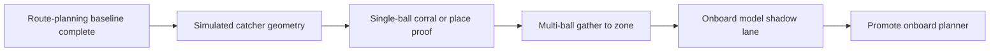

# Roadmap 2026 H2

## Near-Term (First UAT to Full Visual UAT)

Current status as of February 27, 2026:

1. First-UAT promotion gate is green (`session 20260227T230314Z`).
2. Full headless replay gate is green (`session 20260227T231443Z`).
3. Visual milestone evidence runs are green for M1/M2/M3 (latest M2 `20260227T232250Z`, M3 `20260227T232745Z`).
4. Next promotion focus is repeatability and soak cycles for the same gates.

1. Keep `scripts/run_first_uat.ps1` as the default operator entrypoint on `ExecutionLane=container_kilted`.
2. Keep gate-critical first-UAT steps container-native (no host `/opt/ros/kilted` dependency).
3. Achieve first-UAT green on canonical target:
   - coordinate summary `pass=true`
   - milestone 1 evidence bundle present
4. Run headless replay gates in sequence:
   - coordinate
   - snapshot verification
   - orientation
   - Nav2 readiness
   - multi-target Nav2
5. Run visual milestone progression:
   - milestone 1 (perception)
   - milestone 2 (3D estimate coherence)
   - milestone 3 (autonomous approach)
6. Freeze operator docs only after one green first-UAT cycle and one green full headless replay cycle.
7. Keep `scripts/run_headless_pre_llm.ps1` as the default developer push path with `Lane=dual` until LLM integration starts.

Status update as of February 28, 2026:

1. Pre-LLM dual-lane campaign achieved `3/3` green:
   - `artifacts/session/20260228T155850Z/pre_llm_headless_summary.json`
   - `artifacts/session/20260228T160643Z/pre_llm_headless_summary.json`
   - `artifacts/session/20260228T161425Z/pre_llm_headless_summary.json`
2. Fidelity soak gate is green:
   - `artifacts/session/20260228T162201Z/pre_llm_headless_summary.json`
   - includes Nav2 duration `1200s` and 12-goal multi-target sequence.
3. Campaign trend report and RC package generated:
   - `artifacts/session/20260228T164623Z/pre_llm_campaign_trend.json`
   - `artifacts/session/20260228T164654Z/readiness_report.json` (`pass=true`)
4. Pre-LLM contract freeze applied:
   - `runtime/contracts/llm_control_contract.yaml` (`contract_status: frozen_pre_llm`)

## Mid-Term (Dual-Lane Regression Hardening)

1. Keep Jetty gate lane as authoritative release lane.
2. Maintain Isaac lane as parity/cross-validation lane behind bridge contract.
3. Add weekly dual-lane regression policy:
   - Jetty full headless gate replay weekly
   - Isaac subset parity replay weekly
4. Enforce per-session isolation:
   - unique compose project naming
   - stale project cleanup before each run
   - explicit ROS domain strategy per session

## Pre-LLM Integration Gate Checklist

1. Acquire/plan/track low-level interfaces are frozen and documented.
2. Safety contracts are frozen:
   - stale detection timeout
   - navigation timeout
   - safe stop behavior
3. Required artifact set is green in one release candidate cycle:
   - coordinate summary
   - orientation summary
   - nav readiness summary
   - milestone evidence bundle(s)
4. Unresolved failure signatures are tracked in session readiness reports.
5. Final GUI rehearsal aligns with headless gate outcomes before LLM handoff.

## Post-Freeze Bounded LLM Promotion Path

Once the frozen pre-LLM boundary is in place, the next roadmap step is not open-ended autonomy. It is a bounded promotion ladder:

1. headless LLM proof over the frozen intent contract (complete)
2. repeatability gate on the authoritative `container_kilted` lane (complete)
3. simple browser UAT demo for the same proof path (complete)
4. bounded supervisor reuse across the visible-ball M3 scenario family (complete)
   - `visit_m3_positions` scenario validates center, left, right targets using the same policy
5. target prior contract for multi-target scenarios (complete)
   - executor receives expected target position from the mission layer, not from sim ground truth
   - prior-based lock gating and prior-based track approach implemented and tested
   - `visit_single_ball_proof` and `visit_three_ball_sequence` passing
   - sim truth probe is a validation oracle (test-time only), not an executor runtime dependency
   - this makes the executor's target discrimination portable to hardware
6. provider benchmarking infrastructure for a future on-machine model path on Orin Nano (complete)
   - provider abstraction (`DecisionProvider` protocol) and replay comparison tool exist
   - `LocalModelProvider` placeholder ready for Orin Nano integration
   - benchmarking is not a prerequisite for the current promotion ladder

Status update as of April 3, 2026:

1. All six promotion ladder steps are complete.
2. Target prior contract validated: `visit_three_ball_sequence` 3/3, `visit_m3_positions` 3/3.
3. Escalation rules formalized with table and 19 policy tests.
4. Browser UAT surface meets acceptance criteria (Watch/Drive/Inspect tabs).
5. Provider benchmarking infrastructure in place (replay comparison tool, local provider placeholder).

Status update as of April 4, 2026:

1. Direct intent dispatch implemented: file-based inbox replaces docker-exec-per-intent.
2. Intent dispatch latency reduced from ~13s to <1s.
3. Zombie dashboard prevention: startup kills stale processes, `allow_reuse_address` enabled.
4. Dashboard URL fix: client-facing URL uses `127.0.0.1` when binding `0.0.0.0` (Windows).

### Intended Outcomes

1. prove that the LLM can supervise high-level bounded decisions without owning low-level loops
2. keep deterministic policy/gating as the safety and contract layer
3. give operators a browser demo that is simple enough to trust and understand
4. keep the control architecture compatible with both:
   - Wi-Fi/cloud inference
   - smaller local-model inference later
5. ensure multi-target discrimination is solved in sim before hardware POC:
   - executor target verification uses mission-provided priors, not sim-only ground truth
   - the same mechanism works on hardware with operator-provided or observation-derived priors

### Explicit Non-Goals For This Roadmap Slice

1. freeform browser prompt control
2. open-ended task decomposition
3. end-to-end VLA action generation
4. autonomous environment lifecycle management by the LLM
5. pivoting the roadmap slice to end-to-end VLA control
6. replacing deterministic perception, planning, or execution loops with model-generated low-level action

## Next Roadmap Slice: Ball Corral / Place and Onboard Planning

The route-planning baseline is now the proved foundation, not the next open
question. The next slice upgrades the mission from "visit balls in a smart
order" to "gather balls into a designated area," then uses that fuller task to
evaluate whether an onboard planner can replace the cloud-backed planner.

For the first gather proof we assume smooth-surface operation such as soccer
fields or similar turf-like practice surfaces. That keeps the milestone focused
on controlled placement with a front catcher instead of trying to generalize a
harder bump-and-roll behavior too early.

### Step 1: Route-Planning Baseline - Complete

Goal: keep the current visit-and-avoid stack as the regression floor while new
gather behavior lands above it.

Validated evidence:

1. authoritative serial dashboard gate: `artifacts/session/20260412T170306Z/route_planning_serial_gate/campaign_summary.json`
2. serial operator scorecard: `artifacts/session/20260412T170306Z/route_planning_serial_gate/scorecard.md`
3. isolated parallel soak baseline: `artifacts/session/20260412T054630Z/route_planning_parallel_soak/campaign_summary.json`

What this means:

1. `visit_route_planning` is now a one-click self-contained dashboard proof
2. already-visited balls are avoided on later legs instead of being driven through
3. serial dashboard UAT remains the trust surface
4. parallel soak remains the throughput surface

Exit criterion for this step:

1. keep the route-planning serial gate green while corral/place work is added

### Step 2: Ball Corral / Place Proof

Goal: the robot gathers a ball by keeping it controlled at the front of the
robot and placing it into a designated area, rather than relying on random
post-contact rolling.

Assumptions for the first proof:

1. operating surface is smooth, like a soccer field or similar practice surface
2. the robot gets a simulated front-mounted catcher shaped like a spur with a U opening outward
3. the catcher sits below the ball midline so the ball can roll into a stable push envelope while the robot advances
4. success is measured by zone entry and control, not just contact

Work:

1. add and tune the simulated catcher geometry on the robot in Gazebo
2. add a designated corral zone with explicit scoring and event logging
3. create a single-ball browser-dashboard UAT scenario for corral/place
4. instrument control metrics: capture acquired, capture lost, place complete, time-to-place, and zone occupancy
5. extend from single-ball place to multi-ball gather-to-zone using the existing route planner as the upper layer

Acceptance:

1. single-ball corral/place passes `3/3` consecutive dashboard runs
2. the robot keeps the ball controlled long enough to place it into the zone without depending on random ricochet behavior
3. multi-ball gather-to-zone completes end-to-end with route planning still respecting obstacle avoidance and self-contained dashboard resets
4. artifacts include route order, place times, zone score, and capture-loss events

### Step 3: Onboard Model for Visit + Gather Planning

Goal: determine whether a local model on the Orin can take over high-level visit
and gather planning after the task is stable enough to benchmark fairly.

Why this comes after corral/place:

1. route planning alone is now too small a target; the more useful benchmark is the full visit-and-gather loop
2. gather introduces richer tradeoffs: which ball next, when to place, when to recover a lost ball, and how to sequence the corral zone efficiently
3. evaluating local models after that task surface stabilizes gives a more meaningful promotion decision

Work:

1. record decision traces from the visit-and-gather scenarios using the current GPT planner as the baseline
2. replay those traces through candidate onboard providers with `llm_provider_replay_compare.py`
3. compare validity, agreement, latency, and gather-quality metrics
4. run the best local candidate in shadow mode first, then in live sim if it holds up
5. promote the onboard planner only if it matches the safety and task-completion bar; otherwise document the gap and keep cloud planning as the baseline

Acceptance:

1. replay comparison report for candidate onboard models against visit-and-gather traces
2. shadow-lane evidence that the top local model makes comparable high-level decisions
3. live end-to-end gather proof with the promoted local planner, or a documented decision to stay cloud-backed for this milestone
