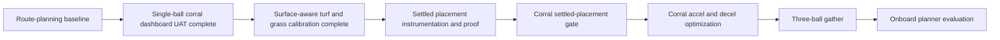

# Roadmap 2026 H2

## Near-Term (First UAT to Full Visual UAT)

Current status as of February 27, 2026:

1. First-UAT promotion gate is green (`session 20260227T230314Z`).
2. Full headless replay gate is green (`session 20260227T231443Z`).
3. Visual milestone evidence runs are green for M1/M2/M3 (latest M2 `20260227T232250Z`, M3 `20260227T232745Z`).
4. Next promotion focus is repeatability and soak cycles for the same gates.

1. Keep `scripts/run_first_uat.ps1` as the default operator entrypoint on `ExecutionLane=container_kilted`.
2. Keep gate-critical first-UAT steps container-native (no host `/opt/ros/kilted` dependency).
3. Achieve first-UAT green on canonical target:
   - coordinate summary `pass=true`
   - milestone 1 evidence bundle present
4. Run headless replay gates in sequence:
   - coordinate
   - snapshot verification
   - orientation
   - Nav2 readiness
   - multi-target Nav2
5. Run visual milestone progression:
   - milestone 1 (perception)
   - milestone 2 (3D estimate coherence)
   - milestone 3 (autonomous approach)
6. Freeze operator docs only after one green first-UAT cycle and one green full headless replay cycle.
7. Keep `scripts/run_headless_pre_llm.ps1` as the default developer push path with `Lane=dual` until LLM integration starts.

Status update as of February 28, 2026:

1. Pre-LLM dual-lane campaign achieved `3/3` green:
   - `artifacts/session/20260228T155850Z/pre_llm_headless_summary.json`
   - `artifacts/session/20260228T160643Z/pre_llm_headless_summary.json`
   - `artifacts/session/20260228T161425Z/pre_llm_headless_summary.json`
2. Fidelity soak gate is green:
   - `artifacts/session/20260228T162201Z/pre_llm_headless_summary.json`
   - includes Nav2 duration `1200s` and 12-goal multi-target sequence.
3. Campaign trend report and RC package generated:
   - `artifacts/session/20260228T164623Z/pre_llm_campaign_trend.json`
   - `artifacts/session/20260228T164654Z/readiness_report.json` (`pass=true`)
4. Pre-LLM contract freeze applied:
   - `runtime/contracts/llm_control_contract.yaml` (`contract_status: frozen_pre_llm`)

## Mid-Term (Dual-Lane Regression Hardening)

1. Keep Jetty gate lane as authoritative release lane.
2. Maintain Isaac lane as parity/cross-validation lane behind bridge contract.
3. Add weekly dual-lane regression policy:
   - Jetty full headless gate replay weekly
   - Isaac subset parity replay weekly
4. Enforce per-session isolation:
   - unique compose project naming
   - stale project cleanup before each run
   - explicit ROS domain strategy per session

## Pre-LLM Integration Gate Checklist

1. Acquire/plan/track low-level interfaces are frozen and documented.
2. Safety contracts are frozen:
   - stale detection timeout
   - navigation timeout
   - safe stop behavior
3. Required artifact set is green in one release candidate cycle:
   - coordinate summary
   - orientation summary
   - nav readiness summary
   - milestone evidence bundle(s)
4. Unresolved failure signatures are tracked in session readiness reports.
5. Final GUI rehearsal aligns with headless gate outcomes before LLM handoff.

## Post-Freeze Bounded LLM Promotion Path

Once the frozen pre-LLM boundary is in place, the next roadmap step is not open-ended autonomy. It is a bounded promotion ladder:

1. headless LLM proof over the frozen intent contract (complete)
2. repeatability gate on the authoritative `container_kilted` lane (complete)
3. simple browser UAT demo for the same proof path (complete)
4. bounded supervisor reuse across the visible-ball M3 scenario family (complete)
   - `visit_m3_positions` scenario validates center, left, right targets using the same policy
5. target prior contract for multi-target scenarios (complete)
   - executor receives expected target position from the mission layer, not from sim ground truth
   - prior-based lock gating and prior-based track approach implemented and tested
   - `visit_single_ball_proof` and `visit_three_ball_sequence` passing
   - sim truth probe is a validation oracle (test-time only), not an executor runtime dependency
   - this makes the executor's target discrimination portable to hardware
6. provider benchmarking infrastructure for a future on-machine model path on Orin Nano (complete)
   - provider abstraction (`DecisionProvider` protocol) and replay comparison tool exist
   - `LocalModelProvider` placeholder ready for Orin Nano integration
   - benchmarking is not a prerequisite for the current promotion ladder

Status update as of April 3, 2026:

1. All six promotion ladder steps are complete.
2. Target prior contract validated: `visit_three_ball_sequence` 3/3, `visit_m3_positions` 3/3.
3. Escalation rules formalized with table and 19 policy tests.
4. Browser UAT surface meets acceptance criteria (Watch/Drive/Inspect tabs).
5. Provider benchmarking infrastructure in place (replay comparison tool, local provider placeholder).

Status update as of April 4, 2026:

1. Direct intent dispatch implemented: file-based inbox replaces docker-exec-per-intent.
2. Intent dispatch latency reduced from ~13s to <1s.
3. Zombie dashboard prevention: startup kills stale processes, `allow_reuse_address` enabled.
4. Dashboard URL fix: client-facing URL uses `127.0.0.1` when binding `0.0.0.0` (Windows).

### Intended Outcomes

1. prove that the LLM can supervise high-level bounded decisions without owning low-level loops
2. keep deterministic policy/gating as the safety and contract layer
3. give operators a browser demo that is simple enough to trust and understand
4. keep the control architecture compatible with both:
   - Wi-Fi/cloud inference
   - smaller local-model inference later
5. ensure multi-target discrimination is solved in sim before hardware POC:
   - executor target verification uses mission-provided priors, not sim-only ground truth
   - the same mechanism works on hardware with operator-provided or observation-derived priors

### Explicit Non-Goals For This Roadmap Slice

1. freeform browser prompt control
2. open-ended task decomposition
3. end-to-end VLA action generation
4. autonomous environment lifecycle management by the LLM
5. pivoting the roadmap slice to end-to-end VLA control
6. replacing deterministic perception, planning, or execution loops with model-generated low-level action

## Next Roadmap Slice: Settled Corral Placement on Calibrated Turf

The route-planning baseline is still the proved regression floor, and the
single-ball corral path is now calibrated on realistic soccer-practice
surfaces. The immediate next slice is no longer perfect spur retention. It is
to use the calibrated `short_turf` surface as the canonical one-ball proof
surface and make the corral run pass only when the ball finishes with its
center inside the corral, comes fully to rest there, and does not roll away
after the final release or handoff. Clean spur retention remains useful
diagnostic evidence, but it is no longer the operator gate. Only after that
settled-placement gate is green should we optimize acceleration and
deceleration for time. Multi-ball gather still comes after the one-ball
settled-placement milestone, and onboard planning still waits until the fuller
gather task is stable enough to benchmark meaningfully.

The important shift is that the product outcome is now explicit: we care about
the ball ending up stopped in the corral, not whether it stayed perfectly
captured in the spur throughout place.

### Step 1: Route-Planning Baseline - Complete

Goal: keep the current visit-and-avoid stack as the regression floor while new
gather behavior lands above it.

Validated evidence:

1. authoritative serial dashboard gate: `artifacts/session/20260412T170306Z/route_planning_serial_gate/campaign_summary.json`
2. serial operator scorecard: `artifacts/session/20260412T170306Z/route_planning_serial_gate/scorecard.md`
3. isolated parallel soak baseline: `artifacts/session/20260412T054630Z/route_planning_parallel_soak/campaign_summary.json`

What this means:

1. `visit_route_planning` is now a one-click self-contained dashboard proof
2. already-visited balls are avoided on later legs instead of being driven through
3. serial dashboard UAT remains the trust surface
4. parallel soak remains the throughput surface

Exit criterion for this step:

1. keep the route-planning serial gate green while corral/place work is added

### Step 2: Single-Ball Corral / Place Through Dashboard UAT - Complete

Goal: the robot keeps one ball controlled at the front of the robot and places
it into a designated area, then proves that behavior through the browser
dashboard before the operator-facing primary action changes.

Assumptions for this proof:

1. operating surface is smooth, like a soccer field or similar practice surface
2. the robot gets a simulated front-mounted catcher shaped like a spur with a U opening outward
3. the catcher sits below the ball midline so the ball can roll into a stable push envelope while the robot advances
4. success is measured by zone entry and control, not just contact

Work:

1. keep `visit_route_planning` green as the regression baseline while catcher/corral work lands
2. hold the single-ball corral/place proof green offline and headless before dashboard handoff
3. keep `corral_single_ball_place` integrated in the dashboard control plane without promoting the primary button yet
4. stabilize repeated operator-visible dashboard UAT on the one-ball flow until it is green `3/3`
5. repoint and relabel the old `Run LLM Route Plan` primary button only after the dashboard proof is green

Validated evidence:

1. single-ball headless `5/5`: `artifacts/session/20260413T054235Z/gather_mission_repeatability/campaign_run_summary.json`
2. clean browser/dashboard `3/3`: `artifacts/session/20260413T_CORRAL_DASHBOARD_UAT_GATE2/dashboard_uat_summary.json`
3. milestone promotion commit: `98ca4a2`

Acceptance:

1. single-ball dashboard UAT passes `3/3`
2. the ball is kept controlled and placed into the zone without ricochet dependence
3. the old primary route-planning button is replaced by the new single-ball corral action only after that proof
4. route-planning regression evidence remains green

Operator-facing promotion rule:

1. before dashboard UAT passes, `corral_single_ball_place` may exist as a scenario but does not replace the primary route-planning action
2. after dashboard UAT passes, the existing `Run LLM Route Plan` primary button is repointed or relabelled to the single-ball corral flow
3. that button replacement is the promotion signal for this milestone

Interfaces held constant in this slice:

1. active UAT scenario: `corral_single_ball_place`
2. protected regression scenario: `visit_route_planning`
3. deferred later scenario: `gather_three_ball_zone`
4. deferred provider seam: `plan_collection_route(...)`
5. no frozen-contract changes in this slice

### Step 3: Surface-Aware Single-Ball Corral Refinement - Complete

Goal: simulate the real practice surfaces we care about, then tune one-ball
corral placement so surface friction helps the ball settle inside the zone
instead of rolling through and overshooting.

Why this mattered:

1. fresh UAT showed the ball can still overshoot after it exits the catcher
2. real turf and grass surfaces add friction that should arrest the ball earlier than the current sim surface does
3. it is better to get one-ball place-and-settle behavior right before adding multi-ball gather complexity

Completed work:

1. research how to simulate turf-like and grass-like practice surfaces in the active Gazebo/SDF stack
2. choose one canonical friction preset for short turf and one for short grass, then make them repeatable in sim
3. rerun the one-ball corral proof on those surfaces and measure zone overshoot and settle distance
4. tune the corral placement behavior so friction works to our advantage once the ball leaves the catcher
5. keep `visit_route_planning` green while the surface and corral changes land

Validated evidence:

1. route-planning regression pass: `artifacts/session/20260413T135805491949Z/visit_mission/20260413T135817Z/mission_verdict.json`
2. canonical short-turf headless `5/5`: `artifacts/session/20260413T135949Z/gather_mission_repeatability/campaign_run_summary.json`
3. secondary short-grass headless `3/3`: `artifacts/session/20260413T140714Z/gather_mission_repeatability/campaign_run_summary.json`
4. dashboard UAT `3/3` on calibrated short turf: `artifacts/session/20260412T_CORRAL_DASHBOARD_UAT/dashboard_uat_summary.json`

Acceptance:

1. at least one turf-like surface preset and one grass-like surface preset are reproducible in sim
2. single-ball corral on the chosen canonical surface settles the ball inside the zone instead of obviously overshooting through the corral
3. route-planning regression evidence remains green

What this means:

1. `short_turf` is now the canonical one-ball corral proof surface
2. `short_grass` is credible as a secondary comparison surface
3. gather artifacts now carry settle metrics (`surface_profile`, `final_settle_distance_m`, `max_overshoot_distance_m`, `settle_time_s`, `release_recontact_count`)
4. future time optimization can target a stable, calibrated baseline instead of compensating for an unrealistic low-friction world

### Step 4: Corral Settled Placement Gate - Current Focus

Goal: make one-ball corral/place pass on canonical `short_turf` only when the
ball finishes center-inside the corral, comes to a complete stop there, and
does not roll away after the final release or handoff.

Why this comes before time optimization:

1. the current weak point is not speed; it is the ball rolling through or stopping outside the true corral center after release
2. the operator outcome is “ball ends up stopped in the corral,” not “ball stayed perfectly retained in the spur”
3. acceleration and deceleration tuning should optimize a behavior that already settles correctly on the target surface

Immediate instrumentation step:

1. add explicit settled-placement metrics at the final release or handoff moment
2. record whether the ball finishes center-inside the zone, whether it actually stops there, and whether it rolls away after release
3. keep clean-retention metrics as diagnostics, not milestone blockers

Work:

1. make the final settle path authoritative even when the ball reaches the zone during capture or recovery
2. tune release behavior so turf friction helps the ball stop inside the zone instead of rolling through it
3. keep minimal post-release correction only when needed to get the ball center fully inside and stopped
4. update headless summaries, dashboard UAT summaries, and scorecards so settled placement is the primary gate and clean retention is secondary evidence

Acceptance:

1. route-planning regression evidence remains green
2. headless `short_turf` corral gate passes `5/5` with `final_center_inside_zone == true`, `ball_stopped_in_corral == true`, and `rolled_away_after_release == false`
3. dashboard UAT passes `3/3` with the same settled-placement outcome fields green
4. clean spur retention remains visible in artifacts, but it is diagnostic rather than gating
5. a run that reaches the zone still fails this milestone if the ball does not finish centered and stopped there

### Step 5: Corral Time Optimization

Goal: reduce time-to-place only after clean retention is proven.

Why this comes later:

1. faster push profiles are only useful once the ball already settles correctly on the target surface
2. acceleration and deceleration tuning should optimize settled placement, not mask a release or roll-away problem

Work:

1. add explicit acceleration and deceleration shaping to the corral approach and push phases
2. compare mission time against the clean-retention baseline
3. keep clean retention and in-zone settle behavior intact while reducing time

Acceptance:

1. mission time improves on the canonical clean-retention one-ball proof
2. placement still settles center-inside the zone without reintroducing roll-through or roll-away
3. route-planning regression evidence remains green

### Step 6: Multi-Ball Gather To Zone

Goal: extend the proven one-ball corral/place mechanics into a fuller gather
task only after the surface-aware one-ball placement work is signed off.

Why it comes later:

1. the next real risk is still one-ball placement quality on realistic surfaces
2. multi-ball gather adds route-order, recovery, and obstacle-persistence complexity that should not delay friction-aware one-ball refinement

Work:

1. introduce `gather_three_ball_zone` only after the surface-aware one-ball milestones are complete
2. preserve route-planning obstacle avoidance and self-contained resets while extending gather behavior
3. score multi-ball runs with placed count, route order, mission time, zone score, and capture-loss events

Acceptance:

1. multi-ball gather completes end-to-end after the surface-aware one-ball milestones are signed off
2. route-planning protections remain green while gather complexity increases

### Step 7: Onboard Model for Visit + Gather Planning

Goal: determine whether a local model on the Orin can take over high-level visit
and gather planning after the task is stable enough to benchmark fairly.

Why this comes after multi-ball gather:

1. route planning alone is now too small a target; the more useful benchmark is the full visit-and-gather loop
2. gather introduces richer tradeoffs: which ball next, when to place, when to recover a lost ball, and how to sequence the corral zone efficiently
3. evaluating local models after that task surface stabilizes gives a more meaningful promotion decision

Work:

1. record decision traces from the visit-and-gather scenarios using the current GPT planner as the baseline
2. replay those traces through candidate onboard providers with `llm_provider_replay_compare.py`
3. compare validity, agreement, latency, and gather-quality metrics
4. run the best local candidate in shadow mode first, then in live sim if it holds up
5. promote the onboard planner only if it matches the safety and task-completion bar; otherwise document the gap and keep cloud planning as the baseline

Acceptance:

1. replay comparison report for candidate onboard models against visit-and-gather traces
2. shadow-lane evidence that the top local model makes comparable high-level decisions
3. live end-to-end gather proof with the promoted local planner, or a documented decision to stay cloud-backed for this milestone
